# 分支聊天历史

<cite>
**本文引用的文件**
- [messages.repository.ts](file://src/server/repositories/messages.repository.ts)
- [chats.repository.ts](file://src/server/repositories/chats.repository.ts)
- [conversation-thread.tsx](file://src/client/components/conversation-thread.tsx)
- [use-chat-api.ts](file://src/client/hooks/use-chat-api.ts)
- [20260930220000_chat_message_tree_branching.sql](file://supabase/migrations/20260930220000_chat_message_tree_branching.sql)
- [20261001070000_fix_chat_thread_page_rpc_depth_ambiguity.sql](file://supabase/migrations/20261001070000_fix_chat_thread_page_rpc_depth_ambiguity.sql)
- [20261001080000_fix_message_chain_turn_order.sql](file://supabase/migrations/20261001080000_fix_message_chain_turn_order.sql)
- [20261002183000_fix_thread_page_paging_direction_and_perf.sql](file://supabase/migrations/20261002183000_fix_thread_page_paging_direction_and_perf.sql)
- [20261004221000_chat_branch_persistence_and_perspective.sql](file://supabase/migrations/20261004221000_chat_branch_persistence_and_perspective.sql)
</cite>

## 目录
1. [简介](#简介)
2. [项目结构定位](#项目结构定位)
3. [核心概念与数据模型](#核心概念与数据模型)
4. [树形结构与存储设计](#树形结构与存储设计)
5. [后端数据访问层](#后端数据访问层)
6. [数据库函数与分页机制](#数据库函数与分页机制)
7. [前端渲染与交互逻辑](#前端渲染与交互逻辑)
8. [分支创建、切换与合并语义](#分支创建切换与合并语义)
9. [版本控制、快照与回滚](#版本控制快照与回滚)
10. [迁移策略与索引优化](#迁移策略与索引优化)
11. [API 使用示例](#api-使用示例)
12. [前端集成指南](#前端集成指南)
13. [常见场景解决方案](#常见场景解决方案)
14. [性能特征与调优建议](#性能特征与调优建议)
15. [故障排查](#故障排查)
16. [结论](#结论)

## 简介
分支聊天历史是该项目中把一次对话从“线性消息列表”升级为“可分叉、可回溯、可切换的聊天树”的核心能力。其目标是：

- 用户编辑提示词或重新生成助手回复时，不修改已有消息，而是插入兄弟节点。
- 每条聊天维护一个“活跃叶子”，表示当前可见分支路径的末端。
- 服务端通过递归查询返回从叶子到根的路径，并附带每个节点的变体序号和总数，让前端直接渲染分支箭头。
- 前端支持按变体切换、编辑重发、重试助手回复，并通过实时通道同步多端状态。
- 数据库提供幂等写入、事务保护、深度分页、分支视角记忆和跨设备即时同步。

该功能主要分布在以下层次：

| 层次 | 职责 | 关键文件 |
|---|---|---|
| 数据库迁移 | 树形字段、递归查询函数、分支切换函数、索引 | `supabase/migrations/*.sql` |
| 服务端仓库 | 消息插入、分支目标解析、活跃叶子解析、线程分页读取 | `src/server/repositories/messages.repository.ts`、`chats.repository.ts` |
| 客户端钩子 | 聊天加载、流式更新、分支切换、乐观渲染、持久化 | `src/client/hooks/use-chat-api.ts` |
| 客户端组件 | 消息行、分支切换器、编辑、重试、来源展示 | `src/client/components/conversation-thread.tsx` |

## 项目结构定位
分支聊天历史不是单一模块，而是贯穿数据库、服务端仓库、客户端 API 钩子和 UI 组件的组合能力：

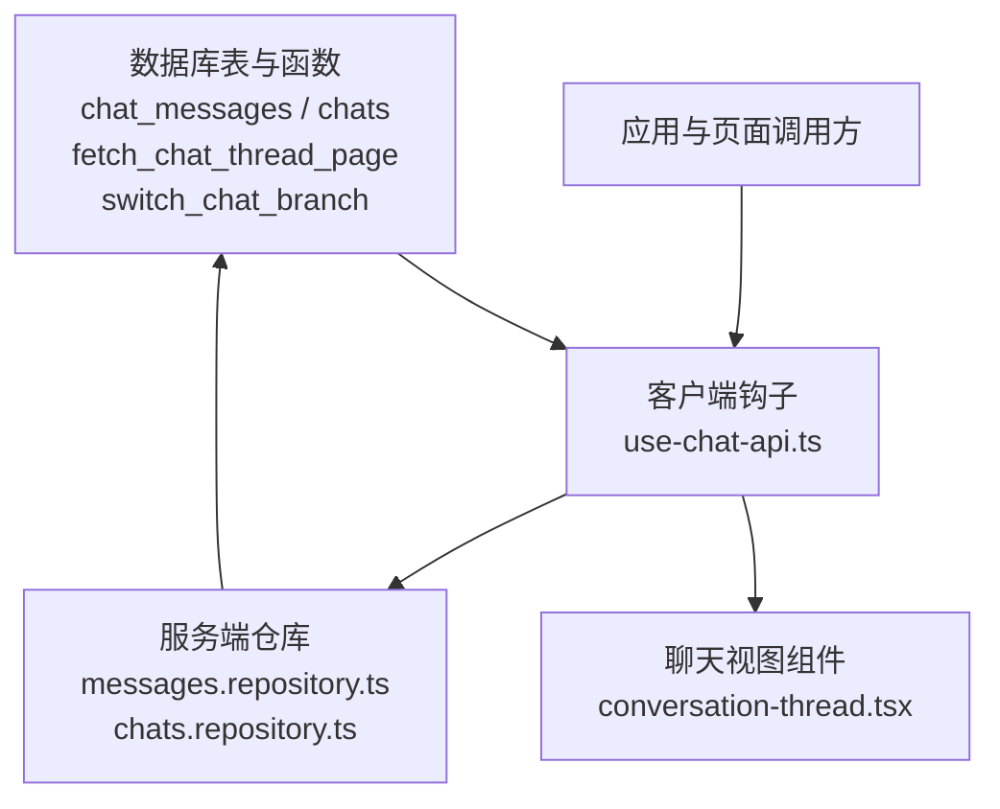

**图示来源**
- [messages.repository.ts:1-120](file://src/server/repositories/messages.repository.ts#L1-L120)
- [chats.repository.ts:1-60](file://src/server/repositories/chats.repository.ts#L1-L60)
- [conversation-thread.tsx:1-80](file://src/client/components/conversation-thread.tsx#L1-L80)
- [use-chat-api.ts:3570-3620](file://src/client/hooks/use-chat-api.ts#L3570-L3620)

**章节来源**
- [messages.repository.ts:1-120](file://src/server/repositories/messages.repository.ts#L1-L120)
- [chats.repository.ts:1-60](file://src/server/repositories/chats.repository.ts#L1-L60)
- [conversation-thread.tsx:1-80](file://src/client/components/conversation-thread.tsx#L1-L80)
- [use-chat-api.ts:3570-3620](file://src/client/hooks/use-chat-api.ts#L3570-L3620)

## 核心概念与数据模型
### 基本实体
- **聊天会话**：由 `chats` 表承载，记录用户、标题、状态、更新时间，以及分支相关的元数据。
- **消息节点**：由 `chat_messages` 表承载，记录角色、内容、状态、元数据、客户端标识、创建时间，以及父消息标识。
- **活跃叶子**：`chats.active_leaf_message_id` 指向当前可见分支路径的最新消息。
- **活跃子节点映射**：`chats.metadata.active_children` 记录每个父节点对应的活跃子消息，用于快速恢复分支视角。

### 树形关键字段
| 字段或属性 | 含义 | 作用 |
|---|---|---|
| `parent_message_id` | 父消息标识 | 构建消息树 |
| `active_leaf_message_id` | 当前可见分支末端 | 决定渲染哪条路径 |
| `client_id` | 客户端生成标识 | 幂等写入、乐观消息映射 |
| `role` | 用户、助手、系统 | 渲染顺序与分支配对 |
| `status` | complete、streaming、failed、cancelled | 过滤不可见节点 |
| `variant_index` | 兄弟节点中的序号 | 前端显示“第几版” |
| `variant_count` | 兄弟节点总数 | 控制分支导航按钮数量 |
| `sibling_ids` | 兄弟消息 ID 数组 | 本地快速切换分支 |
| `sibling_variants` | 兄弟变体摘要 | 无需额外请求即可预览分支 |

**章节来源**
- [messages.repository.ts:1-40](file://src/server/repositories/messages.repository.ts#L1-L40)
- [20260930220000_chat_message_tree_branching.sql:1-60](file://supabase/migrations/20260930220000_chat_message_tree_branching.sql#L1-L60)
- [20261004221000_chat_branch_persistence_and_perspective.sql:1-40](file://supabase/migrations/20261004221000_chat_branch_persistence_and_perspective.sql#L1-L40)

## 树形结构与存储设计
### 树的形成方式
系统采用“父指针 + 活跃叶子”的方式表达聊天树：

1. 每条消息通过 `parent_message_id` 链接到上一条相关消息。
2. 正常发送时，助手消息以用户消息为父；编辑重发时，新提示词以原提示词的父为父；重新生成时，新回复以旧回复的用户提示词为父。
3. `chats.active_leaf_message_id` 始终指向当前可见路径的最新节点。
4. `chats.metadata.active_children` 保存每个分叉点的活跃子节点，使切换分支后能沿下游继续追踪最新子节点。

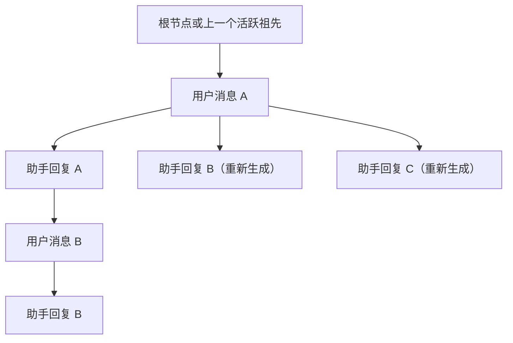

**图示来源**
- [messages.repository.ts:200-360](file://src/server/repositories/messages.repository.ts#L200-L360)
- [20261004221000_chat_branch_persistence_and_perspective.sql:230-431](file://supabase/migrations/20261004221000_chat_branch_persistence_and_perspective.sql#L230-L431)

### 深度与路径
数据库函数返回每个节点的 `depth`，表示从活跃叶子向上的跳数：

- `depth = 0`：活跃叶子本身。
- `depth > 0`：更老的祖先。
- 分页使用深度游标，避免重复加载已渲染的历史。

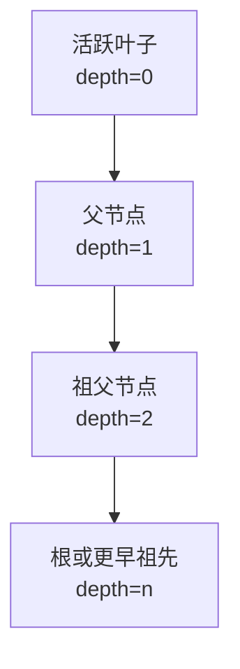

**图示来源**
- [20261001070000_fix_chat_thread_page_rpc_depth_ambiguity.sql:1-40](file://supabase/migrations/20261001070000_fix_chat_thread_page_rpc_depth_ambiguity.sql#L1-L40)
- [20261002183000_fix_thread_page_paging_direction_and_perf.sql:1-40](file://supabase/migrations/20261002183000_fix_thread_page_paging_direction_and_perf.sql#L1-L40)

**章节来源**
- [messages.repository.ts:200-360](file://src/server/repositories/messages.repository.ts#L200-L360)
- [20260930220000_chat_message_tree_branching.sql:1-120](file://supabase/migrations/20260930220000_chat_message_tree_branching.sql#L1-L120)
- [20261004221000_chat_branch_persistence_and_perspective.sql:230-431](file://supabase/migrations/20261004221000_chat_branch_persistence_and_perspective.sql#L230-L431)

## 后端数据访问层
### 消息仓库职责
`messages.repository.ts` 承担聊天树的主要数据访问职责：

| 方法 | 职责 | 分支相关行为 |
|---|---|---|
| `listThreadPage` | 读取活跃分支路径 | 调用 `fetch_chat_thread_page`，解析变体、兄弟节点、分页游标 |
| `switchThreadBranch` | 切换分支 | 调用 `switch_chat_branch`，更新活跃叶子和活跃子节点 |
| `resolveActiveLeaf` | 获取活跃叶子 | 防止 UI 在无叶子时崩溃 |
| `resolveForkTarget` | 解析编辑重发或重新生成的父节点 | 区分 edit 和 regenerate 两种分叉语义 |
| `rechainChatMessages` | 重建消息链 | 迁移或归档恢复后修复树结构 |
| `createMessage` | 插入单条消息 | 默认连接到活跃叶子，分支插入时显式传入父节点 |
| `beginChatTurn` | 原子提交用户+助手消息 | 支持分叉父节点、幂等写入、训练行同步 |
| `createUserMessageWithTranscript` | 独立插入用户消息 | 保留分支上下文 |

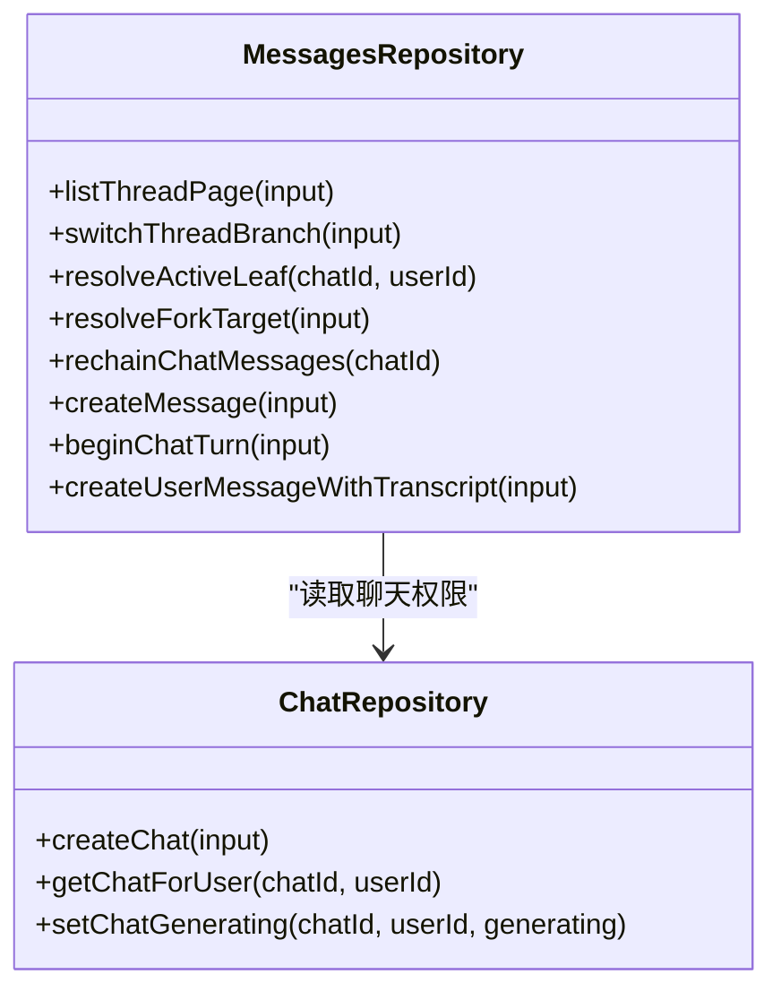

**图示来源**
- [messages.repository.ts:1-120](file://src/server/repositories/messages.repository.ts#L1-L120)
- [chats.repository.ts:1-60](file://src/server/repositories/chats.repository.ts#L1-L60)

**章节来源**
- [messages.repository.ts:1-120](file://src/server/repositories/messages.repository.ts#L1-L120)
- [messages.repository.ts:200-360](file://src/server/repositories/messages.repository.ts#L200-L360)
- [messages.repository.ts:500-900](file://src/server/repositories/messages.repository.ts#L500-L900)
- [chats.repository.ts:1-60](file://src/server/repositories/chats.repository.ts#L1-L60)

## 数据库函数与分页机制
### 活跃分支分页函数
`fetch_chat_thread_page` 是聊天树的核心查询函数。它完成以下工作：

1. 校验用户身份和聊天所有权。
2. 解析目标叶子：优先使用显式叶子，其次使用 `active_leaf_message_id`，最后回退到最新消息。
3. 递归向上遍历父链，得到完整路径。
4. 计算每个节点的 `variant_index` 和 `variant_count`。
5. 根据深度游标分页，返回 `has_more` 和 `next_depth`。
6. 在后续迁移中注入 `sibling_ids` 和 `sibling_variants`，实现跨设备即时分支切换。

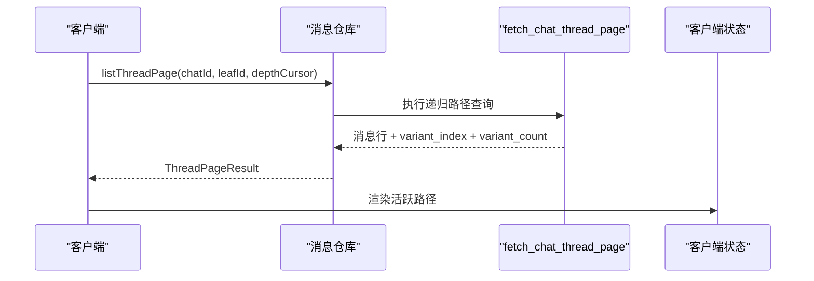

**图示来源**
- [messages.repository.ts:80-120](file://src/server/repositories/messages.repository.ts#L80-L120)
- [20261001070000_fix_chat_thread_page_rpc_depth_ambiguity.sql:1-159](file://supabase/migrations/20261001070000_fix_chat_thread_page_rpc_depth_ambiguity.sql#L1-L159)
- [20261002183000_fix_thread_page_paging_direction_and_perf.sql:1-207](file://supabase/migrations/20261002183000_fix_thread_page_paging_direction_and_perf.sql#L1-L207)

### 分支切换函数
`switch_chat_branch` 负责把活跃叶子从一个兄弟节点切换到另一个兄弟节点，并重建下游活跃子节点链：

- 支持按方向切换：上一个、下一个。
- 支持按索引切换：直接指定第几个变体。
- 支持按目标消息 ID 切换：精确跳转到某个兄弟节点。
- 更新 `chats.active_leaf_message_id`。
- 更新 `chats.metadata.active_children`，使每次切换后的下游分支都能被正确恢复。

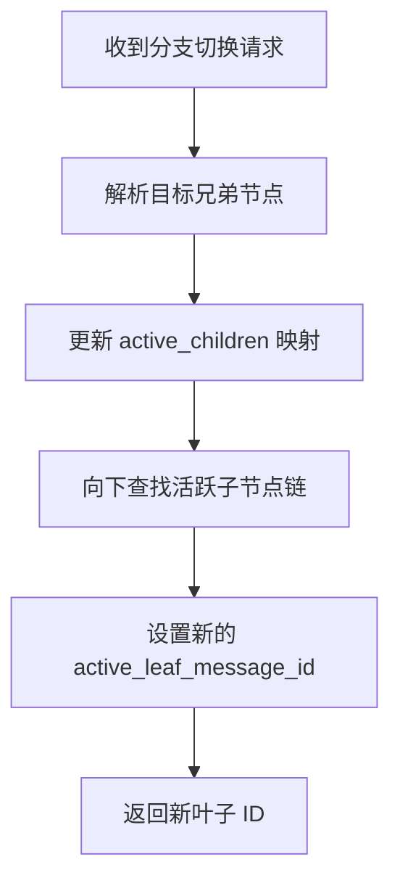

**图示来源**
- [20261004221000_chat_branch_persistence_and_perspective.sql:230-431](file://supabase/migrations/20261004221000_chat_branch_persistence_and_perspective.sql#L230-L431)

**章节来源**
- [20260930220000_chat_message_tree_branching.sql:60-200](file://supabase/migrations/20260930220000_chat_message_tree_branching.sql#L60-L200)
- [20261001070000_fix_chat_thread_page_rpc_depth_ambiguity.sql:1-159](file://supabase/migrations/20261001070000_fix_chat_thread_page_rpc_depth_ambiguity.sql#L1-L159)
- [20261002183000_fix_thread_page_paging_direction_and_perf.sql:1-207](file://supabase/migrations/20261002183000_fix_thread_page_paging_direction_and_perf.sql#L1-L207)
- [20261004221000_chat_branch_persistence_and_perspective.sql:230-431](file://supabase/migrations/20261004221000_chat_branch_persistence_and_perspective.sql#L230-L431)

## 前端渲染与交互逻辑
### 消息行与分支导航
`conversation-thread.tsx` 负责把服务器返回的消息渲染为用户界面，并处理分支交互：

- 如果某条消息存在多个兄弟变体，会显示“版本 N/M”导航控件。
- 点击上一版或下一版时，调用 `onSwitchBranch(messageId, direction)`。
- 分支导航在用户消息和助手消息上均可出现。
- 编辑、重试、复制、分享等操作与分支导航共存，互不干扰。

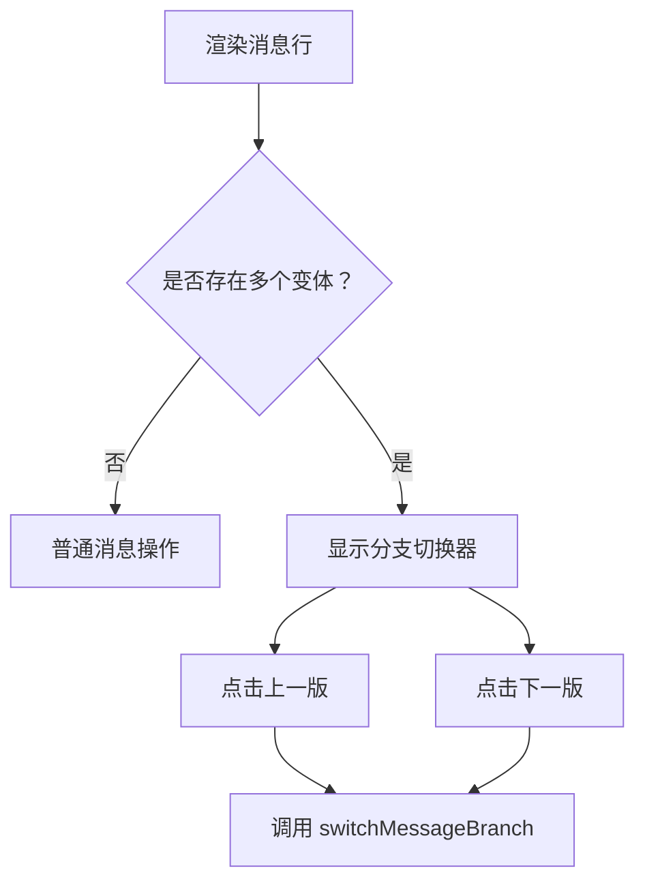

**图示来源**
- [conversation-thread.tsx:330-470](file://src/client/components/conversation-thread.tsx#L330-L470)
- [conversation-thread.tsx:620-700](file://src/client/components/conversation-thread.tsx#L620-L700)

### 展开收起与路径导航
当前聊天树以“活跃路径”形式渲染，而不是完整树。因此：

- 不需要传统意义上的“节点展开收起”。
- 需要的是“历史加载更多”和“分支切换”。
- 加载更多依赖 `hasMore` 和 `nextDepth`。
- 分支切换依赖 `variantIndex`、`variantCount`、`siblingIds`、`siblingVariants`。

**章节来源**
- [conversation-thread.tsx:330-470](file://src/client/components/conversation-thread.tsx#L330-L470)
- [conversation-thread.tsx:620-700](file://src/client/components/conversation-thread.tsx#L620-L700)
- [conversation-thread.tsx:950-1131](file://src/client/components/conversation-thread.tsx#L950-L1131)

## 分支创建、切换与合并语义
### 分支创建
系统中存在两种主要分叉方式：

| 类型 | 触发方式 | 父节点选择 | 语义 |
|---|---|---|---|
| 编辑重发 | 用户编辑提示词并重发 | 原提示词的父节点 | 新提示词与原提示词成为兄弟 |
| 重新生成 | 用户重试助手回复 | 旧回复的用户提示词 | 新回复与旧回复成为兄弟 |

这两种方式都通过 `resolveForkTarget` 确定父节点，再由 `beginChatTurn` 或 `createUserMessageWithTranscript` 插入消息。

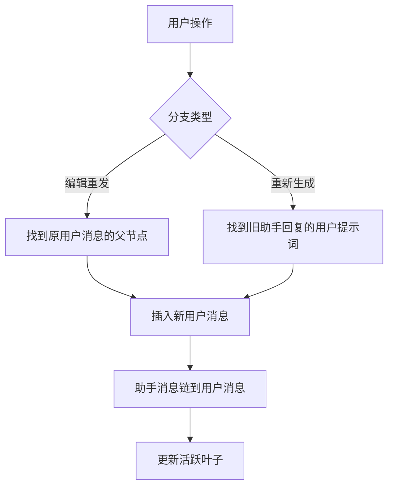

**图示来源**
- [messages.repository.ts:200-360](file://src/server/repositories/messages.repository.ts#L200-L360)
- [messages.repository.ts:500-900](file://src/server/repositories/messages.repository.ts#L500-L900)

### 分支切换
分支切换不是删除旧分支，而是改变“活跃叶子”：

1. 前端先做乐观更新，让用户立刻看到切换结果。
2. 调用服务端 `switch_chat_branch`。
3. 服务端更新 `active_leaf_message_id` 和 `active_children`。
4. 客户端拉取刷新后的活跃路径，替换本地状态。

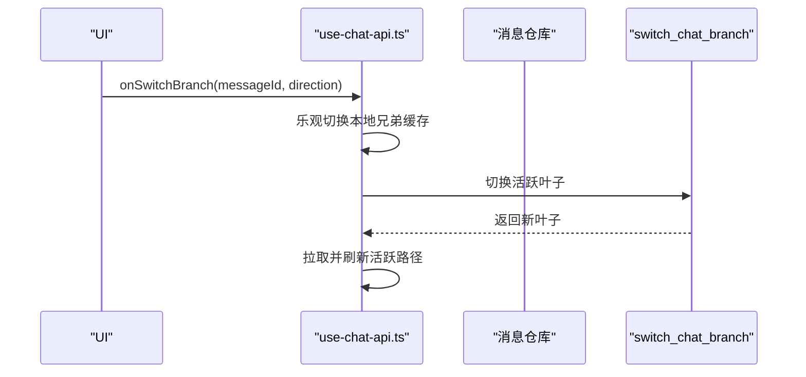

**图示来源**
- [use-chat-api.ts:3570-3620](file://src/client/hooks/use-chat-api.ts#L3570-L3620)
- [20261004221000_chat_branch_persistence_and_perspective.sql:230-431](file://supabase/migrations/20261004221000_chat_branch_persistence_and_perspective.sql#L230-L431)

### 分支合并
当前实现没有显式的“合并两个分支”操作。合并语义更接近“选择其中一个分支作为活跃分支”：

- 系统保留所有兄弟消息。
- 只有一条活跃路径被渲染。
- 如果需要真正合并，应由业务层定义合并规则，例如选择最新、选择用户确认的版本，或人工导出后再重建。

**章节来源**
- [messages.repository.ts:200-360](file://src/server/repositories/messages.repository.ts#L200-L360)
- [use-chat-api.ts:3570-3620](file://src/client/hooks/use-chat-api.ts#L3570-L3620)
- [20261004221000_chat_branch_persistence_and_perspective.sql:230-431](file://supabase/migrations/20261004221000_chat_branch_persistence_and_perspective.sql#L230-L431)

## 版本控制、快照与回滚
### 版本控制
聊天树本身就是版本控制的体现：

- 每个兄弟节点是一个版本。
- `variant_index` 表示当前激活版本的位置。
- `variant_count` 表示总版本数。
- `sibling_ids` 和 `sibling_variants` 让客户端无需再次请求即可切换。

### 快照机制
快照主要通过以下方式实现：

- 数据库函数返回完整活跃路径，可作为一次加载快照。
- 客户端对消息进行 hydrate，再写入全局聊天状态。
- 设备本地缓存 `persistDeviceChatNow` 会保存最近聊天。
- 共享快照迁移也涉及聊天快照，但主要用于分享而非回滚。

### 回滚操作
当前代码中没有名为 `rollback` 的通用回滚 API。可回滚的实现方式是：

- 如果之前切换过分支，可通过再次切换回到之前的兄弟节点。
- 如果消息仍存在于树中，可以重新选择其对应分支。
- 如果消息已被归档、删除或无法恢复，则需要外部备份或迁移工具。

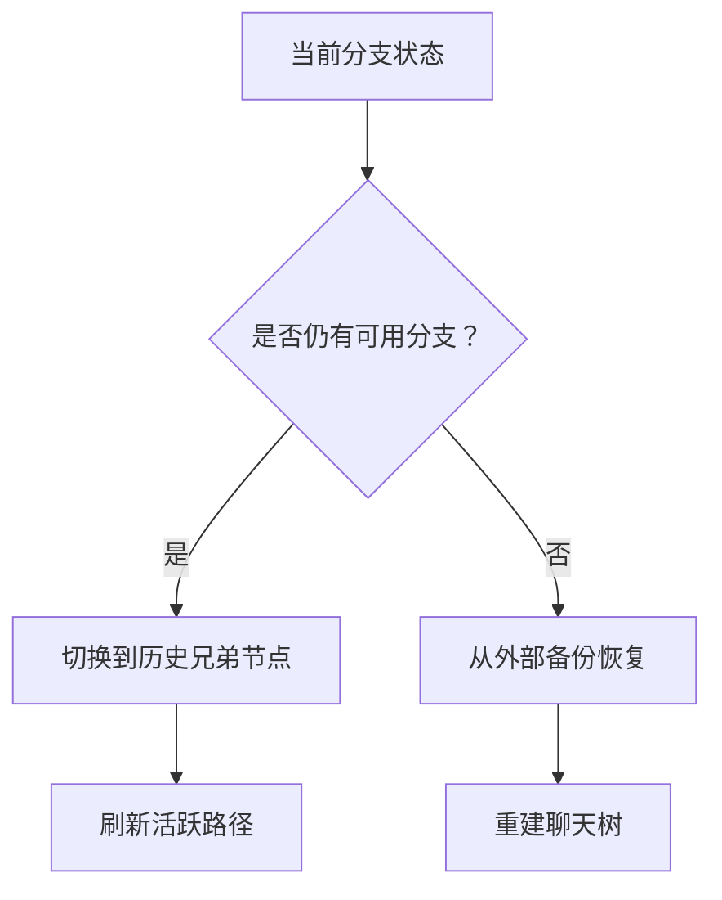

**图示来源**
- [20261004221000_chat_branch_persistence_and_perspective.sql:230-431](file://supabase/migrations/20261004221000_chat_branch_persistence_and_perspective.sql#L230-L431)
- [use-chat-api.ts:3570-3620](file://src/client/hooks/use-chat-api.ts#L3570-L3620)

**章节来源**
- [messages.repository.ts:1-40](file://src/server/repositories/messages.repository.ts#L1-L40)
- [20261004221000_chat_branch_persistence_and_perspective.sql:230-431](file://supabase/migrations/20261004221000_chat_branch_persistence_and_perspective.sql#L230-L431)
- [use-chat-api.ts:3570-3620](file://src/client/hooks/use-chat-api.ts#L3570-L3620)

## 迁移策略与索引优化
### 关键迁移演进
| 迁移文件 | 目的 |
|---|---|
| `20260930220000_chat_message_tree_branching.sql` | 引入父消息链、活跃叶子、递归线程分页函数 |
| `20261001070000_fix_chat_thread_page_rpc_depth_ambiguity.sql` | 修复深度字段歧义导致的 RPC 报错 |
| `20261001080000_fix_message_chain_turn_order.sql` | 修复同一事务内用户消息与助手消息的链序 |
| `20261002183000_fix_thread_page_paging_direction_and_perf.sql` | 修正分页方向、性能优化、限制兄弟窗口范围 |
| `20261004221000_chat_branch_persistence_and_perspective.sql` | 增强分支切换、活跃子节点记忆、兄弟变体注入 |

### 索引与性能
- `chats_active_leaf_message_id_idx`：加速按活跃叶子查询。
- `chat_messages_chat_parent_idx`：加速同父消息的兄弟查找和分支切换。
- 递归路径查询基于 `parent_message_id`，适合树深有限的对话场景。
- 分页基于 `depth`，避免全量加载长对话。
- 兄弟窗口只在页面相交的父节点上计算，降低全表排序成本。

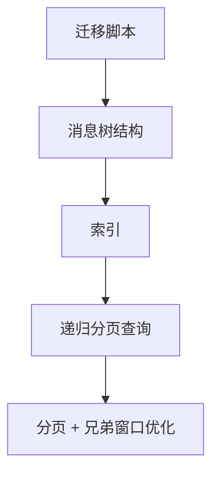

**图示来源**
- [20260930220000_chat_message_tree_branching.sql:1-120](file://supabase/migrations/20260930220000_chat_message_tree_branching.sql#L1-L120)
- [20261002183000_fix_thread_page_paging_direction_and_perf.sql:1-207](file://supabase/migrations/20261002183000_fix_thread_page_paging_direction_and_perf.sql#L1-L207)

**章节来源**
- [20260930220000_chat_message_tree_branching.sql:1-200](file://supabase/migrations/20260930220000_chat_message_tree_branching.sql#L1-L200)
- [20261001070000_fix_chat_thread_page_rpc_depth_ambiguity.sql:1-159](file://supabase/migrations/20261001070000_fix_chat_thread_page_rpc_depth_ambiguity.sql#L1-L159)
- [20261001080000_fix_message_chain_turn_order.sql:1-58](file://supabase/migrations/20261001080000_fix_message_chain_turn_order.sql#L1-L58)
- [20261002183000_fix_thread_page_paging_direction_and_perf.sql:1-207](file://supabase/migrations/20261002183000_fix_thread_page_paging_direction_and_perf.sql#L1-L207)
- [20261004221000_chat_branch_persistence_and_perspective.sql:1-230](file://supabase/migrations/20261004221000_chat_branch_persistence_and_perspective.sql#L1-L230)

## API 使用示例
### 读取活跃分支
调用服务端仓库的线程分页接口，传入聊天 ID、用户 ID，可选叶子 ID 和深度游标：

- 输入：聊天 ID、用户 ID、可选叶子 ID、可选深度游标、可选限制大小。
- 输出：消息数组、下一页游标、是否还有更多、活跃叶子 ID。
- 适用场景：初次加载聊天、滚动加载历史祖先。

### 切换分支
调用分支切换接口，传入聊天 ID、用户 ID、消息 ID、方向和目标索引或目标消息 ID：

- 输入：聊天 ID、用户 ID、消息 ID、可选方向、可选索引、可选目标消息 ID。
- 输出：新活跃叶子 ID 和刷新后的消息集合。
- 适用场景：点击“上一版”“下一版”。

### 创建分叉消息
调用分叉目标解析接口，传入聊天 ID、用户 ID 和分叉类型：

- 编辑重发：传入用户消息 ID。
- 重新生成：传入助手消息 ID。
- 输出：父消息 ID，必要时携带 turnId。

**章节来源**
- [messages.repository.ts:80-120](file://src/server/repositories/messages.repository.ts#L80-L120)
- [messages.repository.ts:200-360](file://src/server/repositories/messages.repository.ts#L200-L360)
- [use-chat-api.ts:3570-3620](file://src/client/hooks/use-chat-api.ts#L3570-L3620)

## 前端集成指南
### 所需状态
前端应维护：

- 聊天消息列表。
- 当前活跃聊天 ID。
- 是否正在生成。
- 每个消息的 `variantIndex`、`variantCount`、`siblingIds`、`siblingVariants`。
- 分页游标 `depthCursor`。
- 是否有更多历史 `hasMore`。

### 集成步骤
1. 使用 `use-chat-api.ts` 提供的聊天加载能力获取消息。
2. 将消息交给 `ConversationThread` 组件渲染。
3. 实现 `onSwitchBranch`，调用 `switchMessageBranch`。
4. 监听实时通道，合并远端更新和本地乐观状态。
5. 在生成长对话时，确保不会用冷快照覆盖流式消息。

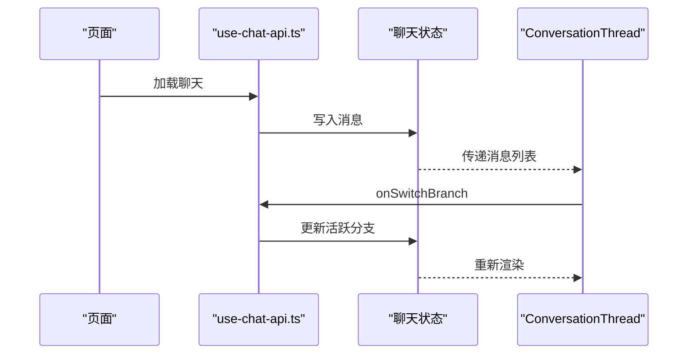

**图示来源**
- [conversation-thread.tsx:330-470](file://src/client/components/conversation-thread.tsx#L330-L470)
- [use-chat-api.ts:3570-3620](file://src/client/hooks/use-chat-api.ts#L3570-L3620)

**章节来源**
- [conversation-thread.tsx:330-470](file://src/client/components/conversation-thread.tsx#L330-L470)
- [conversation-thread.tsx:950-1131](file://src/client/components/conversation-thread.tsx#L950-L1131)
- [use-chat-api.ts:3570-3620](file://src/client/hooks/use-chat-api.ts#L3570-L3620)

## 常见场景解决方案
### 用户编辑提示词并重发
- 解析原用户消息的父节点。
- 插入新用户消息，父节点与原提示词相同。
- 插入助手消息，链到新用户消息。
- 更新活跃叶子。
- 前端立即显示新分支，隐藏旧助手回复。

### 用户重试助手回复
- 解析旧助手回复的用户提示词。
- 插入新的助手消息，保持 turnId 以便 hydrate 配对。
- 更新活跃叶子。
- 前端复用原有用户消息，仅替换助手回复分支。

### 多端同时编辑导致分支冲突
- 客户端通过 `client_id` 去重。
- 实时通道忽略不在当前尾部父链上的未知节点。
- 分支切换后，服务端保证 `active_children` 一致。

### 长对话历史未完全加载
- 检查 `hasMore`。
- 使用 `nextDepth` 继续加载更老祖先。
- 避免在生成期间用冷快照覆盖流式状态。

**章节来源**
- [messages.repository.ts:200-360](file://src/server/repositories/messages.repository.ts#L200-L360)
- [messages.repository.ts:500-900](file://src/server/repositories/messages.repository.ts#L500-L900)
- [use-chat-api.ts:1000-1350](file://src/client/hooks/use-chat-api.ts#L1000-L1350)

## 性能特征与调优建议
### 时间复杂度
- 活跃路径长度近似等于对话轮次，记为 `O(d)`。
- 兄弟节点数量通常较小，记为 `O(v)`。
- 分页查询按深度过滤，避免全树扫描。
- 分支切换最多沿下游遍历有限层级，代码中存在循环上限保护。

### 空间复杂度
- 单次分页结果包含一条路径上的消息。
- 兄弟变体摘要仅包含必要信息，不包含完整内容树。
- 客户端状态保存整个聊天消息列表，需配合虚拟滚动或分批加载。

### 调优建议
| 问题 | 建议 |
|---|---|
| 长对话加载慢 | 合理使用 `limit` 和 `depthCursor` |
| 分支切换卡顿 | 利用 `sibling_ids` 和 `sibling_variants` 做本地切换 |
| 历史缺失 | 检查 `hasMore` 和 `nextDepth` |
| 兄弟排序异常 | 依赖 `created_at` 和 `id` 的稳定排序 |
| 多端状态不一致 | 确保实时更新通道订阅 `chat_messages` |
| 索引不足 | 关注 `chat_messages_chat_parent_idx` 和 `chats_active_leaf_message_id_idx` |

**章节来源**
- [20261002183000_fix_thread_page_paging_direction_and_perf.sql:1-207](file://supabase/migrations/20261002183000_fix_thread_page_paging_direction_and_perf.sql#L1-L207)
- [20261004221000_chat_branch_persistence_and_perspective.sql:230-431](file://supabase/migrations/20261004221000_chat_branch_persistence_and_perspective.sql#L230-L431)
- [use-chat-api.ts:1000-1350](file://src/client/hooks/use-chat-api.ts#L1000-L1350)

## 故障排查
### 常见问题
| 现象 | 可能原因 | 处理方式 |
|---|---|---|
| 打开聊天时报“Something unexpected happened” | 深度字段歧义导致 RPC 失败 | 确认已应用修复深度歧义的迁移 |
| 聊天历史顺序错乱 | 用户消息和助手消息链序错误 | 确认已应用修复链序的迁移 |
| 历史只加载第一页 | 分页方向错误或 `has_more` 判断错误 | 检查分页函数和客户端游标逻辑 |
| 分支切换无效 | 消息不存在或不在当前聊天 | 检查目标消息 ID 和权限 |
| 分支切换后下游丢失 | `active_children` 未正确重建 | 检查分支切换函数和活跃叶子更新 |
| 流式气泡卡住 | 本地乐观状态与服务端快照冲突 | 检查 hydrate 合并逻辑 |

### 调试建议
1. 查看数据库函数是否已授权给认证角色和服务角色。
2. 检查 `chats.active_leaf_message_id` 是否指向有效消息。
3. 检查 `chats.metadata.active_children` 是否与活跃路径一致。
4. 检查客户端是否传入了正确的 `depthCursor`。
5. 检查实时通道是否订阅了 `chat_messages` 且过滤了当前聊天。

**章节来源**
- [20261001070000_fix_chat_thread_page_rpc_depth_ambiguity.sql:1-159](file://supabase/migrations/20261001070000_fix_chat_thread_page_rpc_depth_ambiguity.sql#L1-L159)
- [20261001080000_fix_message_chain_turn_order.sql:1-58](file://supabase/migrations/20261001080000_fix_message_chain_turn_order.sql#L1-L58)
- [20261002183000_fix_thread_page_paging_direction_and_perf.sql:1-207](file://supabase/migrations/20261002183000_fix_thread_page_paging_direction_and_perf.sql#L1-L207)
- [20261004221000_chat_branch_persistence_and_perspective.sql:230-431](file://supabase/migrations/20261004221000_chat_branch_persistence_and_perspective.sql#L230-L431)
- [use-chat-api.ts:1000-1350](file://src/client/hooks/use-chat-api.ts#L1000-L1350)

## 结论
分支聊天历史通过“父指针 + 活跃叶子 + 活跃子节点映射”的设计，把聊天从线性文本升级为可探索的对话树。后端通过数据库递归函数保证一致性，前端通过乐观更新和实时通道保证体验。迁移脚本逐步修复了路径、分页、排序和分支记忆等关键问题。

对于后续扩展，建议：

- 明确是否需要真正的分支合并操作。
- 为超长对话增加分层加载或懒加载祖先路径的策略。
- 为重要分支添加命名、标签或快照点。
- 监控 `active_children` 与真实活跃路径的一致性。
- 在审计场景中保留完整分支图，而不仅渲染活跃路径。