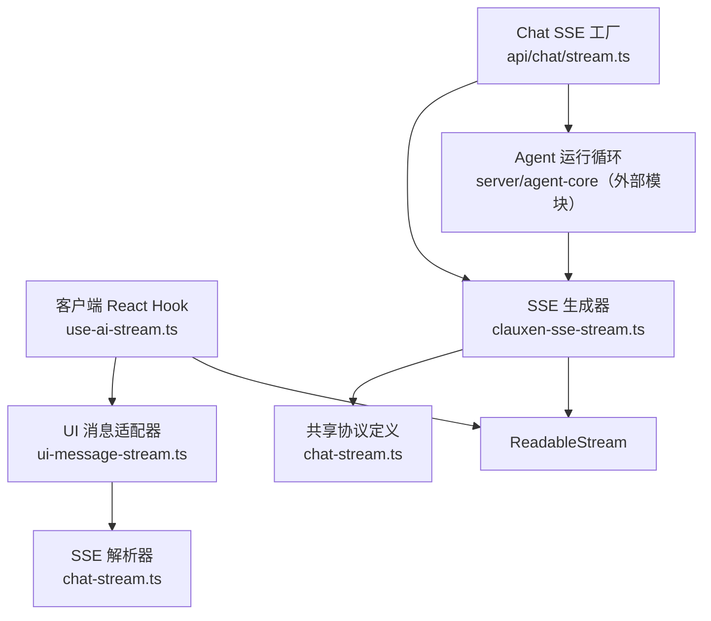
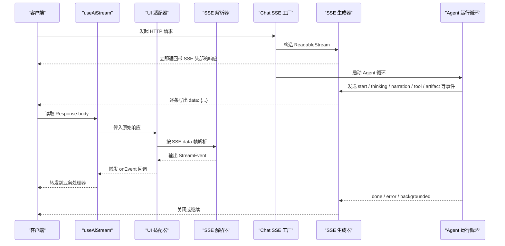
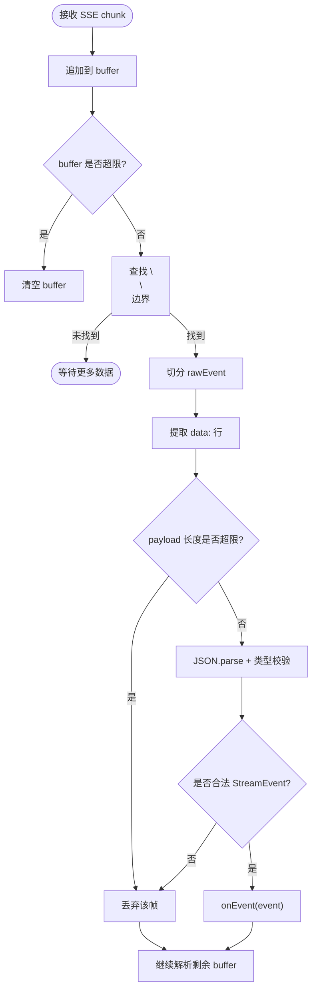
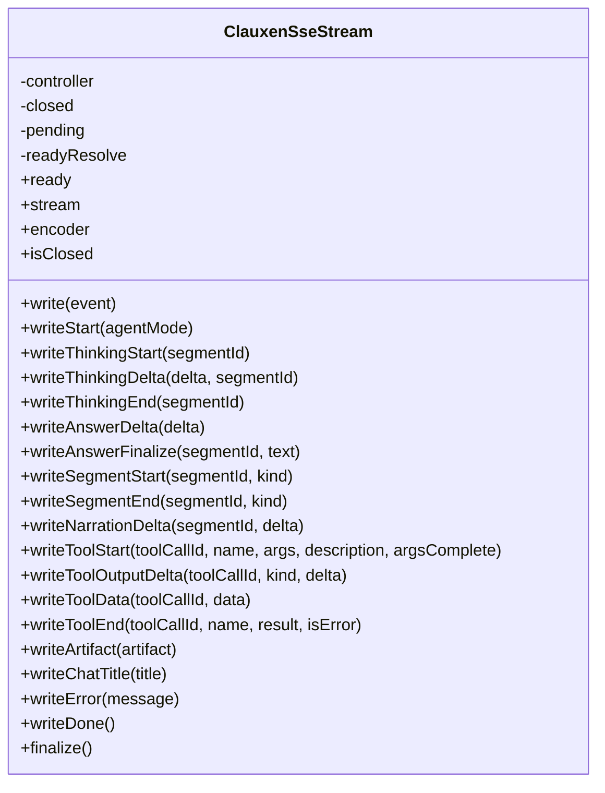
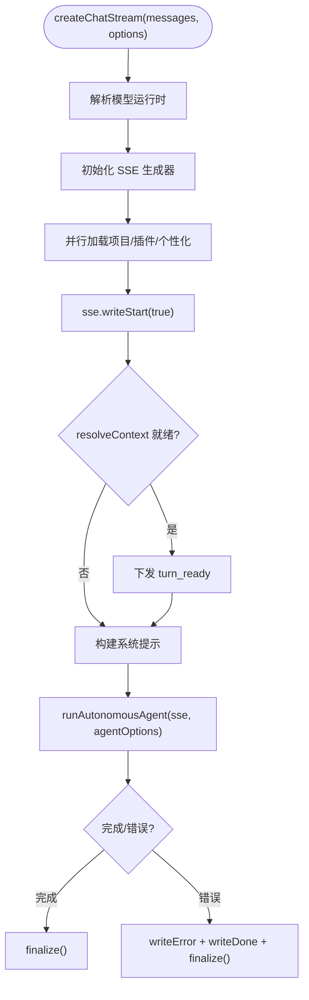
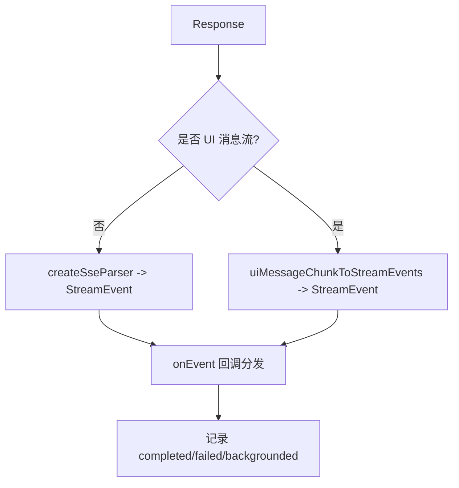
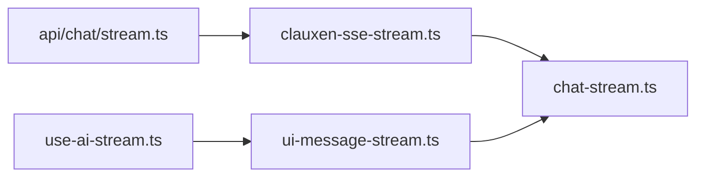

# 流式协议实现

<cite>
**本文引用的文件**   
- [chat-stream.ts](file://src/shared/lib/chat-stream.ts)
- [clauxen-sse-stream.ts](file://src/server/inference/clauxen-sse-stream.ts)
- [stream.ts](file://src/app/api/chat/stream.ts)
- [use-ai-stream.ts](file://src/client/hooks/use-ai-stream.ts)
- [ui-message-stream.ts](file://src/shared/lib/ui-message-stream.ts)
</cite>

## 目录
1. [引言](#引言)
2. [项目结构](#项目结构)
3. [核心组件](#核心组件)
4. [架构总览](#架构总览)
5. [详细组件分析](#详细组件分析)
6. [依赖关系分析](#依赖关系分析)
7. [性能与容量控制](#性能与容量控制)
8. [安全与兼容性](#安全与兼容性)
9. [故障排查指南](#故障排查指南)
10. [结论](#结论)

## 引言
本文面向聊天系统中的“流式协议”，重点解释基于 Server-Sent Events 的 Agent SSE 协议。文档覆盖连接建立、事件类型定义、数据格式规范，以及服务端生成器、客户端解析器、错误传播、断线恢复思路、协议版本兼容性与性能调优建议。文中所有实现细节均对应仓库中的实际代码路径，便于进一步定位与扩展。

## 项目结构
本项目的流式协议涉及服务端响应构建、Agent 运行循环、SSE 字节流封装，以及客户端事件消费与适配：

- 共享协议定义与解析器：`src/shared/lib/chat-stream.ts`
- 服务端 SSE 生成器：`src/server/inference/clauxen-sse-stream.ts`
- Chat SSE 工厂与 Agent 调用入口：`src/app/api/chat/stream.ts`
- 客户端 Hook 与 UI 适配器：`src/client/hooks/use-ai-stream.ts`、`src/shared/lib/ui-message-stream.ts`

**图示来源**
- [use-ai-stream.ts:1-73](file://src/client/hooks/use-ai-stream.ts#L1-L73)
- [ui-message-stream.ts:1-376](file://src/shared/lib/ui-message-stream.ts#L1-L376)
- [chat-stream.ts:1-325](file://src/shared/lib/chat-stream.ts#L1-L325)
- [clauxen-sse-stream.ts:1-241](file://src/server/inference/clauxen-sse-stream.ts#L1-L241)
- [stream.ts:1-341](file://src/app/api/chat/stream.ts#L1-L341)

**章节来源**
- [chat-stream.ts:1-325](file://src/shared/lib/chat-stream.ts#L1-L325)
- [clauxen-sse-stream.ts:1-241](file://src/server/inference/clauxen-sse-stream.ts#L1-L241)
- [stream.ts:1-341](file://src/app/api/chat/stream.ts#L1-L341)
- [use-ai-stream.ts:1-73](file://src/client/hooks/use-ai-stream.ts#L1-L73)
- [ui-message-stream.ts:1-376](file://src/shared/lib/ui-message-stream.ts#L1-L376)

## 核心组件
- 协议与解析器：定义统一的 `StreamEvent` 联合类型，提供 JSON 校验与字段规范化；提供 `createSseParser` 流式解析 SSE data 帧。
- 服务端 SSE 生成器：封装 `ReadableStream`，支持先写后消费缓冲、标准化 SSE 头部、统一事件写入方法、错误包装与最终关闭。
- Chat SSE 工厂：负责上下文准备、个性化提示、模型运行时选择、Agent 启动、异常处理，并返回可消费的流。
- 客户端 Hook：将后端响应交给 UI 适配器，再转换为统一的 `StreamEvent`，并提供简单回调分发。
- UI 适配器：兼容 Vercel AI SDK UI 消息流与旧版 Clauxen SSE，将其映射为内部协议事件。

**章节来源**
- [chat-stream.ts:1-325](file://src/shared/lib/chat-stream.ts#L1-L325)
- [clauxen-sse-stream.ts:1-241](file://src/server/inference/clauxen-sse-stream.ts#L1-L241)
- [stream.ts:1-341](file://src/app/api/chat/stream.ts#L1-L341)
- [use-ai-stream.ts:1-73](file://src/client/hooks/use-ai-stream.ts#L1-L73)
- [ui-message-stream.ts:1-376](file://src/shared/lib/ui-message-stream.ts#L1-L376)

## 架构总览
下面的时序图展示一次典型聊天请求的端到端流程：

**图示来源**
- [stream.ts:1-341](file://src/app/api/chat/stream.ts#L1-L341)
- [clauxen-sse-stream.ts:1-241](file://src/server/inference/clauxen-sse-stream.ts#L1-L241)
- [use-ai-stream.ts:1-73](file://src/client/hooks/use-ai-stream.ts#L1-L73)
- [ui-message-stream.ts:1-376](file://src/shared/lib/ui-message-stream.ts#L1-L376)
- [chat-stream.ts:1-325](file://src/shared/lib/chat-stream.ts#L1-L325)

## 详细组件分析

### 协议定义与解析器（chat-stream.ts）
- 事件生命周期
  - `start`：回合开始，可选 `agentMode` 与 `assistantMessageId`。
  - `turn_ready`：持久化 ID 可用时下发，用于乐观 id 替换。
  - 思考阶段：`thinking_start`、`thinking_delta`、`thinking_end`。
  - 叙述阶段：`segment_start`/`segment_end`、`text_delta`、`narration_delta`、`answer_finalize`。
  - 工具调用：`tool_start`（含 `argsComplete`）、`tool_output_delta`、`tool_data`、`tool_end`。
  - 产物卡片：`artifact_upsert`。
  - 元信息与控制：`chat_title`、`error`、`done`、`backgrounded`。
- 数据格式
  - 每条 SSE data 帧承载一个 JSON 对象，包含 `type` 及若干字段。
  - 解析器对每个字段进行类型检查与可选字段降级，避免上游脏数据破坏下游。
- 解析策略
  - 使用 `MAX_SSE_BUFFER_BYTES` 限制累积缓冲区大小，防止内存暴涨。
  - 以 `\n\n` 为帧边界，提取 `data:` 行，再执行 `JSON.parse`。
  - 单条 payload 长度超过阈值直接丢弃，避免恶意或异常大消息阻塞。
  - 解析成功才调用消费者回调，确保下游只看到合法事件。

**图示来源**
- [chat-stream.ts:1-325](file://src/shared/lib/chat-stream.ts#L1-L325)

**章节来源**
- [chat-stream.ts:1-325](file://src/shared/lib/chat-stream.ts#L1-L325)

### 服务端 SSE 生成器（clauxen-sse-stream.ts）
- 设计要点
  - 封装 `ReadableStream`，在消费者尚未 attach 时缓冲已写入事件，避免首帧丢失导致 UI 长时间无响应。
  - 标准 SSE 响应头：`Content-Type: text/event-stream; charset=utf-8`、`Cache-Control: no-cache, no-transform`、`X-Accel-Buffering: no`、`Connection: keep-alive`。
  - 提供语义化写入方法：`writeStart`、`writeThinkingStart/Delta/End`、`writeNarrationDelta`、`writeAnswerFinalize`、`writeSegmentStart/End`、`writeTool*`、`writeArtifact`、`writeChatTitle`、`writeError`、`writeDone`、`finalize`。
  - 错误传播：通过 `toUserFacingChatError` 包装上游错误，不泄露供应商内部信息。
  - 关闭语义：`finalize` 置闭标志、清空 pending、关闭控制器，后续写入被忽略。
- 复杂度与吞吐
  - 每次 `write` 仅做一次 UTF-8 编码与一次 enqueue，时间复杂度 O(1)，适合高频增量事件。
  - pending 缓冲仅在消费者延迟 attach 时使用，正常路径下零拷贝开销。

**图示来源**
- [clauxen-sse-stream.ts:1-241](file://src/server/inference/clauxen-sse-stream.ts#L1-L241)

**章节来源**
- [clauxen-sse-stream.ts:1-241](file://src/server/inference/clauxen-sse-stream.ts#L1-L241)

### Chat SSE 工厂（api/chat/stream.ts）
- 职责
  - 根据请求参数选择模型运行时、解析模型标识。
  - 并行加载项目提示、插件工具、用户个性化配置，缩短首字节延迟。
  - 尽早发出 `start`，让 UI 快速感知回合开始。
  - 将乐观 client id 映射为数据库持久化 id，下发 `turn_ready`。
  - 组装系统提示，包括时间上下文、个性化、项目上下文、隐身模式、标题指令、后续问题提示、插件安全指令。
  - 启动 Agent 运行循环，透传工具、信号、切片与回环状态。
  - 异常分支中，统一包装错误并发送 `error` + `done`，然后安全 `finalize`。
- 关键参数
  - `resolveContext`：允许在响应已开始后再准备历史与附件，避免阻塞 TTFT。
  - `signal`：支持前端中止。
  - `extendedThinking`：控制思维开关。
  - `initialConversation/startStep/shouldYield/yieldSignal/onRoundEnd`：支持长轮次切片与恢复。

**图示来源**
- [stream.ts:1-341](file://src/app/api/chat/stream.ts#L1-L341)
- [clauxen-sse-stream.ts:1-241](file://src/server/inference/clauxen-sse-stream.ts#L1-L241)

**章节来源**
- [stream.ts:1-341](file://src/app/api/chat/stream.ts#L1-L341)

### 客户端流处理（use-ai-stream.ts 与 ui-message-stream.ts）
- use-ai-stream.ts
  - 暴露 `streamFromResponse(response, handlers, signal)`，委托给 `consumeClauxenStreamResponse`。
  - 提供简单的回调分发：`onStart`、`onThinkingStart`、`onThinkingDelta`、`onAnswerDelta`、`onDone`、`onError`、`onEvent`。
- ui-message-stream.ts
  - 自动检测是否为 Vercel AI SDK UI 消息流（`x-vercel-ai-ui-message-stream: v1`）。
  - 非 UI 流：直接使用 `createSseParser` 解析 JSON 事件。
  - UI 流：将 AI SDK 的 `UIMessageChunk` 与自定义 `data-*` 片段映射为内部 `StreamEvent`，维护状态（如 reasoning、tool input、tool names）。
  - 结果值：`completed`、`failed`、`backgrounded`、`interrupted`、`aborted`。
  - 资源释放：使用 `reader.cancel()` 和 `releaseLock()` 保证中断与结束场景下的正确清理。

**图示来源**
- [use-ai-stream.ts:1-73](file://src/client/hooks/use-ai-stream.ts#L1-L73)
- [ui-message-stream.ts:1-376](file://src/shared/lib/ui-message-stream.ts#L1-L376)
- [chat-stream.ts:1-325](file://src/shared/lib/chat-stream.ts#L1-L325)

**章节来源**
- [use-ai-stream.ts:1-73](file://src/client/hooks/use-ai-stream.ts#L1-L73)
- [ui-message-stream.ts:1-376](file://src/shared/lib/ui-message-stream.ts#L1-L376)

## 依赖关系分析
- 低耦合点
  - 协议类型集中在 `chat-stream.ts`，服务端的生成器与客户端的解析器都依赖该契约，降低两端实现耦合。
  - UI 适配器屏蔽了不同上游流格式的差异，使上层 UI 仅关心 `StreamEvent`。
- 关键依赖链
  - `api/chat/stream.ts` → `clauxen-sse-stream.ts` → `ReadableStream`
  - `api/chat/stream.ts` → `server/agent-core`（外部）→ 通过 `sse` 回调事件
  - `client/hooks/use-ai-stream.ts` → `shared/lib/ui-message-stream.ts` → `shared/lib/chat-stream.ts`

**图示来源**
- [stream.ts:1-341](file://src/app/api/chat/stream.ts#L1-L341)
- [clauxen-sse-stream.ts:1-241](file://src/server/inference/clauxen-sse-stream.ts#L1-L241)
- [use-ai-stream.ts:1-73](file://src/client/hooks/use-ai-stream.ts#L1-L73)
- [ui-message-stream.ts:1-376](file://src/shared/lib/ui-message-stream.ts#L1-L376)
- [chat-stream.ts:1-325](file://src/shared/lib/chat-stream.ts#L1-L325)

**章节来源**
- [stream.ts:1-341](file://src/app/api/chat/stream.ts#L1-L341)
- [clauxen-sse-stream.ts:1-241](file://src/server/inference/clauxen-sse-stream.ts#L1-L241)
- [use-ai-stream.ts:1-73](file://src/client/hooks/use-ai-stream.ts#L1-L73)
- [ui-message-stream.ts:1-376](file://src/shared/lib/ui-message-stream.ts#L1-L376)
- [chat-stream.ts:1-325](file://src/shared/lib/chat-stream.ts#L1-L325)

## 性能与容量控制
- 首字节延迟优化
  - 工厂函数在准备个性化与历史前就返回流，并尽早发送 `start`，避免 TTFT 被慢查询阻塞。
  - 使用 Promise.race 与超时预算（`CHAT_CONTEXT_BUDGET_MS`）保护首次 token 的延迟。
- 缓冲与内存控制
  - 服务端 `clauxen-sse-stream.ts` 在消费者未 attach 时缓冲早期事件，避免 UI 假死。
  - 客户端与服务端解析器均限制 SSE buffer 与单条 payload 大小，防止恶意或异常数据引发 OOM。
- I/O 与编码
  - 使用 `TextEncoder`/`TextDecoder(stream:true)` 减少重复解码成本。
  - 流式 reader 读取并即时解析，避免整包落盘。
- 调优建议
  - 合理设置 `maxTokens` 与 `temperature`，避免过长回复与过度发散。
  - 对工具输出采用增量渲染，优先展示 stdout/stderr 增量而非等待最终结果。
  - 在需要时启用 `extendedThinking`，但需评估推理开销与延迟。

[本节为通用性能指导，不直接分析具体代码行]

## 安全与兼容性
- 安全考虑
  - 服务端统一通过 `toUserFacingChatError` 包装错误，避免泄露供应商或内部实现细节。
  - 解析器对字段进行严格类型校验与可选字段降级，抵御畸形数据。
  - 对超大 buffer 与 payload 做硬上限保护。
  - 支持 `AbortSignal`，客户端可随时中止流，释放资源。
- 协议版本兼容
  - 客户端根据响应头判断是否为 Vercel AI SDK UI 消息流，分别走 UI 适配器或传统 SSE 解析路径。
  - 保留旧版 `data-*` 片段映射逻辑，逐步迁移到扁平 trace 协议。
  - `step_done` 与 `agent-frame` 标记为废弃，映射为空操作，保持向前兼容。
- 重连与断线恢复
  - 当前实现没有内置指数退避重连逻辑；可通过上层应用层结合 `backgrounded` 事件与 `jobId`/`chatId` 自行实现重试与恢复。
  - 对于长任务，服务端通过切片与 `yieldSignal`/`shouldYield` 支持后台推进，客户端应监听 `backgrounded` 并决定 UI 状态。

**章节来源**
- [clauxen-sse-stream.ts:1-241](file://src/server/inference/clauxen-sse-stream.ts#L1-L241)
- [chat-stream.ts:1-325](file://src/shared/lib/chat-stream.ts#L1-L325)
- [ui-message-stream.ts:1-376](file://src/shared/lib/ui-message-stream.ts#L1-L376)
- [stream.ts:1-341](file://src/app/api/chat/stream.ts#L1-L341)

## 故障排查指南
- 常见问题与定位
  - 首帧丢失或 UI 长时间无响应：检查服务端是否过早 `finalize`，确认消费者 attach 时机与 pending 缓冲逻辑。
    - 参考：[clauxen-sse-stream.ts:1-241](file://src/server/inference/clauxen-sse-stream.ts#L1-L241)
  - 解析失败或空白回答：检查 SSE buffer 是否被截断、payload 是否超长、JSON 是否非法。
    - 参考：[chat-stream.ts:1-325](file://src/shared/lib/chat-stream.ts#L1-L325)
  - 工具输入未完整：关注 `tool_start.argsComplete` 与 `tool_input-delta` 拼接逻辑。
    - 参考：[ui-message-stream.ts:1-376](file://src/shared/lib/ui-message-stream.ts#L1-L376)
  - 错误被吞掉：确保 `onEvent` 中的错误事件未被捕获，避免将错误转成“成功”空回合。
    - 参考：[ui-message-stream.ts:1-376](file://src/shared/lib/ui-message-stream.ts#L1-L376)
  - 网络中断后状态不一致：结合 `backgrounded` 与 `jobId`/`chatId`，在上层实现断线恢复与进度同步。
    - 参考：[stream.ts:1-341](file://src/app/api/chat/stream.ts#L1-L341)
- 调试步骤
  - 打印服务端 `write*` 调用序列，确认事件顺序符合预期。
  - 在客户端 `onEvent` 处记录事件序列，核对 `start`、`thinking_*`、`narration_delta`、`tool_*`、`done`/`error`。
  - 检查响应头是否正确（`text/event-stream`、`no-cache`、`keep-alive`）。
  - 若使用 UI 消息流，确认响应头 `x-vercel-ai-ui-message-stream: v1` 是否存在。

**章节来源**
- [clauxen-sse-stream.ts:1-241](file://src/server/inference/clauxen-sse-stream.ts#L1-L241)
- [chat-stream.ts:1-325](file://src/shared/lib/chat-stream.ts#L1-L325)
- [ui-message-stream.ts:1-376](file://src/shared/lib/ui-message-stream.ts#L1-L376)
- [stream.ts:1-341](file://src/app/api/chat/stream.ts#L1-L341)

## 结论
本项目围绕一个扁平、回合级的 Agent SSE 协议展开：服务端通过 `clauxen-sse-stream.ts` 标准化事件输出，`api/chat/stream.ts` 负责任务编排与错误处理，客户端通过 `use-ai-stream.ts` 与 `ui-message-stream.ts` 兼容多种上游流格式并统一为 `StreamEvent`。协议具备严格的字段校验、容量控制与错误包装，适合高吞吐、低延迟的对话场景。未来可在应用层扩展重连、心跳与更精细的切片恢复机制，同时保持对旧版 UI 流的兼容。