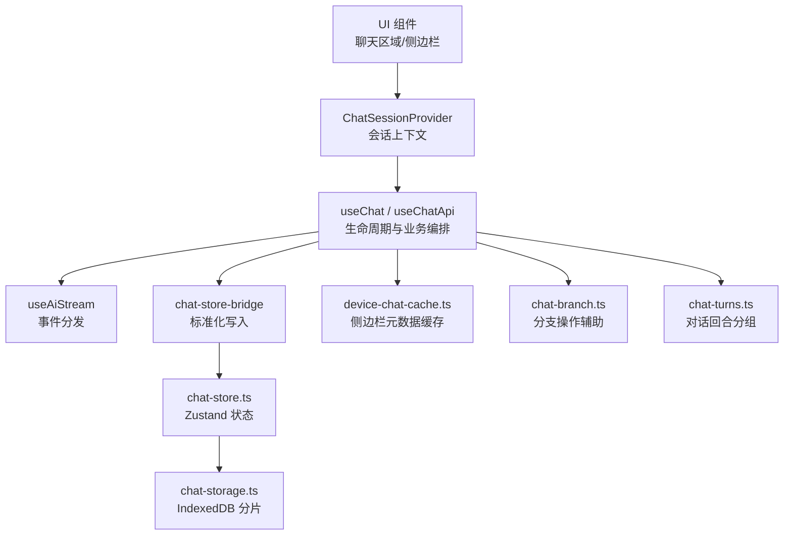
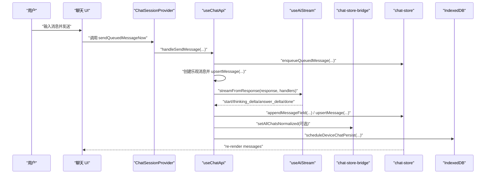
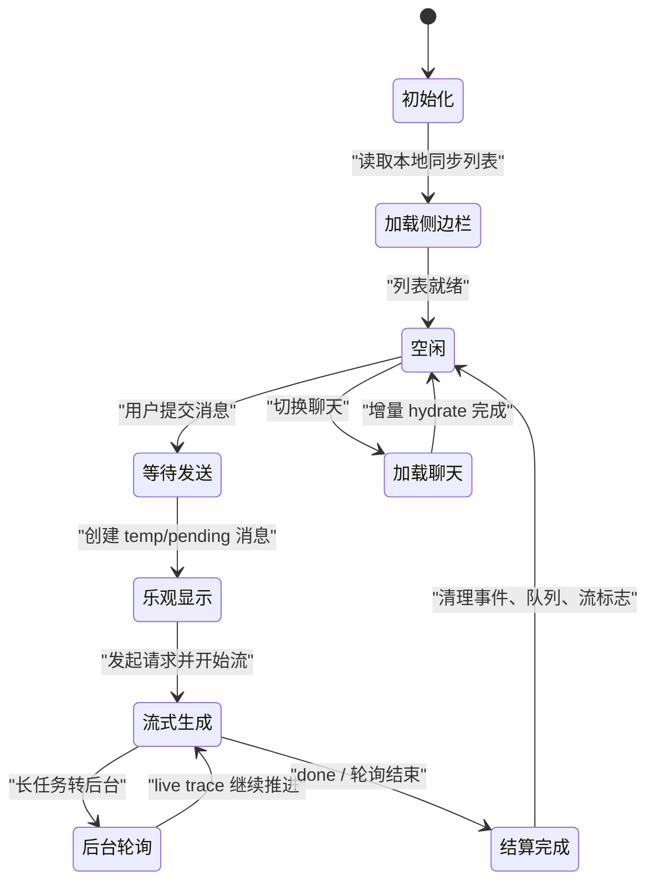
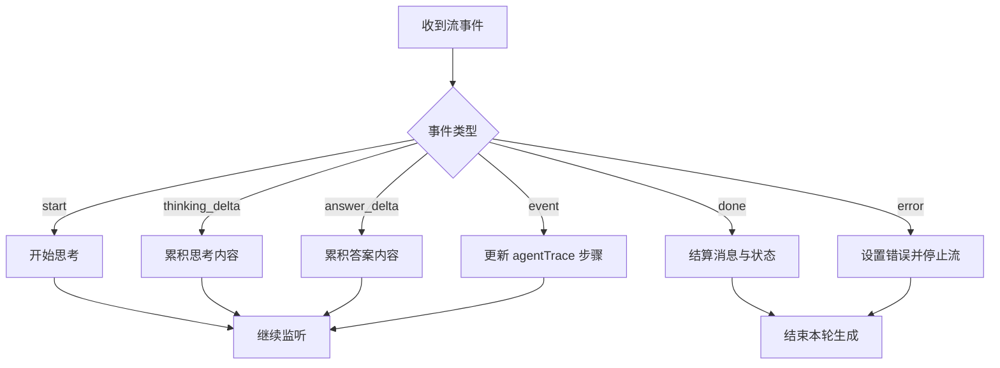
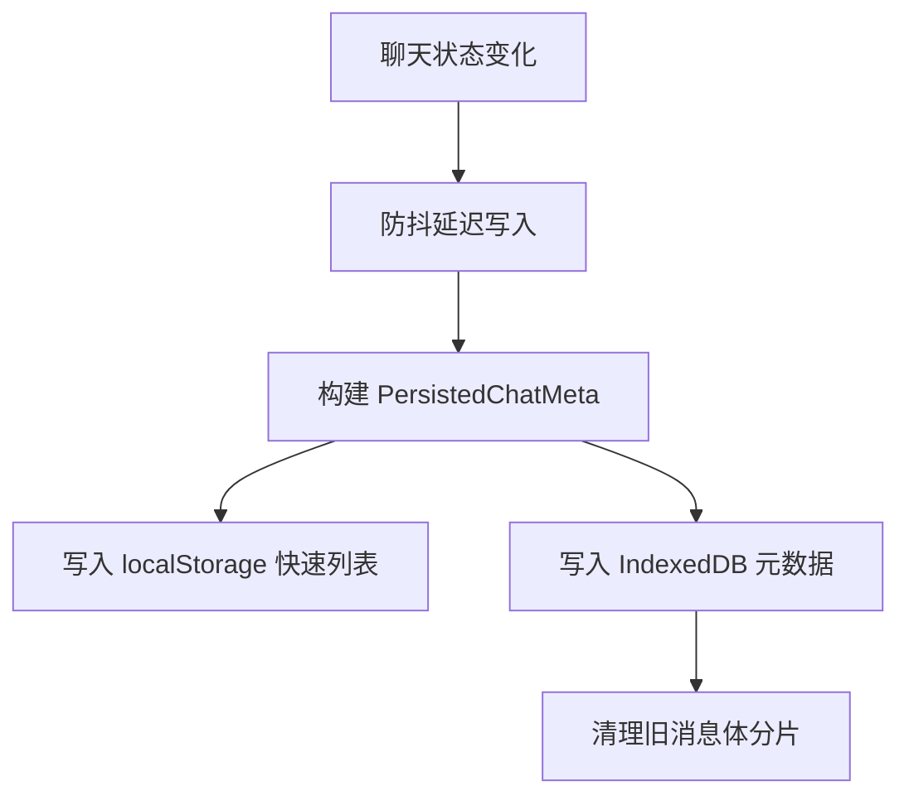
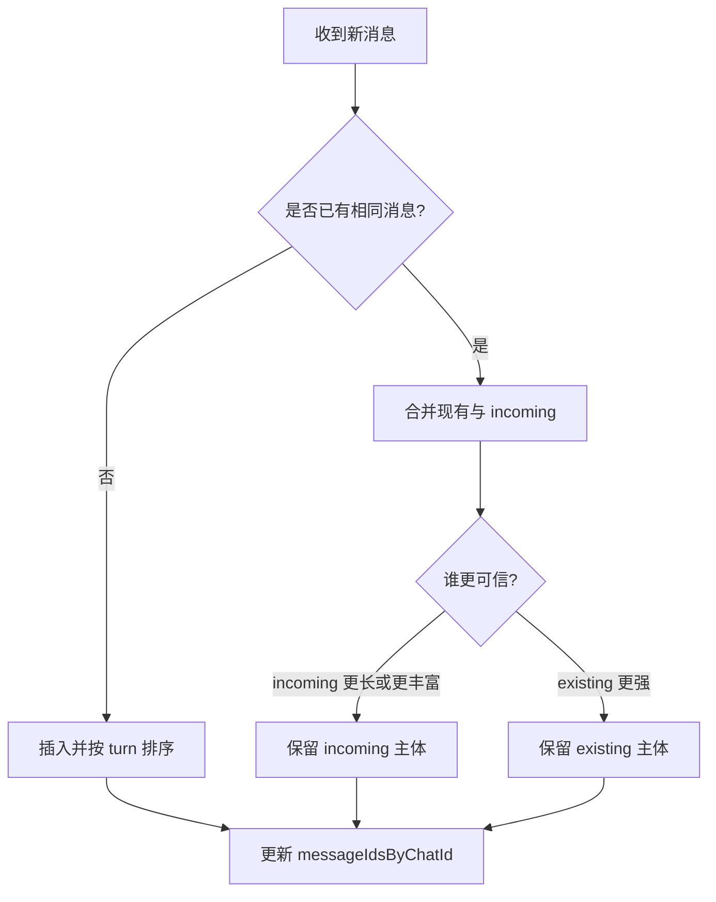
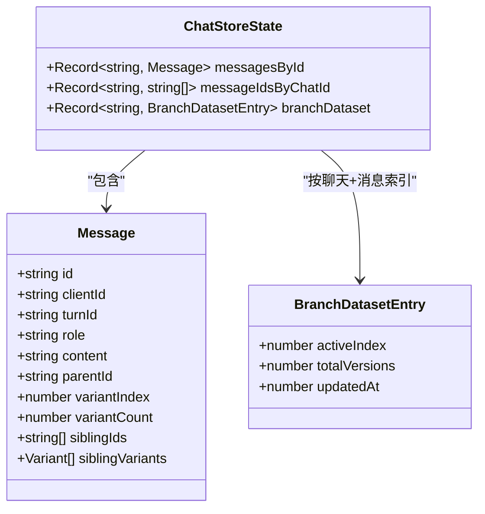
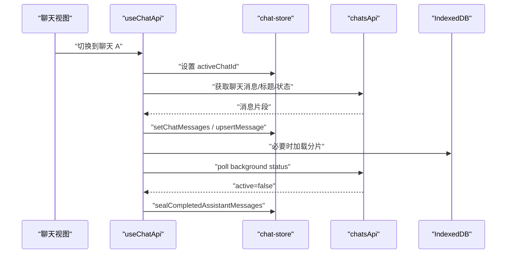
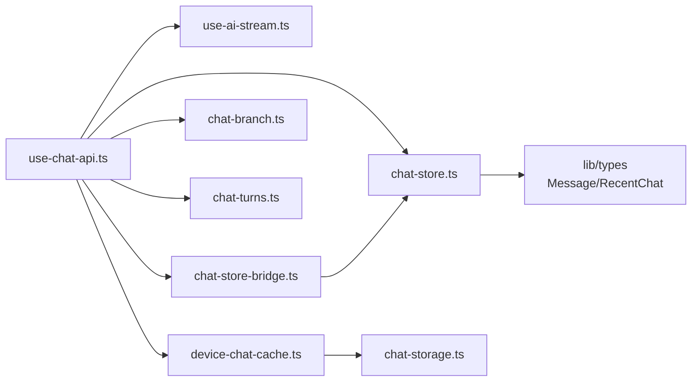

# 聊天状态管理

<cite>
**本文引用的文件**   
- [chat-store.ts](file://src/client/stores/chat-store.ts)
- [use-chat.ts](file://src/client/hooks/use-chat.ts)
- [use-chat-api.ts](file://src/client/hooks/use-chat-api.ts)
- [use-ai-stream.ts](file://src/client/hooks/use-ai-stream.ts)
- [chat-session-context.tsx](file://src/client/contexts/chat-session-context.tsx)
- [chat-store-bridge.ts](file://src/shared/lib/chat-store-bridge.ts)
- [chat-turns.ts](file://src/shared/lib/chat-turns.ts)
- [device-chat-cache.ts](file://src/shared/lib/device-chat-cache.ts)
- [chat-storage.ts](file://src/shared/lib/chat-storage.ts)
- [chat-branch.ts](file://src/shared/lib/chat-branch.ts)
</cite>

## 目录
1. [引言](#引言)
2. [项目结构](#项目结构)
3. [核心组件](#核心组件)
4. [架构总览](#架构总览)
5. [详细组件分析](#详细组件分析)
6. [依赖关系分析](#依赖关系分析)
7. [性能与内存管理](#性能与内存管理)
8. [故障排查指南](#故障排查指南)
9. [结论](#结论)
10. [附录：状态扩展与自定义 Hook 开发指南](#附录状态扩展与自定义-hook-开发指南)

## 引言
本文件面向聊天状态管理子系统，围绕以下目标展开：
- 解释 Zustand store 的设计模式、聊天会话状态结构与消息更新机制。
- 说明 useChat hook 的生命周期管理，以及基于 useAiStream 的流式数据处理。
- 文档化状态持久化、乐观更新、冲突解决策略。
- 解释分支聊天的状态分离、历史消息增量加载、实时同步机制。
- 提供状态调试工具、性能监控与内存泄漏防护建议。
- 给出状态扩展指南与自定义 hooks 开发示例。

该实现以浏览器端为入口：React Hooks 负责用户交互与网络流程，Zustand store 作为单源状态中心，IndexedDB 作为设备侧持久层，服务端通过 REST、轮询和后台任务完成最终一致性。

## 项目结构
聊天状态管理主要分布在客户端 Hooks、Zustand Store、共享数据桥接与持久化工具中：

**图示来源**
- [chat-session-context.tsx:1-114](file://src/client/contexts/chat-session-context.tsx#L1-L114)
- [use-chat.ts:1-19](file://src/client/hooks/use-chat.ts#L1-L19)
- [use-chat-api.ts:1-200](file://src/client/hooks/use-chat-api.ts#L1-L200)
- [use-ai-stream.ts:1-73](file://src/client/hooks/use-ai-stream.ts#L1-L73)
- [chat-store-bridge.ts:1-38](file://src/shared/lib/chat-store-bridge.ts#L1-L38)
- [chat-store.ts:1-120](file://src/client/stores/chat-store.ts#L1-L120)
- [device-chat-cache.ts:1-120](file://src/shared/lib/device-chat-cache.ts#L1-L120)
- [chat-storage.ts:1-120](file://src/shared/lib/chat-storage.ts#L1-L120)
- [chat-branch.ts:1-60](file://src/shared/lib/chat-branch.ts#L1-L60)
- [chat-turns.ts:1-73](file://src/shared/lib/chat-turns.ts#L1-L73)

**章节来源**
- [chat-session-context.tsx:1-114](file://src/client/contexts/chat-session-context.tsx#L1-L114)
- [use-chat.ts:1-19](file://src/client/hooks/use-chat.ts#L1-L19)

## 核心组件
- **Zustand Store**：集中保存消息索引、按聊天聚合的消息 ID 列表、最近聊天、活跃聊天、生成状态、流式指针、待发送队列与分支数据集。
- **useChat / useChatApi**：统一聊天控制器，封装模型选择、推理强度、消息发送、流式接收、历史加载、标题生成、分支编辑与重试等。
- **useAiStream**：将后端流事件（思考、答案、工具调用）转换为前端回调，驱动 store 增量更新。
- **ChatSessionProvider**：为整个主界面提供一个稳定的聊天会话上下文，避免频繁重渲染。
- **chat-store-bridge**：把旧式“所有聊天”对象映射到归一化的 store 写入 API。
- **chat-turns**：将已排序消息折叠为可渲染的“对话回合”。
- **device-chat-cache + chat-storage**：侧边栏元数据快速缓存与消息分片持久化。
- **chat-branch**：分支编辑、重发、重试与变体切换的纯函数辅助。

**章节来源**
- [chat-store.ts:1-120](file://src/client/stores/chat-store.ts#L1-L120)
- [use-chat.ts:1-19](file://src/client/hooks/use-chat.ts#L1-L19)
- [use-chat-api.ts:1-200](file://src/client/hooks/use-chat-api.ts#L1-L200)
- [use-ai-stream.ts:1-73](file://src/client/hooks/use-ai-stream.ts#L1-L73)
- [chat-store-bridge.ts:1-38](file://src/shared/lib/chat-store-bridge.ts#L1-L38)
- [chat-turns.ts:1-73](file://src/shared/lib/chat-turns.ts#L1-L73)
- [device-chat-cache.ts:1-120](file://src/shared/lib/device-chat-cache.ts#L1-L120)
- [chat-storage.ts:1-120](file://src/shared/lib/chat-storage.ts#L1-L120)
- [chat-branch.ts:1-60](file://src/shared/lib/chat-branch.ts#L1-L60)

## 架构总览
聊天状态管理采用“Hooks 编排 + Store 归一化 + IndexedDB 持久化”的分层架构。

**图示来源**
- [use-chat-api.ts:820-1050](file://src/client/hooks/use-chat-api.ts#L820-L1050)
- [use-ai-stream.ts:1-73](file://src/client/hooks/use-ai-stream.ts#L1-L73)
- [chat-store.ts:380-470](file://src/client/stores/chat-store.ts#L380-L470)
- [chat-store-bridge.ts:1-38](file://src/shared/lib/chat-store-bridge.ts#L1-L38)
- [device-chat-cache.ts:120-200](file://src/shared/lib/device-chat-cache.ts#L120-L200)

## 详细组件分析

### Zustand Store 设计模式
Store 使用 `create` 与 `subscribeWithSelector` 组合，暴露以下职责：
- **消息存储**：`messagesById` 按 ID 归一化；`messageIdsByChatId` 保持有序 ID 列表。
- **会话控制**：`activeChatId`、`isGenerating`、`generatingChatIds`、`streaming`。
- **队列管理**：每聊天一个 `queuedMessagesByChatId`，支持入队、编辑、移除、移位与提升。
- **分支数据**：`branchDataset` 记录每个聊天下某条消息的活跃变体索引、总变体数与更新时间。
- **内存窗口**：按聊天保留活跃消息窗口，丢弃非活跃聊天或超出窗口的消息。
- **历史迁移**：提供 `hydrateFromLegacy` 与 `exportLegacyAllChats` 兼容旧格式。

关键数据结构如下：

| 字段 | 类型 | 作用 | 复杂度影响 |
|---|---|---|---|
| `messagesById` | `Record<string, Message>` | 消息去重与随机访问 | O(1) 查找 |
| `messageIdsByChatId` | `Record<string, string[]>` | 聊天内消息顺序 | 排序 O(n log n)，追加后重排 |
| `recentChats` | `RecentChat[]` | 侧边栏列表 | 小集合，直接遍历 |
| `activeChatId` | `string \| null` | 当前激活聊天 | O(1) |
| `isGenerating` | `boolean` | 全局生成标志 | O(1) |
| `generatingChatIds` | `Record<string, true>` | 各聊天生成标志 | O(1) |
| `streaming` | `{ chatId, messageId } \| null` | 当前流式回复位置 | O(1) |
| `queuedMessagesByChatId` | `Record<string, QueuedChatMessage[]>` | 用户消息队列 | 每聊天线性操作 |
| `branchDataset` | `Record<chatId, Record<messageId, branchMeta>>` | 分支变体状态 | 分支操作时局部更新 |

消息合并与排序逻辑保证：
- 同一条消息不会因多次到达而重复。
- 同一 turn 的用户消息始终位于其助手回复之前。
- 流式消息优先保留更长内容或更丰富 agentTrace。
- 无 turnId 的历史行仍保持时间顺序，避免沉底错序。

**章节来源**
- [chat-store.ts:1-120](file://src/client/stores/chat-store.ts#L1-L120)
- [chat-store.ts:201-470](file://src/client/stores/chat-store.ts#L201-L470)
- [chat-store.ts:450-755](file://src/client/stores/chat-store.ts#L450-L755)

### useChat 与 useChatApi 生命周期
`useChat` 是薄包装，实际逻辑委托给 `useChatApi`。`useChatApi` 维护：
- 模型参数与推理强度。
- 最近聊天列表、活跃聊天、加载状态。
- 设备缓存初始化、消息加载错误、标题生成进度。
- 流式生成、后台轮询、消息队列消费。
- 分支编辑、重发、重试与会话级副作用清理。

典型生命周期阶段：

**图示来源**
- [use-chat-api.ts:520-600](file://src/client/hooks/use-chat-api.ts#L520-L600)
- [use-chat-api.ts:820-1050](file://src/client/hooks/use-chat-api.ts#L820-L1050)
- [use-chat-api.ts:1300-1650](file://src/client/hooks/use-chat-api.ts#L1300-L1650)
- [use-chat-api.ts:1800-2250](file://src/client/hooks/use-chat-api.ts#L1800-L2250)

**章节来源**
- [use-chat.ts:1-19](file://src/client/hooks/use-chat.ts#L1-L19)
- [use-chat-api.ts:520-600](file://src/client/hooks/use-chat-api.ts#L520-L600)

### 流式数据处理：useAiStream 与事件分发
`useAiStream` 不直接处理网络，而是将响应交给统一的流解析器，再把 `start`、`thinking_start`、`thinking_delta`、`answer_delta`、`done`、`error` 等事件派发给上层回调。`useChatApi` 在回调中：
- 启动思考流：创建 thinking 状态。
- 累积答案文本：追加到 assistant 消息。
- 处理工具调用：更新 agentTrace 步骤。
- 结束流：结算 agentTrace、关闭流标志、清空队列、标记生成完成。

**图示来源**
- [use-ai-stream.ts:1-73](file://src/client/hooks/use-ai-stream.ts#L1-L73)
- [use-chat-api.ts:1800-2250](file://src/client/hooks/use-chat-api.ts#L1800-L2250)

**章节来源**
- [use-ai-stream.ts:1-73](file://src/client/hooks/use-ai-stream.ts#L1-L73)
- [use-chat-api.ts:1800-2250](file://src/client/hooks/use-chat-api.ts#L1800-L2250)

### 状态持久化与设备缓存
持久化分为两层：
- **IndexedDB 消息分片**：每条聊天消息被切分为固定大小的分片，避免大对象写入阻塞。同时删除旧版完整消息体，只保留 meta。
- **IndexedDB 元数据与 localStorage 快速列表**：侧边栏仅保存最近聊天元数据，首次进入时使用 localStorage 同步副本进行首帧渲染。

**图示来源**
- [device-chat-cache.ts:120-200](file://src/shared/lib/device-chat-cache.ts#L120-L200)
- [chat-storage.ts:1-120](file://src/shared/lib/chat-storage.ts#L1-L120)
- [chat-storage.ts:120-208](file://src/shared/lib/chat-storage.ts#L120-L208)

**章节来源**
- [device-chat-cache.ts:1-200](file://src/shared/lib/device-chat-cache.ts#L1-L200)
- [chat-storage.ts:1-208](file://src/shared/lib/chat-storage.ts#L1-L208)

### 乐观更新与冲突解决
乐观更新体现在：
- 用户消息先以 `temp-` 或 `pending-` 前缀插入 store。
- assistant 回复先以占位流式消息出现，随后被真实内容替换。
- 编辑、重发、重试会立即隐藏旧分支后续内容，并绘制新分支流式占位。

冲突解决策略：
- **ID 与 clientId 匹配**：`resolveExistingId` 通过 id、clientId 双向映射识别同一条消息。
- **内容长度与 agentTrace 优先级**：`mergeMessage` 优先保留更长内容或更丰富的工具轨迹。
- **turnId 稳定性**：从 clientId 推导 turnId，确保服务端返回行能正确加入原有 turn。
- **流式标志收敛**：非活跃 tab 或长时间未更新的 streaming 行会被清理或转为静态时长。

**图示来源**
- [chat-store.ts:120-220](file://src/client/stores/chat-store.ts#L120-L220)
- [chat-store.ts:220-320](file://src/client/stores/chat-store.ts#L220-L320)

**章节来源**
- [chat-store.ts:120-320](file://src/client/stores/chat-store.ts#L120-L320)

### 分支聊天的状态分离
分支由以下维度分离：
- **消息树位置**：parentId、variantIndex、variantCount、siblingIds、siblingVariants。
- **客户端行为**：editMessageWithBranch、redoUserMessageWithBranch、retryAssistantWithBranch、switchMessageBranch。
- **store 元数据**：branchDataset 记录活跃变体索引、总变体数与更新时间。
- **渲染隔离**：分支操作会截断旧分支后续消息，并在同一更新中绘制新分支占位。

**图示来源**
- [chat-store.ts:20-40](file://src/client/stores/chat-store.ts#L20-L40)
- [chat-store.ts:30-90](file://src/client/stores/chat-store.ts#L30-L90)
- [chat-branch.ts:1-120](file://src/shared/lib/chat-branch.ts#L1-L120)

**章节来源**
- [chat-branch.ts:1-200](file://src/shared/lib/chat-branch.ts#L1-L200)
- [chat-store.ts:30-90](file://src/client/stores/chat-store.ts#L30-L90)

### 历史消息的增量加载
历史加载不是简单全量拉取，而是：
- 初始侧边栏列表来自设备缓存。
- 打开聊天后按需 hydrate 消息。
- 对长对话使用分页与分片读取。
- 使用 AbortController 取消过期 hydrate 请求。
- 对后台任务使用 `/status` 与 `/live` 轮询，直到任务结束。

**图示来源**
- [use-chat-api.ts:1400-1650](file://src/client/hooks/use-chat-api.ts#L1400-L1650)
- [use-chat-api.ts:500-560](file://src/client/hooks/use-chat-api.ts#L500-L560)
- [chat-storage.ts:80-160](file://src/shared/lib/chat-storage.ts#L80-L160)

**章节来源**
- [use-chat-api.ts:1400-1650](file://src/client/hooks/use-chat-api.ts#L1400-L1650)
- [chat-storage.ts:80-160](file://src/shared/lib/chat-storage.ts#L80-L160)

### 实时同步机制
实时性通过多条路径保障：
- **流式 SSE/UI 消息流**：即时更新 assistant 内容与 thinking。
- **后台轮询 live trace**：当连接断开或任务进入后台时，继续推进 agentTrace。
- **服务端状态对齐**：对陈旧 streaming 行做 staleStreaming 判断，避免残留 orb。
- **本地结算保护**：本地已完成生成的短期 grace period 内忽略服务器滞后 flag。

**章节来源**
- [use-chat-api.ts:250-360](file://src/client/hooks/use-chat-api.ts#L250-L360)
- [use-chat-api.ts:500-560](file://src/client/hooks/use-chat-api.ts#L500-L560)

## 依赖关系分析

**图示来源**
- [use-chat-api.ts:1-120](file://src/client/hooks/use-chat-api.ts#L1-L120)
- [use-ai-stream.ts:1-73](file://src/client/hooks/use-ai-stream.ts#L1-L73)
- [chat-store.ts:1-120](file://src/client/stores/chat-store.ts#L1-L120)
- [chat-store-bridge.ts:1-38](file://src/shared/lib/chat-store-bridge.ts#L1-L38)
- [chat-branch.ts:1-60](file://src/shared/lib/chat-branch.ts#L1-L60)
- [chat-turns.ts:1-73](file://src/shared/lib/chat-turns.ts#L1-L73)
- [device-chat-cache.ts:1-120](file://src/shared/lib/device-chat-cache.ts#L1-L120)
- [chat-storage.ts:1-120](file://src/shared/lib/chat-storage.ts#L1-L120)

**章节来源**
- [use-chat-api.ts:1-120](file://src/client/hooks/use-chat-api.ts#L1-L120)

## 性能与内存管理
- **消息排序成本**：每次批量写入都会按 turn 重新排序，适合中小规模聊天；超大对话应依赖分页与 window trimming。
- **流式追加成本**：`appendMessageField` 会复制消息对象并拼接字符串，高频 delta 场景下需保证 delta 粒度合理。
- **内存窗口**：`trimChatMessagesToWindow` 保留活跃消息与流式消息，其余丢弃；`clearInactiveChatMessages` 清理非活跃聊天。
- **IndexedDB 分片**：按固定大小分片写入，减少单次 IO 压力，并在写入后清理旧分片。
- **AbortController 清理**：流、轮询、hydrat 请求均绑定信号，切换聊天或卸载时主动中断。
- **背景轮询节流**：轮询间隔固定，hidden tab 跳过轮询，可见时恢复，避免后台耗电。
- **上下文稳定引用**：`ChatSessionProvider` 用 `useMemo` 包裹 value，仅当必要 observable 变化时更新，降低子组件重渲染。

[本节为通用性能指导，不直接分析具体代码行]

## 故障排查指南
常见问题与定位方式：

| 问题 | 可能原因 | 排查建议 |
|---|---|---|
| 流式光标不消失 | 流未正常结算或服务器滞后 | 检查 `setStreaming(null)`、`rememberGenerationSettled`、`clearIdleStreamingFlags` |
| 历史消息缺失 | hydrate 被取消或分页未加载 | 检查 loadControllersRef、hydatedChatIdsRef、分页请求 |
| 分支箭头闪烁 | 服务端 switch 尚未返回 | 利用 siblingVariants 本地缓存提前渲染 |
| 侧边栏空白 | 本地列表为空或用户变更 | 检查 `readSyncDeviceChatList`、IndexedDB meta userId |
| 长时间生成卡住 | 后台轮询失败或连接中断 | 查看 `pollBackgroundTurn`、`paintLiveTurn` 异常路径 |
| 消息顺序错乱 | turnId 缺失或 clientId 不一致 | 检查 `deriveTurnIdFromClientId`、`resolveExistingId` |

**章节来源**
- [use-chat-api.ts:250-360](file://src/client/hooks/use-chat-api.ts#L250-L360)
- [use-chat-api.ts:500-560](file://src/client/hooks/use-chat-api.ts#L500-L560)
- [chat-store.ts:120-220](file://src/client/stores/chat-store.ts#L120-L220)
- [device-chat-cache.ts:1-120](file://src/shared/lib/device-chat-cache.ts#L1-L120)

## 结论
聊天状态管理以 Zustand store 为中心，结合 React Hooks 的生命周期编排，实现了乐观更新、流式渲染、分支隔离与设备侧持久化。其优势在于：
- 状态归一化，避免重复消息与顺序错乱。
- 流式与后台轮询双通道保障实时性。
- IndexedDB 分片与 localStorage 快速列表兼顾性能与首屏体验。
- 分支操作具备本地即时反馈与服务端权威一致性。

改进方向包括：
- 对超大聊天进一步细化分页策略。
- 将部分复杂计算下沉到 Web Worker。
- 增强状态调试面板，暴露 store snapshot 与事件日志。
- 对高频 appendMessageField 使用结构化克隆或增量 diff。

[本节为总结性内容，不直接分析具体代码行]

## 附录：状态扩展与自定义 Hook 开发指南

### 如何扩展 Zustand Store
推荐做法：
- 新增状态字段时，同步更新 `ChatStoreState`、`ChatStoreActions`、`ChatStore` 类型。
- 在 store 初始化处赋予默认值。
- 编写原子 action，尽量只修改最小相关字段。
- 若涉及消息顺序，复用 `sortIdsByTurn` 与 `mergeMessage`。
- 若涉及分支，更新 `branchDataset` 并保持 activeIndex、totalVersions、updatedAt 一致。
- 如需对外部组件暴露订阅，增加 `useXxx` selector，并使用 `useShallow` 减少无关重渲染。

参考路径：
- [chat-store.ts:1-120](file://src/client/stores/chat-store.ts#L1-L120)
- [chat-store.ts:201-470](file://src/client/stores/chat-store.ts#L201-L470)
- [chat-store.ts:450-755](file://src/client/stores/chat-store.ts#L450-L755)

### 如何编写自定义聊天 Hook
建议遵循 useChatApi 的模式：
- 从 store 读取只读状态，例如 `useActiveChatMessages`、`useActiveChatId`。
- 使用 `useChatStore.getState()` 执行命令式更新。
- 将副作用放入 `useEffect`，并用 `AbortController` 管理异步生命周期。
- 对高频状态使用 `useShallow` 或细粒度 selector。
- 对网络请求统一错误处理，并映射为用户友好提示。
- 对分支操作调用 `chat-branch.ts` 中的 helper，保持行为一致。

参考路径：
- [use-chat-api.ts:520-600](file://src/client/hooks/use-chat-api.ts#L520-L600)
- [use-chat-api.ts:820-1050](file://src/client/hooks/use-chat-api.ts#L820-L1050)
- [chat-branch.ts:1-200](file://src/shared/lib/chat-branch.ts#L1-L200)

### 如何集成新的流事件
- 在 `use-ai-stream.ts` 的事件派发逻辑中新增事件类型。
- 在 `use-chat-api.ts` 的 stream handler 中处理新事件，更新 store 或触发副作用。
- 若新事件需要持久化，在结算阶段写入 IndexedDB 或触发 `scheduleDeviceChatPersist`。

参考路径：
- [use-ai-stream.ts:1-73](file://src/client/hooks/use-ai-stream.ts#L1-L73)
- [use-chat-api.ts:1800-2250](file://src/client/hooks/use-chat-api.ts#L1800-L2250)
- [device-chat-cache.ts:120-200](file://src/shared/lib/device-chat-cache.ts#L120-L200)