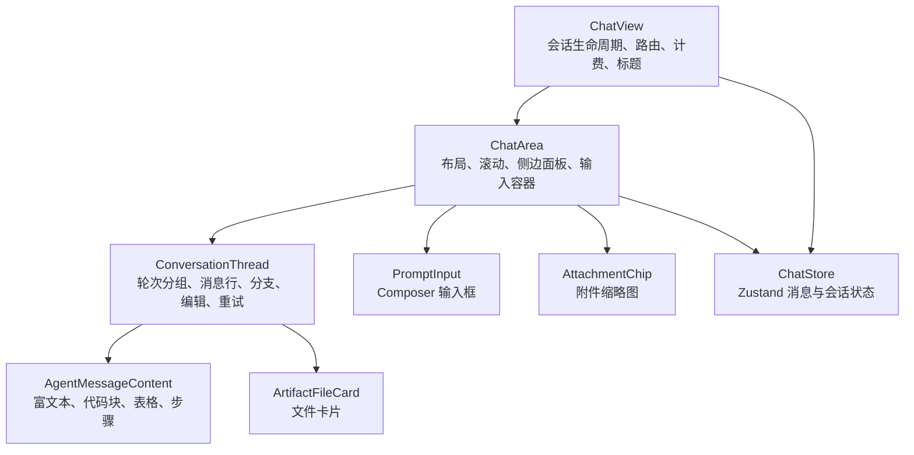
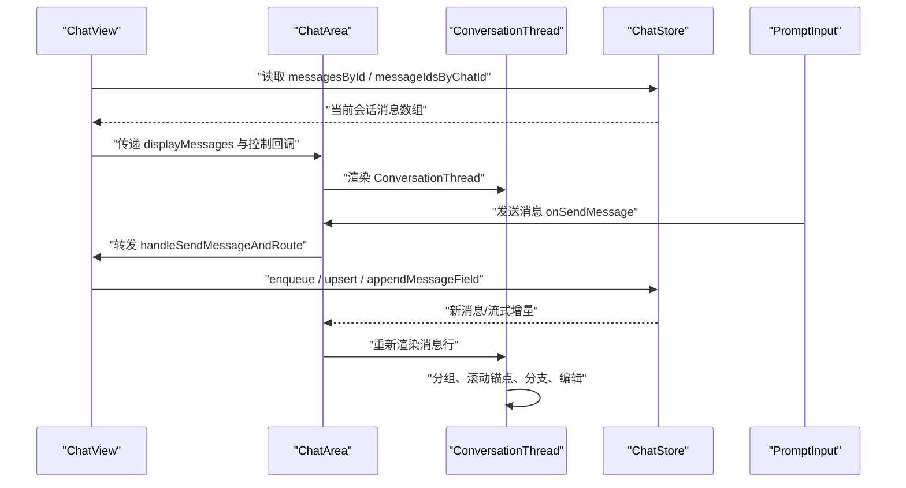
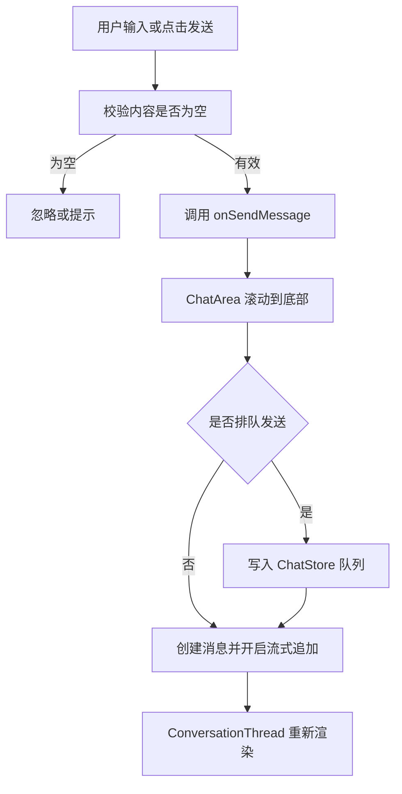
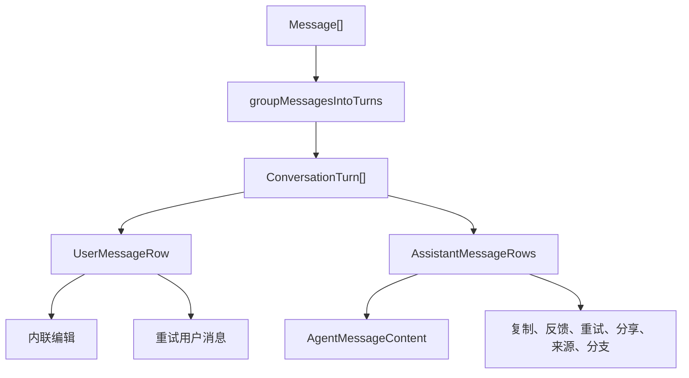
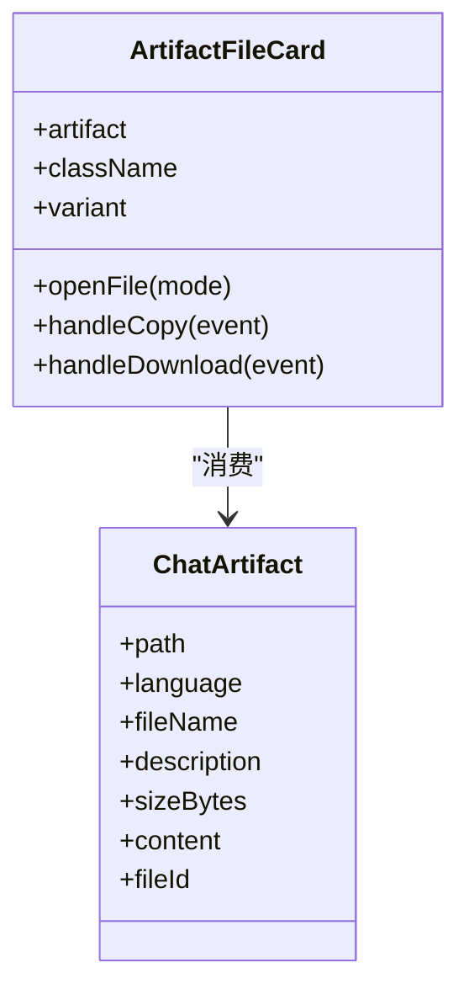
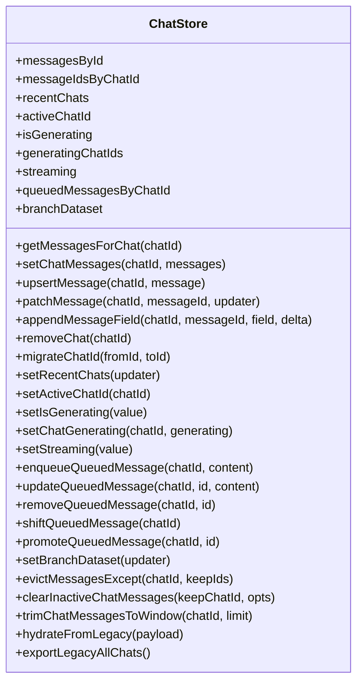

# 聊天界面组件

<cite>
**本文引用的文件**   
- [chat-view.tsx](file://src/client/components/chat-view.tsx)
- [chat-area.tsx](file://src/client/components/chat-area.tsx)
- [conversation-thread.tsx](file://src/client/components/conversation-thread.tsx)
- [artifact-file-card.tsx](file://src/client/components/agent/artifact-file-card.tsx)
- [attachment-chip.tsx](file://src/client/components/composer/attachment-chip.tsx)
- [prompt-input.tsx](file://src/client/components/prompt-input.tsx)
- [chat-store.ts](file://src/client/stores/chat-store.ts)
</cite>

## 目录
1. [引言](#引言)
2. [项目结构与职责划分](#项目结构与职责划分)
3. [核心组件总览](#核心组件总览)
4. [架构与数据流](#架构与数据流)
5. [ChatView 主组件详解](#chatview-主组件详解)
6. [Composer 输入框组件详解](#composer-输入框组件详解)
7. [MessageList 消息列表渲染机制](#messagelist-消息列表渲染机制)
8. [ArtifactCard 文件卡片展示](#artifactcard-文件卡片展示)
9. [Zustand Store 集成与状态模型](#zustand-store-集成与状态模型)
10. [响应式设计、键盘快捷键与无障碍访问](#响应式设计键盘快捷键与无障碍访问)
11. [使用示例、样式定制与主题扩展](#使用示例样式定制与主题扩展)
12. [性能优化与虚拟列表策略](#性能优化与虚拟列表策略)
13. [故障排查指南](#故障排查指南)
14. [结论](#结论)

## 引言
本文面向聊天界面前端代码，围绕 `ChatView` 主组件、`Composer` 输入框、`ConversationThread` 消息列表以及 `ArtifactFileCard` 文件卡片进行系统化文档。目标包括：说明组件接口、状态来源、事件处理流程、响应式行为、键盘与无障碍支持、Zustand store 集成、滚动加载和虚拟列表优化方式，并给出可操作的自定义主题与扩展建议。

## 项目结构与职责划分
聊天界面采用“路由视图 → 布局区域 → 对话线程 → 单条消息”的分层结构：
- `ChatView`：负责会话生命周期、路由切换、计费弹窗、页面标题、Incognito 模式，并将高层控制交给 `ChatArea`。
- `ChatArea`：负责布局、滚动跟随、侧边资源面板、文件查看器、消息发送入口组合。
- `ConversationThread`：负责将扁平消息数组分组为轮次，渲染用户消息、助手回复、分支切换、编辑、重试、分享、来源面板等交互。
- `ArtifactFileCard`：负责渲染由 agent 生成的可下载或预览的文件卡片。
- `AttachmentChip`：负责附件缩略图、类型标签、上传状态、打开预览、移除操作。
- `PromptInput`：复杂输入框，包含模型选择、思考深度、项目、附件、语音、队列、快捷提示等。
- `ChatStore`：基于 Zustand 的聊天状态持久化与同步中心。

**图表来源**
- [chat-view.tsx:1-611](file://src/client/components/chat-view.tsx#L1-L611)
- [chat-area.tsx:1-702](file://src/client/components/chat-area.tsx#L1-L702)
- [conversation-thread.tsx:1-1131](file://src/client/components/conversation-thread.tsx#L1-L1131)
- [artifact-file-card.tsx:1-236](file://src/client/components/agent/artifact-file-card.tsx#L1-L236)
- [attachment-chip.tsx:1-173](file://src/client/components/composer/attachment-chip.tsx#L1-L173)
- [prompt-input.tsx:1-200](file://src/client/components/prompt-input.tsx#L1-L200)
- [chat-store.ts:1-755](file://src/client/stores/chat-store.ts#L1-L755)

**章节来源**
- [chat-view.tsx:1-611](file://src/client/components/chat-view.tsx#L1-L611)
- [chat-area.tsx:1-702](file://src/client/components/chat-area.tsx#L1-L702)
- [conversation-thread.tsx:1-1131](file://src/client/components/conversation-thread.tsx#L1-L1131)

## 核心组件总览
| 组件 | 主要职责 | 关键 props 能力 | 主要副作用 |
|---|---|---|---|
| `ChatView` | 会话控制器、路由、计费、Incognito、标题 | `apiEnabled`、`incognito`、`initialPrompt` | 订阅计费事件、URL 参数、导航、文档标题 |
| `ChatArea` | 聊天布局、滚动、侧边源面板、文件查看器、输入容器 | 大量发送/编辑/重试/分支 props、模型、努力度、扩展思维、Incognito | 滚动跟随、窗口事件、面板开关、草稿状态 |
| `ConversationThread` | 消息分组、行渲染、编辑、分支切换、复制、分享、来源 | 消息数组、回调、滚动区 ref、是否快速滚动、生成态 | 文本选择浮窗、本地编辑状态、锚点、动画 |
| `ArtifactFileCard` | 文件预览/代码/下载/复制 | `artifact`、`className`、`variant` | 调用 artifact viewer、剪贴板、下载 |
| `AttachmentChip` | 附件缩略、类型、上传状态、预览、移除 | `file`、`size`、`onRemove`、`onOpen` | 图片/视频预览失败回退、hover 移除按钮 |
| `PromptInput` | 完整 Composer 输入框 | 发送、停止、模型、努力度、项目、附件、占位符等 | 附件上传、语音转录、菜单弹出、焦点管理 |
| `ChatStore` | 全局消息、队列、活跃会话、流式增量 | actions：增删改查、排序、迁移、缓存窗口 | 不可变更新、按 turn 排序、streaming 合并 |

**章节来源**
- [chat-view.tsx:1-611](file://src/client/components/chat-view.tsx#L1-L611)
- [chat-area.tsx:1-702](file://src/client/components/chat-area.tsx#L1-L702)
- [conversation-thread.tsx:1-1131](file://src/client/components/conversation-thread.tsx#L1-L1131)
- [artifact-file-card.tsx:1-236](file://src/client/components/agent/artifact-file-card.tsx#L1-L236)
- [attachment-chip.tsx:1-173](file://src/client/components/composer/attachment-chip.tsx#L1-L173)
- [prompt-input.tsx:1-200](file://src/client/components/prompt-input.tsx#L1-L200)
- [chat-store.ts:1-755](file://src/client/stores/chat-store.ts#L1-L755)

## 架构与数据流
聊天界面的数据流是“组件状态 + Zustand store + 外部 API/事件”的组合：
- `ChatView` 通过 `useChat` 或 `ChatSessionProvider` 获取会话控制器；若无 session，则使用独立模式。
- 消息从 `ChatStore` 的 `messagesById` 和 `messageIdsByChatId` 组装为当前显示消息数组。
- `ChatArea` 负责把消息传给 `ConversationThread`，同时维护滚动、侧边面板、文件查看器和输入框。
- `ConversationThread` 根据 `groupMessagesIntoTurns` 将消息分成用户与助手轮次，再逐条渲染。
- 流式增量通过 `appendMessageField` 直接拼接字符串并标记 `isStreaming`。
- 外部事件如计费更新、聊天发送事件会触发 UI 刷新或滚动。

**图表来源**
- [chat-view.tsx:201-611](file://src/client/components/chat-view.tsx#L201-L611)
- [chat-area.tsx:200-702](file://src/client/components/chat-area.tsx#L200-L702)
- [conversation-thread.tsx:860-1131](file://src/client/components/conversation-thread.tsx#L860-L1131)
- [chat-store.ts:200-480](file://src/client/stores/chat-store.ts#L200-L480)

**章节来源**
- [chat-view.tsx:201-611](file://src/client/components/chat-view.tsx#L201-L611)
- [chat-area.tsx:200-702](file://src/client/components/chat-area.tsx#L200-L702)
- [conversation-thread.tsx:860-1131](file://src/client/components/conversation-thread.tsx#L860-L1131)
- [chat-store.ts:200-480](file://src/client/stores/chat-store.ts#L200-L480)

## ChatView 主组件详解
`ChatView` 是聊天界面的入口。它根据是否存在 `ChatSessionProvider` 决定复用 shell 提供的会话还是自建会话；它还处理以下职责：
- 解析路由中的会话 id，并与 `activeChatId` 对齐。
- 在匿名路径或 `incognito` 模式下隐藏历史、文件和侧栏。
- 监听计费订阅变化，决定是否显示升级提示。
- 处理支付成功 URL 参数和 sessionStorage，显示支付成功弹窗。
- 计算空白欢迎页、路由切换空窗、hydrating 状态，避免闪烁。
- 将消息、滚动、分支、模型、努力度、扩展思维、Incognito 控制交给 `ChatArea`。

### Props 与内部状态
- 公开 props：`apiEnabled`、`incognito`、`initialPrompt`。
- 内部状态包括：本地模型、推理努力度、扩展思维、支付成功状态、免费计划升级标志、项目面包屑。
- 当存在 `session` 时，直接传入 `ChatViewBody`；否则使用 `ChatViewStandalone` 包装 `useChat`。

### 路由与导航
- 通过正则匹配 `/conversations/:id` 或 `/c/:id` 获取目标 chat id。
- 首次发送时若需要新建会话，会在创建成功后立即替换为 `/c/:id` 路由。
- Incognito 模式进入时清空非匿名会话，退出时回到 `/new`。

### 页面标题与品牌标签
- 根据项目名和会话名动态设置浏览器标题。
- 当正在生成且标题仍为默认值时，启用 brand-only tab 模式，减少干扰。

**章节来源**
- [chat-view.tsx:1-200](file://src/client/components/chat-view.tsx#L1-L200)
- [chat-view.tsx:201-450](file://src/client/components/chat-view.tsx#L201-L450)
- [chat-view.tsx:451-611](file://src/client/components/chat-view.tsx#L451-L611)

## Composer 输入框组件详解
Composer 主要由 `PromptInput` 承担，并由 `ChatArea` 以 `IsolatedChatInput` 形式嵌入。它不是简单 textarea，而是一个具备以下能力的输入系统：

### 功能特性
- 发送消息、停止生成。
- 模型选择、推理努力度、扩展思维。
- 项目选择与创建。
- 文件附件拖放、预览、上传状态。
- 语音听写流式转写。
- 待发送队列面板。
- 快捷菜单、内联模式芯片。
- 滚动到底部按钮。
- Incognito 模式的简化输入壳。

### Props 接口要点
- 发送与停止：`onSendMessage`、`onStopGeneration`。
- 滚动与交互：`onScrollToBottom`、`showScrollToBottomButton`、`isConversationStarted`、`isGenerating`。
- 队列：`queuedMessages`、`onEditQueuedMessage`、`onSendQueuedMessageNow`、`onRemoveQueuedMessage`。
- 草稿与聚焦：`onPromptChange`、`focusKey`。
- 计费与计划：`onUpgradeClick`、`isFreePlan`。
- 模型与推理：`homerReasoningEffort`、`onHomerReasoningEffortChange`、`extendedThinking`、`onExtendedThinkingChange`、`chatModel`、`onChatModelChange`。
- 项目与附件：`projectId`、`allowAttachments`。
- 外观：`placeholder`、`composerVariant`。

### 事件处理流程

**图表来源**
- [prompt-input.tsx:1-200](file://src/client/components/prompt-input.tsx#L1-L200)
- [chat-area.tsx:200-480](file://src/client/components/chat-area.tsx#L200-L480)
- [chat-store.ts:200-480](file://src/client/stores/chat-store.ts#L200-L480)

**章节来源**
- [prompt-input.tsx:1-200](file://src/client/components/prompt-input.tsx#L1-L200)
- [chat-area.tsx:200-480](file://src/client/components/chat-area.tsx#L200-L480)

## MessageList 消息列表渲染机制
聊天列表的核心是 `ConversationThread`。它接收扁平消息数组，将其分组为“一轮对话”，然后渲染用户消息和多个助手消息。

### 分组与渲染
- 使用 `groupMessagesIntoTurns` 将消息分组，保证用户 prompt 与其助手回复在同一轮。
- 每个轮次用 `ConversationTurn` 渲染，用户消息走 `MessageRow`，助手消息也走 `MessageRow`。
- 每条消息使用 `React.memo` 比较字段，避免无关字段变化导致整行重渲染。

### 用户消息行为
- 长文本折叠：超过固定行数后显示“Show more”。
- 附件展示：使用 `AttachmentChip` 和 `ComposerAttachmentStrip`。
- 编辑：内联编辑器保存时会触发分支 fork，先关闭编辑器再异步保存，避免阻塞 UI。
- 重试与复制：提供重试相同输入、复制到剪贴板。

### 助手消息行为
- 错误消息单独渲染为危险颜色。
- 正常消息交由 `AgentMessageContent` 渲染富文本、代码、表格、trace。
- 完成后显示复制、点赞、踩、重试、分享、来源、分支切换、时间戳。
- 选择助手回答文本后，桌面端会出现浮动工具栏，支持继续提问或直接开始写作。

### 滚动与可见性
- 列表根节点带有 `data-virtual-scroll`，用于标识虚拟滚动容器。
- 顶部和底部各有一个像素锚点，便于定位首尾。
- 使用 `useMessageDetailLevel` 控制展开细节级别，流式消息保持 full detail。
- 结构化 markdown（代码块、表格）强制 full detail，防止高度抖动。

**图表来源**
- [conversation-thread.tsx:1-200](file://src/client/components/conversation-thread.tsx#L1-L200)
- [conversation-thread.tsx:200-520](file://src/client/components/conversation-thread.tsx#L200-L520)
- [conversation-thread.tsx:520-860](file://src/client/components/conversation-thread.tsx#L520-L860)
- [conversation-thread.tsx:860-1131](file://src/client/components/conversation-thread.tsx#L860-L1131)

**章节来源**
- [conversation-thread.tsx:1-200](file://src/client/components/conversation-thread.tsx#L1-L200)
- [conversation-thread.tsx:200-520](file://src/client/components/conversation-thread.tsx#L200-L520)
- [conversation-thread.tsx:520-860](file://src/client/components/conversation-thread.tsx#L520-L860)
- [conversation-thread.tsx:860-1131](file://src/client/components/conversation-thread.tsx#L860-L1131)

## ArtifactCard 文件卡片展示
`ArtifactFileCard` 渲染由 agent 产生的文件产物，例如 HTML、Markdown、代码或其他文本文件。

### 功能
- 自动判断文件类型：HTML、代码、其他。
- 显示文件名、描述、语言/类型标签、文件大小。
- 支持预览：如果文件支持预览，优先打开预览模式；否则打开代码模式。
- 支持复制内容到剪贴板。
- 支持下载文件。
- 支持 panel 与 message 两种尺寸 variant。

### 交互
- 点击卡片主体打开文件。
- “预览/代码”按钮强制指定打开模式。
- 复制按钮显示短暂成功状态。
- 下载按钮直接触发下载。

**图表来源**
- [artifact-file-card.tsx:1-236](file://src/client/components/agent/artifact-file-card.tsx#L1-L236)

**章节来源**
- [artifact-file-card.tsx:1-236](file://src/client/components/agent/artifact-file-card.tsx#L1-L236)

## Zustand Store 集成与状态模型
`ChatStore` 是整个聊天界面的状态中枢。它使用 `create` 和 `subscribeWithSelector`，并通过 `useShallow` 订阅最小字段。

### 状态结构
- `messagesById`：消息 id 到消息对象的映射。
- `messageIdsByChatId`：会话 id 到消息 id 数组的映射。
- `recentChats`：最近会话列表。
- `activeChatId`：当前活跃会话。
- `isGenerating`：全局生成态。
- `generatingChatIds`：按会话的生成态。
- `streaming`：当前流式消息位置。
- `queuedMessagesByChatId`：会话级待发送队列。
- `branchDataset`：分支数据集，记录版本索引、总数、更新时间。

### 关键动作
- `getMessagesForChat`：按 id 顺序取消息。
- `setChatMessages`：批量覆盖并排序。
- `upsertMessage`：新增或合并消息。
- `patchMessage`：局部更新消息字段。
- `appendMessageField`：流式追加 content 或 thinkingContent。
- `removeChat`：删除会话及其消息和分支。
- `migrateChatId`：迁移旧 id 到新 id。
- `setRecentChats`、`setActiveChatId`、`setIsGenerating`、`setChatGenerating`、`setStreaming`。
- 队列操作：`enqueueQueuedMessage`、`updateQueuedMessage`、`removeQueuedMessage`、`shiftQueuedMessage`、`promoteQueuedMessage`。
- 内存窗口：`evictMessagesExcept`、`clearInactiveChatMessages`、`trimChatMessagesToWindow`。
- 兼容层：`hydrateFromLegacy`、`exportLegacyAllChats`。

### 排序与合并策略
- 使用 `turnSortKey` 和 `sortIdsByTurn` 保证同一 turn 的用户消息在前、助手在后，并保持稳定时序。
- `mergeMessage` 处理 live/non-live 消息长度差异，保留更长内容、更丰富 trace。
- `resolveExistingId` 通过 `clientId` 与 `id` 的多种对应关系找到已存在消息。

**图表来源**
- [chat-store.ts:1-200](file://src/client/stores/chat-store.ts#L1-L200)
- [chat-store.ts:200-480](file://src/client/stores/chat-store.ts#L200-L480)

**章节来源**
- [chat-store.ts:1-200](file://src/client/stores/chat-store.ts#L1-L200)
- [chat-store.ts:200-480](file://src/client/stores/chat-store.ts#L200-L480)

## 响应式设计、键盘快捷键与无障碍访问
### 响应式设计
- `ChatArea` 使用 `useIsMobile` 控制移动端布局，并在 Incognito 模式下改变圆角与头部。
- `ConversationThread` 在移动端禁用桌面端文本选择浮窗。
- 附件缩略图尺寸随 size prop 变化，适配消息气泡、Composer、内联编辑三种场景。
- 文件查看器和来源面板有最小宽度、最大宽度和默认宽度，避免挤压聊天列。

### 键盘快捷键
- `PromptInput` 引用了键盘导航和快捷键事件模块，支持快捷键提示、保留导航键、与全局快捷键系统集成。
- 具体快捷键实现不在本文件范围内，但输入框明确区分普通按键与导航按键，避免误拦截。

### 无障碍访问
- 分支切换按钮提供 `role="group"`、`aria-label`。
- 附件移除按钮提供 `role="button"`、`tabIndex`、`aria-label`，并支持 Enter 和 Space。
- 用户消息复制、重试、编辑按钮均提供 `aria-label`。
- 助手消息错误使用 `role="alert"`。
- 时间戳使用 `<time>` 并提供 `dateTime` 和 `title`。
- 所有图标按钮通常配合 Tooltip 和 aria-label，避免纯图标无意义。

**章节来源**
- [chat-area.tsx:1-200](file://src/client/components/chat-area.tsx#L1-L200)
- [conversation-thread.tsx:1-200](file://src/client/components/conversation-thread.tsx#L1-L200)
- [conversation-thread.tsx:200-520](file://src/client/components/conversation-thread.tsx#L200-L520)
- [attachment-chip.tsx:1-173](file://src/client/components/composer/attachment-chip.tsx#L1-L173)
- [prompt-input.tsx:1-200](file://src/client/components/prompt-input.tsx#L1-L200)

## 使用示例、样式定制与主题扩展
### 基本使用
在 Next.js 路由中渲染 `ChatView`：
- 如果是 shell 提供会话，`ChatView` 会自动复用 `ChatSessionProvider`。
- 如果没有会话，`ChatView` 会切换到独立模式，并通过 `useChat` 初始化。
- 传入 `incognito=true` 可获得全屏临时聊天体验。
- 传入 `initialPrompt` 可在挂载后自动发送一次提示词。

### 样式定制选项
- `ChatArea` 外层容器使用 CSS 变量 `--chat-canvas-bg` 作为背景色。
- 主题广泛使用 Tailwind 与 CSS 变量，如 `--ui-fg`、`--ui-border`、`--ui-field-bg`、`--ui-hover-wash`、`--popup-bg`、`--popup-shadow`。
- `ConversationThread` 的轮次间距在移动端和桌面端不同，可通过外层 className 覆盖。
- `ArtifactFileCard` 支持 `className` 和 `variant`，可用于嵌入侧边面板或消息体内。
- `AttachmentChip` 支持 `size`，可选 `sm`、`md`、`lg`，用于压缩消息气泡、Composer 默认、内联编辑三种密度。

### 扩展指南
- 扩展消息内容：通过 `AgentMessageContent` 渲染逻辑注入新的 block 类型。
- 扩展文件卡片：在 `collectChatArtifacts` 与 `ArtifactFileCard` 中增加新的 artifact 类型。
- 扩展 Composer：通过 `PromptInput` 的 `onPromptChange`、`onAddMenuOpenChange`、`projectId`、`chatModel` 等 props 接入业务逻辑。
- 扩展主题：集中定义 CSS 变量，并让组件引用这些变量，而不是硬编码颜色。

**章节来源**
- [chat-view.tsx:451-611](file://src/client/components/chat-view.tsx#L451-L611)
- [chat-area.tsx:1-200](file://src/client/components/chat-area.tsx#L1-L200)
- [artifact-file-card.tsx:1-236](file://src/client/components/agent/artifact-file-card.tsx#L1-L236)
- [attachment-chip.tsx:1-173](file://src/client/components/composer/attachment-chip.tsx#L1-L173)
- [prompt-input.tsx:1-200](file://src/client/components/prompt-input.tsx#L1-L200)

## 性能优化与虚拟列表策略
### 虚拟列表现状
- `ConversationThread` 渲染全部轮次，没有引入第三方虚拟列表库。
- 根容器带有 `data-virtual-scroll`，表明该区域被视作虚拟滚动目标，但当前实现是完整遍历 `groups.map`。
- 这意味着在超长聊天记录下，DOM 节点数量可能较大，适合短到中等长度对话。

### 已有优化手段
- 每条消息行使用 `React.memo`，并自定义相等函数，只比较必要字段。
- `ConversationTurn` 也使用 `React.memo`，比较用户消息、助手消息数组长度和内容关键字段。
- 结构化 markdown 强制 full detail，避免 off-screen 渲染时因降级导致高度变化。
- `useMessageDetailLevel` 控制非流式消息的细节层级，减少不必要的展开。
- 流式增量使用 `appendMessageField` 原地拼接字符串，避免重建整条消息对象。
- `ChatStore` 使用 `ACTIVE_RAM_MESSAGE_WINDOW` 和 `MAX_ACTIVE_CHAT_MESSAGES` 限制活跃消息窗口。
- `trimChatMessagesToWindow`、`evictMessagesExcept`、`clearInactiveChatMessages` 支持清理非活跃会话消息。

### 滚动优化
- `useChatScroll` 提供 `scrollToBottom`、`pinToBottom`、`showScrollToBottom`。
- `useChatScrollActivity` 检测快速滑动，避免在用户拖动时误判为自动跟随。
- 新发送用户消息后立即 `pinToBottom`，并使用 `requestAnimationFrame` 确保 DOM 更新后再滚动。
- 流式增长时依赖 ResizeObserver 自动跟随，而不是每次增量都主动滚动。

### 推荐优化方向
- 如果预期对话非常长，考虑引入真正的虚拟列表，仅渲染可视区域内的 `ConversationTurn`。
- 对 `groups` 计算结果做更大粒度 memo，避免频繁重建。
- 对大图附件和代码块懒加载，降低首屏压力。
- 对 `collectChatSources`、`collectChatArtifacts` 的结果加稳定 key，避免不必要重算。
- 对 `branchDataset` 和 `queuedMessagesByChatId` 的更新尽量保持最小 diff。

**章节来源**
- [conversation-thread.tsx:860-1131](file://src/client/components/conversation-thread.tsx#L860-L1131)
- [chat-area.tsx:200-480](file://src/client/components/chat-area.tsx#L200-L480)
- [chat-store.ts:1-200](file://src/client/stores/chat-store.ts#L1-L200)
- [chat-store.ts:200-480](file://src/client/stores/chat-store.ts#L200-L480)

## 故障排查指南
### 消息未加载或闪烁
- 检查 `displayMessagesLoading`、`blankPaneChatId`、`switchingRouteChat` 三个状态。
- 如果处于 hydrating 路由，`ChatArea` 会显示骨架或空白面板，而不是欢迎页。
- 若出现 `messagesLoadError`，应显示重试按钮。

### 滚动错乱
- 确认 `hasScrollableConversation` 是否正确。
- 检查是否在生成期间禁用了 `isFastScrolling`，避免程序化滚动被误判为用户快速滚动。
- 检查是否多次调用 `pinToBottom`，尤其是新消息和 lastMessageKey 变化时。

### 流式文本不更新
- 确认 store 是否调用 `appendMessageField`。
- 检查消息是否被正确识别为 streaming。
- 检查 `AgentMessageContent` 是否消费 `thinkingContent` 和 `isThinkingStreaming`。

### 附件预览失败
- `AttachmentChip` 会在图片预览失败后尝试回退到 durable file url。
- 若仍失败，显示文件图标占位。
- 检查 `filePreviewSrc` 和 `durableFileContentUrl` 返回值。

### 支付成功弹窗不消失
- 检查 URL 参数 `checkout=success` 和 sessionStorage `clauxen:checkout-success`。
- 检查 `showPaymentSuccess` 状态和 `onGetStarted` 回调。
- 检查计费事件 `clauxen:billing-updated` 是否正确分发。

**章节来源**
- [chat-view.tsx:201-450](file://src/client/components/chat-view.tsx#L201-L450)
- [chat-area.tsx:200-480](file://src/client/components/chat-area.tsx#L200-L480)
- [attachment-chip.tsx:1-173](file://src/client/components/composer/attachment-chip.tsx#L1-L173)
- [conversation-thread.tsx:520-860](file://src/client/components/conversation-thread.tsx#L520-L860)

## 结论
聊天界面由 `ChatView`、`ChatArea`、`ConversationThread`、`ArtifactFileCard`、`AttachmentChip`、`PromptInput` 和 `ChatStore` 共同组成。整体设计强调：
- 清晰的状态分层：组件局部状态、Zustand 全局状态、外部 API/事件。
- 清晰的职责边界：路由与会话控制、布局与滚动、消息分组与渲染、文件与附件展示、输入与附件处理。
- 良好的可访问性与主题化基础：aria 属性、CSS 变量、Tailwind 语义类。
- 明确的性能边界：React.memo、流式增量、滚动优化、消息窗口裁剪。

在实际使用中，建议优先通过 props 扩展 Composer 和消息行为，通过 CSS 变量统一主题，通过 store actions 管理消息和分支，避免在组件内部直接修改全局状态。对于超长对话，应评估是否需要引入真实虚拟列表，并继续优化大附件、结构化 markdown 和流式渲染的性能瓶颈。