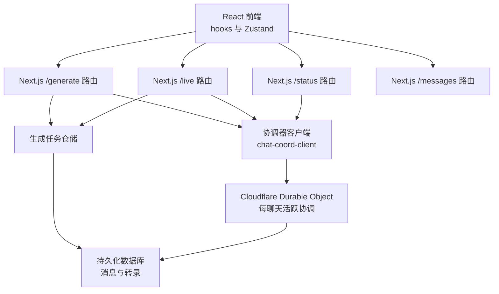
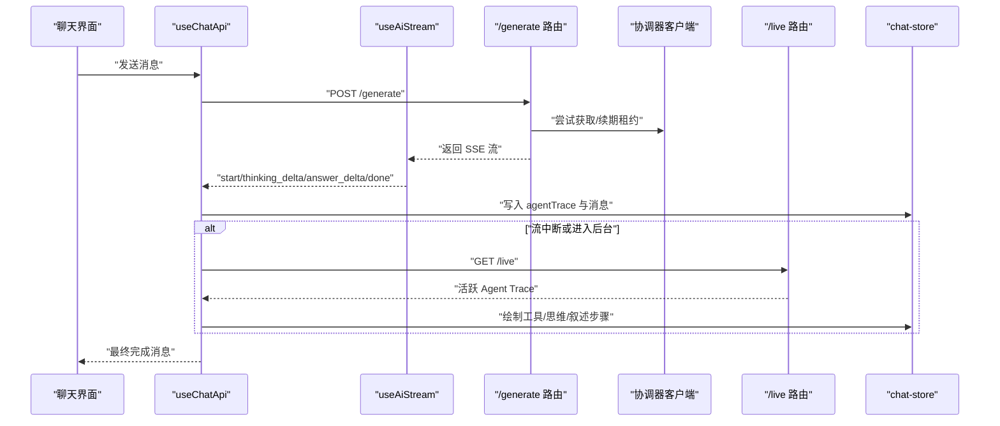
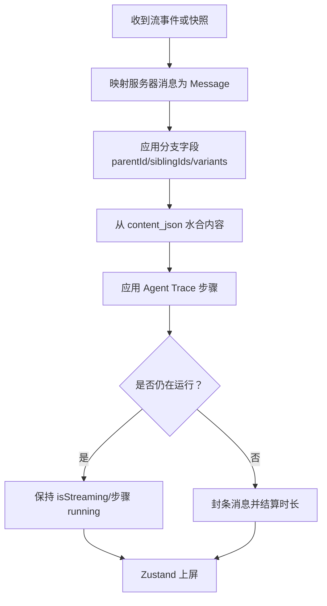
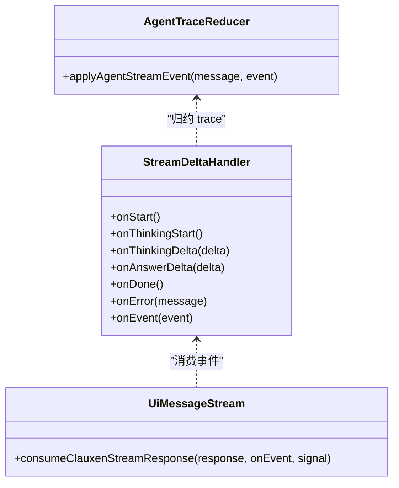
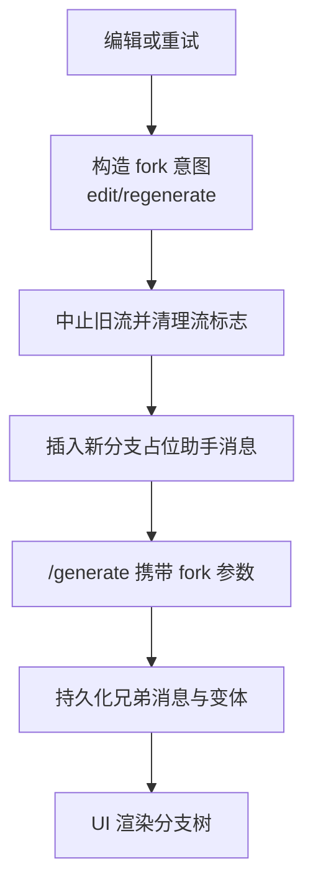
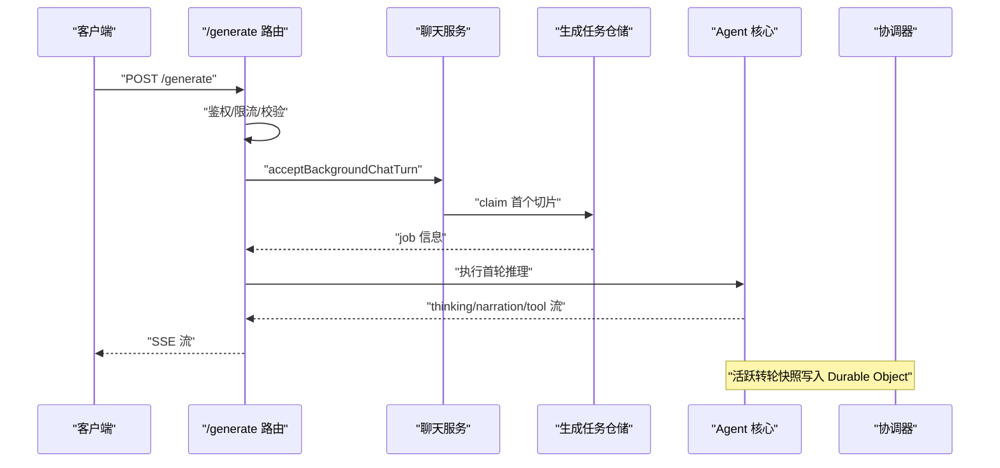
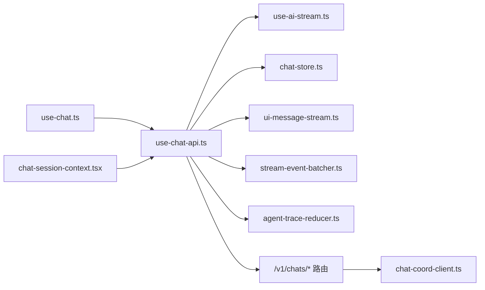
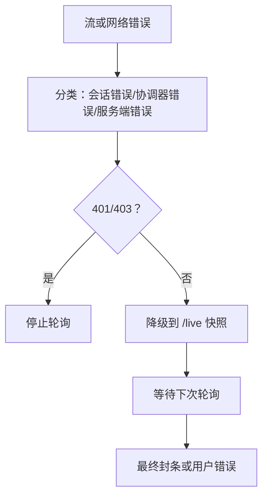

# 聊天系统

<cite>
**本文引用的文件**
- [use-chat.ts](file://src/client/hooks/use-chat.ts)
- [use-chat-api.ts](file://src/client/hooks/use-chat-api.ts)
- [chat-session-context.tsx](file://src/client/contexts/chat-session-context.tsx)
- [use-ai-stream.ts](file://src/client/hooks/use-ai-stream.ts)
- [chat-store.ts](file://src/client/stores/chat-store.ts)
- [route.ts](file://src/app/api/v1/chats/[chatId]/generate/route.ts)
- [route.ts](file://src/app/api/v1/chats/[chatId]/live/route.ts)
- [route.ts](file://src/app/api/v1/chats/[chatId]/generate/status/route.ts)
- [route.ts](file://src/app/api/v1/chats/[chatId]/messages/route.ts)
- [chat-coord-client.ts](file://src/server/chat/chat-coord-client.ts)
- [ui-message-stream.ts](file://src/shared/lib/ui-message-stream.ts)
- [stream-event-batcher.ts](file://src/shared/lib/stream-event-batcher.ts)
- [agent-trace-reducer.ts](file://src/shared/lib/agent-trace-reducer.ts)
- [chat-latency-audit.md](file://docs/chat-latency-audit.md)
- [cloudflare-chat-storage-architecture.md](file://docs/cloudflare-chat-storage-architecture.md)
</cite>

## 目录
1. [简介](#简介)
2. [项目结构](#项目结构)
3. [核心组件](#核心组件)
4. [架构总览](#架构总览)
5. [详细组件分析](#详细组件分析)
6. [依赖关系分析](#依赖关系分析)
7. [性能与延迟特性](#性能与延迟特性)
8. [API 接口规范](#api-接口规范)
9. [客户端集成指南](#客户端集成指南)
10. [错误处理与重试机制](#错误处理与重试机制)
11. [调试技巧](#调试技巧)
12. [常见问题与排障](#常见问题与排障)
13. [结论](#结论)

## 简介
本文件面向实现和排查聊天系统的工程师，系统性说明实时聊天界面的职责边界、消息流、SSE 协议、Agent Trace 可视化、聊天状态管理、分支历史、流式响应、thinking/narration/tool 三阶段展示、错误处理和重试机制。文档同时覆盖服务端生成入口、后台轮询、协调器租约、Cloudflare Durable Object 存储设计，以及客户端如何从流到 UI 的完整链路。

## 项目结构
聊天系统横跨前端 React hooks、Zustand 聊天状态、共享流解析库、Next.js API Route 以及 Cloudflare Worker 协调层：

- 前端控制层
  - `useChat`：统一入口 hook，委托给 `useChatApi`。
  - `ChatSessionProvider`：为整个主 Shell 提供聊天会话上下文，暴露模型、推理强度、扩展思考等选项。
  - `useAiStream`：封装 Vercel AI SDK UI 消息流或 Clauxen SSE 事件消费。
  - `chat-store`：Zustand 本地内存状态，维护消息、最近对话、生成标志、队列和分支数据集。

- 后端生成与状态
  - `/v1/chats/[chatId]/generate`：接收用户消息、校验、限流、提交生成任务、优先走前台 SSE；否则进入后台切片链。
  - `/v1/chats/[chatId]/live`：读取当前运行中的 Agent Trace，优先来自协调器 Durable Object，回退到持久化检查点。
  - `/v1/chats/[chatId]/generate/status`：查询是否仍在生成、是否被停止、是否处于后台链。
  - `/v1/chats/[chatId]/messages`：分页加载对话线程，并支持插入新消息。

- 协调与持久化
  - `chat-coord-client`：通过内部服务调用获取/续期/释放生成租约、发布和读取活跃转轮快照。
  - `ui-message-stream`、`stream-event-batcher`、`agent-trace-reducer`：定义流事件类型、批量合并和 Agent Trace 归约逻辑。
  - 架构文档说明 Cloudflare-only 存储目标：Worker 鉴权、D1 元数据、R2 不可变转录、Durable Object 每 chat 活跃协调。

**图表来源**
- [route.ts:1-200](file://src/app/api/v1/chats/[chatId]/generate/route.ts#L1-L200)
- [route.ts:1-125](file://src/app/api/v1/chats/[chatId]/live/route.ts#L1-L125)
- [route.ts:1-49](file://src/app/api/v1/chats/[chatId]/generate/status/route.ts#L1-L49)
- [route.ts:1-77](file://src/app/api/v1/chats/[chatId]/messages/route.ts#L1-L77)
- [chat-coord-client.ts:1-175](file://src/server/chat/chat-coord-client.ts#L1-L175)

**章节来源**
- [use-chat.ts:1-19](file://src/client/hooks/use-chat.ts#L1-L19)
- [chat-session-context.tsx:1-114](file://src/client/contexts/chat-session-context.tsx#L1-L114)
- [chat-latency-audit.md:1-44](file://docs/chat-latency-audit.md#L1-L44)
- [cloudflare-chat-storage-architecture.md:1-109](file://docs/cloudflare-chat-storage-architecture.md#L1-L109)

## 核心组件
- `useChat`：将聊天能力收敛为一个 hook，默认启用 API，并可传入模型与推理强度。它本身不持有状态，而是委托给 `useChatApi`。
- `ChatSessionProvider`：在应用主壳层创建唯一会话，包裹 `useChatApi`，并向子组件提供聊天模型、推理强度、扩展思考开关以及所有聊天方法引用。
- `useChatApi`：聊天系统的核心控制器，负责发送消息、订阅流、渲染 Agent Trace、处理分支、更新本地 store、同步设备缓存和 Supabase。
- `useAiStream`：把底层响应转换为统一的 `StreamEvent`，分派 start/thinking_delta/answer_delta/done/error 等事件。
- `chat-store`：Zustand 聊天状态机，维护消息映射、按聊天 ID 的消息列表、活跃生成标记、流目标、队列消息、分支数据集，并提供排序、去重、窗口裁剪等操作。

关键行为包括：
- 乐观插入用户消息和助手占位消息。
- 使用 `applyAgentStreamEvent` 将流事件写入 `agentTrace.steps`。
- 对 thinking、narration、tool 三类步骤分别设置 streaming、running、completedAtMs 等状态。
- 分支聊天时中止旧流、清理流标志、追加新分支占位消息。
- 后台轮询 `/status` 与 `/live`，在隐藏标签页中暂停轮询，恢复后继续。
- 将完成态助手消息“封条”并清空流标志。

**章节来源**
- [use-chat.ts:1-19](file://src/client/hooks/use-chat.ts#L1-L19)
- [chat-session-context.tsx:1-114](file://src/client/contexts/chat-session-context.tsx#L1-L114)
- [use-chat-api.ts:200-600](file://src/client/hooks/use-chat-api.ts#L200-L600)
- [use-ai-stream.ts:1-73](file://src/client/hooks/use-ai-stream.ts#L1-L73)
- [chat-store.ts:1-200](file://src/client/stores/chat-store.ts#L1-L200)

## 架构总览
聊天系统采用“前台直连流 + 后台快照轮询”的双通道设计：

1. 客户端调用 `/generate`。
2. 服务端先做认证、限流、输入清洗、视觉附件解析和 fork 意图校验。
3. 服务端尝试立即 claim 第一个生成切片，并直接向前端转发 SSE。
4. 如果无法立即运行，则进入后台作业队列；客户端通过 `/status` 和 `/live` 轮询。
5. `/live` 优先返回 Durable Object 中的活跃转轮快照，否则回退到持久化检查点。
6. 前端根据 `StreamEvent` 和 Agent Trace 渲染 thinking/narration/tool 三个阶段。
7. 生成完成后，客户端封条消息、清除流标志，并结束后台轮询。

**图表来源**
- [route.ts:1-200](file://src/app/api/v1/chats/[chatId]/generate/route.ts#L1-L200)
- [route.ts:1-125](file://src/app/api/v1/chats/[chatId]/live/route.ts#L1-L125)
- [use-ai-stream.ts:1-73](file://src/client/hooks/use-ai-stream.ts#L1-L73)
- [use-chat-api.ts:200-600](file://src/client/hooks/use-chat-api.ts#L200-L600)
- [chat-coord-client.ts:1-175](file://src/server/chat/chat-coord-client.ts#L1-L175)

## 详细组件分析

### 聊天状态管理与消息渲染
`useChatApi` 是聊天行为的中心：

- 消息来源
  - 本地 optimistic 消息（`temp-`、`pending-`）。
  - 从 `/messages` 拉取的持久化消息。
  - 从 `/live` 拉取的 Agent Trace 活跃快照。
  - 设备 IndexedDB 缓存的最近聊天列表。

- 消息映射与分支
  - 将服务器行映射为 `Message`，保留 `clientId`、`turnId`、`parentId`、`variantIndex`、`siblingIds` 等字段。
  - 使用 `buildChatConversation` 构建分支树，供 UI 渲染箭头和变体。
  - 编辑用户消息、重新生成助手回复、切换分支都会中止旧流并追加新分支占位消息。

- 流状态收尾
  - `clearIdleStreamingFlags` 将未完成的 tool、thinking、narration 步骤结算为静态时长，避免断线后丢失“耗时 N 秒”。
  - `sealCompletedAssistantMessages` 标记助手消息完成，清除 `isStreaming`、`isThinkingStreaming`。

- 背景轮询
  - `pollBackgroundTurn` 每 2.5 秒轮询 `/status` 和 `/live`，隐藏标签页跳过轮询，恢复后继续。
  - 最后一次权威绘制后封条消息、清空生成标记。

**图表来源**
- [use-chat-api.ts:200-600](file://src/client/hooks/use-chat-api.ts#L200-L600)
- [chat-store.ts:1-200](file://src/client/stores/chat-store.ts#L1-L200)

**章节来源**
- [use-chat-api.ts:200-600](file://src/client/hooks/use-chat-api.ts#L200-L600)
- [chat-store.ts:1-200](file://src/client/stores/chat-store.ts#L1-L200)

### SSE 协议与 Agent Trace 可视化
流协议由 `useAiStream` 统一消费，并通过 `consumeClauxenStreamResponse` 转换为标准事件：

- 事件类型
  - `start`：开始一轮生成。
  - `thinking_start`：开始思考阶段。
  - `thinking_delta`：思考文本增量。
  - `answer_delta`：回答文本增量。
  - `done`：流结束。
  - `error`：流错误。
  - 通用 `event`：用于 agent/交错片段，例如 tool、narration。

- Agent Trace
  - `agent-trace-reducer` 将流事件归约为 `agentTrace.steps`，包含 thinking、narration、tool 三类 step。
  - tool step 可具有 `running`、`done`、`error` 等状态；thinking/narration 有 `isStreaming` 与持续时间。
  - UI 通过 `agentMode`、`agentFrameComplete`、`agentTrace` 渲染折叠面板、工具卡片和最终答案。

**图表来源**
- [use-ai-stream.ts:1-73](file://src/client/hooks/use-ai-stream.ts#L1-L73)
- [ui-message-stream.ts:1-200](file://src/shared/lib/ui-message-stream.ts#L1-L200)
- [agent-trace-reducer.ts:1-200](file://src/shared/lib/agent-trace-reducer.ts#L1-L200)

**章节来源**
- [use-ai-stream.ts:1-73](file://src/client/hooks/use-ai-stream.ts#L1-L73)
- [stream-event-batcher.ts:1-200](file://src/shared/lib/stream-event-batcher.ts#L1-L200)
- [agent-trace-reducer.ts:1-200](file://src/shared/lib/agent-trace-reducer.ts#L1-L200)

### 分支聊天历史
分支功能围绕以下关键字段展开：

- `parent_message_id`：父消息 ID，决定分支根节点。
- `variant_index` / `variant_count`：同一位置的不同版本。
- `sibling_ids` / `sibling_variants`：兄弟消息与变体内容摘要。
- `branchDataset`：Zustand 中每个分支的活跃索引、总版本数和更新时间。

操作语义：

- `editMessageWithBranchHelper`：编辑用户消息并基于该消息创建新分支。
- `redoUserMessageWithBranchHelper`：重新发送用户消息并创建分支。
- `retryAssistantWithBranchHelper`：针对助手消息重试生成新分支。
- `switchMessageBranchHelper`：切换分支视角，仅改变 UI 可见分支，不破坏其他分支。
- `stripLegacyBranchFields`：兼容旧分支字段，保证迁移安全。

**图表来源**
- [use-chat-api.ts:200-600](file://src/client/hooks/use-chat-api.ts#L200-L600)
- [route.ts:1-200](file://src/app/api/v1/chats/[chatId]/generate/route.ts#L1-L200)

**章节来源**
- [use-chat-api.ts:200-600](file://src/client/hooks/use-chat-api.ts#L200-L600)
- [chat-store.ts:1-200](file://src/client/stores/chat-store.ts#L1-L200)

### 与 Agent 核心的交互流程
服务端 `/generate` 路由承担以下职责：

- 身份与会话校验。
- 全局与 IP 维度速率限制。
- 维护模式检查。
- 清洗用户消息、vision 附件、fork 意图。
- 组装 `GenerationJobInput`，包括模型、推理强度、扩展思考、时区、国家码等。
- 调用 `acceptBackgroundChatTurn` 接受后台任务。
- 若可立即执行，则直接返回 SSE；否则进入后台切片链。

Agent 核心随后输出 thinking、narration、tool 调用结果，并最终形成助手回答。

**图表来源**
- [route.ts:1-200](file://src/app/api/v1/chats/[chatId]/generate/route.ts#L1-L200)
- [chat-coord-client.ts:1-175](file://src/server/chat/chat-coord-client.ts#L1-L175)

**章节来源**
- [route.ts:1-200](file://src/app/api/v1/chats/[chatId]/generate/route.ts#L1-L200)

### 工具调用执行过程
工具调用体现在 Agent Trace 的 tool 步骤中：

- tool step 初始为 `running`。
- 成功时变为 `done` 并记录 `completedAtMs`。
- 失败时标记 `error`。
- 客户端在后台轮询时会刷新最后一个 step 的状态，使长时间运行的工具显示为运行中。
- UI 根据 tool 步骤渲染工具名称、参数、输出和状态。

工具调用并非由浏览器直接执行，而是由 Agent 核心在服务端调度，并将结构化结果写回 `contentJson`，再由客户端水合成消息内容。

**章节来源**
- [use-chat-api.ts:200-600](file://src/client/hooks/use-chat-api.ts#L200-L600)
- [agent-trace-reducer.ts:1-200](file://src/shared/lib/agent-trace-reducer.ts#L1-L200)

## 依赖关系分析

**图表来源**
- [use-chat.ts:1-19](file://src/client/hooks/use-chat.ts#L1-L19)
- [chat-session-context.tsx:1-114](file://src/client/contexts/chat-session-context.tsx#L1-L114)
- [use-chat-api.ts:200-600](file://src/client/hooks/use-chat-api.ts#L200-L600)
- [use-ai-stream.ts:1-73](file://src/client/hooks/use-ai-stream.ts#L1-L73)
- [chat-store.ts:1-200](file://src/client/stores/chat-store.ts#L1-L200)
- [route.ts:1-200](file://src/app/api/v1/chats/[chatId]/generate/route.ts#L1-L200)
- [chat-coord-client.ts:1-175](file://src/server/chat/chat-coord-client.ts#L1-L175)

**章节来源**
- [use-chat-api.ts:200-600](file://src/client/hooks/use-chat-api.ts#L200-L600)
- [chat-store.ts:1-200](file://src/client/stores/chat-store.ts#L1-L200)

## 性能与延迟特性
根据项目内审计文档，聊天路径的关键优化如下：

- 前台直连流
  - 正常发送路径不再只返回 `202` 加两个 SSE 事件，而是原子提交提示词、助手占位和作业后，立即 claim 首个切片并转发 token 流。
  - 这避免了“首条模型输出延迟到达”的问题。

- 后台轮询节奏
  - 后台轮询每 2.5 秒请求一次 `/status` 和 `/live`。
  - Runner 最多每 1.5 秒发布一次活跃快照。
  - 两者叠加可能引入数秒延迟，但保证了断线恢复和跨设备可见性。

- 并发发现循环
  - 原实现会重复发起 live 读取，健康场景下每分钟可达上百次请求。
  - 改进后，当本地已存在 SSE 或后台轮询时，减少冗余 live 读取。

- Thinking 控制
  - Thinking 偏好现在能正确传递到上游 provider；Novita 使用 `enable_thinking`，其他兼容 provider 使用 `reasoning_effort`。
  - 缺失 effort 不会强制禁用所有 provider 的推理。

- 超时与节流
  - 自动 SDK 重试关闭。
  - provider 响应头与有意义流活动拥有 45 秒空闲超时。
  - generate 端点保留用户级 45 次/分钟、IP 级 90 次/分钟限制。
  - 进度查询独立于生成节流。

- 存储规划
  - Cloudflare-only 架构建议将完整转录放入 R2，D1 仅存紧凑元数据。
  - 长对话分页加载，避免每次打开下载完整对话。
  - 生成使用有界近期消息窗口，历史总结存储在 R2。

**章节来源**
- [chat-latency-audit.md:1-44](file://docs/chat-latency-audit.md#L1-L44)
- [cloudflare-chat-storage-architecture.md:1-109](file://docs/cloudflare-chat-storage-architecture.md#L1-L109)

## API 接口规范

### POST `/v1/chats/[chatId]/generate`
- 作用：启动一轮聊天生成。
- 认证：需要会话。
- 主要入参
  - `messages`：历史消息数组。
  - `turn.content`：用户消息文本。
  - `turn.modelContent`：可选模型侧内容。
  - `turn.fileIds` / `turn.images`：视觉附件。
  - `turn.userClientId` / `turn.assistantClientId`：客户端生成的 turn 标识。
  - `fork.kind`：`edit` 或 `regenerate`，附带对应消息 UUID。
  - `vision.fileIds` / `vision.images`：附加 vision 数据。
  - `generateChatTitle`：是否需要自动生成标题。
  - `chatModel`：模型标识。
  - `homerReasoningEffort`：推理强度。
  - `extendedThinking`：是否启用扩展思考。
  - `clientTimezone`：客户端时区。
- 返回：SSE 流，事件类型包括 `turn_ready`、`thinking_*`、`narration`、`answer_finalize`、`done` 等。
- 异常
  - 缺少消息：400。
  - 维护模式：503。
  - 非法 turn 标识：400。
  - 超频：由 durable rate limit 拒绝。

**章节来源**
- [route.ts:1-200](file://src/app/api/v1/chats/[chatId]/generate/route.ts#L1-L200)

### GET `/v1/chats/[chatId]/live`
- 作用：读取当前运行中的 Agent Trace。
- 认证：需要会话且具备聊天权限。
- 返回
  - `turn.assistantId`：助手消息 ID。
  - `turn.answer`：当前回答文本。
  - `turn.contentJson`：结构化 Agent Trace。
  - `turn.status`：`running` 或终端状态。
  - `turn.updatedAt`：更新时间戳。
- 优先级
  - 优先返回 Durable Object 中的活跃快照。
  - 若无活跃 job，则回退到持久化消息表。
  - 若持久化消息已 terminal，则用数据库状态覆盖 stale live mirror。

**章节来源**
- [route.ts:1-125](file://src/app/api/v1/chats/[chatId]/live/route.ts#L1-L125)

### GET `/v1/chats/[chatId]/generate/status`
- 作用：查询生成是否仍在进行。
- 返回
  - `active`：是否仍在工作。
  - `stopRequested`：是否已请求停止。
  - `backgrounded`：是否处于后台链。
  - `jobId`：作业 ID。
  - `assistantMessageId`：助手消息 ID。
  - `jobStatus`：作业状态。
- 清理逻辑
  - 若既无 job 又无协调器 active 且本地标记仍存在，则清除 `generating` 标记。

**章节来源**
- [route.ts:1-49](file://src/app/api/v1/chats/[chatId]/generate/status/route.ts#L1-L49)

### GET `/v1/chats/[chatId]/messages`
- 作用：分页加载对话线程。
- 参数
  - `limit`：默认 500，上限 500。
  - `cursor_depth`：可选深度游标。
- 返回
  - `messages`：消息数组。
  - `nextCursor`：下一页游标。
  - `hasMore`：是否还有更多。

**章节来源**
- [route.ts:1-77](file://src/app/api/v1/chats/[chatId]/messages/route.ts#L1-L77)

### POST `/v1/chats/[chatId]/messages`
- 作用：插入一条用户消息。
- 入参
  - `content`：字符串。
  - `fileIds`：可选文件 ID 数组。
- 校验
  - 内容必须为字符串。
  - 最大 256 KiB。
- 返回：201 Created，包含新建消息对象。

**章节来源**
- [route.ts:1-77](file://src/app/api/v1/chats/[chatId]/messages/route.ts#L1-L77)

## 客户端集成指南

### 基本用法
1. 在应用主壳外层包裹 `ChatSessionProvider`，并传入 `apiEnabled`。
2. 在页面中使用 `useChatSession` 或 `useChat` 获取聊天方法。
3. 调用 `handleSendMessage` 发送消息；该方法会自动：
   - 乐观插入用户消息。
   - 创建助手占位消息。
   - 调用 `/generate`。
   - 消费 SSE 流。
   - 更新 `agentTrace`。
   - 处理分支和队列。

### 流式事件处理
`useAiStream` 暴露 `streamFromResponse`，可将底层响应转换为统一事件：

- 监听 `onThinkingStart` / `onThinkingDelta` 渲染思考过程。
- 监听 `onAnswerDelta` 渲染最终回答。
- 监听 `onEvent` 处理 tool、narration 等交错片段。
- 监听 `onError` 展示用户友好错误。

### 分支操作
- 编辑用户消息：调用 `editMessageWithBranch`。
- 重试助手回复：调用 `retryAssistantWithBranch`。
- 切换分支：调用 `switchMessageBranch`。
- 这些操作会在本地立即中止旧流并绘制新分支占位消息，再向后端发起带 fork 参数的生成请求。

**章节来源**
- [chat-session-context.tsx:1-114](file://src/client/contexts/chat-session-context.tsx#L1-L114)
- [use-chat.ts:1-19](file://src/client/hooks/use-chat.ts#L1-L19)
- [use-chat-api.ts:200-600](file://src/client/hooks/use-chat-api.ts#L200-L600)
- [use-ai-stream.ts:1-73](file://src/client/hooks/use-ai-stream.ts#L1-L73)

## 错误处理与重试机制

### 流错误
- `useAiStream` 将底层错误转为 `error` 事件。
- `useChatApi` 使用 `toUserFacingChatError` 将技术错误转换为用户可读错误。
- 安全挑战检测：若响应像安全挑战，则走特殊流程，而不是简单当作普通流错误。

### 网络与服务异常
- 协调器调用失败时，`acquireChatCoordLease`、`renewChatCoordLease`、`requestChatCoordStop` 均 fail-open，避免协调器故障阻塞聊天。
- 后台轮询捕获 `/status` 和 `/live` 异常，不轻易结束 turn，只在真正 inactive 时结束。
- 401/403 会终止轮询，因为通常意味着会话失效。

### 超时与心跳
- 协调器 HTTP 调用使用短超时。
- 心跳失败时记录警告并返回 `skipped`，让健康推理继续。
- 释放租约失败时最多重试三次，指数退避。

### 重试策略
- 自动 SDK 重试已关闭，避免重复触发上游模型调用。
- 重试主要发生在协调器租约释放和后台轮询重试读取，而非原始模型请求。

**图表来源**
- [use-chat-api.ts:200-600](file://src/client/hooks/use-chat-api.ts#L200-L600)
- [chat-coord-client.ts:1-175](file://src/server/chat/chat-coord-client.ts#L1-L175)

**章节来源**
- [use-chat-api.ts:200-600](file://src/client/hooks/use-chat-api.ts#L200-L600)
- [chat-coord-client.ts:1-175](file://src/server/chat/chat-coord-client.ts#L1-L175)

## 调试技巧
- 观察 Zustand 状态
  - 检查 `messageIdsByChatId` 是否有序。
  - 检查 `generatingChatIds` 是否在完成后清零。
  - 检查 `streaming` 是否指向正确的 `chatId` 和 `messageId`。
  - 检查 `branchDataset` 中分支活跃索引是否与 UI 一致。

- 观察 Agent Trace
  - 查看 `agentTrace.steps` 是否包含 thinking、narration、tool。
  - 确认 tool 步骤从 `running` 过渡到 `done` 或 `error`。
  - 确认 thinking/narration 的 `isStreaming` 在完成后被关闭。
  - 检查 `completedAtMs` 是否合理，避免断线后时长丢失。

- 观察 API 行为
  - `/generate` 应返回 SSE，而不是纯 JSON。
  - `/live` 应在生成期间返回 `running` 状态。
  - `/status` 的 `active` 应与 `/live` 和协调器状态一致。
  - `/messages` 分页游标应保持稳定顺序。

- 性能观测
  - 关注首次 token 到达时间。
  - 观察后台轮询频率是否为每 2.5 秒一次。
  - 检查隐藏标签页是否停止轮询。
  - 验证长对话不会一次性加载全部消息。

**章节来源**
- [chat-store.ts:1-200](file://src/client/stores/chat-store.ts#L1-L200)
- [use-chat-api.ts:200-600](file://src/client/hooks/use-chat-api.ts#L200-L600)
- [chat-latency-audit.md:1-44](file://docs/chat-latency-audit.md#L1-L44)

## 常见问题与排障

| 现象 | 可能原因 | 排查建议 |
| --- | --- | --- |
| 消息发送后长时间无输出 | 协调器未配置或不可达 | 检查 `chatCoordWorkerUrl` 和内部 token；查看协调器日志。 |
| 生成中途断线后 UI 仍显示 spinner | 旧流标志未清理 | 检查 `clearIdleStreamingFlags` 是否被调用，确认 `isStreaming` 已清零。 |
| 分支切换后旧分支仍有 orb | 旧生成未被中止 | 检查 `abortInFlightGenerationForBranch` 是否正确中止请求并清空 store。 |
| tool 一直显示 running | 后台轮询被隐藏标签页暂停 | 切回聊天页，确认 `/live` 刷新后 tool 状态更新。 |
| 后台转轮结束后 UI 未封条 | 最后一次权威绘制失败 | 检查 `paintLiveTurn` 异常是否被吞掉，确认最终 `sealCompletedAssistantMessages` 执行。 |
| 频繁 401/403 导致轮询停止 | 会话过期或权限变更 | 重新登录或刷新会话；检查聊天所有权。 |
| 长对话打开缓慢 | 一次性加载过多消息 | 检查分页 limit 和游标；确认未下载完整转录。 |
| 生成节流命中 | 用户或 IP 超过限制 | 等待冷却；检查并发发送和重复点击。 |

**章节来源**
- [use-chat-api.ts:200-600](file://src/client/hooks/use-chat-api.ts#L200-L600)
- [route.ts:1-200](file://src/app/api/v1/chats/[chatId]/generate/route.ts#L1-L200)
- [route.ts:1-125](file://src/app/api/v1/chats/[chatId]/live/route.ts#L1-L125)
- [route.ts:1-49](file://src/app/api/v1/chats/[chatId]/generate/status/route.ts#L1-L49)

## 结论
聊天系统以 `useChatApi` 为核心，串联前端流消费、Zustand 状态、Agent Trace 可视化和后端生成路由。其关键设计是“前台直连流优先、后台快照兜底”，在保证低延迟的同时，提供可靠的断线恢复、跨设备可见性和分支历史能力。配合协调器租约、Cloudflare Durable Object 和 R2/D1 存储规划，系统在可扩展性、安全性和成本方面都有明确边界。实际部署时应重点关注会话鉴权、协调器配置、流超时、后台轮询节奏和长对话分页加载。