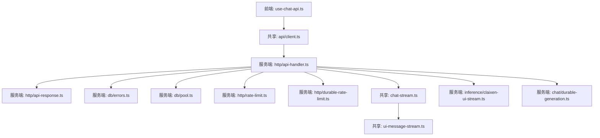
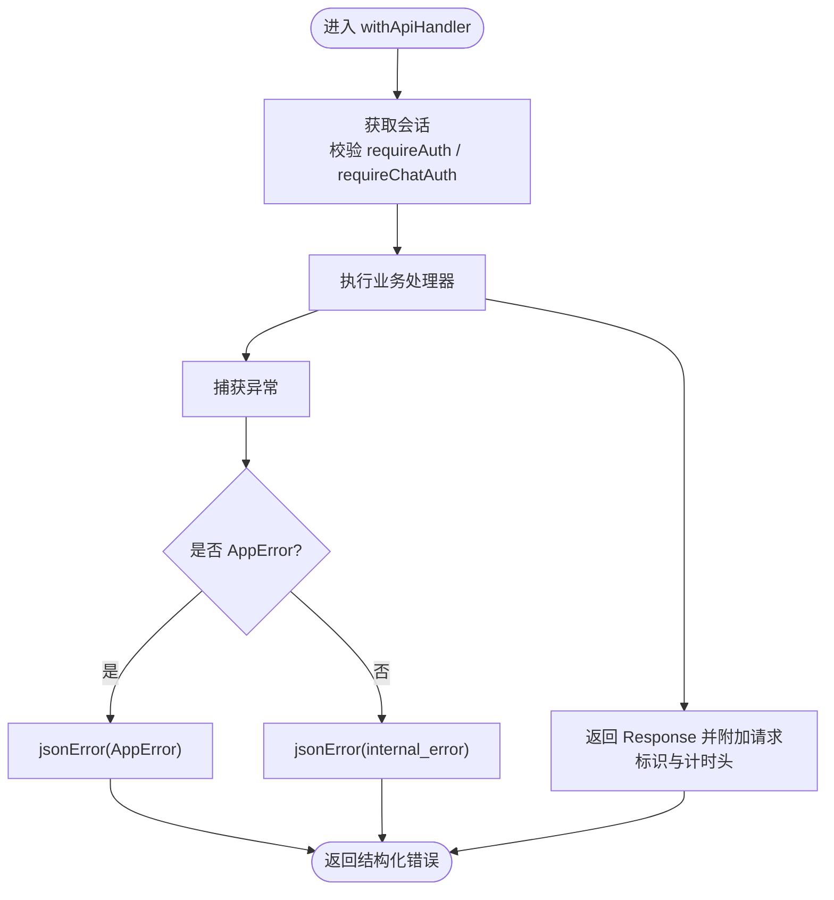
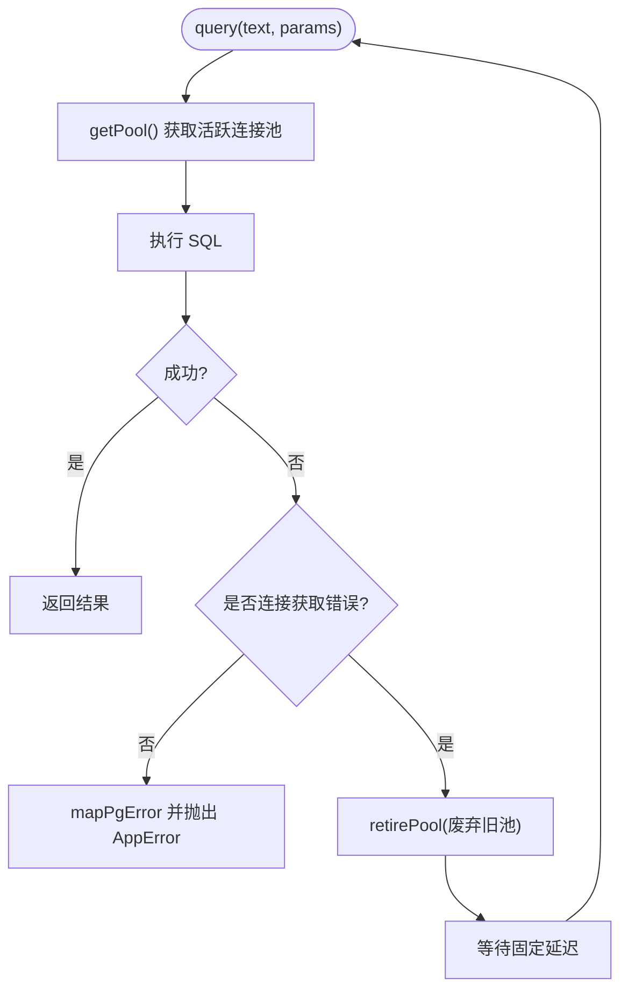
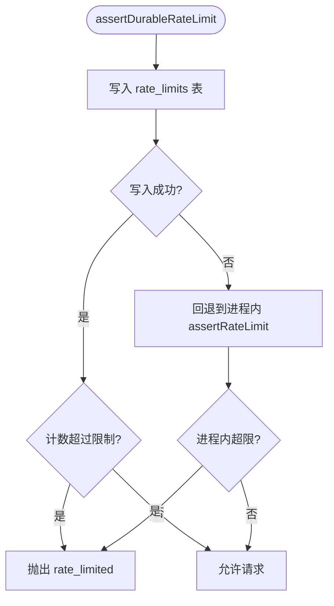
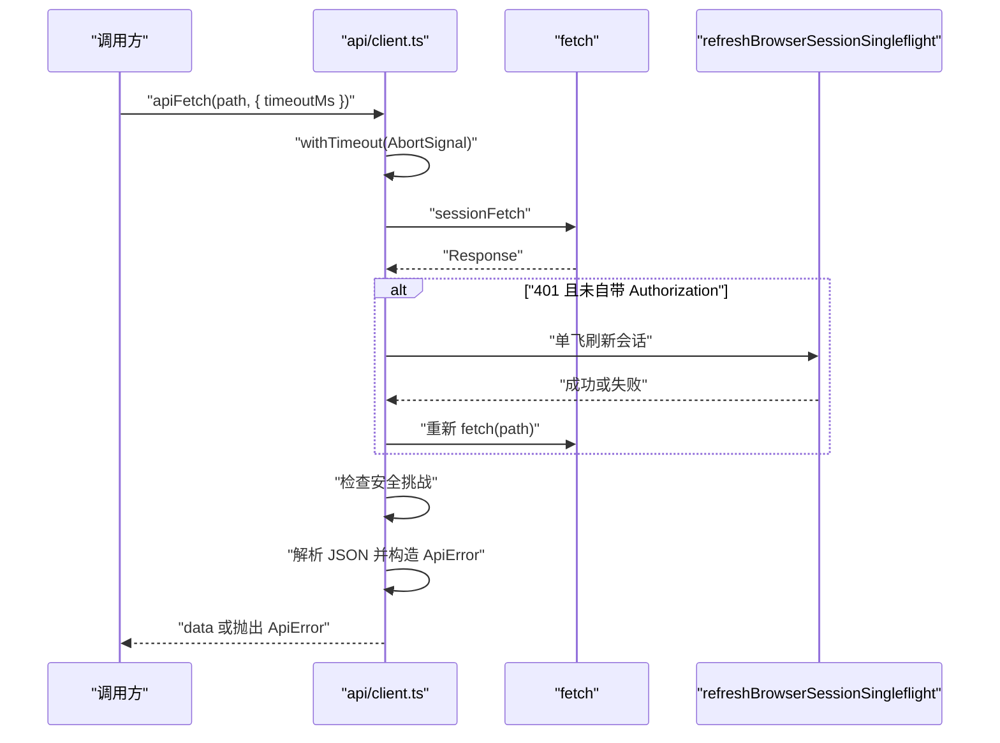
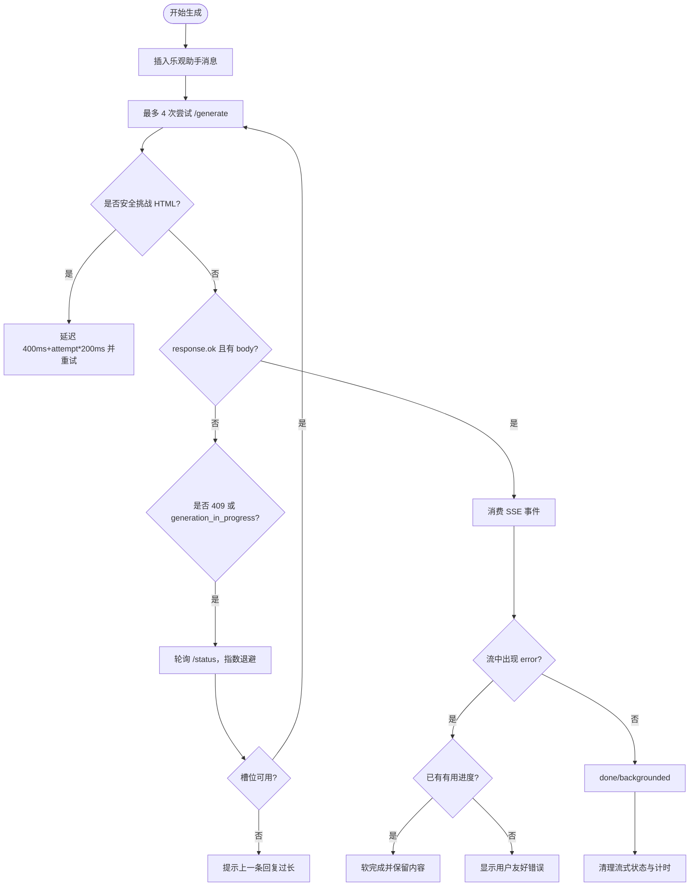
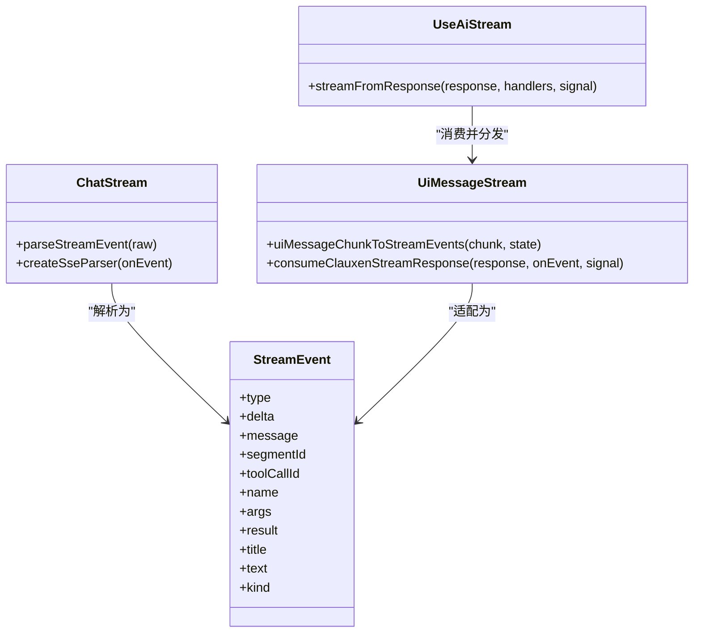
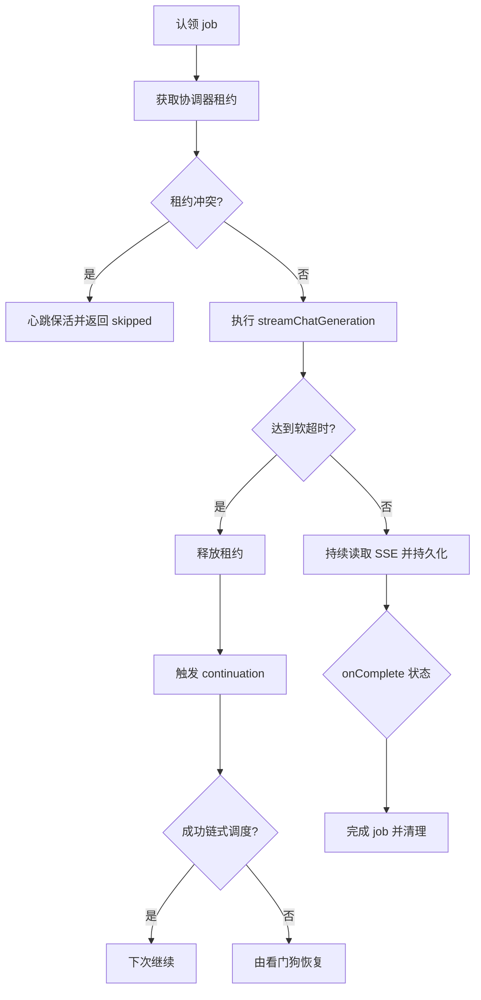
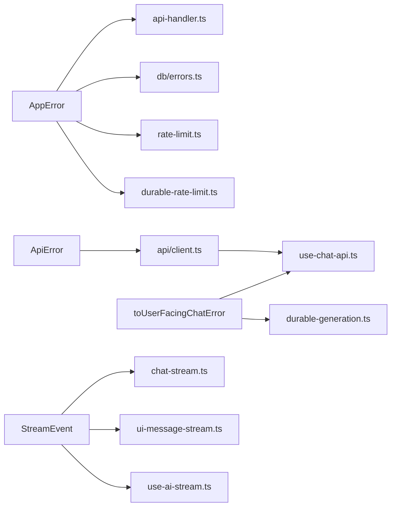

# 错误处理和重试机制

<cite>
**本文引用的文件**   
- [api-handler.ts](file://src/server/http/api-handler.ts)
- [api-response.ts](file://src/server/http/api-response.ts)
- [errors.ts](file://src/server/db/errors.ts)
- [pool.ts](file://src/server/db/pool.ts)
- [rate-limit.ts](file://src/server/http/rate-limit.ts)
- [durable-rate-limit.ts](file://src/server/http/durable-rate-limit.ts)
- [client.ts](file://src/shared/lib/api/client.ts)
- [assistant-generation-error.ts](file://src/shared/lib/assistant-generation-error.ts)
- [supabase-query-error.ts](file://src/shared/lib/supabase-query-error.ts)
- [use-chat-api.ts](file://src/client/hooks/use-chat-api.ts)
- [use-ai-stream.ts](file://src/client/hooks/use-ai-stream.ts)
- [chat-stream.ts](file://src/shared/lib/chat-stream.ts)
- [ui-message-stream.ts](file://src/shared/lib/ui-message-stream.ts)
- [claixen-ui-stream.ts](file://src/server/inference/claixen-ui-stream.ts)
- [durable-generation.ts](file://src/server/chat/durable-generation.ts)
- [internal-generations-auth.ts](file://src/server/http/internal-generations-auth.ts)
</cite>

## 目录
1. [引言](#引言)
2. [项目结构中的错误处理位置](#项目结构中的错误处理位置)
3. [错误分类体系](#错误分类体系)
4. [架构总览：从用户请求到流式回复的错误路径](#架构总览从用户请求到流式回复的错误路径)
5. [核心组件分析](#核心组件分析)
6. [依赖关系与耦合分析](#依赖关系与耦合分析)
7. [性能、超时与资源清理](#性能超时与资源清理)
8. [可观测性、日志与故障诊断](#可观测性日志与故障诊断)
9. [重试、退避与降级策略](#重试退避与降级策略)
10. [常见问题排查指南](#常见问题排查指南)
11. [结论](#结论)

## 引言
本文件聚焦聊天系统中的错误处理与重试机制，覆盖以下关键目标：
- 统一错误分类、异常捕获和用户友好提示。
- 明确客户端与服务端的重试逻辑、退避策略和超时控制。
- 说明网络错误的降级、数据库连接失败恢复、速率限制容错。
- 解释长任务分片、断点续跑、取消与心跳等错误恢复能力。
- 提供日志记录、监控上报、调试与故障诊断建议。
- 给出重试配置参数、超时设置和资源清理策略的实操参考。

该文档不直接粘贴代码，而是通过文件路径和行号引用实现细节；读者可在源码中对照定位。

## 项目结构中的错误处理位置
本项目围绕“前端会话钩子—共享 API 客户端—服务端 HTTP 封装—数据库连接池—流式推理服务—后台持久化生成器”这条主线组织错误处理：



**图表来源**
- [use-chat-api.ts](file://src/client/hooks/use-chat-api.ts)
- [client.ts](file://src/shared/lib/api/client.ts)
- [api-handler.ts](file://src/server/http/api-handler.ts)
- [api-response.ts](file://src/server/http/api-response.ts)
- [errors.ts](file://src/server/db/errors.ts)
- [pool.ts](file://src/server/db/pool.ts)
- [rate-limit.ts](file://src/server/http/rate-limit.ts)
- [durable-rate-limit.ts](file://src/server/http/durable-rate-limit.ts)
- [chat-stream.ts](file://src/shared/lib/chat-stream.ts)
- [ui-message-stream.ts](file://src/shared/lib/ui-message-stream.ts)
- [claixen-ui-stream.ts](file://src/server/inference/claixen-ui-stream.ts)
- [durable-generation.ts](file://src/server/chat/durable-generation.ts)

**章节来源**
- [api-handler.ts:1-66](file://src/server/http/api-handler.ts#L1-L66)
- [client.ts:1-153](file://src/shared/lib/api/client.ts#L1-L153)
- [use-chat-api.ts:1800-2350](file://src/client/hooks/use-chat-api.ts#L1800-L2350)

## 错误分类体系
系统把错误分为以下几类，并在不同层面对其进行分类、转换和展示：

| 类别 | 典型来源 | 内部表示 | 用户可见行为 |
|---|---|---|---|
| 应用业务错误 | 认证缺失、权限不足、冲突、未找到 | `AppError`，带状态码与业务码 | 返回结构化错误对象；生产环境隐藏敏感信息 |
| 数据库错误 | PostgreSQL 驱动错误、连接超时、连接拒绝、连接池耗尽 | `mapPgError` 映射为 `AppError` | 将“忙/不可用”映射为 503，其他统一为数据库错误 |
| 速率限制错误 | 进程内或持久化速率限制 | `AppError`，code=`rate_limited` | 返回 429，提示稍后重试 |
| 网络与安全挑战错误 | 安全验证页面、无效 JSON、空响应、401/403/429/5xx | `ApiError`，带 status 与 code | 自动刷新会话、安全挑战重试、抛出结构化异常 |
| 流式生成错误 | SSE 事件中的 error、模型中断、提供商错误 | `toUserFacingChatError` | 输出无技术细节的友好提示，保留已生成的内容 |
| Supabase 查询错误 | PostgREST/Realtime 查询失败 | `logSupabaseQueryError` | 控制台记录详细上下文，UI 仍使用通用提示 |

关键设计原则：
- 服务器端始终对外暴露最小必要信息，生产环境隐藏堆栈、SQL 片段和供应商名称。
- 客户端对网络、JSON、空响应做边界保护，不抛原始异常给 UI。
- 流式场景优先“软完成”，避免已经渲染的工具调用、思考过程或答案被清空。
- 所有可操作错误都携带稳定 code，便于上层路由重试、降级和埋点。

**章节来源**
- [errors.ts:1-98](file://src/server/db/errors.ts#L1-L98)
- [api-response.ts:1-39](file://src/server/http/api-response.ts#L1-L39)
- [client.ts:1-153](file://src/shared/lib/api/client.ts#L1-L153)
- [assistant-generation-error.ts:1-126](file://src/shared/lib/assistant-generation-error.ts#L1-L126)
- [supabase-query-error.ts:1-26](file://src/shared/lib/supabase-query-error.ts#L1-L26)

## 架构总览：从用户请求到流式回复的错误路径
下图展示一次聊天生成请求在正常路径和错误路径上的交互，包括认证、速率限制、流解析、后端分片与后台恢复。

```mermaid
sequenceDiagram
    participant Browser as "浏览器"
    participant Hook as "use-chat-api.ts"
    participant Client as "api/client.ts"
    participant Handler as "http/api-handler.ts"
    participant DB as "db/pool.ts / errors.ts"
    participant Stream as "chat-stream.ts / ui-message-stream.ts"
    participant Gen as "durable-generation.ts"

    Browser->>Hook: "发送消息"
    Hook->>Client: "sessionFetch + apiFetch"
    Client->>Handler: "HTTP 请求(含可选 Authorization)"
    Handler->>Handler: "校验会话/鉴权"
    alt "需要鉴权但未登录"
        Handler-->>Client: "401 AppError"
        Client->>Client: "单飞刷新会话并重试一次"
    end
    Client->>Client: "默认超时 AbortSignal"
    Client->>Client: "安全检查页识别与二次请求"
    Client-->>Hook: "Response 或 ApiError"
    Hook->>Hook: "最多 4 次尝试; 409 走状态轮询"
    Hook->>Stream: "消费 SSE 事件"
    Stream->>Gen: "后台分片执行/心跳/续跑"
    Stream-->>Hook: "start/thinking_delta/answer_delta/error/done/backgrounded"
    Hook-->>Browser: "更新消息; 失败时软完成或提示"
```

**图表来源**
- [use-chat-api.ts:1800-2350](file://src/client/hooks/use-chat-api.ts#L1800-L2350)
- [client.ts:1-153](file://src/shared/lib/api/client.ts#L1-L153)
- [api-handler.ts:1-66](file://src/server/http/api-handler.ts#L1-L66)
- [pool.ts:1-200](file://src/server/db/pool.ts#L1-L200)
- [chat-stream.ts:1-325](file://src/shared/lib/chat-stream.ts#L1-L325)
- [ui-message-stream.ts:1-200](file://src/shared/lib/ui-message-stream.ts#L1-L200)
- [durable-generation.ts:1-450](file://src/server/chat/durable-generation.ts#L1-L450)

## 核心组件分析

### 服务端 API 包装与统一错误输出
服务端入口使用 `withApiHandler` 包裹业务处理器：
- 在数据库请求上下文中运行。
- 提取关联请求 ID，注入响应头。
- 捕获业务异常并转为结构化 JSON 错误。
- 生产环境屏蔽堆栈与原始 SQL，仅返回业务可读消息。
- 非 `AppError` 异常统一视为内部错误。

同时，API 响应模块区分数据库错误与普通异常：
- 数据库错误在生产环境替换为通用消息。
- 普通异常标记为 `internal_error`。
- 始终返回包含 `error.message` 和 `error.code` 的结构体。



**图表来源**
- [api-handler.ts:1-66](file://src/server/http/api-handler.ts#L1-L66)
- [api-response.ts:1-39](file://src/server/http/api-response.ts#L1-L39)

**章节来源**
- [api-handler.ts:1-66](file://src/server/http/api-handler.ts#L1-L66)
- [api-response.ts:1-39](file://src/server/http/api-response.ts#L1-L39)

### 数据库错误映射与连接池重试
数据库层通过 `mapPgError` 把底层驱动错误转换为 `AppError`：
- “聊天不存在”映射为 404。
- 唯一键冲突映射为 409。
- 引用失效映射为 400。
- 连接池耗尽、连接超时、连接拒绝映射为 503，并给出可重试提示。
- 开发环境暴露列缺失等调试信息，生产环境统一为数据库错误。
- 所有真实驱动错误都会异步记录到数据库日志工具。

连接池 `query` 方法实现连接级重试：
- 针对连接获取超时和连接拒绝进行有限重试。
- 每次失败后废弃旧连接池，等待固定延迟再试。
- Hyperdrive 环境下按请求生命周期管理连接，避免跨请求复用。



**图表来源**
- [pool.ts:1-200](file://src/server/db/pool.ts#L1-L200)
- [errors.ts:1-98](file://src/server/db/errors.ts#L1-L98)

**章节来源**
- [errors.ts:1-98](file://src/server/db/errors.ts#L1-L98)
- [pool.ts:1-200](file://src/server/db/pool.ts#L1-L200)

### 速率限制与降级
系统提供两层速率限制：
- 进程内滑动窗口：适合单机简单限流，内存维护计数与重置时间。
- 持久化固定窗口：写入数据库表，多实例一致；当数据库不可用时回退到进程内实现，避免阻断生成流程。

两者均抛出 `AppError`，code 为 `rate_limited`，状态码 429。



**图表来源**
- [durable-rate-limit.ts:1-47](file://src/server/http/durable-rate-limit.ts#L1-L47)
- [rate-limit.ts:1-41](file://src/server/http/rate-limit.ts#L1-L41)

**章节来源**
- [rate-limit.ts:1-41](file://src/server/http/rate-limit.ts#L1-L41)
- [durable-rate-limit.ts:1-47](file://src/server/http/durable-rate-limit.ts#L1-L47)

### 客户端 API 客户端与会话刷新
共享客户端定义 `ApiError`，并负责：
- 检测安全挑战响应，抛出 `security_challenge`。
- 解析 JSON 失败时抛出 `invalid_json`。
- 非 ok 响应映射为结构化 `ApiError`。
- 空响应数据抛出 `empty_response`。
- 默认请求超时 60 秒，使用 `AbortSignal.timeout` 防止无限转圈。
- 单飞刷新浏览器 Supabase 会话，避免并发重复刷新。
- 401 且未显式传入 Authorization 时，自动刷新并重试一次。
- 对安全挑战再次发起请求，增加短暂延迟。



**图表来源**
- [client.ts:1-153](file://src/shared/lib/api/client.ts#L1-L153)

**章节来源**
- [client.ts:1-153](file://src/shared/lib/api/client.ts#L1-L153)

### 聊天生成重试、状态轮询与流式错误软完成
`use-chat-api.ts` 是聊天体验的核心控制器：
- 启动时创建 `AbortController`，用于取消正在进行的生成。
- 插入乐观助手消息，提升首字节感知速度。
- 对 `/generate` 最多尝试 4 次。
- 遇到 Cloudflare/Vercel 安全挑战 HTML 时，延迟并重试。
- 遇到 409 或“已在生成”错误时，切换到轻量状态轮询接口，指数退避等待可用槽位。
- 轮询失败达到阈值后，返回“上一条回复仍在进行中”的用户提示。
- 流事件中若出现错误，但助手已有有用进度（回答、工具、思考），则软完成而不是丢弃对话。
- 流结束或中断时，计算思考时长并关闭流式状态，避免永久 spinner。



**图表来源**
- [use-chat-api.ts:1800-2350](file://src/client/hooks/use-chat-api.ts#L1800-L2350)

**章节来源**
- [use-chat-api.ts:1800-2350](file://src/client/hooks/use-chat-api.ts#L1800-L2350)

### 流协议、事件解析与 UI 适配
SSE 协议定义了完整的生命周期事件：start、thinking、narration、tool、artifact、chat_title、error、done、backgrounded。
- `chat-stream.ts` 负责严格类型化解析，并对超大缓冲区做裁剪。
- `ui-message-stream.ts` 将 Vercel AI SDK 的 UI message chunk 适配为内部 StreamEvent。
- `use-ai-stream.ts` 将流事件分发到 onStart/onThinkingDelta/onAnswerDelta/onDone/onError 等回调。
- 服务端 `claixen-ui-stream.ts` 在透传流的同时抽取 answer/thinking/tool 等数据，用于持久化和 UI 增强。



**图表来源**
- [chat-stream.ts:1-325](file://src/shared/lib/chat-stream.ts#L1-L325)
- [ui-message-stream.ts:1-200](file://src/shared/lib/ui-message-stream.ts#L1-L200)
- [use-ai-stream.ts:1-73](file://src/client/hooks/use-ai-stream.ts#L1-L73)

**章节来源**
- [chat-stream.ts:1-325](file://src/shared/lib/chat-stream.ts#L1-L325)
- [ui-message-stream.ts:1-200](file://src/shared/lib/ui-message-stream.ts#L1-L200)
- [use-ai-stream.ts:1-73](file://src/client/hooks/use-ai-stream.ts#L1-L73)

### 后台持久化生成器与分片恢复
后台生成器解决长时间模型流无法在一次边缘请求中完成的问题：
- 定义软超时、硬超时、最大切片数、切片最大尝试次数。
- 每个切片持有协调器租约，周期性心跳保活。
- 切片结束时根据状态决定继续、跳过、暂停或失败。
- 通过内部令牌验证 continuation 请求，支持队列投递或直接调用。
- 如果心跳丢失或租约冲突，安全放弃当前切片。
- 达到最大切片或最大尝试次数时，标记失败并给出用户提示。



**图表来源**
- [durable-generation.ts:1-450](file://src/server/chat/durable-generation.ts#L1-L450)
- [internal-generations-auth.ts:1-47](file://src/server/http/internal-generations-auth.ts#L1-L47)

**章节来源**
- [durable-generation.ts:1-450](file://src/server/chat/durable-generation.ts#L1-L450)
- [internal-generations-auth.ts:1-47](file://src/server/http/internal-generations-auth.ts#L1-L47)

## 依赖关系与耦合分析
- 低耦合点：
  - `AppError` 作为服务端业务错误抽象，被 API 包装、数据库映射、速率限制共同使用。
  - `ApiError` 作为客户端结构化异常，被共享 API 客户端统一抛出。
  - `toUserFacingChatError` 作为纯函数，隔离技术细节与用户文案。
- 高耦合点：
  - `use-chat-api.ts` 集中了生成重试、状态轮询、流事件处理、标题生成、分支切换、设备缓存等多个职责，属于高内聚但复杂度高的核心文件。
  - 流协议在 `chat-stream.ts`、`ui-message-stream.ts`、`claixen-ui-stream.ts` 之间紧密协作，任一格式变更可能影响三处。
- 外部依赖：
  - Supabase 会话刷新、PostgreSQL 连接池、Cloudflare/Vercel 安全挑战、SSE 流、内部 continuation 接口。



**图表来源**
- [api-handler.ts:1-66](file://src/server/http/api-handler.ts#L1-L66)
- [errors.ts:1-98](file://src/server/db/errors.ts#L1-L98)
- [rate-limit.ts:1-41](file://src/server/http/rate-limit.ts#L1-L41)
- [durable-rate-limit.ts:1-47](file://src/server/http/durable-rate-limit.ts#L1-L47)
- [client.ts:1-153](file://src/shared/lib/api/client.ts#L1-L153)
- [assistant-generation-error.ts:1-126](file://src/shared/lib/assistant-generation-error.ts#L1-L126)
- [chat-stream.ts:1-325](file://src/shared/lib/chat-stream.ts#L1-L325)
- [ui-message-stream.ts:1-200](file://src/shared/lib/ui-message-stream.ts#L1-L200)
- [use-ai-stream.ts:1-73](file://src/client/hooks/use-ai-stream.ts#L1-L73)
- [use-chat-api.ts:1800-2350](file://src/client/hooks/use-chat-api.ts#L1800-L2350)
- [durable-generation.ts:1-450](file://src/server/chat/durable-generation.ts#L1-L450)

## 性能、超时与资源清理
- 客户端默认超时：60 秒，通过 `AbortSignal.timeout` 与现有信号合并，确保挂起请求最终报错。
- 生成轮询退避：初始 150ms，上限 1000ms，指数增长，最多 8 次连续失败后认为槽位不可用。
- 安全挑战重试：首次延迟 400ms，后续按 attempt 递增，避免频繁冲击网关。
- 数据库连接池：
  - 连接获取超时和连接拒绝会触发有限重试。
  - 超时会废弃旧池，避免长期占用坏连接。
  - Hyperdrive 下连接生命周期绑定请求，减少 Worker 间复用风险。
- 流缓冲：
  - SSE 事件缓冲区有最大字节限制，过大时截断，避免内存膨胀。
  - 单个 data payload 也有大小限制，防止畸形大字段破坏解析。
- 后台切片：
  - 软超时触发 yield，硬超时强制 abort。
  - 每 15 秒心跳保活，每 2 秒检查取消状态。
  - 达到最大切片数或最大尝试次数时失败，不再无限重试。
- 资源清理：
  - `AbortController` 用于取消生成、轮询、流读取。
  - `sliceRuntime.dispose` 清理定时器与计时器。
  - 断开订阅者时不影响服务端持久化，采用 best-effort 推送。

**章节来源**
- [client.ts:1-153](file://src/shared/lib/api/client.ts#L1-L153)
- [use-chat-api.ts:1800-2350](file://src/client/hooks/use-chat-api.ts#L1800-L2350)
- [pool.ts:1-200](file://src/server/db/pool.ts#L1-L200)
- [chat-stream.ts:1-325](file://src/shared/lib/chat-stream.ts#L1-L325)
- [durable-generation.ts:1-450](file://src/server/chat/durable-generation.ts#L1-L450)

## 可观测性、日志与故障诊断
- 请求追踪：
  - API 包装器注入 `REQUEST_ID_HEADER`，并添加 `Server-Timing`，记录 auth 与应用耗时。
- 数据库错误日志：
  - `mapPgError` 异步调用 `logDbError`，记录驱动级别错误、表、列、错误码。
- Supabase 查询错误：
  - `logSupabaseQueryError` 输出 scope、code、message、details、hint 以及 table/filter/event/chatId/userId 等上下文。
- 后台生成：
  - continuation 失败、watchdog 恢复、心跳失败、所有权丢失等场景均有 warn 或 console.error。
- 调试建议：
  - 查看浏览器控制台的网络面板，确认 401/429/5xx、安全挑战 HTML、SSE 流是否正常。
  - 检查服务端日志中的 `[supabase:*]`、`[db] idle client error`、`[durable-generation]` 前缀。
  - 对于数据库连接问题，关注连接超时、连接拒绝、连接池耗尽相关错误码。
  - 对于生成卡住，关注 `SLICE_SOFT_MS`、`SLICE_HARD_MS`、`SLICE_MAX`、`SLICE_MAX_ATTEMPTS` 相关日志。

**章节来源**
- [api-handler.ts:1-66](file://src/server/http/api-handler.ts#L1-L66)
- [errors.ts:1-98](file://src/server/db/errors.ts#L1-L98)
- [supabase-query-error.ts:1-26](file://src/shared/lib/supabase-query-error.ts#L1-L26)
- [durable-generation.ts:1-450](file://src/server/chat/durable-generation.ts#L1-L450)

## 重试、退避与降级策略

### 客户端重试配置
- 默认超时：60000 毫秒，可通过 `timeoutMs` 覆盖。
- 安全挑战重试：检测到安全挑战 HTML 时，延迟后重新请求。
- 会话刷新重试：401 且未显式传入 Authorization 时，刷新会话并重试一次。
- 生成重试：最多 4 次尝试 `/generate`。
- 状态轮询：遇到 409 或“已在生成”时，轮询 `/status`，指数退避，最长等待约 285 秒。

推荐实践：
- 对短时网络抖动使用现有指数退避，不要自行叠加更多层级。
- 对 429 应尊重服务端提示，避免立即重打。
- 对 401 只刷新一次，避免死循环。
- 对 5xx 和超时交给上层用户提示，不要静默吞掉。

**章节来源**
- [client.ts:1-153](file://src/shared/lib/api/client.ts#L1-L153)
- [use-chat-api.ts:1800-2350](file://src/client/hooks/use-chat-api.ts#L1800-L2350)

### 服务端重试与降级
- 数据库连接重试：仅对连接获取超时和连接拒绝重试，其他错误直接映射为 `AppError`。
- 速率限制降级：持久化计数器失败时回退到进程内 Map，保证生成不会因数据库瞬时故障而硬失败。
- 后台切片失败：达到最大切片或最大尝试次数后失败，不再重试，引导用户拆分任务或重新发送。

**章节来源**
- [pool.ts:1-200](file://src/server/db/pool.ts#L1-L200)
- [durable-rate-limit.ts:1-47](file://src/server/http/durable-rate-limit.ts#L1-L47)
- [durable-generation.ts:1-450](file://src/server/chat/durable-generation.ts#L1-L450)

### 用户友好错误提示
- 通用聊天错误：当无法判断具体原因时，返回“发生意外情况，请重试”。
- 连接中断：匹配网络错误、超时、中止等模式，提示连接中断。
- 限速拥塞：匹配 429、rate limit、too many requests、overloaded 等模式，提示稍后再试。
- 认证失败：匹配 401/403/unauthorized/forbidden/invalid api key 等模式，使用通用提示。
- 提供商错误：匹配 5xx、internal server、bad gateway、provider、openai、inference 等模式，使用通用提示。
- 安全挑战：匹配 security check、challenge-platform、cf-mitigated 等模式，提示安全验证进行中。

**章节来源**
- [assistant-generation-error.ts:1-126](file://src/shared/lib/assistant-generation-error.ts#L1-L126)

## 常见问题排查指南

| 现象 | 可能原因 | 排查步骤 | 修复建议 |
|---|---|---|---|
| 聊天一直 loading | 请求超时、安全挑战、生成槽位不可用 | 检查网络面板 401/429/HTML、SSE 是否建立、`/status` 轮询结果 | 调整超时、等待安全验证、检查后端 lease 与调度 |
| 频繁 401 | 浏览器会话过期、token 未携带 | 检查 Authorization 头、Supabase 会话刷新日志 | 确保单飞刷新、避免手动覆盖 Authorization |
| 数据库连接不稳定 | 连接超时、连接拒绝、连接池耗尽 | 查看 `[db] idle client error`、`mapPgError` 日志 | 调整连接池配置、检查 pooler 地址、扩容数据库 |
| 生成中途失败但已有内容 | 提供商中断、流 error | 查看 `hasUsefulAssistantProgress` 判断路径 | 接受软完成，引导用户继续编辑或重发 |
| 后台任务卡住 | 心跳丢失、租约冲突、切片超限 | 查看 durable-generation 日志、job 状态 | 重启 worker、拆分任务、检查协调器与 watch dog |
| 速率限制触发 | 短时间大量请求 | 检查 429 和 `rate_limited` | 降低频率、增加退避、检查 WAF 与配额 |

**章节来源**
- [errors.ts:1-98](file://src/server/db/errors.ts#L1-L98)
- [assistant-generation-error.ts:1-126](file://src/shared/lib/assistant-generation-error.ts#L1-L126)
- [durable-generation.ts:1-450](file://src/server/chat/durable-generation.ts#L1-L450)
- [use-chat-api.ts:1800-2350](file://src/client/hooks/use-chat-api.ts#L1800-L2350)

## 结论
该项目的错误处理与重试机制以“分类清晰、外层友好、内层可观测、长任务可恢复”为目标：
- 服务端通过 `AppError` 与 `mapPgError` 统一业务与数据库错误。
- 客户端通过 `ApiError`、超时、安全挑战识别、会话刷新、生成重试与状态轮询构建稳健的前端体验。
- 流式错误通过模式匹配与进度检测转化为友好提示，并尽量保留有用内容。
- 后台生成器通过切片、心跳、租约、续跑和看门狗保障长时间任务的可恢复性。
- 速率限制提供持久化主路径与进程内降级路径，避免雪崩。
- 日志与监控贯穿请求、数据库、Supabase、流和后台任务，便于快速定位问题。

在实际使用中，建议：
- 新增错误类型时优先定义 stable code，再决定用户文案。
- 对所有外部 I/O 设置超时、取消和重试边界。
- 对长任务采用分片、心跳、最大尝试次数与失败降级。
- 对用户展示永远保持简洁，对运维日志保持充分。
- 在测试中模拟网络中断、401、429、5xx、SSE 中断和数据库连接失败，验证软完成与恢复路径。