# 发票处理

<cite>
**本文引用的文件**   
- [20260910120000_billing_invoices.sql](file://supabase/migrations/20260910120000_billing_invoices.sql)
- [index.ts（计费 Worker）](file://workers/billing/src/index.ts)
- [invoice-pdf.ts（PDF 渲染）](file://workers/billing/src/invoice-pdf.ts)
- [types.ts（Worker 类型）](file://workers/billing/src/types.ts)
- [wrangler.toml（Worker 配置）](file://workers/billing/wrangler.toml)
- [billing.repository.ts（发票仓储）](file://src/server/repositories/billing.repository.ts)
- [billing.service.ts（计费服务）](file://src/server/services/billing.service.ts)
- [invoice.ts（发票载荷构建）](file://src/server/billing/invoice.ts)
- [razorpay-invoice-upload.ts（Razorpay 文档上传）](file://src/server/billing/razorpay-invoice-upload.ts)
- [route.ts（发票列表接口）](file://src/app/api/v1/billing/invoices/route.ts)
- [route.ts（发票详情接口）](file://src/app/api/v1/billing/invoices/[paymentId]/route.ts)
- [route.ts（PDF 下载接口）](file://src/app/api/v1/billing/invoices/[paymentId]/pdf/route.ts)
- [route.ts（Razorpay Webhook 入口）](file://src/app/api/v1/webhooks/razorpay/route.ts)
- [gstin.ts（GSTIN 校验）](file://src/shared/lib/gstin.ts)
- [checkout-tax.ts（结账税务计算）](file://src/shared/lib/checkout-tax.ts)
</cite>

## 目录
1. [引言](#引言)
2. [项目结构](#项目结构)
3. [核心组件](#核心组件)
4. [架构总览](#架构总览)
5. [详细组件分析](#详细组件分析)
6. [依赖关系分析](#依赖关系分析)
7. [性能与合规考量](#性能与合规考量)
8. [故障排查指南](#故障排查指南)
9. [结论](#结论)

## 引言
本文件面向发票处理子系统，覆盖数据模型、编号生成规则、税务判定逻辑、PDF 发票生成、R2 与 Razorpay Documents 存储、下载鉴权、邮件发送、状态流转、退款与重发机制，以及 API 规范和合规实现细节。该系统的目标是：每次成功支付仅生成一份不可重复的税务发票；PDF 由服务端生成并归档；用户通过受保护的接口下载；必要时将发票附件同步至支付网关以支持审计和导出合规要求。

## 项目结构
发票相关代码分布在以下层次：
- 数据库迁移：定义 `public.billing_invoices` 表及行级安全策略。
- Next.js 应用层：暴露发票列表、发票详情、PDF 下载接口，并处理 Razorpay Webhook。
- 服务层：从订单和支付记录构建发票载荷、调用 Worker、回写 R2 Key、触发邮件或备用邮件。
- Worker 层：在 Cloudflare Workers 中生成 PDF、写入 R2、尝试上传 Razorpay Documents、发送邮件、提供内部 PDF 直读接口。
- 共享库：GSTIN 校验、结账阶段 GST 计算、发票类型枚举等。

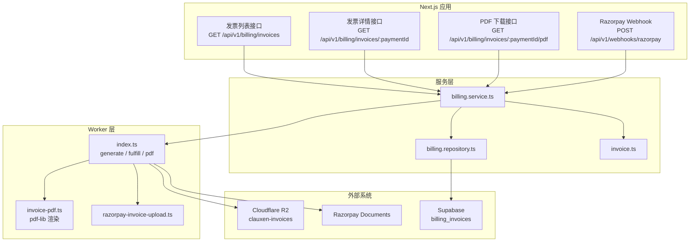

**图示来源**
- [route.ts（发票列表接口）:1-16](file://src/app/api/v1/billing/invoices/route.ts#L1-L16)
- [route.ts（发票详情接口）:1-23](file://src/app/api/v1/billing/invoices/[paymentId]/route.ts#L1-L23)
- [route.ts（PDF 下载接口）:1-32](file://src/app/api/v1/billing/invoices/[paymentId]/pdf/route.ts#L1-L32)
- [route.ts（Razorpay Webhook 入口）:1-70](file://src/app/api/v1/webhooks/razorpay/route.ts#L1-L70)
- [billing.service.ts:1440-1715](file://src/server/services/billing.service.ts#L1440-L1715)
- [billing.repository.ts:530-626](file://src/server/repositories/billing.repository.ts#L530-L626)
- [invoice.ts:1-212](file://src/server/billing/invoice.ts#L1-L212)
- [index.ts（计费 Worker）:1-652](file://workers/billing/src/index.ts#L1-L652)
- [invoice-pdf.ts:1-475](file://workers/billing/src/invoice-pdf.ts#L1-L475)
- [razorpay-invoice-upload.ts:1-139](file://src/server/billing/razorpay-invoice-upload.ts#L1-L139)

**章节来源**
- [20260910120000_billing_invoices.sql:1-58](file://supabase/migrations/20260910120000_billing_invoices.sql#L1-L58)
- [route.ts（发票列表接口）:1-16](file://src/app/api/v1/billing/invoices/route.ts#L1-L16)
- [route.ts（发票详情接口）:1-23](file://src/app/api/v1/billing/invoices/[paymentId]/route.ts#L1-L23)
- [route.ts（PDF 下载接口）:1-32](file://src/app/api/v1/billing/invoices/[paymentId]/pdf/route.ts#L1-L32)
- [route.ts（Razorpay Webhook 入口）:1-70](file://src/app/api/v1/webhooks/razorpay/route.ts#L1-L70)
- [billing.service.ts:1440-1715](file://src/server/services/billing.service.ts#L1440-L1715)
- [billing.repository.ts:530-626](file://src/server/repositories/billing.repository.ts#L530-L626)
- [invoice.ts:1-212](file://src/server/billing/invoice.ts#L1-L212)
- [index.ts（计费 Worker）:1-652](file://workers/billing/src/index.ts#L1-L652)
- [invoice-pdf.ts:1-475](file://workers/billing/src/invoice-pdf.ts#L1-L475)
- [razorpay-invoice-upload.ts:1-139](file://src/server/billing/razorpay-invoice-upload.ts#L1-L139)

## 核心组件
- 发票数据模型：`billing_invoices` 表按支付唯一化，保存发票号、类型、币种、金额、国家、R2 Key、R2 URL、Razorpay 文档 ID、证据快照和邮件时间戳。
- 编号生成器：基于支付 ID 或订单 ID 生成 `INV-` 前缀编号，保证稳定且去敏感化。
- 税务判定器：根据结算币种、地址国家、是否提供有效 GSTIN 决定国内 GST、零税率出口 LUT 或免税 GSTIN 类型。
- PDF 渲染器：使用 pdf-lib 在服务端生成 A4 发票，包含发票抬头、法律实体、地址、GSTIN、客户信息、明细、税额、总额、付款状态和自动续费提示。
- 存储层：同一份 PDF 同时写入 R2 的客户副本和销售副本；Razorpay Documents 为可选合规附件。
- 下载鉴权：Next.js 路由强制会话登录并对 paymentId 做格式校验；Worker 内部 PDF 接口校验 JWT 或内部令牌，并按 userId + paymentId 读取 R2 对象。
- 邮件机制：优先通过 Worker 的 EMAIL binding 发送带附件发票；失败时回退到 Next.js 内置邮件函数，并保留 `emailed_at` 字段用于追踪。
- 状态流转：由支付捕获状态推导发票 `paid` 或 `open`，并通过 `kind` 表达税务类型，`evidence` 记录位置证据。

**章节来源**
- [20260910120000_billing_invoices.sql:8-30](file://supabase/migrations/20260910120000_billing_invoices.sql#L8-L30)
- [invoice.ts:28-36](file://src/server/billing/invoice.ts#L28-L36)
- [checkout-tax.ts:1-79](file://src/shared/lib/checkout-tax.ts#L1-L79)
- [invoice-pdf.ts:1-475](file://workers/billing/src/invoice-pdf.ts#L1-L475)
- [index.ts（计费 Worker）:200-260](file://workers/billing/src/index.ts#L200-L260)
- [route.ts（PDF 下载接口）:1-32](file://src/app/api/v1/billing/invoices/[paymentId]/pdf/route.ts#L1-L32)
- [index.ts（计费 Worker）:520-652](file://workers/billing/src/index.ts#L520-L652)

## 架构总览
发票生命周期分为“生成”和“履行”两条路径：
- 生成路径：Next.js 服务从订单和支付记录构造发票载荷，调用 Worker `/v1/invoices/generate`，Worker 渲染 PDF、写入 R2、尝试上传 Razorpay Documents，返回 R2 Key 和字节数。
- 履行路径：Next.js 服务调用 Worker `/v1/invoices/fulfill`，除生成和存储外，还附加邮件附件并记录结果；若 Worker 邮件失败，Next.js 再尝试发送备用邮件。

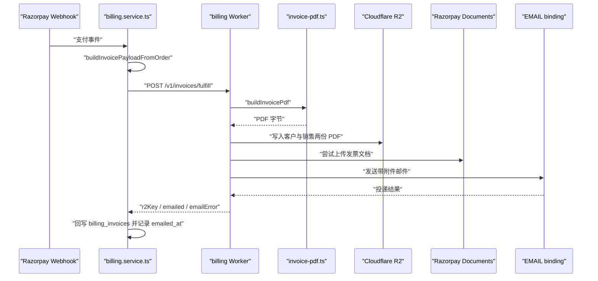

**图示来源**
- [route.ts（Razorpay Webhook 入口）:1-70](file://src/app/api/v1/webhooks/razorpay/route.ts#L1-L70)
- [billing.service.ts:1440-1715](file://src/server/services/billing.service.ts#L1440-L1715)
- [index.ts（计费 Worker）:456-590](file://workers/billing/src/index.ts#L456-L590)
- [invoice-pdf.ts:1-475](file://workers/billing/src/invoice-pdf.ts#L1-L475)
- [razorpay-invoice-upload.ts:1-139](file://src/server/billing/razorpay-invoice-upload.ts#L1-L139)

## 详细组件分析

### 发票数据模型与编号生成
`billing_invoices` 表是发票账本的核心：
- 主键 `id` 与 `payment_id` 唯一约束确保“一次支付一份发票”。
- `invoice_number` 唯一索引便于对账与检索。
- `kind` 限制为 `domestic_gst`、`export_lut`、`exempt_gstin`。
- `currency` 限制为 `INR` 或 `USD`。
- `subtotal_paise`、`tax_paise`、`total_paise` 以印度分单位存储，避免浮点误差。
- `country` 来自位置证据或账单地址。
- `r2_key`、`r2_url` 指向 R2 中的 PDF 副本。
- `razorpay_document_id` 记录 Razorpay 文档 ID。
- `evidence` 记录位置、声明 IP、工具判定等税务依据。
- `emailed_at` 标记首次成功邮件时间。
- 行级安全策略仅允许用户查看自己的发票。

编号生成规则：
- 从支付 ID 或 Razorpay 订单 ID 去除非字母数字字符后取末尾 12 位大写，加上 `INV-` 前缀。
- 这使编号可重现、去敏感且不直接暴露完整支付标识。

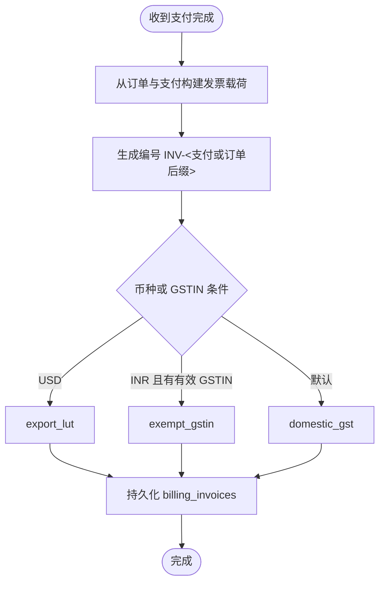

**图示来源**
- [invoice.ts:28-36](file://src/server/billing/invoice.ts#L28-L36)
- [billing.service.ts:1460-1475](file://src/server/services/billing.service.ts#L1460-L1475)
- [20260910120000_billing_invoices.sql:8-30](file://supabase/migrations/20260910120000_billing_invoices.sql#L8-L30)

**章节来源**
- [20260910120000_billing_invoices.sql:8-58](file://supabase/migrations/20260910120000_billing_invoices.sql#L8-L58)
- [billing.repository.ts:530-590](file://src/server/repositories/billing.repository.ts#L530-L590)
- [billing.repository.ts:590-626](file://src/server/repositories/billing.repository.ts#L590-L626)
- [invoice.ts:28-36](file://src/server/billing/invoice.ts#L28-L36)

### 税务计算与合规类型
结账阶段的税务计算逻辑位于共享库：
- 非印度国家不征收 GST。
- 印度国家且提供有效 GSTIN 时，标记为免税，显示税行但不收费。
- 其他印度国家情况按 `GST_RATE` 计算 IGST，当前逻辑标注为 18%。
- GSTIN 校验遵循 15 位标准格式：两位州码、PAN、实体、Z、校验位。

发票层面的 `invoiceKind` 决策：
- 非 INR 币种映射为 `export_lut`。
- INR 且结账时已验证 GSTIN 且税为零，映射为 `exempt_gstin`。
- 否则为 `domestic_gst`。

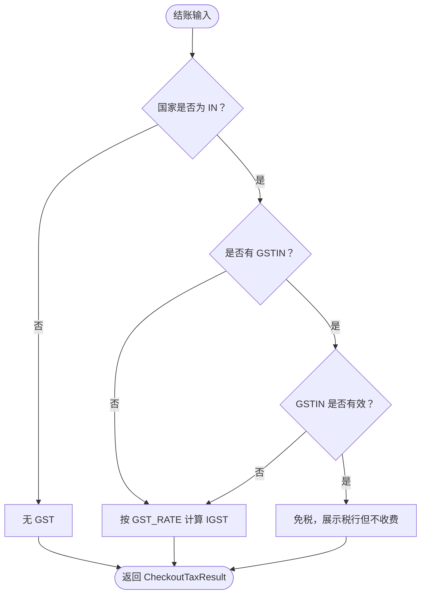

**图示来源**
- [checkout-tax.ts:1-79](file://src/shared/lib/checkout-tax.ts#L1-L79)
- [gstin.ts:1-13](file://src/shared/lib/gstin.ts#L1-L13)
- [billing.service.ts:1460-1475](file://src/server/services/billing.service.ts#L1460-L1475)

**章节来源**
- [checkout-tax.ts:1-79](file://src/shared/lib/checkout-tax.ts#L1-L79)
- [gstin.ts:1-13](file://src/shared/lib/gstin.ts#L1-L13)
- [billing.service.ts:1460-1475](file://src/server/services/billing.service.ts#L1460-L1475)

### PDF 发票生成流程
PDF 渲染在服务端完成，使用 pdf-lib：
- 页面尺寸 A4，字体 Helvetica/HelveticaBold。
- 顶部左侧显示产品品牌、法律实体名称和地址；当不是出口发票时打印发行方 GSTIN。
- 右侧显示“INVOICE”或“EXPORT INVOICE”，出口发票额外显示 LUT 声明行。
- 元数据包括发票号、开具日期、金额、下次账单日期、订单号、支付状态。
- “BILLED TO”区域显示客户名称、邮箱、地址、客户 GSTIN。
- 表格列包含描述、价格、税额、金额；支持计划项和席位明细。
- 底部汇总不含税小计、税项、总金额、已付款、应付金额。
- 自动续费场景显示续订日期与取消提示。
- 页脚声明“计算机生成的税务发票”，并注明通过 Razorpay 处理支付。

发行方信息由 Worker 环境变量注入：
- `INVOICE_ISSUER_NAME`、`INVOICE_ISSUER_LEGAL`、`INVOICE_ISSUER_ADDRESS`、`INVOICE_GSTIN`、`INVOICE_LUT_NUMBER`。
- 这些值由 `wrangler.toml` 提供，生产环境应替换为真实法律和税务信息。

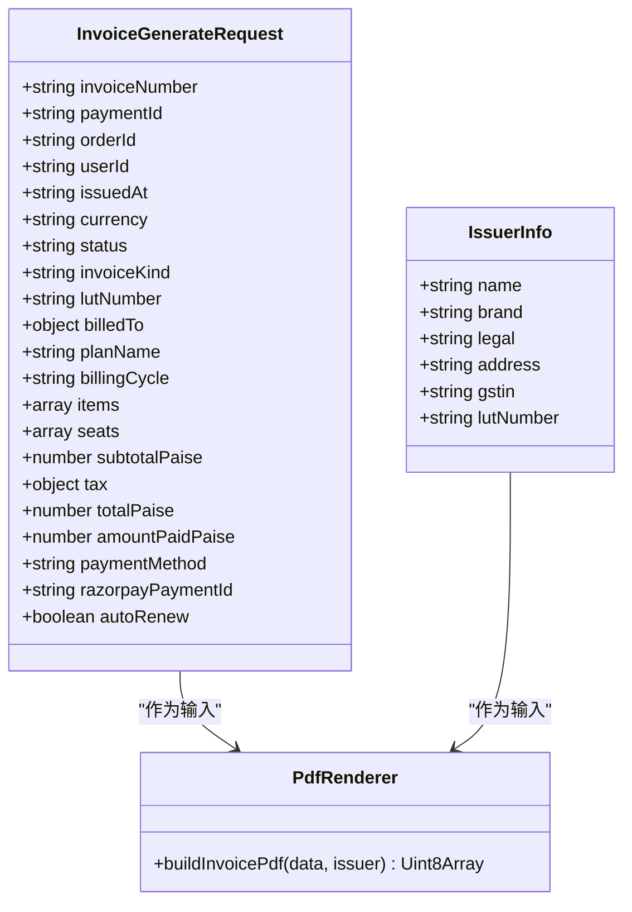

**图示来源**
- [types.ts:1-80](file://workers/billing/src/types.ts#L1-L80)
- [index.ts（计费 Worker）:200-220](file://workers/billing/src/index.ts#L200-L220)
- [invoice-pdf.ts:1-475](file://workers/billing/src/invoice-pdf.ts#L1-L475)

**章节来源**
- [invoice-pdf.ts:1-475](file://workers/billing/src/invoice-pdf.ts#L1-L475)
- [wrangler.toml:1-38](file://workers/billing/wrangler.toml#L1-L38)
- [index.ts（计费 Worker）:200-260](file://workers/billing/src/index.ts#L200-L260)

### 发票文件存储：R2 与 Razorpay Documents
- R2 存储：
  - 客户副本：`invoices/${userId}/${paymentId}.pdf`。
  - 销售副本：`invoices/sales/${yyyy}/${mm}/${paymentId}.pdf`。
  - 两者使用相同 PDF 字节，但自定义元数据不同。
- Razorpay Documents：
  - 先尝试用途 `opgsp_export_invoice`，再尝试 `invoice`。
  - 成功后链接到支付实体，并在支付备注中记录文档 ID。
  - 若失败，尝试通过支付文档路径直接上传。
  - 所有步骤均为最佳努力，失败不会阻断发票生成。
- 应用层还会在 Worker 未返回文档 ID 时，从 Worker 拉取 PDF 字节并执行备用上传。

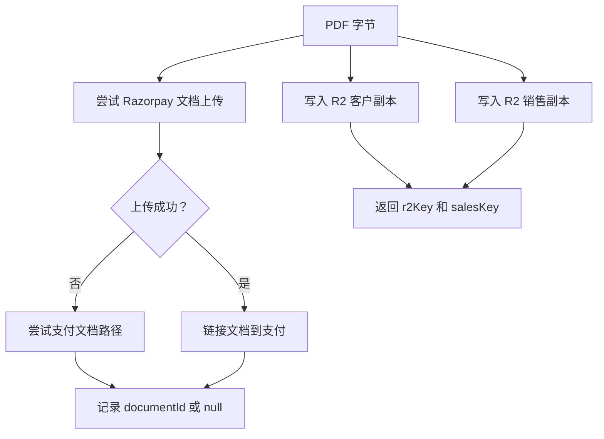

**图示来源**
- [index.ts（计费 Worker）:200-260](file://workers/billing/src/index.ts#L200-L260)
- [razorpay-invoice-upload.ts:1-139](file://src/server/billing/razorpay-invoice-upload.ts#L1-L139)
- [billing.service.ts:1510-1600](file://src/server/services/billing.service.ts#L1510-L1600)

**章节来源**
- [index.ts（计费 Worker）:200-260](file://workers/billing/src/index.ts#L200-L260)
- [razorpay-invoice-upload.ts:1-139](file://src/server/billing/razorpay-invoice-upload.ts#L1-L139)
- [billing.service.ts:1510-1600](file://src/server/services/billing.service.ts#L1510-L1600)

### 下载权限验证
PDF 下载存在两层保护：
- Next.js 路由要求已登录会话，并对 `paymentId` 做正则校验，只接受 `pay_` 开头的支付标识。
- 服务层先查支付归属用户，再查订单归属用户，双重确认所有权。
- Worker 内部 PDF 接口接受两种访问方式：
  - 内部调用：携带内部令牌。
  - 用户调用：携带 Supabase JWT，并附带 `userId` 查询参数。
- R2 对象路径严格使用 `invoices/${userId}/${paymentId}.pdf`，防止横向越权。

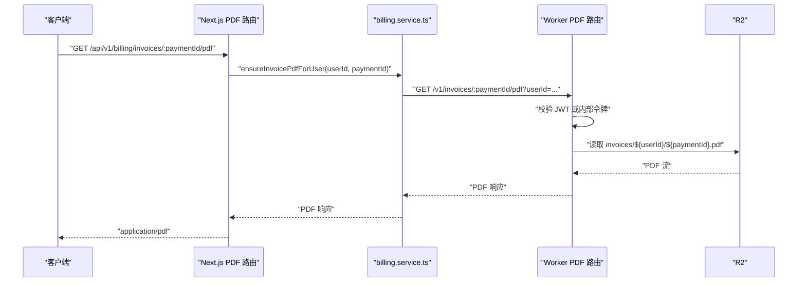

**图示来源**
- [route.ts（PDF 下载接口）:1-32](file://src/app/api/v1/billing/invoices/[paymentId]/pdf/route.ts#L1-L32)
- [index.ts（计费 Worker）:620-652](file://workers/billing/src/index.ts#L620-L652)

**章节来源**
- [route.ts（PDF 下载接口）:1-32](file://src/app/api/v1/billing/invoices/[paymentId]/pdf/route.ts#L1-L32)
- [index.ts（计费 Worker）:620-652](file://workers/billing/src/index.ts#L620-L652)

### 邮件发送机制
- 首选路径：Worker 通过 `EMAIL` binding 发送带 PDF 附件的邮件，附件文件名包含发票号。
- 投递结果解析：
  - `delivered` 或 `queued` 中包含目标邮箱视为成功。
  - `permanent_bounces` 或 `suppressed_recipients` 包含目标邮箱视为拒绝。
  - 其他报告但未投递成功视为失败。
- 回退路径：
  - 若 Worker 未能发送邮件，Next.js 会尝试使用内置邮件函数发送收据，并区分 PDF 是否可用。
  - 若 Worker 连 PDF 都未生成，Next.js 仍会发送基础收据，确保用户不会完全收不到通知。
- 数据库记录：
  - `emailed_at` 在首次成功发送后被更新。
  - 如果 PDF 生成失败但支付收据仍需通知，服务层仍可能返回错误结果但继续尝试邮件。

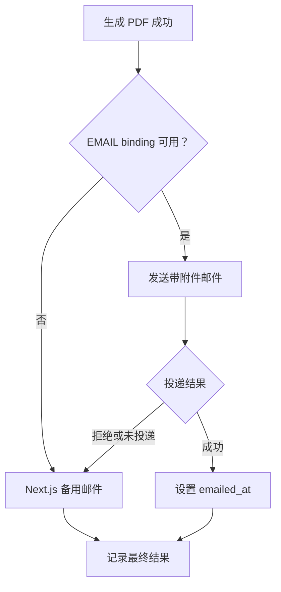

**图示来源**
- [index.ts（计费 Worker）:520-600](file://workers/billing/src/index.ts#L520-L600)
- [billing.service.ts:1480-1715](file://src/server/services/billing.service.ts#L1480-L1715)

**章节来源**
- [index.ts（计费 Worker）:520-600](file://workers/billing/src/index.ts#L520-L600)
- [billing.service.ts:1480-1715](file://src/server/services/billing.service.ts#L1480-L1715)

### 发票状态流转
发票状态主要由支付状态推导：
- 支付状态为 `captured` 时，发票状态为 `paid`。
- 否则为 `open`。
- 发票类型 `kind` 表示税务合规类型：
  - `domestic_gst`：国内 GST。
  - `export_lut`：零税率出口，使用 LUT。
  - `exempt_gstin`：提供有效 GSTIN，结账阶段不征税。
- 退款处理：
  - 当前代码未发现明确的“退款后重新签发红字发票”流程。
  - 更合适的做法是在退款完成后生成新的发票记录，并将原发票标记为已退款或作废；现有模型支持新增一行发票，但业务层尚未显式实现退款发票分支。

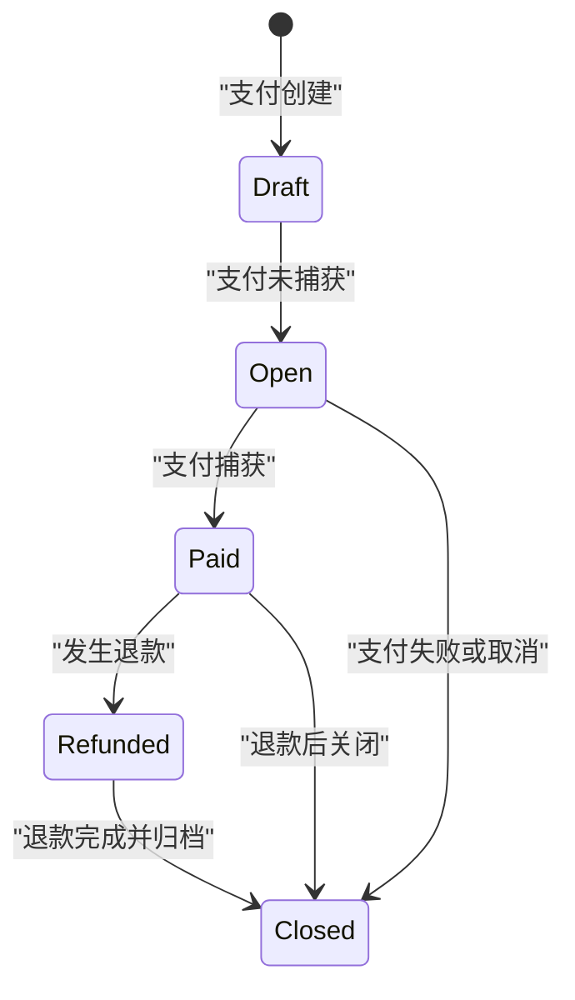

[此图为概念性状态图，用于说明建议的退款闭环；仓库中尚未实现退款发票生成逻辑。]

**章节来源**
- [invoice.ts:60-80](file://src/server/billing/invoice.ts#L60-L80)
- [20260910120000_billing_invoices.sql:8-30](file://supabase/migrations/20260910120000_billing_invoices.sql#L8-L30)

### 重发机制
- 发票详情接口会在缺少 PDF Key 时尝试入队重新生成发票，以避免历史支付遗漏 PDF。
- 如果 Worker 生成 PDF 成功但邮件失败，Next.js 会尝试备用邮件。
- 如果 Worker 完全失败，Next.js 仍会发送基础收据，确保用户至少收到通知。
- 对于已存在的发票记录，`on conflict (payment_id)` 会更新 R2 Key、R2 URL、Razorpay Document ID 和 `emailed_at`，实现幂等更新。

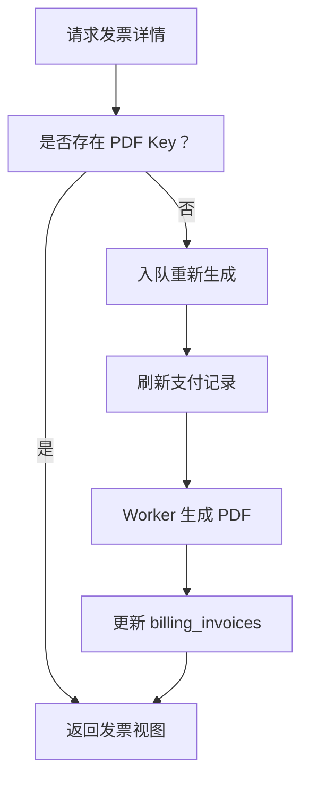

**图示来源**
- [billing.service.ts:1620-1715](file://src/server/services/billing.service.ts#L1620-L1715)
- [billing.repository.ts:530-590](file://src/server/repositories/billing.repository.ts#L530-L590)

**章节来源**
- [billing.service.ts:1620-1715](file://src/server/services/billing.service.ts#L1620-L1715)
- [billing.repository.ts:530-590](file://src/server/repositories/billing.repository.ts#L530-L590)

### API 接口规范
#### 发票列表
- 方法：`GET /api/v1/billing/invoices`
- 认证：需要已登录会话。
- 行为：返回当前用户的发票列表。
- 输出：`{ invoices: unknown[] }`。

#### 发票详情
- 方法：`GET /api/v1/billing/invoices/:paymentId`
- 认证：需要已登录会话。
- 校验：`paymentId` 必须匹配 `pay_[A-Za-z0-9]{8,40}`。
- 行为：校验支付和订单归属用户，构建发票视图数据，并尝试补建缺失的 PDF。
- 输出：包含 `invoice` 和 `pdfKey`。

#### PDF 下载
- 方法：`GET /api/v1/billing/invoices/:paymentId/pdf`
- 认证：需要已登录会话。
- 校验：`paymentId` 格式校验。
- 行为：调用服务层确保 PDF 存在，若缺失则触发 Worker 生成。
- 响应头：`Content-Type: application/pdf`，`Content-Disposition: inline`，`Cache-Control: private, no-store`。

#### Razorpay Webhook
- 方法：`POST /api/v1/webhooks/razorpay`
- 认证：通过 `x-razorpay-signature` 进行 HMAC 校验。
- 防护：限制最大负载大小，拒绝无效 JSON 或缺少 event 字段。
- 行为：委托给 `billingService.handleRazorpayWebhook`，驱动订单、订阅和发票同步。

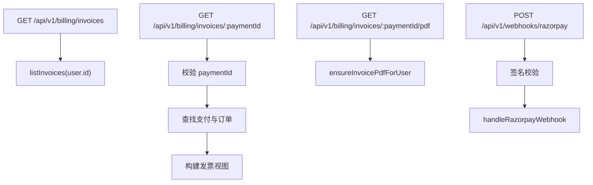

**图示来源**
- [route.ts（发票列表接口）:1-16](file://src/app/api/v1/billing/invoices/route.ts#L1-L16)
- [route.ts（发票详情接口）:1-23](file://src/app/api/v1/billing/invoices/[paymentId]/route.ts#L1-L23)
- [route.ts（PDF 下载接口）:1-32](file://src/app/api/v1/billing/invoices/[paymentId]/pdf/route.ts#L1-L32)
- [route.ts（Razorpay Webhook 入口）:1-70](file://src/app/api/v1/webhooks/razorpay/route.ts#L1-L70)

**章节来源**
- [route.ts（发票列表接口）:1-16](file://src/app/api/v1/billing/invoices/route.ts#L1-L16)
- [route.ts（发票详情接口）:1-23](file://src/app/api/v1/billing/invoices/[paymentId]/route.ts#L1-L23)
- [route.ts（PDF 下载接口）:1-32](file://src/app/api/v1/billing/invoices/[paymentId]/pdf/route.ts#L1-L32)
- [route.ts（Razorpay Webhook 入口）:1-70](file://src/app/api/v1/webhooks/razorpay/route.ts#L1-L70)

## 依赖关系分析
- Next.js 应用依赖服务层，服务层依赖仓储、发票载荷构建器和 Worker 内部接口。
- Worker 依赖 pdf-lib、R2、Razorpay API、Email binding 和 Supabase 用户信息接口。
- 共享库提供 GSTIN 校验和结账税务计算，被前端和服务端共同使用。
- 外部依赖包括 Razorpay 支付网关、Cloudflare R2、Supabase 数据库和邮件服务。

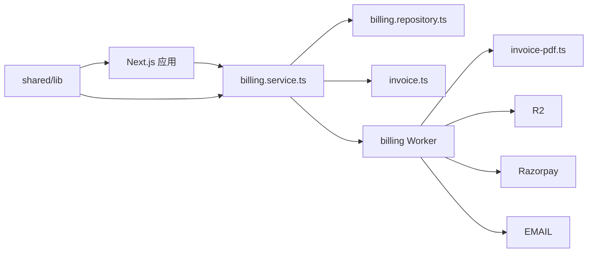

**图示来源**
- [billing.service.ts:1440-1715](file://src/server/services/billing.service.ts#L1440-L1715)
- [billing.repository.ts:530-626](file://src/server/repositories/billing.repository.ts#L530-L626)
- [invoice.ts:1-212](file://src/server/billing/invoice.ts#L1-L212)
- [index.ts（计费 Worker）:1-652](file://workers/billing/src/index.ts#L1-L652)
- [checkout-tax.ts:1-79](file://src/shared/lib/checkout-tax.ts#L1-L79)
- [gstin.ts:1-13](file://src/shared/lib/gstin.ts#L1-L13)

**章节来源**
- [billing.service.ts:1440-1715](file://src/server/services/billing.service.ts#L1440-L1715)
- [index.ts（计费 Worker）:1-652](file://workers/billing/src/index.ts#L1-L652)
- [checkout-tax.ts:1-79](file://src/shared/lib/checkout-tax.ts#L1-L79)
- [gstin.ts:1-13](file://src/shared/lib/gstin.ts#L1-L13)

## 性能与合规考量
- 性能：
  - PDF 渲染在服务端 Worker 中进行，避免浏览器渲染负担。
  - R2 双副本设计便于客户下载和销售归档，减少后续读取复杂度。
  - 发票记录按 `user_id`、`created_at`、`order_id`、`invoice_number` 建立索引，提升查询效率。
  - 发票插入使用 `on conflict` 实现幂等更新，避免重复支付产生重复发票。
- 合规：
  - 国内发票显示发行方 GSTIN。
  - 出口发票显示 LUT 声明，表明零税率出口。
  - 提供 GSTIN 校验，避免误用无效税号。
  - Razorpay 文档上传尝试合规用途，便于审计和监管导出。
  - 位置证据存入 `evidence`，支撑税务判定审计。
- 最佳实践：
  - 始终在服务端生成和签名发票，不在前端修改金额或税项。
  - 将 R2 URL 作为发票下载链接，而非直接暴露原始对象路径。
  - 邮件失败时保留备用通知通道，确保用户始终收到收据。
  - 在生产环境填充真实法律实体、地址、GSTIN 和 LUT 号码。

**章节来源**
- [20260910120000_billing_invoices.sql:30-58](file://supabase/migrations/20260910120000_billing_invoices.sql#L30-L58)
- [billing.repository.ts:530-590](file://src/server/repositories/billing.repository.ts#L530-L590)
- [invoice-pdf.ts:1-475](file://workers/billing/src/invoice-pdf.ts#L1-L475)
- [razorpay-invoice-upload.ts:1-139](file://src/server/billing/razorpay-invoice-upload.ts#L1-L139)
- [wrangler.toml:1-38](file://workers/billing/wrangler.toml#L1-L38)

## 故障排查指南
常见问题与定位建议：
- 无法下载发票 PDF：
  - 检查 Next.js 路由是否要求登录。
  - 检查 `paymentId` 是否符合 `pay_` 前缀格式。
  - 检查 Worker 内部 PDF 路由是否返回 401 或 404。
  - 检查 R2 中是否存在 `invoices/${userId}/${paymentId}.pdf`。
- 发票未出现在列表中：
  - 检查 `billing_invoices` 是否成功插入。
  - 检查 `payment_id` 是否与支付记录一致。
  - 检查行级安全策略是否允许当前用户访问。
- 邮件未送达：
  - 检查 Worker 的 EMAIL binding 是否配置。
  - 检查邮件返回结果中的 `delivered`、`queued`、`permanent_bounces`、`suppressed_recipients`。
  - 检查 Next.js 备用邮件是否触发。
- Razorpay 文档未关联：
  - 检查 Razorpay 密钥是否配置。
  - 检查文档上传返回值和错误描述。
  - 检查支付备注是否写入文档 ID。
- 发票编号重复或异常：
  - 检查 `invoice_number` 唯一索引。
  - 检查编号生成函数是否被正确调用。
  - 检查支付 ID 和订单 ID 是否稳定。

**章节来源**
- [route.ts（PDF 下载接口）:1-32](file://src/app/api/v1/billing/invoices/[paymentId]/pdf/route.ts#L1-L32)
- [index.ts（计费 Worker）:620-652](file://workers/billing/src/index.ts#L620-L652)
- [billing.repository.ts:590-626](file://src/server/repositories/billing.repository.ts#L590-L626)
- [index.ts（计费 Worker）:520-600](file://workers/billing/src/index.ts#L520-L600)
- [razorpay-invoice-upload.ts:1-139](file://src/server/billing/razorpay-invoice-upload.ts#L1-L139)
- [invoice.ts:28-36](file://src/server/billing/invoice.ts#L28-L36)

## 结论
该系统围绕“一次支付一份发票”的原则，实现了从支付事件触发、服务端 PDF 生成、R2 归档、Razorpay 文档同步、用户授权下载到邮件通知的完整链路。税务逻辑在结账阶段与服务端生成阶段保持一致，支持国内 GST、零税率出口 LUT 和免税 GSTIN。下载路径采用双层鉴权，保障发票隐私。邮件和 Razorpay 文档上传采用最佳努力策略，确保即使第三方服务失败，也不影响核心发票生命周期。未来可考虑扩展退款发票、红字发票、电子签名和更多国家的税务合规模板。