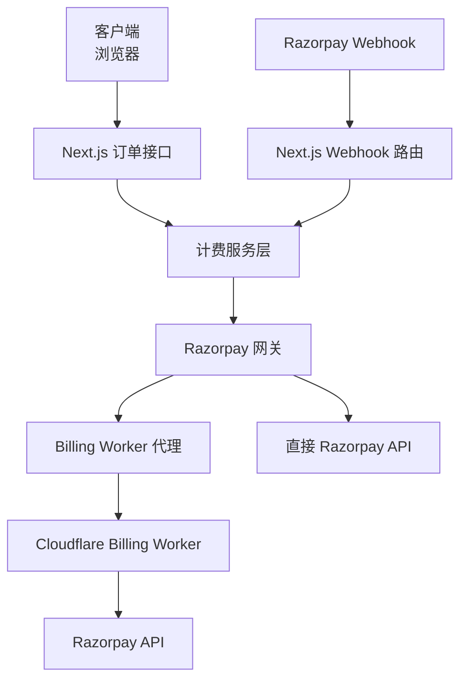
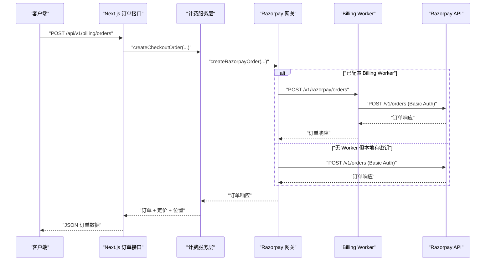
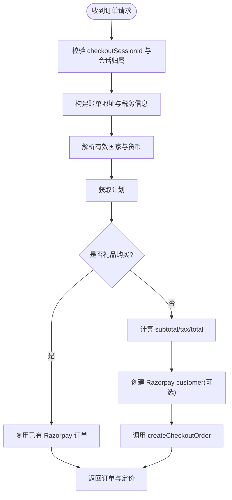
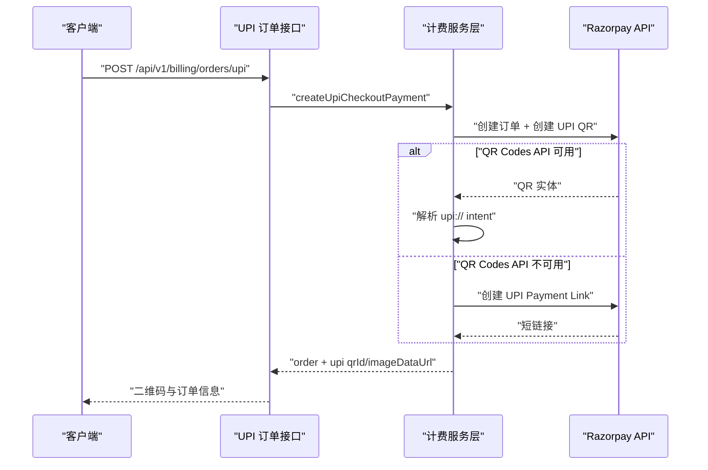
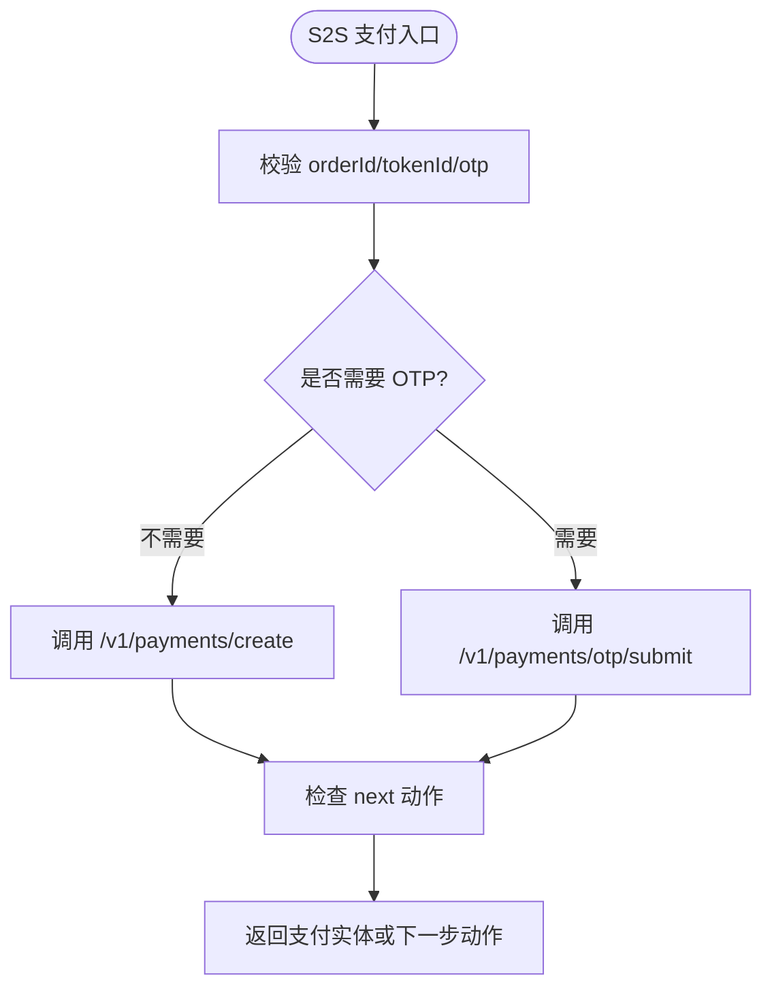
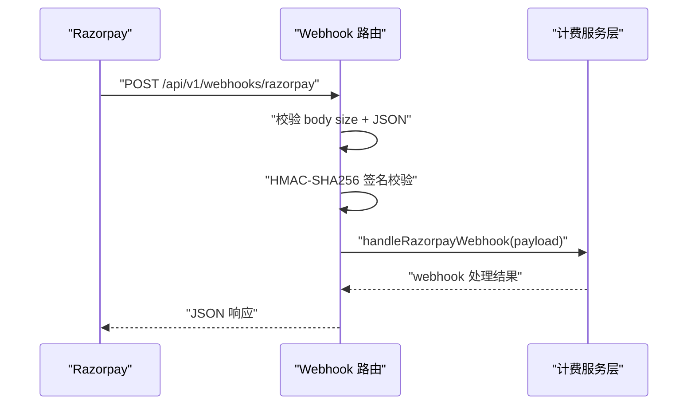
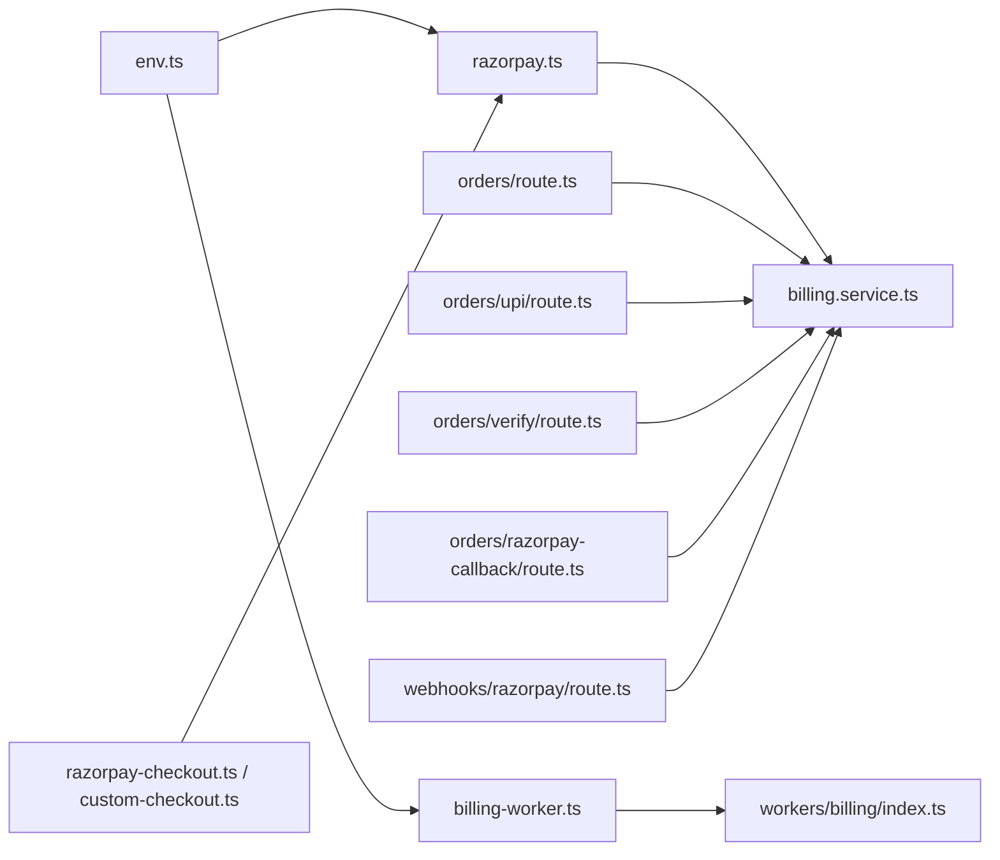

# 支付集成

<cite>
**本文引用的文件**   
- [src/server/billing/razorpay.ts](file://src/server/billing/razorpay.ts)
- [src/server/billing/billing-worker.ts](file://src/server/billing/billing-worker.ts)
- [workers/billing/src/index.ts](file://workers/billing/src/index.ts)
- [src/server/config/env.ts](file://src/server/config/env.ts)
- [src/app/api/v1/webhooks/razorpay/route.ts](file://src/app/api/v1/webhooks/razorpay/route.ts)
- [src/app/api/v1/billing/orders/route.ts](file://src/app/api/v1/billing/orders/route.ts)
- [src/app/api/v1/billing/orders/upi/route.ts](file://src/app/api/v1/billing/orders/upi/route.ts)
- [src/app/api/v1/billing/orders/upi/poll/route.ts](file://src/app/api/v1/billing/orders/upi/poll/route.ts)
- [src/app/api/v1/billing/orders/upi/qr/[qrId]/image/route.ts](file://src/app/api/v1/billing/orders/upi/qr/[qrId]/image/route.ts)
- [src/app/api/v1/billing/orders/verify/route.ts](file://src/app/api/v1/billing/orders/verify/route.ts)
- [src/app/api/v1/billing/orders/razorpay-callback/route.ts](file://src/app/api/v1/billing/orders/razorpay-callback/route.ts)
- [src/server/services/billing.service.ts](file://src/server/services/billing.service.ts)
- [src/server/billing/checkout-session.ts](file://src/server/billing/checkout-session.ts)
- [src/server/billing/checkout-location.ts](file://src/server/billing/checkout-location.ts)
- [src/shared/lib/razorpay-checkout.ts](file://src/shared/lib/razorpay-checkout.ts)
- [src/shared/lib/razorpay-custom-checkout.ts](file://src/shared/lib/razorpay-custom-checkout.ts)
- [src/shared/lib/razorpay-payment-methods.ts](file://src/shared/lib/razorpay-payment-methods.ts)
- [scripts/ops/smoke-razorpay-upi-qr.mjs](file://scripts/ops/smoke-razorpay-upi-qr.mjs)
- [supabase/migrations/20260725180000_payment_methods_upi_and_mandate.sql](file://supabase/migrations/20260725180000_payment_methods_upi_and_mandate.sql)
</cite>

## 目录
1. [简介](#简介)
2. [项目结构](#项目结构)
3. [核心组件](#核心组件)
4. [架构总览](#架构总览)
5. [详细组件分析](#详细组件分析)
6. [依赖关系分析](#依赖关系分析)
7. [性能与可用性特性](#性能与可用性特性)
8. [故障排查指南](#故障排查指南)
9. [结论](#结论)

## 简介
本文件系统化说明 Razorpay 支付集成，覆盖配置、认证、订单创建、UPI QR、卡片支付、OTP 验证、Webhook 签名校验、回调处理、幂等性、支付方式保存与令牌管理、支付状态同步、失败重试和异常处理。系统支持两条执行路径：

- **直接调用 Razorpay API**：当 Vercel 环境变量中存在 `RAZORPAY_KEY_ID` 与 `RAZORPAY_KEY_SECRET` 时，服务器可直接以 Basic Auth 调用 Razorpay。
- **Cloudflare Billing Worker 代理**：当配置了 `BILLING_WORKER_URL` 与 `BILLING_INTERNAL_TOKEN` 时，所有 Razorpay 请求优先通过内部 Worker 转发，密钥只驻留在 Cloudflare 中；Worker 不可用且未配置本地密钥时，按策略回退或返回 503。

该设计确保生产环境可把 Razorpay 密钥从 Vercel 上完全移除，同时保留开发和本地调试能力。

## 项目结构
Razorpay 相关代码分布在以下层次：

| 层次 | 职责 | 关键文件 |
|---|---|---|
| 运行时配置 | 加载 Razorpay、Webhook、UPI profile、Billing Worker 等环境变量 | [src/server/config/env.ts](file://src/server/config/env.ts) |
| 网关封装 | Basic Auth、路由选择、API 统一错误、签名校验、订单/QR/支付链接/令牌工具 | [src/server/billing/razorpay.ts](file://src/server/billing/razorpay.ts) |
| Worker 代理 | 将 `/v1/*` Razorpay 请求转发到 Cloudflare Worker，并处理内部鉴权 | [src/server/billing/billing-worker.ts](file://src/server/billing/billing-worker.ts) |
| Cloudflare Worker | 持有 Razorpay 密钥、生成发票 PDF、发送账单邮件、校验签名 | [workers/billing/src/index.ts](file://workers/billing/src/index.ts) |
| Next.js API 路由 | 订单创建、UPI QR、支付验证、Webhook、支付方式设置 | 多个 `app/api/v1/billing/*` 路由 |
| 业务服务层 | 订单持久化、支付核对、发票生成、礼物交付、地址与税务推导 | [src/server/services/billing.service.ts](file://src/server/services/billing.service.ts) |
| 前端库 | Standard Checkout、Custom Checkout、支付方法配置、Apple Pay Express | [src/shared/lib/razorpay-checkout.ts](file://src/shared/lib/razorpay-checkout.ts)、[src/shared/lib/razorpay-custom-checkout.ts](file://src/shared/lib/razorpay-custom-checkout.ts)、[src/shared/lib/razorpay-payment-methods.ts](file://src/shared/lib/razorpay-payment-methods.ts) |
| 数据库迁移 | 支付方式表扩展 UPI Autopay、mandate、VPA、显示标签 | [supabase/migrations/20260725180000_payment_methods_upi_and_mandate.sql](file://supabase/migrations/20260725180000_payment_methods_upi_and_mandate.sql) |

**图表来源**
- [src/server/billing/razorpay.ts:1-120](file://src/server/billing/razorpay.ts#L1-L120)
- [src/server/billing/billing-worker.ts:1-80](file://src/server/billing/billing-worker.ts#L1-L80)
- [workers/billing/src/index.ts:1-120](file://workers/billing/src/index.ts#L1-L120)
- [src/app/api/v1/webhooks/razorpay/route.ts:1-70](file://src/app/api/v1/webhooks/razorpay/route.ts#L1-L70)

**章节来源**
- [src/server/config/env.ts:1-120](file://src/server/config/env.ts#L1-L120)
- [src/server/billing/razorpay.ts:1-120](file://src/server/billing/razorpay.ts#L1-L120)
- [src/server/billing/billing-worker.ts:1-80](file://src/server/billing/billing-worker.ts#L1-L80)
- [workers/billing/src/index.ts:1-120](file://workers/billing/src/index.ts#L1-L120)

## 核心组件

### Razorpay 网关封装
`src/server/billing/razorpay.ts` 是支付集成的核心：

- **Basic Auth 构造**：使用 `RAZORPAY_KEY_ID:RAZORPAY_KEY_SECRET` 的 Base64 值作为 Authorization 头。
- **直连函数**：`razorpayApiDirect` 直接访问 `https://api.razorpay.com`。
- **路由选择函数**：`razorpayApi` 根据路径与方法映射到 Billing Worker 的内部路由；若 Worker 不可用且未配置本地密钥，则抛错或回退到直连。
- **安全比较**：HMAC 结果使用 `timingSafeEqual` 比较，避免时序攻击。
- **Webhook 签名校验**：`verifyWebhookSignature` 对原始 body 计算 HMAC-SHA256 hex 摘要并与 `x-razorpay-signature` 比较。
- **Checkout 回调签名校验**：`verifyPaymentSignature` 校验 `orderId|paymentId` 的 HMAC hex；`verifyPaymentSignatureSecure` 在无本地 secret 时委托 Worker。
- **订单、支付、QR、支付链接、令牌、OTP、S2S 支付**：统一封装 Razorpay REST 端点，并做 ID 格式校验。

**章节来源**
- [src/server/billing/razorpay.ts:1-200](file://src/server/billing/razorpay.ts#L1-L200)
- [src/server/billing/razorpay.ts:201-650](file://src/server/billing/razorpay.ts#L201-L650)
- [src/server/billing/razorpay.ts:650-1054](file://src/server/billing/razorpay.ts#L650-L1054)

### Billing Worker 代理
`src/server/billing/billing-worker.ts` 负责：

- 检查 `billingWorkerUrl` 与 `billingInternalToken`。
- 构造内部请求头：`Authorization: Bearer <token>` 与 `x-clauxen-billing`。
- 将 `/v1/razorpay/*` 请求转发到 Cloudflare Worker。
- 统一把非 2xx 响应包装为 `AppError`，状态码至少为 502。
- 提供发票生成与发票履约接口，用于后续 PDF/R2/Razorpay Documents/邮件流程。

**章节来源**
- [src/server/billing/billing-worker.ts:1-120](file://src/server/billing/billing-worker.ts#L1-L120)
- [src/server/billing/billing-worker.ts:120-243](file://src/server/billing/billing-worker.ts#L120-L243)

### Cloudflare Billing Worker
`workers/billing/src/index.ts` 是 Razorpay 密钥的实际运行环境，提供：

- 内部路由：订单、UPI QR、支付查询、卡信息、S2S 支付、OTP、客户与令牌、QR 查询与关闭、签名校验、发票生成与履约、邮件。
- 内部鉴权：Bearer Token 或 `x-clauxen-billing` header。
- Razorpay Basic Auth：仅从 Worker 环境变量读取密钥。
- HMAC-SHA256 实现：使用 Web Crypto API 生成 hex 摘要。

**章节来源**
- [workers/billing/src/index.ts:1-120](file://workers/billing/src/index.ts#L1-L120)
- [workers/billing/src/index.ts:120-200](file://workers/billing/src/index.ts#L120-L200)

### 环境变量与配置
`src/server/config/env.ts` 暴露关键配置：

| 变量 | 用途 |
|---|---|
| `RAZORPAY_KEY_ID` | Razorpay 直连 Key ID |
| `RAZORPAY_KEY_SECRET` | Razorpay 直连密钥 |
| `RAZORPAY_WEBHOOK_SECRET` | Webhook HMAC 校验密钥 |
| `NEXT_PUBLIC_RAZORPAY_KEY_ID` | 前端展示用的公共 Key ID |
| `RAZORPAY_UPI_PA/PN/TN/MC/MODE/TR_SUFFIX` | UPI profile 与 intent 构造回退值 |
| `BILLING_WORKER_URL` / `BILLING_INTERNAL_TOKEN` | Cloudflare Billing Worker 内部地址与密钥 |
| `CHECKOUT_USD_INR_RATE` | 结账 USD/INR 汇率 |

**章节来源**
- [src/server/config/env.ts:1-200](file://src/server/config/env.ts#L1-L200)

## 架构总览

**图表来源**
- [src/app/api/v1/billing/orders/route.ts:1-172](file://src/app/api/v1/billing/orders/route.ts#L1-L172)
- [src/server/services/billing.service.ts:300-600](file://src/server/services/billing.service.ts#L300-L600)
- [src/server/billing/razorpay.ts:1-200](file://src/server/billing/razorpay.ts#L1-L200)
- [workers/billing/src/index.ts:1-120](file://workers/billing/src/index.ts#L1-L120)

## 详细组件分析

### 支付网关配置与认证方式

#### 配置判断
- `isRazorpayConfigured()` 优先判断是否配置了 Billing Worker；否则判断是否存在 `RAZORPAY_KEY_ID` 与 `RAZORPAY_KEY_SECRET`。
- `isBillingWorkerConfigured()` 判断 `billingWorkerUrl` 与 `billingInternalToken` 是否都存在。

#### Basic Auth
- 直连模式：Authorization 头为 `Basic base64(keyId:keySecret)`。
- Worker 模式：Worker 内部再构造 Razorpay Basic Auth，Next.js 不持有密钥。
- 缺失密钥时抛出 `billing_unavailable` 503 错误。

#### 路由选择逻辑
`razorpayApi` 将常见 Razorpay 路径映射到 Worker 内部路由，例如：

| Razorpay 路径 | 方法 | 映射到 Worker |
|---|---|---|
| `/v1/orders` | POST | `/v1/razorpay/orders` |
| `/v1/payments/qr_codes` | POST | `/v1/razorpay/upi-qr` |
| `/v1/customers` | POST | `/v1/razorpay/customers` |
| `/v1/payments/create` | POST | `/v1/razorpay/payments/create` |
| `/v1/payments/otp/submit` | POST | `/v1/razorpay/payments/otp/submit` |
| `/v1/payments/otp/resend` | POST | `/v1/razorpay/payments/otp/resend` |
| `/v1/payments/:id/capture` | POST | `/v1/razorpay/payments/:id/capture` |
| `/v1/payments/:id/card` | GET | `/v1/razorpay/payments/:id/card` |
| `/v1/payments/:id` | GET | `/v1/razorpay/payments/:id` |
| `/v1/customers/:id/tokens` | GET/DELETE | `/v1/razorpay/customers/:id/tokens` |
| `/v1/customers/:id` | GET | `/v1/razorpay/customers/:id` |
| `/v1/orders/:id` | GET | `/v1/razorpay/orders/:id` |
| `/v1/payments/qr_codes/:id` | GET | `/v1/razorpay/qr/:id` |
| `/v1/payments/qr_codes/:id/payments` | GET | `/v1/razorpay/qr/:id/payments` |
| `/v1/payments/qr_codes/:id/close` | POST | `/v1/razorpay/qr/:id/close` |

如果匹配不到 Worker 路由，则走直连。Worker 不可用时的行为取决于 `billingRequireWorker`：

- 开启强制 Worker 模式：直接抛出异常。
- 未开启：尝试使用本地 Razorpay 密钥；仍失败则抛错。

**章节来源**
- [src/server/billing/razorpay.ts:1-120](file://src/server/billing/razorpay.ts#L1-L120)
- [src/server/billing/billing-worker.ts:1-80](file://src/server/billing/billing-worker.ts#L1-L80)

### 订单创建与支付路由选择

#### 常规订阅订单
`POST /api/v1/billing/orders` 流程：

1. 校验会话与用户。
2. 校验 checkout session claims 与客户端输入一致。
3. 构建最小开票信息。
4. 基于声明国家与 IP 国家决定有效国家、货币与 GST。
5. 获取计划信息。
6. 如果是礼品购买，复用已创建的 Razorpay 订单。
7. 计算子金额、税额与总金额。
8. 尝试创建 Razorpay customer（用于保存卡）。
9. 调用 `billingService.createCheckoutOrder`。
10. 返回订单、Razorpay 公开 key、定价与位置证据。

**图表来源**
- [src/app/api/v1/billing/orders/route.ts:1-172](file://src/app/api/v1/billing/orders/route.ts#L1-L172)
- [src/server/services/billing.service.ts:600-900](file://src/server/services/billing.service.ts#L600-L900)

**章节来源**
- [src/app/api/v1/billing/orders/route.ts:1-172](file://src/app/api/v1/billing/orders/route.ts#L1-L172)
- [src/server/services/billing.service.ts:600-900](file://src/server/services/billing.service.ts#L600-L900)

### UPI QR 生成与扫码支付

#### UPI QR 创建
`POST /api/v1/billing/orders/upi` 流程：

1. 校验 checkout session 与用户。
2. 获取计划与价格。
3. 限制仅 INR 印度场景可用。
4. 计算税额与总金额。
5. 并行创建 Razorpay Order 与 UPI QR。
6. 如果 QR Codes API 不可用，自动降级为 UPI Payment Link。
7. 解析原生 `upi://` intent，渲染干净方形 PNG。
8. 将 intent 缓存到订单 metadata，避免重复解码。
9. 返回订单、Razorpay 公开 key、UPI QR 信息与 close_by。

**图表来源**
- [src/app/api/v1/billing/orders/upi/route.ts:1-148](file://src/app/api/v1/billing/orders/upi/route.ts#L1-L148)
- [src/server/services/billing.service.ts:300-600](file://src/server/services/billing.service.ts#L300-L600)
- [src/server/billing/razorpay.ts:650-1054](file://src/server/billing/razorpay.ts#L650-L1054)

#### UPI QR 图像
`GET /api/v1/billing/orders/upi/qr/[qrId]/image`：

- 仅允许订单所有者获取。
- 对于 Payment Link，解析 `plink_*` ID 并拉取短链接。
- 优先使用缓存的 `upiIntent`。
- 否则拉取 Razorpay QR 或解析 branded image_url 得到 `upi://`。
- 返回干净 PNG，避免 Razorpay 品牌营销卡片。

**章节来源**
- [src/app/api/v1/billing/orders/upi/qr/[qrId]/image/route.ts:1-99](file://src/app/api/v1/billing/orders/upi/qr/[qrId]/image/route.ts#L1-L99)
- [src/server/billing/razorpay.ts:650-1054](file://src/server/billing/razorpay.ts#L650-L1054)

#### UPI 支付轮询
`POST /api/v1/billing/orders/upi/poll`：

- 校验 `qrId` 与 `billingOrderId`。
- 如果是 Payment Link：拉取 link 状态，找到 captured/authorized payment。
- 如果是 QR：拉取 QR payments，找到 captured 支付。
- 拉取完整 payment entity，校验金额。
- 同步 Razorpay order_id。
- 调用 `fulfillPayment` 完成订单。
- 触发发票生成与礼物交付。

**章节来源**
- [src/app/api/v1/billing/orders/upi/poll/route.ts:1-31](file://src/app/api/v1/billing/orders/upi/poll/route.ts#L1-L31)
- [src/server/services/billing.service.ts:600-900](file://src/server/services/billing.service.ts#L600-L900)

### 卡片支付与 OTP 验证

#### 标准 Checkout 与 Custom Checkout
- **Standard Checkout**：使用 `checkout.razorpay.com/v1/checkout.js`，适合大多数场景，包括 Apple Pay Express。
- **Custom Checkout**：使用 `checkout.razorpay.com/v1/razorpay.js`，卡片和网银数据直接在浏览器发送给 Razorpay，不经过服务端。
- 前端库会动态注入脚本、清理冲突全局对象、预热 TLS、校验输入参数。

#### 支付方式配置
前端支持的支付方式包括卡、Google Pay、PhonePe、Paytm、其他 UPI，以及标准 Checkout 下的网银和钱包。Express Checkout 专用于 Apple Pay。

#### S2S 令牌支付与 OTP
服务端支持 Razorpay Server-to-Server 令牌支付流程：

- `createRazorpayTokenPayment`：使用 token 发起支付。
- `submitRazorpayPaymentOtp`：提交 OTP。
- `resendRazorpayPaymentOtp`：重新发送 OTP。
- 这些接口也受 Billing Worker 路由映射保护。

**图表来源**
- [src/server/billing/razorpay.ts:201-650](file://src/server/billing/razorpay.ts#L201-L650)
- [src/shared/lib/razorpay-checkout.ts:1-200](file://src/shared/lib/razorpay-checkout.ts#L1-L200)
- [src/shared/lib/razorpay-custom-checkout.ts:1-200](file://src/shared/lib/razorpay-custom-checkout.ts#L1-L200)

**章节来源**
- [src/shared/lib/razorpay-checkout.ts:1-200](file://src/shared/lib/razorpay-checkout.ts#L1-L200)
- [src/shared/lib/razorpay-custom-checkout.ts:1-200](file://src/shared/lib/razorpay-custom-checkout.ts#L1-L200)
- [src/shared/lib/razorpay-payment-methods.ts:1-200](file://src/shared/lib/razorpay-payment-methods.ts#L1-L200)
- [src/server/billing/razorpay.ts:201-650](file://src/server/billing/razorpay.ts#L201-L650)

### Webhook 签名验证与回调处理

#### Webhook 入口
`POST /api/v1/webhooks/razorpay`：

1. 限制请求体大小。
2. 解析 JSON，校验 `event` 字段。
3. 使用 `verifyWebhookSignature` 校验 `x-razorpay-signature`。
4. 调用 `billingService.handleRazorpayWebhook`。
5. 返回结构化响应；失败返回标准化 JSON 错误。

**图表来源**
- [src/app/api/v1/webhooks/razorpay/route.ts:1-70](file://src/app/api/v1/webhooks/razorpay/route.ts#L1-L70)
- [src/server/billing/razorpay.ts:650-1054](file://src/server/billing/razorpay.ts#L650-L1054)

#### 自定义 Checkout 回调
`POST /api/v1/billing/orders/razorpay-callback`：

- 仅接受同域相对路径 return，防止开放重定向。
- 支持 form 与 JSON。
- 校验 Razorpay 返回的 order/payment/signature 格式。
- 校验订单归属当前用户。
- 调用 `verifyCheckoutPayment` 完成支付。
- 303 重定向回原结账页面，携带 `?checkout=success|failed|error`。

**章节来源**
- [src/app/api/v1/webhooks/razorpay/route.ts:1-70](file://src/app/api/v1/webhooks/razorpay/route.ts#L1-L70)
- [src/app/api/v1/billing/orders/razorpay-callback/route.ts:1-111](file://src/app/api/v1/billing/orders/razorpay-callback/route.ts#L1-L111)

### 支付签名验证与幂等性

#### Checkout 回调签名
- 路由层先正则校验 `razorpay_order_id`、`razorpay_payment_id`、`razorpay_signature`。
- 再查询数据库确认订单属于当前用户，防止 IDOR。
- 最后调用 `billingService.verifyCheckoutPayment`。

#### Webhook 签名
- 使用 `RAZORPAY_WEBHOOK_SECRET` 对原始 body 计算 hex HMAC。
- 使用 `timingSafeEqual` 比较，避免时序攻击。

#### 幂等性保证
- 支付成功后的订单履行、发票生成、礼物交付都通过服务层与仓储层协调，避免重复发放。
- UPI 轮询与 webhook 都先检查支付状态，再执行 fulfill。
- 礼物交付使用 delivery-job 与 code-rotation 守卫。
- 订单金额在多个环节被再次校验，防止篡改。

**章节来源**
- [src/app/api/v1/billing/orders/verify/route.ts:1-90](file://src/app/api/v1/billing/orders/verify/route.ts#L1-L90)
- [src/app/api/v1/webhooks/razorpay/route.ts:1-70](file://src/app/api/v1/webhooks/razorpay/route.ts#L1-L70)
- [src/server/services/billing.service.ts:600-900](file://src/server/services/billing.service.ts#L600-L900)

### 支付方式保存、令牌管理与 UPI Autopay

#### 支付方式设置入口
- `POST /api/v1/billing/payment-methods/setup`：启动 card 或 upi 支付方式设置。
- `POST /api/v1/billing/payment-methods/setup/verify`：验证 Razorpay 返回的 order/payment/signature。
- `GET /api/v1/billing/payment-methods`：列出用户已保存的支付方式。

#### 数据库模型
`payment_methods` 表扩展：

| 字段 | 含义 |
|---|---|
| `method_type` | `card` 或 `upi` |
| `upi_vpa` | UPI Autopay VPA |
| `display_label` | 显示标签 |
| `mandate_max_amount_paise` | mandate 授权上限 |
| `mandate_status` | mandate 状态 |
| `card_first4` / `card_last4` | PCI-safe 卡号片段 |

约束保证 card 类型必须包含首尾四位数字，upi 类型必须包含 VPA 或 display_label。

**章节来源**
- [src/app/api/v1/billing/payment-methods/setup/route.ts:1-49](file://src/app/api/v1/billing/payment-methods/setup/route.ts#L1-L49)
- [src/app/api/v1/billing/payment-methods/setup/verify/route.ts:1-56](file://src/app/api/v1/billing/payment-methods/setup/verify/route.ts#L1-L56)
- [src/app/api/v1/billing/payment-methods/route.ts:1-16](file://src/app/api/v1/billing/payment-methods/route.ts#L1-L16)
- [supabase/migrations/20260725180000_payment_methods_upi_and_mandate.sql:1-31](file://supabase/migrations/20260725180000_payment_methods_upi_and_mandate.sql#L1-L31)

### 地理位置、货币与税务

#### 订单时间位置决策
`resolveOrderTimeLocation`：

- 使用声明国家与 IP 国家。
- 任意一个信号为 IN → 有效国家为 IN，货币为 INR，可能产生 18% GST。
- 两个信号都不是 IN → 非印度出口，USD 零税率。
- 保守策略：冲突时默认计入印度，避免逃避 GST。

#### 支付后仪器证据
`instrumentCountryHint` 与 `evaluateLocationVerdict`：

- UPI、netbanking、EMI、wallet、RuPay、国内卡倾向 IN。
- 国际卡标记 FOREIGN。
- 最终 2-of-3 投票：声明、IP、仪器证据。
- 平票或印度支付轨道 → 有效国家为 IN。

**章节来源**
- [src/server/billing/checkout-location.ts:1-197](file://src/server/billing/checkout-location.ts#L1-L197)

### 结账会话与返回路径

#### 结账会话
- 使用 Base64url claims + HMAC 签名。
- TTL 6 小时，避免 UPI/地址/支付过程中过期。
- 支持 gift checkout、seat breakdown、maxTier、returnPath 等扩展字段。
- 提供 inspect、verify、refresh 三种语义：无效、过期、有效。

#### 返回路径清洗
- 仅允许 `/new`、`/library`、`/scheduled`、`/my-clauxen` 等白名单路径。
- 过滤协议相对路径、反斜杠、`@` 等危险字符。
- 非法输入回退到 `/new`。

**章节来源**
- [src/server/billing/checkout-session.ts:1-204](file://src/server/billing/checkout-session.ts#L1-L204)

## 依赖关系分析

**图表来源**
- [src/server/config/env.ts:1-200](file://src/server/config/env.ts#L1-L200)
- [src/server/billing/razorpay.ts:1-200](file://src/server/billing/razorpay.ts#L1-L200)
- [src/server/billing/billing-worker.ts:1-120](file://src/server/billing/billing-worker.ts#L1-L120)
- [src/server/services/billing.service.ts:1-300](file://src/server/services/billing.service.ts#L1-L300)
- [workers/billing/src/index.ts:1-120](file://workers/billing/src/index.ts#L1-L120)

**章节来源**
- [src/server/billing/razorpay.ts:1-200](file://src/server/billing/razorpay.ts#L1-L200)
- [src/server/billing/billing-worker.ts:1-120](file://src/server/billing/billing-worker.ts#L1-L120)
- [src/server/services/billing.service.ts:1-300](file://src/server/services/billing.service.ts#L1-L300)
- [workers/billing/src/index.ts:1-120](file://workers/billing/src/index.ts#L1-L120)

## 性能与可用性特性

- **Worker 优先**：生产部署建议启用 Billing Worker，使 Razorpay 密钥不出 Vercel。
- **直连回退**：开发环境可继续使用本地 Razorpay 密钥，降低配置成本。
- **UPI QR 降级**：如果 Razorpay QR Codes API 不可用，自动切换到 UPI Payment Link。
- **UPI intent 缓存**：首次解析出 `upi://` 后缓存到订单 metadata，减少重复解码。
- **Clean QR 渲染**：不使用 Razorpay 带品牌的长图，而是渲染紧凑方形 PNG，提升移动端扫码体验。
- **并行请求**：创建订单与 UPI QR 并行执行，缩短端到端延迟。
- **脚本预连接**：Custom Checkout 预热 `checkout.razorpay.com` 与 `api.razorpay.com`。
- **限额保护**：订单子金额上限、签名长度限制、请求体大小限制、ID 正则校验。

[本节为通用指导，不直接分析具体代码行]

## 故障排查指南

### 常见问题

| 现象 | 可能原因 | 排查步骤 |
|---|---|---|
| 503 billing_unavailable | 未配置 Razorpay 密钥且 Billing Worker 未配置 | 检查 `RAZORPAY_KEY_ID`、`RAZORPAY_KEY_SECRET`、`BILLING_WORKER_URL`、`BILLING_INTERNAL_TOKEN` |
| Webhook 返回 401 unauthorized | `x-razorpay-signature` 不匹配 | 检查 `RAZORPAY_WEBHOOK_SECRET`、原始 body、Razorpay Dashboard Webhook 配置 |
| UPI QR 无法显示 | QR Codes API 未启用或 `image_content` 缺失 | 查看 QR 创建日志；检查 Payment Link 降级路径 |
| 扫码金额不一致 | `upi://` 中的 `am=` 与实际订单金额不同 | 检查 `assertUpiIntentAmount`、Razorpay QR amount、Payment Link amount |
| 支付验证失败 | 回调签名或订单归属校验失败 | 检查 `verifyCheckoutPayment`、订单 user_id、signature 格式 |
| 银行卡支付卡住 | Custom Checkout 网银双弹窗或 redirect 被拦截 | 使用 Standard Checkout 或确保 same-tab redirect |
| S2S 支付报错 | Token 支付未启用或 OTP 流程未完成 | 检查 Razorpay S2S 权限、next 动作、OTP 输入 |

### 调试技巧

1. **Smoke 测试 UPI QR**  
   使用脚本直接调用 Razorpay QR Codes API，验证账户是否启用该能力：
   - 命令：`node scripts/ops/smoke-razorpay-upi-qr.mjs`
   - 要求：`.env.local` 或环境变量中包含有效的 `RAZORPAY_KEY_ID` 与 `RAZORPAY_KEY_SECRET`。
   - 输出：CREATE_OK、FETCH、CLOSE 状态。

2. **检查 Webhook 原始 payload**  
   在 `POST /api/v1/webhooks/razorpay` 之前记录 rawBody 与 signature，确认 HMAC 计算方式与 Razorpay 文档一致。

3. **区分 invalid_session 与 expired_session**  
   结账会话分为“无效”“过期”“有效”，前端可根据状态决定是否重新 mint session。

4. **定位 Indian vs Export 场景**  
   通过 location evidence 的 declared、ip、instrument、effective、verdict 字段判断是否误判为出口。

5. **检查 Worker 内部路由**  
   如果 Billing Worker 返回 503 或 502，确认内部 token、路径映射、Razorpay 密钥是否在 Worker 环境中正确配置。

**章节来源**
- [scripts/ops/smoke-razorpay-upi-qr.mjs:1-125](file://scripts/ops/smoke-razorpay-upi-qr.mjs#L1-L125)
- [src/app/api/v1/webhooks/razorpay/route.ts:1-70](file://src/app/api/v1/webhooks/razorpay/route.ts#L1-L70)
- [src/server/billing/checkout-session.ts:1-204](file://src/server/billing/checkout-session.ts#L1-L204)
- [src/server/billing/checkout-location.ts:1-197](file://src/server/billing/checkout-location.ts#L1-L197)

## 结论
该 Razorpay 支付集成采用“Worker 优先、直连回退”的双路径架构，既满足生产环境密钥隔离，又保留本地开发便利。系统覆盖了订单创建、UPI QR、Payment Link 降级、卡片支付、S2S 令牌支付、OTP 验证、Webhook 签名校验、回调处理、支付方式保存、令牌管理与地理位置税务判定。通过严格的 ID 校验、金额校验、所有权校验、HMAC 时序安全比较与多次幂等保护，系统在安全性与可靠性方面具备较完整的工程实践。

在实际部署中，推荐：

- 生产环境启用 Billing Worker，并将 Razorpay 密钥只放在 Cloudflare。
- 配置 `RAZORPAY_WEBHOOK_SECRET` 并开启签名校验。
- 启用 QR Codes API，并为 Payment Link 保留降级路径。
- 使用 `smoke-razorpay-upi-qr.mjs` 进行上线前冒烟测试。
- 监控 Webhook、支付验证、UPI 轮询与发票生成链路，及时发现异步状态不一致问题。

[本节为总结性内容，不直接分析具体代码行]