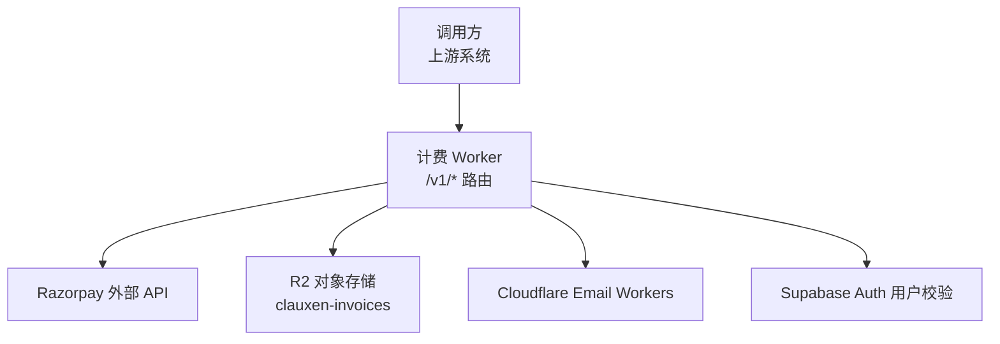
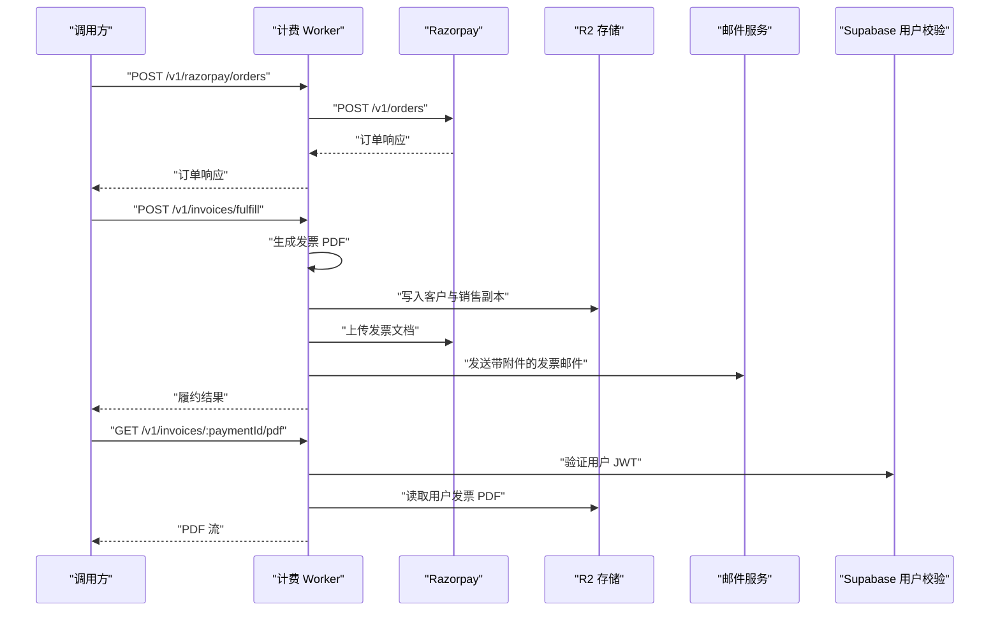
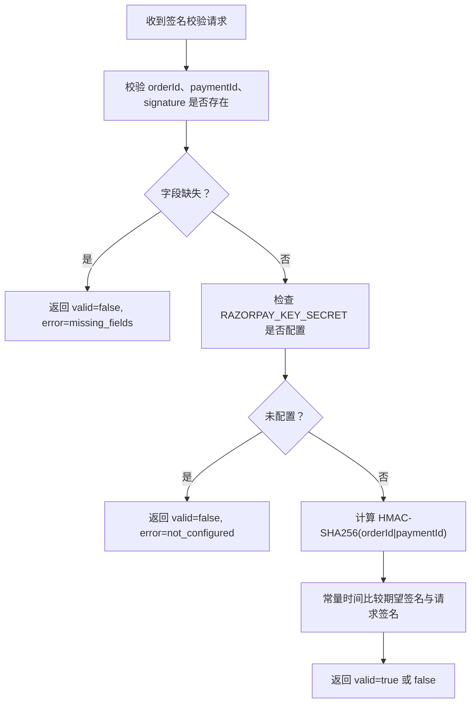
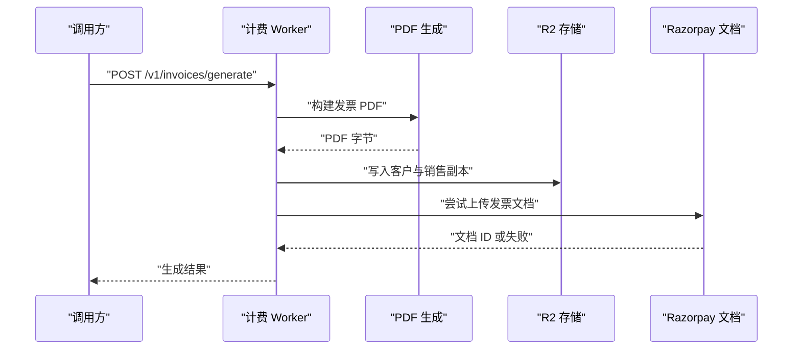
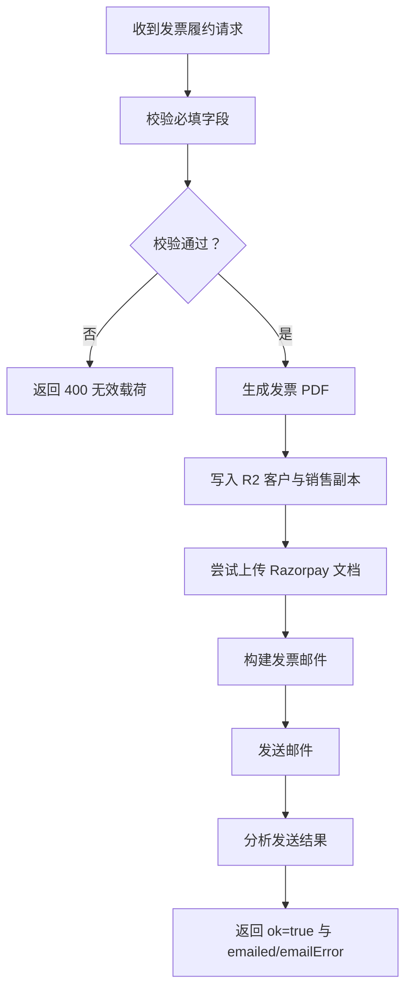
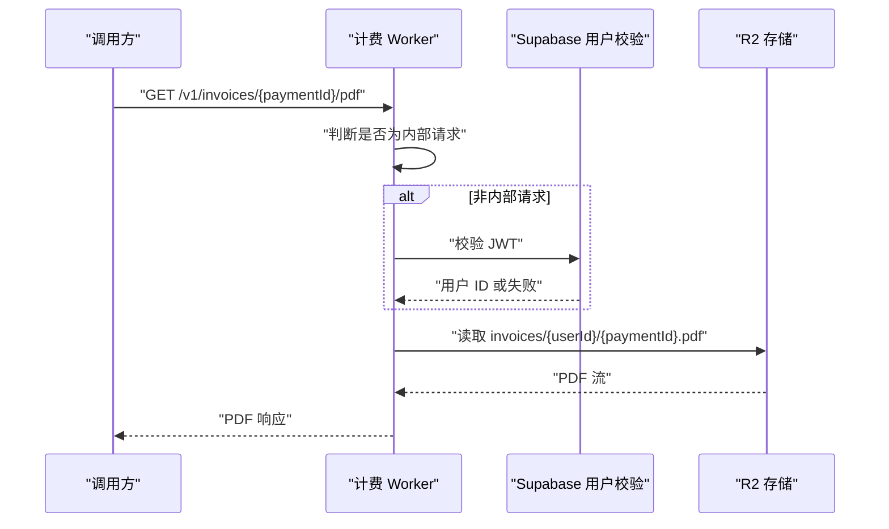
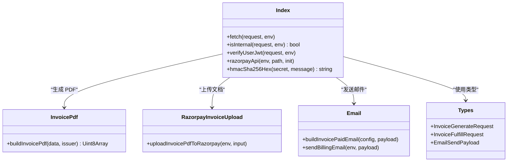

# 计费 Worker API

<cite>
**本文引用的文件**   
- [workers/billing/src/index.ts](file://workers/billing/src/index.ts)
- [workers/billing/src/types.ts](file://workers/billing/src/types.ts)
- [workers/billing/src/email.ts](file://workers/billing/src/email.ts)
- [workers/billing/src/invoice-pdf.ts](file://workers/billing/src/invoice-pdf.ts)
- [workers/billing/src/razorpay-invoice-upload.ts](file://workers/billing/src/razorpay-invoice-upload.ts)
- [workers/billing/wrangler.toml](file://workers/billing/wrangler.toml)
</cite>

## 目录
1. [简介](#简介)
2. [项目结构](#项目结构)
3. [核心组件](#核心组件)
4. [架构总览](#架构总览)
5. [详细端点参考](#详细端点参考)
6. [依赖与集成分析](#依赖与集成分析)
7. [性能与扩展性](#性能与扩展性)
8. [故障排查指南](#故障排查指南)
9. [结论](#结论)

## 简介
计费 Worker 是一个运行在 Cloudflare Workers 上的内部服务，负责：
- 作为 Razorpay 的受控代理，为上游应用创建订单、生成 UPI 收款码、查询支付、处理 Express Pay（令牌支付）和保存客户支付令牌。
- 生成并归档发票 PDF，上传至 R2 存储，并尝试同步到 Razorpay Documents。
- 发送账单通知邮件，包括已支付发票回执、地址变更通知、礼品通知等。
- 提供用户侧发票 PDF 下载接口，使用 Supabase JWT 或内部认证鉴权。

该 Worker 的所有业务路由均位于根路径下，并通过单一入口函数统一分发。

**章节来源**
- [workers/billing/src/index.ts:1-40](file://workers/billing/src/index.ts#L1-L40)

## 项目结构
billing Worker 的核心代码集中在 `workers/billing/src` 中：
- `index.ts`：HTTP 路由、鉴权、Razorpay 代理、发票生成、PDF 归档、Razorpay 文档上传、邮件发送和用户 PDF 下载。
- `types.ts`：发票生成与履约请求/响应类型。
- `email.ts`：基于 Cloudflare Email Workers 绑定的邮件模板与发送逻辑。
- `invoice-pdf.ts`：基于 pdf-lib 的服务端 PDF 生成逻辑。
- `razorpay-invoice-upload.ts`：将发票 PDF 上传到 Razorpay Documents 并与支付关联。
- `wrangler.toml`：Worker 名称、可观测性、环境变量、Secrets、Email 绑定和 R2 桶配置。

**图表来源**
- [workers/billing/src/index.ts:100-180](file://workers/billing/src/index.ts#L100-L180)
- [workers/billing/src/email.ts:1-30](file://workers/billing/src/email.ts#L1-L30)
- [workers/billing/src/invoice-pdf.ts:1-25](file://workers/billing/src/invoice-pdf.ts#L1-L25)
- [workers/billing/src/razorpay-invoice-upload.ts:1-25](file://workers/billing/src/razorpay-invoice-upload.ts#L1-L25)
- [workers/billing/wrangler.toml:1-38](file://workers/billing/wrangler.toml#L1-L38)

**章节来源**
- [workers/billing/src/index.ts:1-40](file://workers/billing/src/index.ts#L1-L40)
- [workers/billing/wrangler.toml:1-38](file://workers/billing/wrangler.toml#L1-L38)

## 核心组件
- **路由与鉴权层**：所有 `/v1/*` 路由由主 `fetch` 函数解析；内部端点要求 Bearer Token 或 `x-clauxen-billing` 头；用户 PDF 下载支持 Supabase JWT。
- **Razorpay 代理层**：封装 Razorpay 密钥、Basic Auth、JSON 透传、状态码透传与错误包装。
- **发票层**：生成 PDF、写入 R2、可选上传 Razorpay Documents。
- **邮件层**：构造 HTML/纯文本邮件，附加 PDF，并解析发送结果。
- **类型层**：集中定义发票字段、金额单位（paise）、发票种类与邮件负载。

**章节来源**
- [workers/billing/src/index.ts:100-180](file://workers/billing/src/index.ts#L100-L180)
- [workers/billing/src/types.ts:1-80](file://workers/billing/src/types.ts#L1-L80)
- [workers/billing/src/email.ts:1-40](file://workers/billing/src/email.ts#L1-L40)

## 架构总览
计费 Worker 的典型流程如下：

**图表来源**
- [workers/billing/src/index.ts:250-420](file://workers/billing/src/index.ts#L250-L420)
- [workers/billing/src/index.ts:451-652](file://workers/billing/src/index.ts#L451-L652)

## 详细端点参考

### 通用说明
- 部署域名：由部署环境决定，通常通过 Cloudflare Workers 暴露。
- 内容类型：除 PDF 下载外，所有 JSON 响应均为 `application/json`。
- 缓存策略：大多数响应设置 `cache-control: no-store`；用户 PDF 下载为私有缓存。
- CORS：Worker 对 OPTIONS 请求返回允许跨域访问的响应头，允许 GET、POST 以及指定请求头。

**章节来源**
- [workers/billing/src/index.ts:230-260](file://workers/billing/src/index.ts#L230-L260)
- [workers/billing/src/index.ts:60-80](file://workers/billing/src/index.ts#L60-L80)

### 健康检查
- 方法：`GET`
- URL：`/health`
- 认证：无需认证
- 成功响应示例字段：
  - `ok`：布尔值，表示服务可用。
  - `service`：固定字符串 `clauxen-billing`。
  - `razorpay`：布尔值，表示是否已配置 Razorpay 密钥。
- 错误行为：未命中其他路由时返回 404。

**章节来源**
- [workers/billing/src/index.ts:240-260](file://workers/billing/src/index.ts#L240-L260)

### 内部认证机制
内部端点接受以下两种认证方式之一：
- `Authorization: Bearer <BILLING_INTERNAL_TOKEN>`
- `x-clauxen-billing: <BILLING_INTERNAL_TOKEN>`

令牌比较使用常量时间比较，防止时序攻击。若未配置 `BILLING_INTERNAL_TOKEN`，内部认证直接失败。

**章节来源**
- [workers/billing/src/index.ts:80-120](file://workers/billing/src/index.ts#L80-L120)

### Razorpay 订单
- 方法：`POST`
- URL：`/v1/razorpay/orders`
- 认证：内部 Bearer Token 或 `x-clauxen-billing`
- 请求体：透传给 Razorpay `/v1/orders`
- 响应：直接透传 Razorpay 响应，包含 Razorpay 的状态码与 JSON 体
- 典型用途：创建订阅或一次性订单

**章节来源**
- [workers/billing/src/index.ts:260-300](file://workers/billing/src/index.ts#L260-L300)

### Razorpay UPI 收款码
- 方法：`POST`
- URL：`/v1/razorpay/upi-qr`
- 认证：内部 Bearer Token 或 `x-clauxen-billing`
- 请求体：透传给 Razorpay `/v1/payments/qr_codes`
- 响应：直接透传 Razorpay 响应

**章节来源**
- [workers/billing/src/index.ts:290-310](file://workers/billing/src/index.ts#L290-L310)

### Razorpay 支付查询
- 方法：`GET`
- URL：`/v1/razorpay/payments/{paymentId}`
- 认证：内部 Bearer Token 或 `x-clauxen-billing`
- 查询参数：透传给 Razorpay，例如 `expand[]=card`
- 响应：直接透传 Razorpay 支付详情

**章节来源**
- [workers/billing/src/index.ts:310-330](file://workers/billing/src/index.ts#L310-L330)

### Razorpay 支付卡片证据
- 方法：`GET`
- URL：`/v1/razorpay/payments/{paymentId}/card`
- 认证：内部 Bearer Token 或 `x-clauxen-billing`
- 用途：获取卡组织、发卡行、国际交易标记等位置证据

**章节来源**
- [workers/billing/src/index.ts:330-350](file://workers/billing/src/index.ts#L330-L350)

### Razorpay 令牌支付创建
- 方法：`POST`
- URL：`/v1/razorpay/payments/create`
- 认证：内部 Bearer Token 或 `x-clauxen-billing`
- 请求体：透传给 Razorpay `/v1/payments/create`
- 用途：Express Pay 或 S2S 令牌支付

**章节来源**
- [workers/billing/src/index.ts:340-360](file://workers/billing/src/index.ts#L340-L360)

### Razorpay 令牌支付 OTP 提交
- 方法：`POST`
- URL：`/v1/razorpay/payments/otp/submit`
- 认证：内部 Bearer Token 或 `x-clauxen-billing`
- 请求体：透传给 Razorpay `/v1/payments/otp/submit`

**章节来源**
- [workers/billing/src/index.ts:360-380](file://workers/billing/src/index.ts#L360-L380)

### Razorpay 令牌支付 OTP 重发
- 方法：`POST`
- URL：`/v1/razorpay/payments/otp/resend`
- 认证：内部 Bearer Token 或 `x-clauxen-billing`
- 请求体：透传给 Razorpay `/v1/payments/otp/resend`

**章节来源**
- [workers/billing/src/index.ts:380-400](file://workers/billing/src/index.ts#L380-L400)

### Razorpay 支付捕获
- 方法：`POST`
- URL：`/v1/razorpay/payments/{paymentId}/capture`
- 认证：内部 Bearer Token 或 `x-clauxen-billing`
- 请求体：透传给 Razorpay `/v1/payments/{paymentId}/capture`

**章节来源**
- [workers/billing/src/index.ts:300-320](file://workers/billing/src/index.ts#L300-L320)

### Razorpay 订单查询
- 方法：`GET`
- URL：`/v1/razorpay/orders/{orderId}`
- 认证：内部 Bearer Token 或 `x-clauxen-billing`
- 响应：直接透传 Razorpay 订单详情

**章节来源**
- [workers/billing/src/index.ts:400-420](file://workers/billing/src/index.ts#L400-L420)

### Razorpay UPI 收款码查询
- 方法：`GET`
- URL：`/v1/razorpay/qr/{qrId}`
- 认证：内部 Bearer Token 或 `x-clauxen-billing`
- 响应：直接透传 Razorpay 收款码详情

**章节来源**
- [workers/billing/src/index.ts:420-440](file://workers/billing/src/index.ts#L420-L440)

### Razorpay UPI 收款码支付记录
- 方法：`GET`
- URL：`/v1/razorpay/qr/{qrId}/payments`
- 认证：内部 Bearer Token 或 `x-clauxen-billing`
- 查询行为：内部追加 `count=5`，最多返回最近 5 笔支付

**章节来源**
- [workers/billing/src/index.ts:440-460](file://workers/billing/src/index.ts#L440-L460)

### Razorpay UPI 收款码关闭
- 方法：`POST`
- URL：`/v1/razorpay/qr/{qrId}/close`
- 认证：内部 Bearer Token 或 `x-clauxen-billing`
- 请求体：固定为空对象 `{}`
- 响应：直接透传 Razorpay 关闭结果

**章节来源**
- [workers/billing/src/index.ts:460-480](file://workers/billing/src/index.ts#L460-L480)

### Razorpay 签名校验
- 方法：`POST`
- URL：`/v1/razorpay/verify-signature`
- 认证：内部 Bearer Token 或 `x-clauxen-billing`
- 请求体：
  - `orderId`：订单 ID
  - `paymentId`：支付 ID
  - `signature`：待校验签名
- 成功响应：
  - `valid`：布尔值，表示 HMAC-SHA256 校验是否匹配
  - 当缺少字段时返回 `valid: false` 且 `error: missing_fields`
  - 当未配置 Razorpay Secret 时返回 `valid: false` 且 `error: not_configured`
- 校验算法：`HMAC-SHA256(RAZORPAY_KEY_SECRET, orderId|paymentId)`

**图表来源**
- [workers/billing/src/index.ts:480-520](file://workers/billing/src/index.ts#L480-L520)

**章节来源**
- [workers/billing/src/index.ts:480-520](file://workers/billing/src/index.ts#L480-L520)

### Razorpay 客户管理
- 创建客户
  - 方法：`POST`
  - URL：`/v1/razorpay/customers`
  - 认证：内部 Bearer Token 或 `x-clauxen-billing`
  - 请求体：透传给 Razorpay `/v1/customers`
- 查询客户
  - 方法：`GET`
  - URL：`/v1/razorpay/customers/{customerId}`
  - 认证：内部 Bearer Token 或 `x-clauxen-billing`
  - 响应：直接透传 Razorpay 客户信息

**章节来源**
- [workers/billing/src/index.ts:520-560](file://workers/billing/src/index.ts#L520-L560)

### Razorpay 客户令牌管理
- 查询已保存令牌
  - 方法：`GET`
  - URL：`/v1/razorpay/customers/{customerId}/tokens`
  - 认证：内部 Bearer Token 或 `x-clauxen-billing`
  - 用途：Express Pay 复用支付手段
- 撤销令牌
  - 方法：`DELETE`
  - URL：`/v1/razorpay/customers/{customerId}/tokens/{token}`
  - 认证：内部 Bearer Token 或 `x-clauxen-billing`

**章节来源**
- [workers/billing/src/index.ts:560-600](file://workers/billing/src/index.ts#L560-L600)

### 发票生成
- 方法：`POST`
- URL：`/v1/invoices/generate`
- 认证：内部 Bearer Token 或 `x-clauxen-billing`
- 请求体：符合 `InvoiceGenerateRequest`
  - 关键字段：`invoiceNumber`、`paymentId`、`userId`、`items`、`currency`、`totalPaise`、`billedTo`、`planName`、`billingCycle`、`status`、`issuedAt`
  - 可选字段：`nextBillingAt`、`invoiceKind`、`lutNumber`、`tax`、`amountPaidPaise`、`paymentMethod`、`razorpayPaymentId`、`autoRenew`
- 处理流程：
  1. 生成发票 PDF
  2. 写入 R2 客户副本与销售副本
  3. 尝试上传到 Razorpay Documents
  4. 返回归档键、字节数与 Razorpay 文档信息
- 成功响应示例字段：
  - `ok`：`true`
  - `invoiceNumber`
  - `paymentId`
  - `r2Key`：客户副本 R2 Key
  - `salesKey`：销售副本 R2 Key
  - `contentType`：`application/pdf`
  - `bytes`：PDF 字节数
  - `razorpayDocumentId`：可选
  - `razorpayDocumentPurpose`：可选
- 错误响应：
  - 400：无效发票载荷
  - 401：未认证
  - 404：路由不存在
  - 5xx：Razorpay 或 R2 异常可能向上抛出或由调用方感知

**图表来源**
- [workers/billing/src/index.ts:451-520](file://workers/billing/src/index.ts#L451-L520)
- [workers/billing/src/invoice-pdf.ts:20-60](file://workers/billing/src/invoice-pdf.ts#L20-L60)
- [workers/billing/src/razorpay-invoice-upload.ts:30-120](file://workers/billing/src/razorpay-invoice-upload.ts#L30-L120)

**章节来源**
- [workers/billing/src/index.ts:451-520](file://workers/billing/src/index.ts#L451-L520)
- [workers/billing/src/types.ts:1-60](file://workers/billing/src/types.ts#L1-L60)
- [workers/billing/src/invoice-pdf.ts:20-120](file://workers/billing/src/invoice-pdf.ts#L20-L120)
- [workers/billing/src/razorpay-invoice-upload.ts:30-120](file://workers/billing/src/razorpay-invoice-upload.ts#L30-L120)

### 发票履约
- 方法：`POST`
- URL：`/v1/invoices/fulfill`
- 认证：内部 Bearer Token 或 `x-clauxen-billing`
- 请求体：符合 `InvoiceFulfillRequest`
  - 继承 `InvoiceGenerateRequest` 所有字段
  - 新增 `email.to` 必填
  - 可选 `email.billedToName`、`email.addressSummary`、`email.pdfDownloadUrl`
- 处理流程：
  1. 生成发票 PDF
  2. 写入 R2 客户与销售副本
  3. 尝试上传到 Razorpay Documents
  4. 构建已支付发票邮件模板
  5. 通过 Cloudflare Email Workers 发送带 PDF 附件的邮件
  6. 根据邮件发送结果判断是否成功
- 成功响应示例字段：
  - `ok`：`true`
  - `emailed`：布尔值，表示邮件是否成功投递或排队
  - `emailError`：可选错误原因，如 `recipient_rejected`、`recipient_not_accepted`、`send_failed`
  - 其余字段与发票生成相同
- 错误响应：
  - 400：无效履约载荷
  - 401：未认证
  - 503：邮件绑定缺失或发送失败

**图表来源**
- [workers/billing/src/index.ts:520-620](file://workers/billing/src/index.ts#L520-L620)
- [workers/billing/src/email.ts:120-200](file://workers/billing/src/email.ts#L120-L200)

**章节来源**
- [workers/billing/src/index.ts:520-620](file://workers/billing/src/index.ts#L520-L620)
- [workers/billing/src/types.ts:60-80](file://workers/billing/src/types.ts#L60-L80)
- [workers/billing/src/email.ts:120-200](file://workers/billing/src/email.ts#L120-L200)

### 账单通知邮件
- 方法：`POST`
- URL：`/v1/email/send`
- 认证：内部 Bearer Token 或 `x-clauxen-billing`
- 请求体：符合 `EmailSendPayload`
  - 支持多种邮件类型，例如已支付发票、地址保存、地址更新、礼品通知、自动化任务通知
  - 至少需要 `to` 和 `kind`
- 成功响应：`{ ok: true }`
- 失败响应：
  - 400：无效邮件载荷
  - 401：未认证
  - 503：邮件发送失败

**章节来源**
- [workers/billing/src/index.ts:620-640](file://workers/billing/src/index.ts#L620-L640)
- [workers/billing/src/email.ts:1-40](file://workers/billing/src/email.ts#L1-L40)

### 用户发票 PDF 下载
- 方法：`GET`
- URL：`/v1/invoices/{paymentId}/pdf`
- 认证：
  - 内部：Bearer Token 或 `x-clauxen-billing`
  - 用户：`Authorization: Bearer <Supabase JWT>`
- 查询参数：
  - 内部调用时可传 `?userId=`
  - 用户 JWT 模式下从 JWT 解析 `sub` 作为用户 ID
- 鉴权流程：
  1. 若为内部请求，跳过用户校验
  2. 否则调用 Supabase `/auth/v1/user` 校验 JWT
  3. 必须获得用户 ID，否则返回 400
  4. 按 `invoices/{userId}/{paymentId}.pdf` 从 R2 读取
- 成功响应：`application/pdf` 二进制流
- 错误响应：
  - 400：缺少用户 ID
  - 401：未认证或 JWT 无效
  - 404：发票不存在

**图表来源**
- [workers/billing/src/index.ts:640-652](file://workers/billing/src/index.ts#L640-L652)

**章节来源**
- [workers/billing/src/index.ts:640-652](file://workers/billing/src/index.ts#L640-L652)

## 依赖与集成分析

### 外部依赖
- **Razorpay**：订单、UPI 收款码、支付、客户、令牌、文档、OTP、捕获等 API
- **R2**：发票 PDF 的客户与销售双副本归档
- **Cloudflare Email Workers**：账单通知与发票回执邮件
- **Supabase Auth**：用户 JWT 校验与用户身份解析

### 内部模块关系

**图表来源**
- [workers/billing/src/index.ts:1-40](file://workers/billing/src/index.ts#L1-L40)
- [workers/billing/src/invoice-pdf.ts:20-60](file://workers/billing/src/invoice-pdf.ts#L20-L60)
- [workers/billing/src/razorpay-invoice-upload.ts:30-120](file://workers/billing/src/razorpay-invoice-upload.ts#L30-L120)
- [workers/billing/src/email.ts:120-200](file://workers/billing/src/email.ts#L120-L200)
- [workers/billing/src/types.ts:1-80](file://workers/billing/src/types.ts#L1-L80)

**章节来源**
- [workers/billing/src/index.ts:1-40](file://workers/billing/src/index.ts#L1-L40)
- [workers/billing/src/types.ts:1-80](file://workers/billing/src/types.ts#L1-L80)

## 性能与扩展性
- **轻量代理**：Razorpay 路由基本为透传，延迟主要来自网络往返。
- **并发写入**：发票生成时使用并行写入 R2 客户与销售副本。
- **PDF 生成**：在服务端使用 pdf-lib 生成 A4 发票，避免浏览器渲染开销。
- **邮件发送**：使用 Cloudflare Email Workers，适合异步批量通知。
- **可扩展点**：
  - 增加速率限制中间件
  - 增加审计日志与指标上报
  - 增加重试与退避策略
  - 增加请求大小限制与字段白名单校验

[本节为通用建议，不直接分析具体代码]

## 故障排查指南

### 常见错误码与含义
- `400 Invalid invoice payload`：发票生成或履约缺少必填字段
- `400 Invalid invoice fulfill payload`：履约请求缺少邮箱或必填字段
- `400 Invalid email payload`：邮件请求缺少 `to` 或 `kind`
- `400 userId required`：用户 PDF 下载缺少用户 ID
- `401 Unauthorized`：内部端点未提供有效内部令牌，或用户 JWT 无效
- `404 Not found`：路由不存在或发票 PDF 不存在
- `503`：Razorpay 密钥未配置、邮件绑定缺失或外部服务不可用

**章节来源**
- [workers/billing/src/index.ts:451-640](file://workers/billing/src/index.ts#L451-L640)

### 认证问题排查
- 确认内部端点携带 `Authorization: Bearer` 或 `x-clauxen-billing`
- 确认 `BILLING_INTERNAL_TOKEN` 已配置
- 用户 PDF 下载需携带有效的 Supabase JWT，或作为内部调用传入 `userId`

**章节来源**
- [workers/billing/src/index.ts:80-120](file://workers/billing/src/index.ts#L80-L120)
- [workers/billing/src/index.ts:640-652](file://workers/billing/src/index.ts#L640-L652)

### 发票问题排查
- 检查 R2 桶绑定与命名空间是否正确
- 检查发票载荷中的 `invoiceNumber`、`paymentId`、`userId`、`items`
- 检查 Razorpay 文档上传是否因密钥缺失被跳过

**章节来源**
- [workers/billing/src/index.ts:451-520](file://workers/billing/src/index.ts#L451-L520)
- [workers/billing/src/razorpay-invoice-upload.ts:30-120](file://workers/billing/src/razorpay-invoice-upload.ts#L30-L120)

### 邮件问题排查
- 确认 `EMAIL` 绑定存在
- 检查收件人地址是否被拒绝或被抑制
- 关注 `emailError` 字段，区分 `recipient_rejected`、`recipient_not_accepted`、`send_failed`

**章节来源**
- [workers/billing/src/index.ts:560-620](file://workers/billing/src/index.ts#L560-L620)
- [workers/billing/src/email.ts:1-40](file://workers/billing/src/email.ts#L1-L40)

## 结论
计费 Worker 以清晰的路由分层实现了支付代理、发票生成、PDF 归档、Razorpay 文档同步与账单邮件通知。其安全模型采用内部令牌与用户 JWT 双重鉴权，对外部依赖进行最小化封装，便于运维与排错。部署时需确保 Razorpay 密钥、Supabase 用户校验凭据、Email 绑定与 R2 桶均已正确配置。

[本节为总结性内容，不直接分析具体代码]