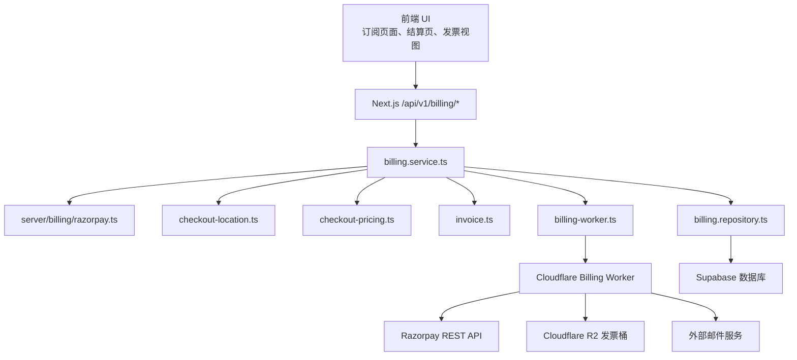
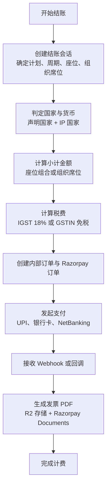
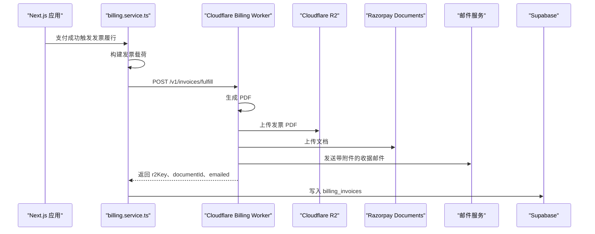
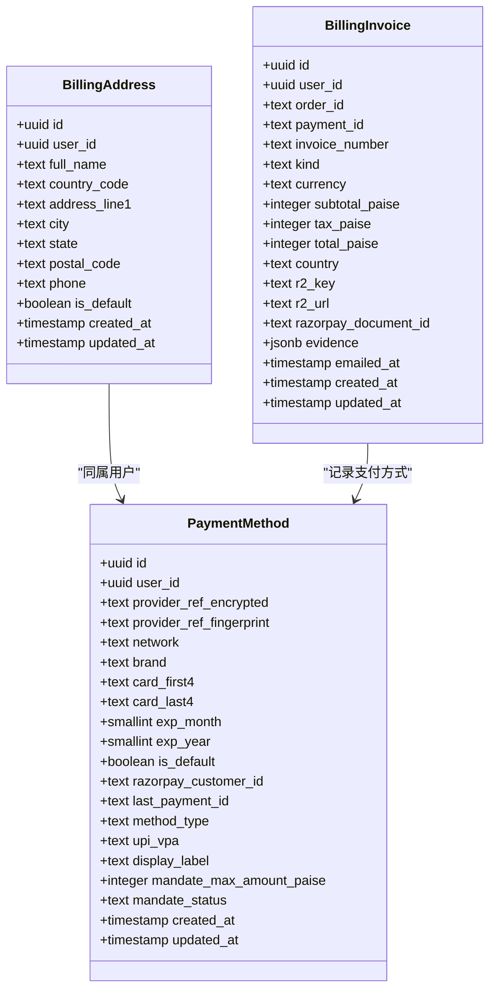
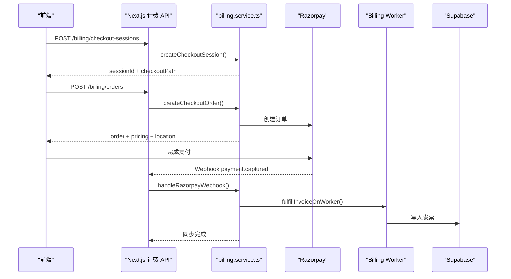
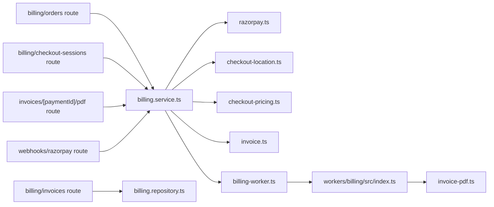

# 计费与支付

<cite>
**本文引用的文件**   
- [src/server/billing/razorpay.ts](file://src/server/billing/razorpay.ts)
- [src/server/billing/checkout-session.ts](file://src/server/billing/checkout-session.ts)
- [src/server/billing/invoice.ts](file://src/server/billing/invoice.ts)
- [src/server/billing/billing-worker.ts](file://src/server/billing/billing-worker.ts)
- [workers/billing/src/index.ts](file://workers/billing/src/index.ts)
- [workers/billing/src/types.ts](file://workers/billing/src/types.ts)
- [workers/billing/src/invoice-pdf.ts](file://workers/billing/src/invoice-pdf.ts)
- [src/server/billing/checkout-pricing.ts](file://src/server/billing/checkout-pricing.ts)
- [src/server/billing/checkout-location.ts](file://src/server/billing/checkout-location.ts)
- [src/server/billing/razorpay-customers.ts](file://src/server/billing/razorpay-customers.ts)
- [src/server/services/billing.service.ts](file://src/server/services/billing.service.ts)
- [src/shared/lib/checkout-tax.ts](file://src/shared/lib/checkout-tax.ts)
- [src/app/api/v1/billing/orders/route.ts](file://src/app/api/v1/billing/orders/route.ts)
- [src/app/api/v1/billing/checkout-sessions/route.ts](file://src/app/api/v1/billing/checkout-sessions/route.ts)
- [src/app/api/v1/billing/invoices/route.ts](file://src/app/api/v1/billing/invoices/route.ts)
- [src/app/api/v1/billing/invoices/[paymentId]/pdf/route.ts](file://src/app/api/v1/billing/invoices/[paymentId]/pdf/route.ts)
- [src/app/api/v1/webhooks/razorpay/route.ts](file://src/app/api/v1/webhooks/razorpay/route.ts)
- [src/app/api/v1/billing/orders/razorpay-callback/route.ts](file://src/app/api/v1/billing/orders/razorpay-callback/route.ts)
- [src/app/api/v1/billing/plans/route.ts](file://src/app/api/v1/billing/plans/route.ts)
- [src/app/api/v1/billing/payment-methods/setup/route.ts](file://src/app/api/v1/billing/payment-methods/setup/route.ts)
- [src/app/api/v1/billing/orders/upi/qr/[qrId]/image/route.ts](file://src/app/api/v1/billing/orders/upi/qr/[qrId]/image/route.ts)
- [supabase/migrations/20260725143000_billing_addresses_payment_methods.sql](file://supabase/migrations/20260725143000_billing_addresses_payment_methods.sql)
- [supabase/migrations/20260725180000_payment_methods_upi_and_mandate.sql](file://supabase/migrations/20260725180000_payment_methods_upi_and_mandate.sql)
- [supabase/migrations/20260910120000_billing_invoices.sql](file://supabase/migrations/20260910120000_billing_invoices.sql)
</cite>

## 目录
1. [简介](#简介)
2. [项目结构](#项目结构)
3. [核心组件](#核心组件)
4. [架构总览](#架构总览)
5. [详细组件分析](#详细组件分析)
6. [依赖关系分析](#依赖关系分析)
7. [性能与可靠性](#性能与可靠性)
8. [故障排查指南](#故障排查指南)
9. [结论](#结论)
10. [附录：接口规范](#附录接口规范)

## 简介
本文档系统化梳理该项目的计费与支付体系，覆盖以下主题：
- 订阅管理与套餐定价、座位（seat）组合、组织人数计费。
- Razorpay 支付网关集成，包括订单创建、UPI 二维码、银行卡、NetBanking、OTP、客户令牌化。
- 发票处理：服务端生成 PDF、R2 存储、Razorpay Documents 上传、邮件回执、按支付 ID 幂等。
- 税务计算：印度国内 18% IGST、有效 GSTIN 免税、出口零税率 USD。
- 支付方式管理：银行卡与 UPI Autopay（含 Mandate）。
- 支付状态机、Webhook 回调、错误重试策略。
- 订阅变更、升级降级、到期处理的业务逻辑边界说明。

本系统采用“服务器端权威”设计：客户端不直接持有 Razorpay 私钥，关键 API 调用优先走 Cloudflare Billing Worker；若不可用且允许回退，则使用 Vercel 环境变量中的 Razorpay 密钥。所有价格、国家、货币、税费均由服务端决定，客户端仅提交最小意图。

## 项目结构
计费相关代码主要分布在三个层次：
- Next.js 应用层 API：提供计费会话、下单、发票列表、PDF 下载、支付方式设置、计划查询、Webhook 入口。
- Server billing 模块：封装 Razorpay 调用、结账会话签名、定价与位置判定、发票载荷构建、Cloudflare Worker 调度。
- Cloudflare Billing Worker：安全执行 Razorpay 请求、生成发票 PDF、写入 R2、对接 Razorpay Documents、发送邮件。
- Supabase 数据库迁移：账单地址、支付方式、发票账本。

**图表来源**
- [src/server/services/billing.service.ts](file://src/server/services/billing.service.ts)
- [src/server/billing/razorpay.ts](file://src/server/billing/razorpay.ts)
- [src/server/billing/billing-worker.ts](file://src/server/billing/billing-worker.ts)
- [workers/billing/src/index.ts](file://workers/billing/src/index.ts)
- [src/server/billing/checkout-location.ts](file://src/server/billing/checkout-location.ts)
- [src/server/billing/checkout-pricing.ts](file://src/server/billing/checkout-pricing.ts)
- [src/server/billing/invoice.ts](file://src/server/billing/invoice.ts)

**章节来源**
- [src/server/billing/razorpay.ts](file://src/server/billing/razorpay.ts)
- [src/server/billing/checkout-session.ts](file://src/server/billing/checkout-session.ts)
- [src/server/billing/billing-worker.ts](file://src/server/billing/billing-worker.ts)
- [workers/billing/src/index.ts](file://workers/billing/src/index.ts)

## 核心组件
本节聚焦计费系统的五个核心子系统：
1. 结账会话与会话校验。
2. Razorpay 支付网关封装。
3. 定价与税务。
4. 发票生成与投递。
5. 支付方式与 UPI。

### 结账会话与会话校验
结账流程从 `POST /api/v1/billing/checkout-sessions` 开始。服务端根据用户身份、计划标识、账单周期、可选的组织座位或企业席位数量，以及服务端判定的国家与货币，生成一个带签名的会话令牌。该令牌包含：
- 用户 ID、计划 ID、计划名称、账单周期。
- 服务端决定的货币与国家、IP 国家、声明国家。
- 可选最大层级、座位明细、组织席位数量。
- 可选礼品结账标记与礼品元数据。
- 签发时间与过期时间。

会话令牌由 HMAC-SHA256 签名，前缀为 `cs_live_`，过期时间为六小时。服务端在后续下单时校验该令牌，并拒绝篡改的 planId、billingCycle、currency、maxTier、seatBreakdown、organizationSeatCount。

| 字段 | 含义 | 校验规则 |
|---|---|---|
| uid | 用户 ID | 必填，下单时必须匹配当前登录用户 |
| planId | 计划标识 | 必填，必须与服务端传入一致 |
| planName | 计划名称 | 必填，用于显示与发票项 |
| billingCycle | 月度或年度 | 必填，枚举值 |
| currency | INR 或 USD | 可选，必须为受支持的结账货币 |
| country | 服务端判定国家 | 可选，ISO-2 |
| ipCountry | IP 国家 | 可选，ISO-2 |
| declaredCountry | 用户声明国家 | 可选，ISO-2 |
| maxTier | 可选最大层级 | 可选，用于限制可升级上限 |
| seatBreakdown | 各计划座位数 | 可选，整数非负，总和受计划约束 |
| organizationSeatCount | 组织席位数量 | 可选，正整数 |
| returnPath | 支付成功后返回路径 | 白名单路径，否则归一化为 `/new` |
| orderKind | subscription 或 gift | 可选 |
| giftId、giftMonths、giftDeliveryMethod | 礼品结账元数据 | 仅在 gift 模式下校验 |

会话过期后，UI 可使用同一用户的已签名过期令牌重新生成新会话，避免重复收集用户输入。

**章节来源**
- [src/app/api/v1/billing/checkout-sessions/route.ts](file://src/app/api/v1/billing/checkout-sessions/route.ts)
- [src/server/billing/checkout-session.ts](file://src/server/billing/checkout-session.ts)
- [src/server/services/billing.service.ts](file://src/server/services/billing.service.ts)

### Razorpay 支付网关封装
Razorpay 集成位于 `server/billing/razorpay.ts`，提供统一入口：
- 检查 Razorpay 是否配置。
- 通过 Cloudflare Billing Worker 转发 Razorpay 请求，或回退到 Vercel 环境变量中的密钥。
- 对失败响应转换为带业务码的 `AppError`，例如 `billing_unavailable`、`razorpay_error`。
- 支持订单创建、UPI QR 创建、支付查询、支付捕获、客户创建与令牌管理、QR 关闭等。

Cloudflare Billing Worker 是首选路径，因为 Razorpay 私钥可以只保存在 Cloudflare 环境中；当 Worker 未配置、密钥缺失或生产环境强制 Worker 模式时，行为有所不同：
- 如果配置了 `billingRequireWorker`，Worker 失败会直接抛出错误。
- 否则，Worker 不可用时尝试使用本地 Razorpay 密钥。
- 如果本地也无密钥，返回 `billing_unavailable`。

这种双通道设计让部署更灵活，同时保证生产环境下私钥不进入浏览器。

**章节来源**
- [src/server/billing/razorpay.ts](file://src/server/billing/razorpay.ts)
- [src/server/billing/billing-worker.ts](file://src/server/billing/billing-worker.ts)
- [workers/billing/src/index.ts](file://workers/billing/src/index.ts)

### 定价与税务
定价与税务由多个模块协作完成：
- `checkout-pricing.ts` 解析并校验座位组合、组织席位，将计划价格转换为以 paise 表示的金额。
- `checkout-location.ts` 基于声明国家、IP 国家和支付工具证据，判定最终国家与货币。
- `checkout-tax.ts` 根据国家与 GSTIN 计算 18% IGST 或免税。
- `billing.service.ts` 汇总这些结果，创建内部订单并调用 Razorpay。

税务规则如下：
- 非印度国家：USD、零税率。
- 印度国家：默认 18% IGST。
- 印度国家且提供有效 GSTIN：不收取 GST，但会在发票中保留税务标签和证据。
- 出口场景：发票类型为 export_lut，打印 LUT 声明行。

**图表来源**
- [src/server/billing/checkout-pricing.ts](file://src/server/billing/checkout-pricing.ts)
- [src/server/billing/checkout-location.ts](file://src/server/billing/checkout-location.ts)
- [src/shared/lib/checkout-tax.ts](file://src/shared/lib/checkout-tax.ts)
- [src/server/services/billing.service.ts](file://src/server/services/billing.service.ts)

**章节来源**
- [src/server/billing/checkout-pricing.ts](file://src/server/billing/checkout-pricing.ts)
- [src/server/billing/checkout-location.ts](file://src/server/billing/checkout-location.ts)
- [src/shared/lib/checkout-tax.ts](file://src/shared/lib/checkout-tax.ts)
- [src/app/api/v1/billing/orders/route.ts](file://src/app/api/v1/billing/orders/route.ts)

### 发票生成与投递
发票生命周期如下：
1. 支付成功后，服务端根据订单与支付记录构建发票载荷。
2. 调用 Cloudflare Billing Worker 生成 PDF。
3. PDF 写入 R2 对象存储，并保存 R2 Key 与下载 URL。
4. 可选上传至 Razorpay Documents。
5. 向用户邮箱发送收据邮件，附件为发票 PDF。
6. 数据库 `billing_invoices` 表记录发票编号、支付 ID、R2 Key、Razorpay Document ID、税务证据等。

发票载荷由 `invoice.ts` 构建，字段完全来自服务端订单与支付记录，不信任客户端总金额。发票编号由支付 ID 或订单 ID 派生，保证幂等。

**图表来源**
- [src/server/billing/invoice.ts](file://src/server/billing/invoice.ts)
- [src/server/billing/billing-worker.ts](file://src/server/billing/billing-worker.ts)
- [workers/billing/src/index.ts](file://workers/billing/src/index.ts)
- [workers/billing/src/invoice-pdf.ts](file://workers/billing/src/invoice-pdf.ts)
- [supabase/migrations/20260910120000_billing_invoices.sql](file://supabase/migrations/20260910120000_billing_invoices.sql)

**章节来源**
- [src/server/billing/invoice.ts](file://src/server/billing/invoice.ts)
- [src/server/billing/billing-worker.ts](file://src/server/billing/billing-worker.ts)
- [workers/billing/src/types.ts](file://workers/billing/src/types.ts)
- [workers/billing/src/invoice-pdf.ts](file://workers/billing/src/invoice-pdf.ts)
- [supabase/migrations/20260910120000_billing_invoices.sql](file://supabase/migrations/20260910120000_billing_invoices.sql)

### 支付方式管理与 UPI
支付方式存储在 `payment_methods` 表中，遵循 PCI 安全原则：
- 不存储完整卡号。
- 仅存储加密后的 Razorpay 卡 ID 或令牌引用、指纹、网络品牌、首四位与末四位、有效期、默认标记。
- UPI 方式新增 method_type、upi_vpa、display_label、mandate_max_amount_paise、mandate_status。

Mandate 机制用于 UPI Autopay 与银行卡自动续费授权：
- 创建 ₹0 授权订单，设置 Mandate 最高额度为 ₹25,000。
- 不实际扣款，仅注册支付工具。
- 后续自动扣款可通过 Mandate 发起。

UPI 二维码支付流程：
- 后端创建 UPI QR 或支付链接。
- 前端渲染原生 `upi://` 意图 PNG 二维码，而不是 Razorpay 品牌卡片。
- 轮询支付状态，或通过 Webhook 通知完成。

**图表来源**
- [supabase/migrations/20260725143000_billing_addresses_payment_methods.sql](file://supabase/migrations/20260725143000_billing_addresses_payment_methods.sql)
- [supabase/migrations/20260725180000_payment_methods_upi_and_mandate.sql](file://supabase/migrations/20260725180000_payment_methods_upi_and_mandate.sql)
- [supabase/migrations/20260910120000_billing_invoices.sql](file://supabase/migrations/20260910120000_billing_invoices.sql)

**章节来源**
- [supabase/migrations/20260725143000_billing_addresses_payment_methods.sql](file://supabase/migrations/20260725143000_billing_addresses_payment_methods.sql)
- [supabase/migrations/20260725180000_payment_methods_upi_and_mandate.sql](file://supabase/migrations/20260725180000_payment_methods_upi_and_mandate.sql)
- [src/app/api/v1/billing/payment-methods/setup/route.ts](file://src/app/api/v1/billing/payment-methods/setup/route.ts)
- [src/app/api/v1/billing/orders/upi/qr/[qrId]/image/route.ts](file://src/app/api/v1/billing/orders/upi/qr/[qrId]/image/route.ts)
- [src/server/billing/razorpay-customers.ts](file://src/server/billing/razorpay-customers.ts)

## 架构总览
计费系统的关键交互包括：
- 前端发起结账会话。
- 前端发起下单并创建 Razorpay 订单。
- 前端选择支付方式并完成支付。
- Razorpay 通过 Webhook 或浏览器回调通知支付结果。
- 服务端同步订单、订阅与余额，并生成发票。
- 用户可在应用内查看发票列表并下载 PDF。

**图表来源**
- [src/app/api/v1/billing/checkout-sessions/route.ts](file://src/app/api/v1/billing/checkout-sessions/route.ts)
- [src/app/api/v1/billing/orders/route.ts](file://src/app/api/v1/billing/orders/route.ts)
- [src/app/api/v1/webhooks/razorpay/route.ts](file://src/app/api/v1/webhooks/razorpay/route.ts)
- [src/server/services/billing.service.ts](file://src/server/services/billing.service.ts)
- [src/server/billing/billing-worker.ts](file://src/server/billing/billing-worker.ts)

## 详细组件分析

### 订阅管理系统
当前代码库中明确存在的订阅相关能力包括：
- 计划读取：`GET /api/v1/billing/plans` 返回订阅计划。
- 结账会话：区分月度与年度。
- 内部仓储与服务的引用指向订阅、余额、用量等实体，但具体订阅变更、升级降级、到期处理的实现细节未在当前片段中展开。

因此，关于订阅变更与到期处理的业务逻辑应理解为：
- 系统具备订阅模型与仓库抽象。
- 计费服务中引用了订阅相关仓库。
- 具体状态机、自动续费开关、升级降级转换逻辑需要结合 `billing.repository.ts` 与 `billing.service.ts` 中未展示的部分进一步确认。

建议在生产环境中：
- 明确订阅状态机，例如 draft、active、past_due、canceled、trialing。
- 将升级降级的 proration、退款、下一周期生效日期纳入事务。
- 对到期处理增加重试、暂停访问、宽限期、最终取消策略。
- 审计所有订阅变更事件。

**章节来源**
- [src/app/api/v1/billing/plans/route.ts](file://src/app/api/v1/billing/plans/route.ts)
- [src/server/services/billing.service.ts](file://src/server/services/billing.service.ts)

### Razorpay 支付状态机与回调
支付状态机围绕 Razorpay 订单与支付展开，关键节点包括：
- 订单创建：服务端创建 Razorpay 订单，返回给前端。
- 支付发起：UPI、银行卡、NetBanking、支付链接。
- 支付验证：浏览器回调或 Webhook 携带 orderId、paymentId、signature。
- 支付捕获：服务端调用 Razorpay 捕获或直接消费 captured 事件。
- 发票生成：支付成功后生成发票并持久化。

```mermaid
stateDiagram-v2
    [*] --> 订单创建
    订单创建 --> 等待支付
    等待支付 --> 支付失败 : 用户取消或银行拒绝
    等待支付 --> 支付成功 : Webhook 或回调
    支付失败 --> 重试 : 用户重新支付
    重试 --> 等待支付
    支付成功 --> 发票生成
    发票生成 --> 已完成
```

**图表来源**
- [src/server/services/billing.service.ts](file://src/server/services/billing.service.ts)
- [src/app/api/v1/billing/orders/razorpay-callback/route.ts](file://src/app/api/v1/billing/orders/razorpay-callback/route.ts)
- [src/app/api/v1/webhooks/razorpay/route.ts](file://src/app/api/v1/webhooks/razorpay/route.ts)

**章节来源**
- [src/app/api/v1/webhooks/razorpay/route.ts](file://src/app/api/v1/webhooks/razorpay/route.ts)
- [src/app/api/v1/billing/orders/razorpay-callback/route.ts](file://src/app/api/v1/billing/orders/razorpay-callback/route.ts)
- [src/server/services/billing.service.ts](file://src/server/services/billing.service.ts)

### 退款机制
当前可见代码中没有直接的退款 API 或退款状态机。这意味着：
- 退款不是通过本仓库中的计费模块直接实现的。
- 如需退款，应在 Razorpay 侧操作，并在内部系统中记录退款流水、原因、金额与关联订单。
- 建议在数据库中扩展退款表，并与发票、订单、支付方式关联。
- 对部分退款、全额退款、手续费退还制定清晰策略。
- 对退款后的订阅状态进行影响评估，例如是否需要调整下一期费用或停止续费。

**章节来源**
- [src/server/billing/razorpay.ts](file://src/server/billing/razorpay.ts)
- [src/server/services/billing.service.ts](file://src/server/services/billing.service.ts)

### 优惠券机制
当前代码中没有显式的优惠券折扣字段或优惠券校验逻辑。发票项、座位项、组织席位项均没有通用 discountPaise 的使用痕迹；发票载荷构建中虽然类型允许 discountPaise，但主流程未填充。

建议未来扩展：
- 引入优惠券表，包含代码、折扣类型、金额或比例、有效期、适用计划、使用次数。
- 在结账定价阶段应用优惠券。
- 在发票中记录优惠行，保持审计完整性。
- 防止重复使用与跨账户滥用。

**章节来源**
- [src/server/billing/invoice.ts](file://src/server/billing/invoice.ts)
- [src/server/billing/checkout-pricing.ts](file://src/server/billing/checkout-pricing.ts)

### 发票生成、PDF 下载与税务计算
发票 PDF 由 Cloudflare Billing Worker 使用 pdf-lib 生成，格式为 A4，包含：
- 发行方信息、品牌、法律实体、地址、GSTIN。
- 发票编号、开具时间、金额、下次计费时间、订单号。
- 付费状态、Billed To 信息。
- 出口发票附加 LUT 声明行。
- 发票项、座位项、税额、总额。

PDF 生成后写入 R2，并提供下载路由：
- `GET /api/v1/billing/invoices/[paymentId]/pdf`：要求用户登录，校验 ownership，按需生成或返回已有 PDF。
- `GET /api/v1/billing/invoices`：列出用户发票。

税务计算逻辑：
- 非印度：无税。
- 印度且有有效 GSTIN：显示 GST 但不收费。
- 印度且无 GSTIN：18% IGST。
- 出口：零税率 USD，发票类型为 export_lut。

**章节来源**
- [workers/billing/src/invoice-pdf.ts](file://workers/billing/src/invoice-pdf.ts)
- [src/server/billing/invoice.ts](file://src/server/billing/invoice.ts)
- [src/shared/lib/checkout-tax.ts](file://src/shared/lib/checkout-tax.ts)
- [src/app/api/v1/billing/invoices/[paymentId]/pdf/route.ts](file://src/app/api/v1/billing/invoices/[paymentId]/pdf/route.ts)
- [src/app/api/v1/billing/invoices/route.ts](file://src/app/api/v1/billing/invoices/route.ts)

### 订阅变更、升级降级与到期处理
当前仓库展示了订阅模型的引用与结账时的最大层级限制，但没有完整的订阅变更工作流代码。因此，这部分应视为“存在基础设施，但未在当前片段中实现完整状态机”。

建议补充：
- 订阅变更 API：升级、降级、暂停、恢复、取消。
- 变更生效时间：立即生效、下个周期生效。
- 差额计费：按比例分摊剩余天数。
- 到期处理：grace period、usage throttle、final cancellation。
- 审计日志：谁、何时、为何变更。

**章节来源**
- [src/server/services/billing.service.ts](file://src/server/services/billing.service.ts)

## 依赖关系分析
计费模块依赖关系如下：

**图表来源**
- [src/app/api/v1/billing/orders/route.ts](file://src/app/api/v1/billing/orders/route.ts)
- [src/app/api/v1/billing/checkout-sessions/route.ts](file://src/app/api/v1/billing/checkout-sessions/route.ts)
- [src/app/api/v1/billing/invoices/route.ts](file://src/app/api/v1/billing/invoices/route.ts)
- [src/app/api/v1/billing/invoices/[paymentId]/pdf/route.ts](file://src/app/api/v1/billing/invoices/[paymentId]/pdf/route.ts)
- [src/app/api/v1/webhooks/razorpay/route.ts](file://src/app/api/v1/webhooks/razorpay/route.ts)
- [src/server/services/billing.service.ts](file://src/server/services/billing.service.ts)
- [src/server/billing/razorpay.ts](file://src/server/billing/razorpay.ts)
- [src/server/billing/checkout-location.ts](file://src/server/billing/checkout-location.ts)
- [src/server/billing/checkout-pricing.ts](file://src/server/billing/checkout-pricing.ts)
- [src/server/billing/invoice.ts](file://src/server/billing/invoice.ts)
- [src/server/billing/billing-worker.ts](file://src/server/billing/billing-worker.ts)
- [workers/billing/src/index.ts](file://workers/billing/src/index.ts)
- [workers/billing/src/invoice-pdf.ts](file://workers/billing/src/invoice-pdf.ts)

**章节来源**
- [src/server/services/billing.service.ts](file://src/server/services/billing.service.ts)
- [src/server/billing/billing-worker.ts](file://src/server/billing/billing-worker.ts)

## 性能与可靠性
### 性能特征
- 发票 PDF 在 Cloudflare Worker 中生成，避免在浏览器中渲染，减少客户端负载。
- UPI 二维码图片通过服务端渲染 PNG，缓存控制为短期私有缓存。
- 结账会话令牌为轻量 JSON + HMAC，无需数据库查询即可验证。
- 国家与货币判定在服务端完成，避免前端篡改。

### 可靠性与错误处理
- Razorpay 调用优先走 Billing Worker，失败时根据配置决定是否回退或直接报错。
- Webhook 入口限制请求体大小，校验签名，非法负载返回 401 或 400。
- 发票生成失败时记录错误并返回空结果，不会阻塞主流程；下游可重试。
- 所有对外错误使用 `AppError` 携带业务码，便于前端分类处理。

### 重试策略建议
- Webhook 幂等：以 Razorpay payment_id 作为幂等键，避免重复开票。
- Webhook 失败：应用层应记录待处理队列并重试，最多 N 次，指数退避。
- Razorpay API 超时：重试有限次数，区分临时错误与业务错误。
- PDF 生成失败：延迟重试，并保留原始订单与支付记录。
- 邮件发送失败：记录失败并加入重试队列，避免丢失收据。

[本节为通用指导，不直接分析具体文件]

## 故障排查指南
常见问题与定位方式：

| 现象 | 可能原因 | 排查步骤 |
|---|---|---|
| 结账时报 `billing_unavailable` | Razorpay 或 Billing Worker 未配置 | 检查环境变量、Worker URL、内部 Token |
| Razorpay 请求失败 | Worker 不可用、密钥缺失、网络异常 | 查看 `razorpay_error`，检查 Cloudflare Worker 日志 |
| Webhook 返回 401 | Razorpay 签名无效或请求被篡改 | 核对 webhook secret、raw body、x-razorpay-signature |
| 发票 PDF 无法下载 | 无权限、paymentId 无效、R2 缺失 | 检查用户归属、paymentId 正则、ensureInvoicePdfForUser |
| UPI 二维码加载失败 | QR ID 无效、所有权校验失败、Razorpay 不可用 | 检查 qrId 格式、订单归属、Razorpay QR 接口 |
| 发票金额不对 | 客户端篡改或定价逻辑异常 | 核对 session claims、plan 价格、座位明细、税费 |
| 订阅变更异常 | 缺少完整变更工作流 | 检查订阅仓库与服务实现，确认状态机与 proration |

**章节来源**
- [src/server/billing/razorpay.ts](file://src/server/billing/razorpay.ts)
- [src/app/api/v1/webhooks/razorpay/route.ts](file://src/app/api/v1/webhooks/razorpay/route.ts)
- [src/app/api/v1/billing/invoices/[paymentId]/pdf/route.ts](file://src/app/api/v1/billing/invoices/[paymentId]/pdf/route.ts)
- [src/app/api/v1/billing/orders/upi/qr/[qrId]/image/route.ts](file://src/app/api/v1/billing/orders/upi/qr/[qrId]/image/route.ts)
- [src/server/services/billing.service.ts](file://src/server/services/billing.service.ts)

## 结论
该计费与支付系统以“服务器权威”为核心原则，将 Razorpay 私钥、发票生成、税务计算、支付方式加密存储放在后端与 Cloudflare Worker 中，前端仅负责最小意图提交与交互。系统在结账会话、定价、税务、发票、支付方式方面已有较完整实现，但在订阅变更、升级降级、退款、优惠券等方面仍需补充工作流与数据模型。

生产部署建议优先启用 Cloudflare Billing Worker，确保 Razorpay 私钥不出现在 Vercel 环境；对 Webhook、发票生成、邮件发送建立重试与监控；对订阅状态机与退款流程做独立设计与测试。

[本节为总结性内容，不直接分析具体文件]

## 附录：接口规范

### 计费 API 概览
| 方法 | 路径 | 认证 | 用途 | 主要输入 | 主要输出 |
|---|---|---|---|---|---|
| GET | `/api/v1/billing/plans` | 公开 | 获取订阅计划 | 无 | 计划列表 |
| POST | `/api/v1/billing/checkout-sessions` | 登录用户 | 创建结账会话 | planId、planName、billingCycle、countryCode、seatBreakdown、organizationSeatCount、orderKind、giftId、giftMonths、returnPath | sessionId、checkoutPath、expiresInSeconds |
| POST | `/api/v1/billing/orders` | 登录用户 | 创建订单并准备 Razorpay 支付 | checkoutSessionId、planId、billingCycle、maxTier、seatBreakdown、organizationSeatCount、billingDetails、currency | order、razorpay、pricing、location |
| POST | `/api/v1/billing/payment-methods/setup` | 登录用户 | 启动支付方式设置 | method=card 或 upi、contact | setup 结果 |
| GET | `/api/v1/billing/invoices` | 登录用户 | 列出用户发票 | 无 | invoices |
| GET | `/api/v1/billing/invoices/[paymentId]/pdf` | 登录用户 | 下载发票 PDF | paymentId | application/pdf |
| GET | `/api/v1/billing/orders/upi/qr/[qrId]/image` | 登录用户 | 获取 UPI 二维码图片 | qrId | image/png |
| POST | `/api/v1/webhooks/razorpay` | Razorpay 签名 | 接收支付事件 | raw body、x-razorpay-signature | data |

**章节来源**
- [src/app/api/v1/billing/plans/route.ts](file://src/app/api/v1/billing/plans/route.ts)
- [src/app/api/v1/billing/checkout-sessions/route.ts](file://src/app/api/v1/billing/checkout-sessions/route.ts)
- [src/app/api/v1/billing/orders/route.ts](file://src/app/api/v1/billing/orders/route.ts)
- [src/app/api/v1/billing/payment-methods/setup/route.ts](file://src/app/api/v1/billing/payment-methods/setup/route.ts)
- [src/app/api/v1/billing/invoices/route.ts](file://src/app/api/v1/billing/invoices/route.ts)
- [src/app/api/v1/billing/invoices/[paymentId]/pdf/route.ts](file://src/app/api/v1/billing/invoices/[paymentId]/pdf/route.ts)
- [src/app/api/v1/billing/orders/upi/qr/[qrId]/image/route.ts](file://src/app/api/v1/billing/orders/upi/qr/[qrId]/image/route.ts)
- [src/app/api/v1/webhooks/razorpay/route.ts](file://src/app/api/v1/webhooks/razorpay/route.ts)

### Razorpay 集成要点
- 订单金额单位为 paise，货币为 INR 或 USD。
- 优先走 Billing Worker，必要时回退到 Vercel 密钥。
- UPI QR 与支付链接均可用于支付，服务端渲染干净 PNG。
- 支付方式设置使用 Mandate，最高额度 ₹25,000，不扣款。
- Webhook 必须校验签名与负载结构。

**章节来源**
- [src/server/billing/razorpay.ts](file://src/server/billing/razorpay.ts)
- [src/server/billing/razorpay-customers.ts](file://src/server/billing/razorpay-customers.ts)
- [src/app/api/v1/billing/orders/upi/qr/[qrId]/image/route.ts](file://src/app/api/v1/billing/orders/upi/qr/[qrId]/image/route.ts)
- [src/app/api/v1/webhooks/razorpay/route.ts](file://src/app/api/v1/webhooks/razorpay/route.ts)