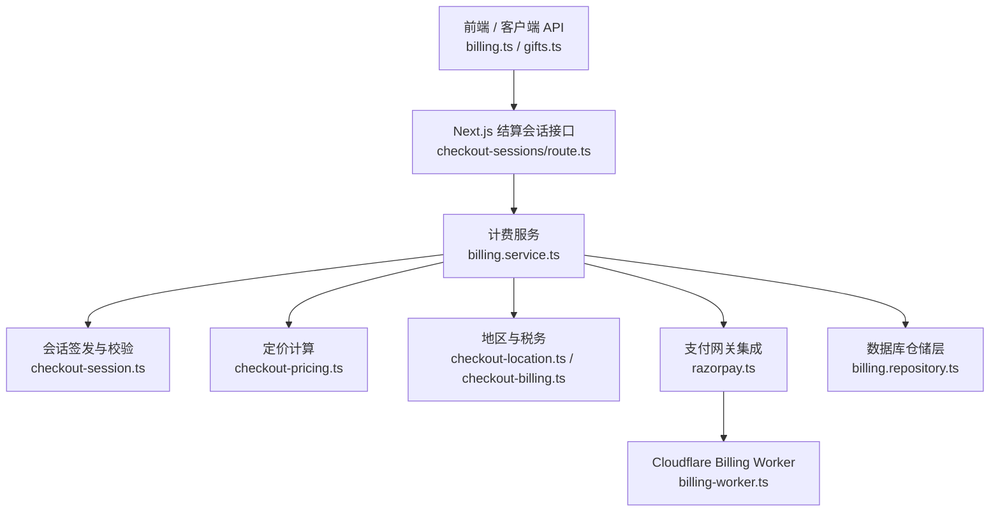
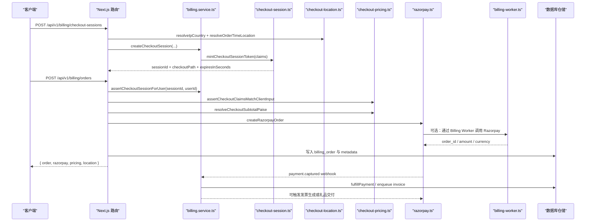
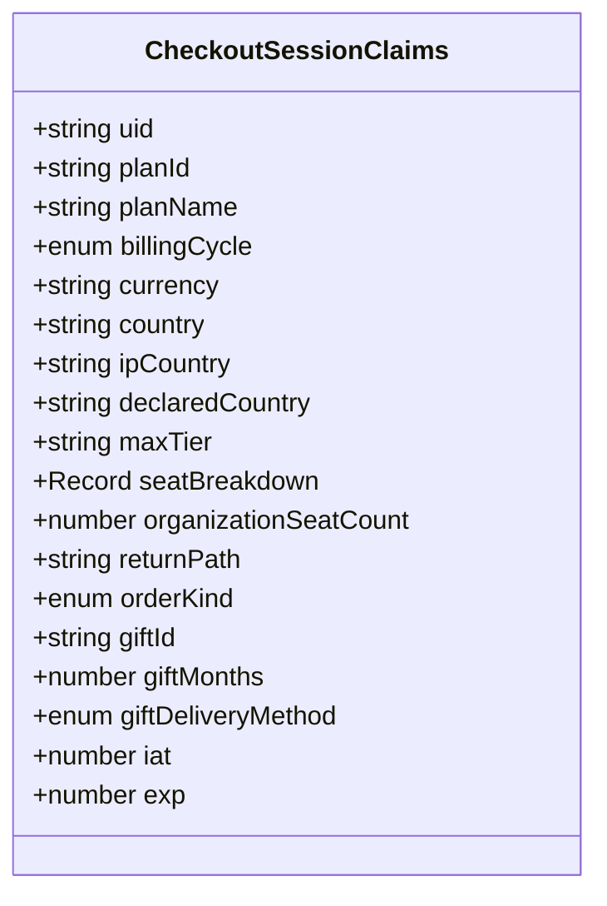
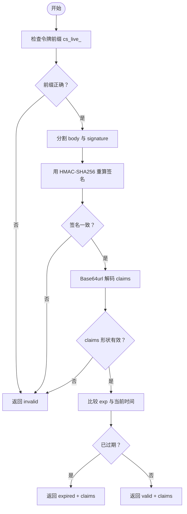
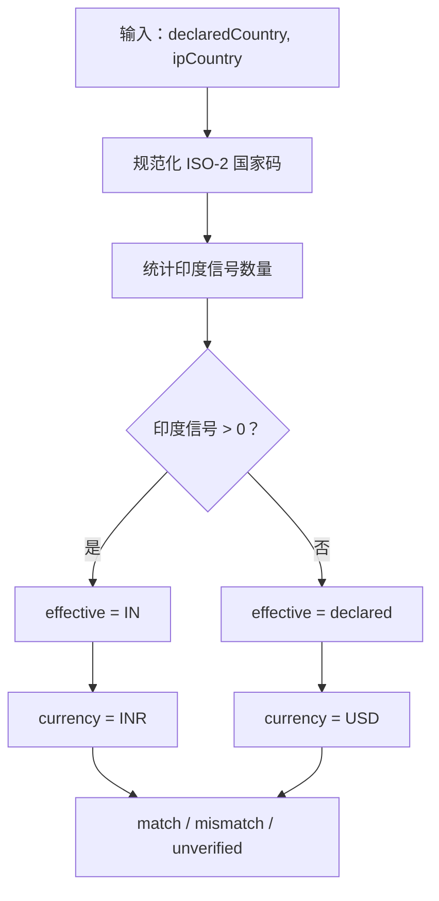
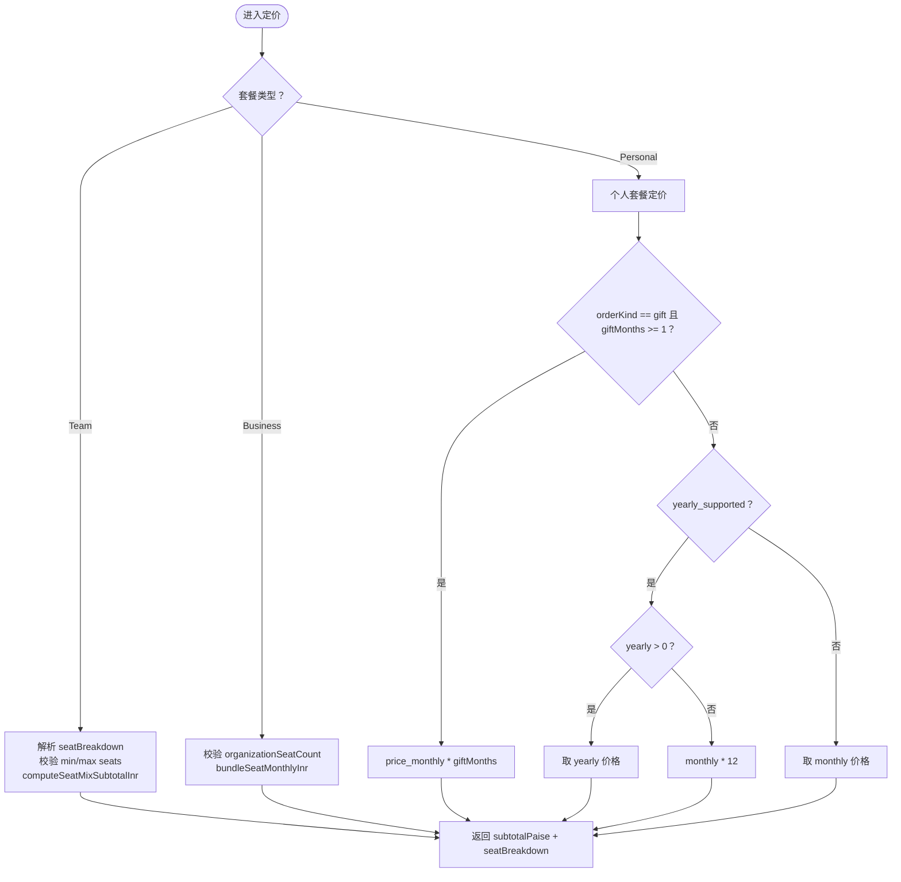
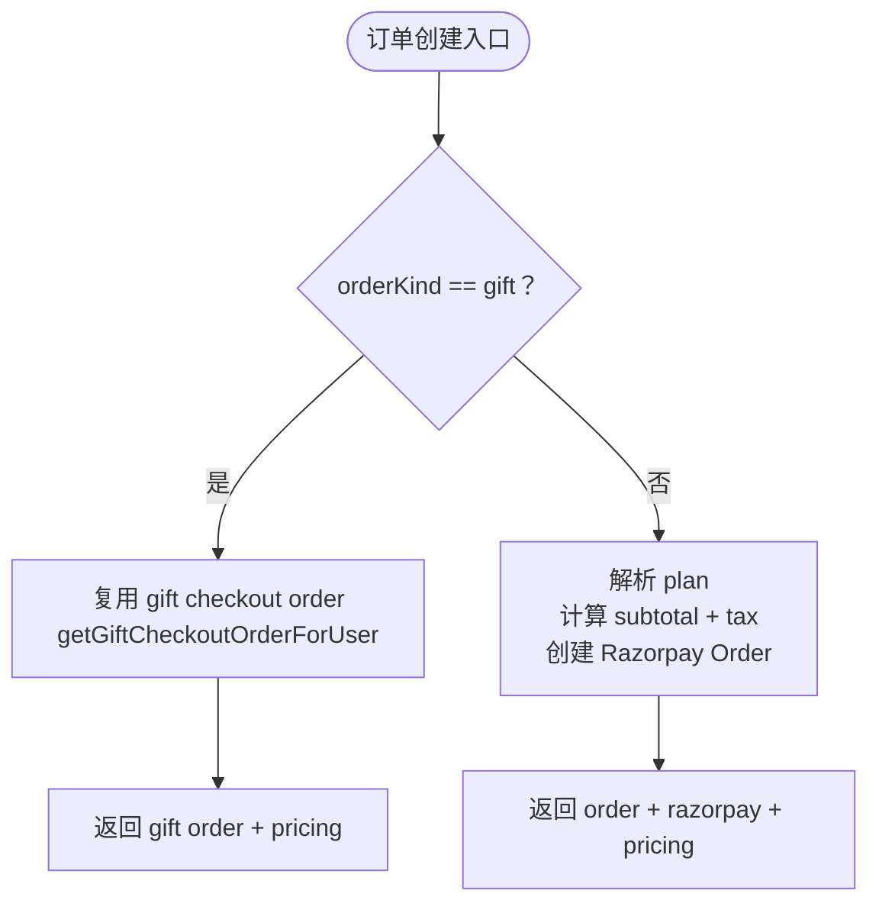
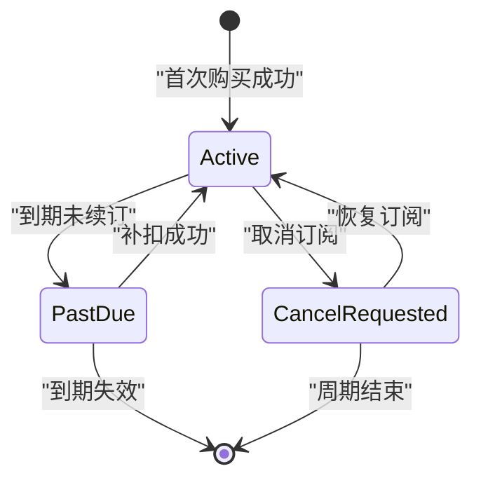
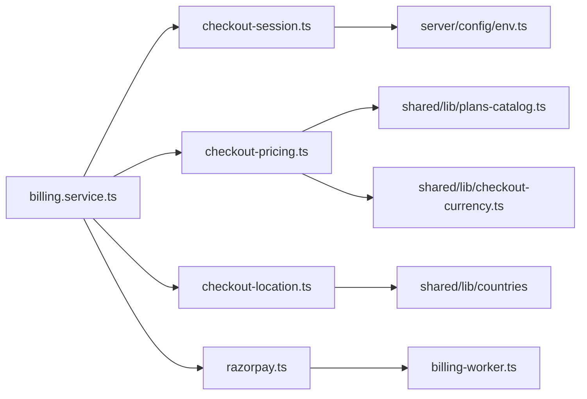

# 订阅管理

<cite>
**本文引用的文件**   
- [checkout-session.ts](file://src/server/billing/checkout-session.ts)
- [checkout-location.ts](file://src/server/billing/checkout-location.ts)
- [checkout-pricing.ts](file://src/server/billing/checkout-pricing.ts)
- [checkout-billing.ts](file://src/server/billing/checkout-billing.ts)
- [checkout-currency-server.ts](file://src/server/billing/checkout-currency-server.ts)
- [razorpay.ts](file://src/server/billing/razorpay.ts)
- [billing-worker.ts](file://src/server/billing/billing-worker.ts)
- [payment-method-crypto.ts](file://src/server/billing/payment-method-crypto.ts)
- [billing.service.ts](file://src/server/services/billing.service.ts)
- [checkout-sessions/route.ts](file://src/app/api/v1/billing/checkout-sessions/route.ts)
- [orders/route.ts](file://src/app/api/v1/billing/orders/route.ts)
- [orders/upi/route.ts](file://src/app/api/v1/billing/orders/upi/route.ts)
- [billing.ts（客户端 API）](file://src/shared/lib/api/billing.ts)
- [gifts.ts（礼品 API）](file://src/shared/lib/api/gifts.ts)
- [plans-catalog.ts](file://src/shared/lib/plans-catalog.ts)
- [checkout-currency.ts](file://src/shared/lib/checkout-currency.ts)
</cite>

## 目录
1. [简介](#简介)
2. [项目结构](#项目结构)
3. [核心组件](#核心组件)
4. [架构总览](#架构总览)
5. [详细组件分析](#详细组件分析)
6. [依赖关系分析](#依赖关系分析)
7. [性能与可靠性](#性能与可靠性)
8. [故障排查指南](#故障排查指南)
9. [结论](#结论)

## 简介
本文件系统化梳理订阅管理系统的设计与实现，重点覆盖：
- `CheckoutSessionClaims` 的数据模型、HMAC 签名、TTL 过期机制与令牌刷新。
- 套餐定价逻辑：月度/年度定价、礼品订阅的月数计费、组织席位计费。
- 地区检测与货币选择：基于 IP、声明国家、支付工具的保守税务判定。
- 订单类型分支：普通订阅与礼品订阅。
- 升级、降级、取消与续订流程。
- 会话创建、验证、续期及错误处理方案。

该文档同时面向后端工程师和需要理解计费语义的产品人员，避免直接粘贴代码，改用“源码路径 + 行号”定位实现。

## 项目结构
订阅相关代码主要分布在以下位置：
- 服务端计费工具：`src/server/billing/*`
- Next.js API 路由：`src/app/api/v1/billing/*`
- 业务编排服务：`src/server/services/billing.service.ts`
- 共享计划目录与货币工具：`src/shared/lib/plans-catalog.ts`、`src/shared/lib/checkout-currency.ts`
- 客户端 API 封装：`src/shared/lib/api/billing.ts`、`src/shared/lib/api/gifts.ts`
- Cloudflare Billing Worker 集成：`src/server/billing/billing-worker.ts`

**图表来源**
- [checkout-sessions/route.ts:1-99](file://src/app/api/v1/billing/checkout-sessions/route.ts#L1-L99)
- [billing.service.ts:170-260](file://src/server/services/billing.service.ts#L170-L260)
- [checkout-session.ts:1-204](file://src/server/billing/checkout-session.ts#L1-L204)
- [checkout-pricing.ts:1-229](file://src/server/billing/checkout-pricing.ts#L1-L229)
- [checkout-location.ts:1-197](file://src/server/billing/checkout-location.ts#L1-L197)
- [razorpay.ts:1-200](file://src/server/billing/razorpay.ts#L1-L200)
- [billing-worker.ts:1-120](file://src/server/billing/billing-worker.ts#L1-L120)

**章节来源**
- [checkout-sessions/route.ts:1-99](file://src/app/api/v1/billing/checkout-sessions/route.ts#L1-L99)
- [billing.service.ts:170-260](file://src/server/services/billing.service.ts#L170-L260)

## 核心组件
- 结算会话模型与令牌：`CheckoutSessionClaims`、`mintCheckoutSessionToken`、`inspectCheckoutSessionToken`、`verifyCheckoutSessionToken`。
- 地区检测与税务：`resolveOrderTimeLocation`、`instrumentCountryHint`、`evaluateLocationVerdict`、`finalizeLocationEvidence`。
- 定价引擎：`assertCheckoutClaimsMatchClientInput`、`resolveCheckoutSubtotalPaise`。
- 计费地址与发票元数据：`parseMinimalCheckoutBillingInput`、`buildCheckoutBillingDetailsForUser`。
- 支付网关适配：`createRazorpayOrder`、`isRazorpayConfigured`、Worker 优先策略。
- 业务编排：`createCheckoutSession`、`refreshCheckoutSession`、`createCheckoutOrder`、`createUpiCheckoutPayment`、`handleRazorpayWebhook`、`cancelSubscription`、`resumeSubscription`。

**章节来源**
- [checkout-session.ts:1-204](file://src/server/billing/checkout-session.ts#L1-L204)
- [checkout-location.ts:1-197](file://src/server/billing/checkout-location.ts#L1-L197)
- [checkout-pricing.ts:1-229](file://src/server/billing/checkout-pricing.ts#L1-L229)
- [checkout-billing.ts:1-264](file://src/server/billing/checkout-billing.ts#L1-L264)
- [razorpay.ts:1-200](file://src/server/billing/razorpay.ts#L1-L200)
- [billing.service.ts:748-1060](file://src/server/services/billing.service.ts#L748-L1060)

## 架构总览
订阅购买的核心时序包括：创建结算会话 → 校验并构建订单 → 发起支付 → Webhook 回调完成履约。

**图表来源**
- [checkout-sessions/route.ts:1-99](file://src/app/api/v1/billing/checkout-sessions/route.ts#L1-L99)
- [orders/route.ts:1-172](file://src/app/api/v1/billing/orders/route.ts#L1-L172)
- [billing.service.ts:170-260](file://src/server/services/billing.service.ts#L170-L260)
- [billing.service.ts:748-1060](file://src/server/services/billing.service.ts#L748-L1060)
- [razorpay.ts:1-200](file://src/server/billing/razorpay.ts#L1-L200)
- [billing-worker.ts:1-120](file://src/server/billing/billing-worker.ts#L1-L120)

## 详细组件分析

### 结算会话令牌与 `CheckoutSessionClaims`
`CheckoutSessionClaims` 是结算令牌的载荷，包含用户标识、套餐信息、计费周期、货币、地区证据、组织席位、返回路径以及礼品订阅字段。关键设计点：
- 令牌前缀固定为 `cs_live_`，便于快速识别。
- HMAC-SHA256 签名使用 base64url 编码的 claims body。
- TTL 固定为 6 小时；过期后仍可通过 refresh 重新签发。
- 支持两种订单类型：普通订阅和礼品订阅。

**图表来源**
- [checkout-session.ts:1-60](file://src/server/billing/checkout-session.ts#L1-L60)

#### 令牌签发与验证流程
签发过程：
1. 计算当前时间戳 `iat`。
2. 设置 `exp = iat + 6 小时`。
3. 将 claims JSON 序列化为 base64url。
4. 使用 HMAC-SHA256 对 body 签名，得到 signature。
5. 组合为 `cs_live_<body>.<signature>`。

验证过程：
1. 检查前缀。
2. 解析 body 和 signature。
3. 用相同密钥重算 HMAC 并安全比较。
4. 反序列化 claims 并校验形状。
5. 判断是否过期；区分 `invalid` 与 `expired`。

**图表来源**
- [checkout-session.ts:60-204](file://src/server/billing/checkout-session.ts#L60-L204)

#### 令牌刷新
当浏览器标签页在 6 小时后刷新时，前端应调用刷新接口。服务端会：
- 校验原令牌签名。
- 校验原令牌归属用户。
- 以原始 claims 重新签发新会话。

**章节来源**
- [checkout-session.ts:1-204](file://src/server/billing/checkout-session.ts#L1-L204)
- [billing.service.ts:199-260](file://src/server/services/billing.service.ts#L199-L260)
- [billing.ts（客户端 API）:120-170](file://src/shared/lib/api/billing.ts#L120-L170)

### 地区检测与货币选择
地区检测采用“保守优先印度”的策略，避免通过虚假声明规避 GST：
- 订单时：若 IP 或声明国家任一为印度，则最终地区为印度，货币为 INR，并按 18% GST 计费。
- 只有两者均非印度时，才可能按出口零税率 USD 结算。
- 支付完成后，可根据支付工具（UPI、Netbanking、RuPay、国际卡等）追加证据，更新审计轨迹。

**图表来源**
- [checkout-location.ts:1-90](file://src/server/billing/checkout-location.ts#L1-L90)
- [checkout-currency.ts:1-99](file://src/shared/lib/checkout-currency.ts#L1-L99)

#### 支付工具证据
支付完成后，系统会根据 Razorpay 返回的工具快照推断国家：
- UPI、Netbanking、EMI、Wallet、VPA、RuPay 视为印度。
- 国际卡标记为 FOREIGN。
- 无法判断时为 UNKNOWN。

最终评估采用多数票制，且印度支付工具具有否决权；平局时倾向印度。

**章节来源**
- [checkout-location.ts:90-197](file://src/server/billing/checkout-location.ts#L90-L197)

### 套餐定价逻辑
定价由 `resolveCheckoutSubtotalPaise` 统一处理，支持三类场景：
1. **Team 席位混合**：根据 `seatBreakdown` 计算混合总价，受组织计划最小/最大席位限制。
2. **Business Workspace/Business 打包席位**：根据 `organizationSeatCount` 与包价单价计算。
3. **个人套餐**：
   - 礼品订阅：`monthly_price * giftMonths`，其中 `giftMonths` 必须为 1–12。
   - 年度付费：如果套餐支持年付，则取年付价格；否则按 12 × 月付。
   - 月付：直接取月付价格。

**图表来源**
- [checkout-pricing.ts:1-229](file://src/server/billing/checkout-pricing.ts#L1-L229)

#### 防篡改校验
客户端提交的 planId、billingCycle、currency、maxTier、seatBreakdown、organizationSeatCount 必须与服务端签发的 claims 一致，否则会抛出会话不匹配错误。

**章节来源**
- [checkout-pricing.ts:1-229](file://src/server/billing/checkout-pricing.ts#L1-L229)
- [plans-catalog.ts:1-200](file://src/shared/lib/plans-catalog.ts#L1-L200)

### 订单类型分支：普通订阅与礼品订阅
- 普通订阅：
  - 创建 Razorpay Order。
  - 记录 billing_order、pricing、location evidence、metadata。
  - 支持 UPI QR、支付链接、Express Pay 等渠道。
- 礼品订阅：
  - 复用购买阶段创建的 Razorpay Order。
  - 不需要再次计算定价，直接使用 gift checkout 中已计算的金额。
  - UPI 支付走专用流程 `createGiftUpiCheckoutPayment`。

**图表来源**
- [orders/route.ts:1-172](file://src/app/api/v1/billing/orders/route.ts#L1-L172)
- [billing.service.ts:465-560](file://src/server/services/billing.service.ts#L465-L560)

**章节来源**
- [orders/route.ts:1-172](file://src/app/api/v1/billing/orders/route.ts#L1-L172)
- [billing.service.ts:465-560](file://src/server/services/billing.service.ts#L465-L560)

### 结算会话创建、验证与续期示例
以下为操作指引式示例，不展示具体代码内容，仅给出步骤与错误处理建议。

#### 创建结算会话
- 前端调用 `/api/v1/billing/checkout-sessions`。
- 请求体包含 planId、planName、billingCycle、可选 countryCode、orderKind 等。
- 服务端：
  - 校验必填字段。
  - 从请求头解析 IP 国家。
  - 使用 `resolveOrderTimeLocation` 确定 effective country 与 currency。
  - 如果是 gift，校验 giftId、giftMonths（1–12）、giftDeliveryMethod。
  - 调用 `createCheckoutSession` 签发令牌。
- 返回 sessionId、checkoutPath、expiresInSeconds。

常见错误：
- planId 或 planName 为空。
- billingCycle 不是 monthly 或 yearly。
- gift 模式缺少 giftId 或 giftMonths 不在 1–12。
- 地区代码无效。

**章节来源**
- [checkout-sessions/route.ts:1-99](file://src/app/api/v1/billing/checkout-sessions/route.ts#L1-L99)
- [billing.service.ts:170-260](file://src/server/services/billing.service.ts#L170-L260)

#### 验证结算会话
- 提交订单前，后端先调用 `assertCheckoutSessionForUser`。
- 内部会调用 `verifyCheckoutSessionToken`。
- 失败时抛出：
  - `invalid_session`：签名无效或 claims 形状非法。
  - `session_expired`：签名有效但已过期。
  - `forbidden`：令牌不属于当前用户。

**章节来源**
- [checkout-session.ts:120-204](file://src/server/billing/checkout-session.ts#L120-L204)
- [billing.service.ts:199-260](file://src/server/services/billing.service.ts#L199-L260)

#### 续费旧会话
- 前端检测到会话过期时，调用刷新接口。
- 服务端：
  - 检查原会话是否为 invalid。
  - 校验原会话归属用户。
  - 用原 claims 重新签发新会话。

**章节来源**
- [billing.service.ts:199-260](file://src/server/services/billing.service.ts#L199-L260)
- [billing.ts（客户端 API）:120-170](file://src/shared/lib/api/billing.ts#L120-L170)

### 支付与 UPI 流程
- 普通订阅：
  - 计算 subtotal、tax、total。
  - 根据地区决定 charge currency。
  - 创建 Razorpay Order。
  - 记录订单到数据库。
- UPI：
  - 仅允许 INR。
  - 优先尝试 Razorpay UPI QR；不可用时回退到 UPI Payment Link。
  - 写入 upiQrId、channel、intent 等元数据。
- 礼品订阅：
  - 复用已有 gift checkout order。
  - 只创建 UPI QR 或链接，不再重复创建 Razorpay Order。

**章节来源**
- [orders/route.ts:1-172](file://src/app/api/v1/billing/orders/route.ts#L1-L172)
- [orders/upi/route.ts:1-148](file://src/app/api/v1/billing/orders/upi/route.ts#L1-L148)
- [billing.service.ts:231-560](file://src/server/services/billing.service.ts#L231-L560)

### 订阅状态机、到期续订与变更
现有实现暴露以下能力：
- 查询订阅与余额。
- 取消订阅：设置 `cancel_at_period_end = true`，保留当前周期有效。
- 恢复订阅：关闭自动取消标志。
- 支付完成通过 Webhook 更新付款状态、生成发票、触发礼品交付。

尚未在引用文件中看到显式的“升级/降级”函数名；实际变更通常通过新的订阅订单与后台 reconciliation 流程处理。因此，升级降级应理解为：
- 新用户：直接创建新订阅。
- 老用户：通常通过账单周期切换、席位调整、或使用新的 planId 创建新订单，再由调度任务或仓库层同步订阅状态。

**图表来源**
- [billing.service.ts:1048-1060](file://src/server/services/billing.service.ts#L1048-L1060)
- [billing.repository.ts:344-387](file://src/server/repositories/billing.repository.ts#L344-L387)

**章节来源**
- [billing.service.ts:1048-1060](file://src/server/services/billing.service.ts#L1048-L1060)
- [billing.repository.ts:263-387](file://src/server/repositories/billing.repository.ts#L263-L387)

### 礼品订阅特殊字段校验
礼品订阅在会话签发和订单创建阶段均有严格校验：
- `orderKind == "gift"`。
- `giftId` 为非空字符串。
- `giftMonths` 为整数且范围 1–12。
- `giftDeliveryMethod` 为 email 或 link。
- 定价时使用 `price_paise_monthly * giftMonths`。
- UPI 流程复用 gift checkout order，不再创建新 Razorpay Order。

**章节来源**
- [checkout-session.ts:1-120](file://src/server/billing/checkout-session.ts#L1-L120)
- [checkout-pricing.ts:201-229](file://src/server/billing/checkout-pricing.ts#L201-L229)
- [orders/route.ts:120-172](file://src/app/api/v1/billing/orders/route.ts#L120-L172)
- [billing.service.ts:465-560](file://src/server/services/billing.service.ts#L465-L560)

### 错误处理方案
- 会话无效：`invalid_session`。
- 会话过期：`session_expired`。
- 用户不匹配：`forbidden`。
- 定价参数非法：`invalid_seats`、`invalid_session`。
- 地区或货币非法：`invalid_billing_details`、`invalid_currency`。
- 支付网关不可用：`billing_unavailable`、`razorpay_error`。
- 加密配置缺失：`encryption_unavailable`。

建议在前端统一处理这些错误码，提示用户重新加载结算页面、刷新会话或检查账单地址与国家。

**章节来源**
- [checkout-session.ts:120-204](file://src/server/billing/checkout-session.ts#L120-L204)
- [checkout-pricing.ts:1-120](file://src/server/billing/checkout-pricing.ts#L1-L120)
- [checkout-billing.ts:1-120](file://src/server/billing/checkout-billing.ts#L1-L120)
- [razorpay.ts:1-120](file://src/server/billing/razorpay.ts#L1-L120)
- [payment-method-crypto.ts:1-75](file://src/server/billing/payment-method-crypto.ts#L1-L75)

## 依赖关系分析

**图表来源**
- [checkout-session.ts:1-204](file://src/server/billing/checkout-session.ts#L1-L204)
- [checkout-pricing.ts:1-229](file://src/server/billing/checkout-pricing.ts#L1-L229)
- [checkout-location.ts:1-197](file://src/server/billing/checkout-location.ts#L1-L197)
- [billing.service.ts:170-1060](file://src/server/services/billing.service.ts#L170-L1060)
- [razorpay.ts:1-200](file://src/server/billing/razorpay.ts#L1-L200)
- [billing-worker.ts:1-120](file://src/server/billing/billing-worker.ts#L1-L120)

**章节来源**
- [billing.service.ts:170-1060](file://src/server/services/billing.service.ts#L170-L1060)

## 性能与可靠性
- 会话 TTL 设为 6 小时，减少频繁刷新带来的开销，同时允许用户在支付流程中长时间停留。
- HMAC 使用 `timingSafeEqual`，避免侧信道攻击。
- Razorpay 调用优先走 Cloudflare Billing Worker，密钥不出 Vercel，提升安全性与可扩展性。
- UPI 流程并行创建 Razorpay Order 与 QR，提高首屏渲染速度。
- 发票生成失败时记录日志但不阻断主流程，保证支付链路健壮性。
- 支付金额上限为 1 亿 paise（约 ₹1M），防止恶意篡改超大金额。

[本节为通用性能讨论，不直接分析特定文件]

## 故障排查指南
常见问题与定位方法：
- 会话签名错误：检查 `CHECKOUT_SESSION_TTL_SECONDS` 与 signing key 配置。
- 地区检测异常：确认 Edge 头 `cf-ipcountry`、`x-vercel-ip-country`、`x-country-code` 是否正确传递。
- UPI 不可用：检查 Razorpay UPI QR 是否启用；若禁用，系统会自动回退 UPI Payment Link。
- 发票未生成：检查 `BILLING_WORKER_URL` 与 `BILLING_INTERNAL_TOKEN`，并查看日志中的 invoice generate failed。
- 加密失败：检查 `PAYMENT_METHOD_ENCRYPTION_KEY`、`RAZORPAY_KEY_SECRET` 或 `JWT_SECRET`。

**章节来源**
- [billing-worker.ts:1-120](file://src/server/billing/billing-worker.ts#L1-L120)
- [razorpay.ts:1-200](file://src/server/billing/razorpay.ts#L1-L200)
- [checkout-location.ts:1-60](file://src/server/billing/checkout-location.ts#L1-L60)
- [payment-method-crypto.ts:1-75](file://src/server/billing/payment-method-crypto.ts#L1-L75)

## 结论
订阅管理系统围绕三个核心主题构建：安全的结算会话、保守的地区税务判定、灵活的定价引擎。`CheckoutSessionClaims` 通过 HMAC 与 TTL 保障会话完整性；地区检测通过 IP、声明国家与支付工具证据确保不会因虚假声明逃避 GST；定价引擎同时支持个人套餐、组织席位与礼品订阅。支付层通过 Razorpay 与 Cloudflare Billing Worker 协同，兼顾安全与可用性。虽然未发现显式的升级/降级函数，但系统设计允许通过新订单与仓储层变更实现订阅演进。

[本节为总结性内容，不直接分析特定文件]