# 部署与运维

<cite>
**本文引用的文件**   
- [README.md](file://README.md)
- [vercel.json](file://vercel.json)
- [wrangler.jsonc](file://wrangler.jsonc)
- [docker-compose.yml](file://docker-compose.yml)
- [apphosting.yaml](file://apphosting.yaml)
- [next.config.ts](file://next.config.ts)
- [open-next.config.ts](file://open-next.config.ts)
- [cloudflare-worker.ts](file://cloudflare-worker.ts)
- [scripts/deploy-cloudflare-workers.sh](file://scripts/deploy-cloudflare-workers.sh)
- [scripts/prepare-cloudflare-env.mjs](file://scripts/prepare-cloudflare-env.mjs)
- [scripts/sync-vercel-env.mjs](file://scripts/sync-vercel-env.mjs)
- [scripts/sync-vercel-env-api.mjs](file://scripts/sync-vercel-env-api.mjs)
- [scripts/bootstrap-db-env.mjs](file://scripts/bootstrap-db-env.mjs)
- [scripts/cleanup-vercel-env.mjs](file://scripts/cleanup-vercel-env.mjs)
- [scripts/reconcile-vercel-env.mjs](file://scripts/reconcile-vercel-env.mjs)
- [scripts/cloudflare-run.mjs](file://scripts/cloudflare-run.mjs)
- [scripts/wire-auth-email-vercel.sh](file://scripts/wire-auth-email-vercel.sh)
- [scripts/wire-chat-history-vercel.sh](file://scripts/wire-chat-history-vercel.sh)
- [scripts/wire-chat-coord-vercel.sh](file://scripts/wire-chat-coord-vercel.sh)
- [scripts/audit-public-env.mjs](file://scripts/audit-public-env.mjs)
- [.github/workflows/deploy-cloudflare-app.yml](file://.github/workflows/deploy-cloudflare-app.yml)
- [.github/workflows/deploy-cloudflare-workers.yml](file://.github/workflows/deploy-cloudflare-workers.yml)
- [docs/cloudflare-workers-setup.md](file://docs/cloudflare-workers-setup.md)
- [docs/cloudflare-app-migration.md](file://docs/cloudflare-app-migration.md)
</cite>

## 目录
1. [简介](#简介)
2. [项目结构与运行边界](#项目结构与运行边界)
3. [本地开发环境搭建](#本地开发环境搭建)
4. [生产部署流程](#生产部署流程)
5. [CI/CD 管道配置](#cicd-管道配置)
6. [Vercel 部署指南](#vercel-部署指南)
7. [Cloudflare Workers 部署指南](#cloudflare-workers-部署指南)
8. [Supabase 集成](#supabase-集成)
9. [环境变量管理与密钥轮换](#环境变量管理与密钥轮换)
10. [监控、日志与错误追踪](#监控日志与错误追踪)
11. [性能优化建议](#性能优化建议)
12. [扩容策略](#扩容策略)
13. [备份恢复与灾难恢复](#备份恢复与灾难恢复)
14. [安全加固最佳实践](#安全加固最佳实践)
15. [故障排查指南](#故障排查指南)
16. [结论](#结论)

## 简介
本项目是一个基于 Next.js、React 和 Supabase 的全栈 AI 聊天平台，并配套一组 Cloudflare Workers 作为边缘侧服务。项目同时支持 Vercel 部署和 Cloudflare Workers 部署；当前文档以仓库中已有的部署脚本、配置文件和工作流为依据，说明本地开发、生产发布、环境变量管理、监控告警、性能优化、扩容、备份恢复与安全加固的完整运维路径。

仓库 README 明确了技术栈、主要功能、依赖和本地启动命令，并指出 Vercel 通过 `vercel.json` 托管 Next.js 应用，Cloudflare Workers 通过专用脚本部署，Supabase 迁移通过 Supabase CLI 管理。

**章节来源**
- [README.md:1-89](file://README.md#L1-L89)

## 项目结构与运行边界
项目的部署相关代码主要集中在以下位置：

- 根级部署配置：`vercel.json`、`wrangler.jsonc`、`open-next.config.ts`、`cloudflare-worker.ts`、`apphosting.yaml`、`docker-compose.yml`。
- 脚本层：`scripts/` 下包含 Vercel 环境变量同步、Cloudflare 环境准备、Worker 部署、跨平台连线等工具。
- CI/CD：`.github/workflows/` 下定义 Cloudflare App 与 Cloudflare Workers 的 GitHub Actions 工作流。
- 文档：`docs/cloudflare-workers-setup.md`、`docs/cloudflare-app-migration.md` 记录 Worker 初始化流程和 Cloudflare 应用迁移细节。

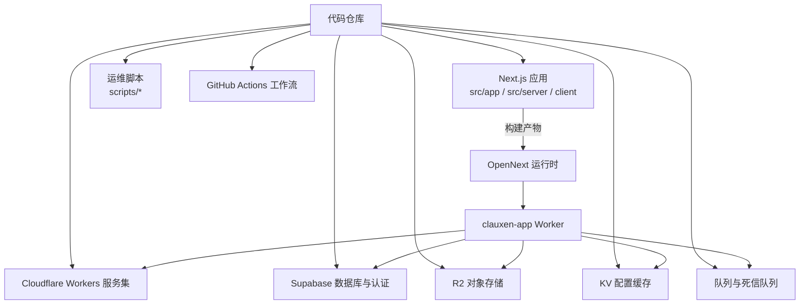

**图表来源**
- [wrangler.jsonc:1-117](file://wrangler.jsonc#L1-L117)
- [cloudflare-worker.ts:1-22](file://cloudflare-worker.ts#L1-L22)
- [open-next.config.ts:1-4](file://open-next.config.ts#L1-L4)
- [README.md:1-89](file://README.md#L1-L89)

**章节来源**
- [wrangler.jsonc:1-117](file://wrangler.jsonc#L1-L117)
- [cloudflare-worker.ts:1-22](file://cloudflare-worker.ts#L1-L22)
- [open-next.config.ts:1-4](file://open-next.config.ts#L1-L4)
- [README.md:1-89](file://README.md#L1-L89)

## 本地开发环境搭建
### 基础要求
- Node.js 24.x。
- npm ≥ 10。
- Docker（用于本地 Postgres 与 Redis）。

### 标准启动步骤
1. 安装依赖。
2. 从示例模板创建本地环境变量文件，并填写 Supabase、API Key 等值。
3. 使用 Docker Compose 启动本地 Postgres 与 Redis。
4. 推送 Supabase 数据库结构。
5. 启动开发服务器。

这些步骤直接对应 README 中的“Getting started”部分。

### 本地数据依赖
`docker-compose.yml` 定义了：
- 一个 `pgvector/pg16` 数据库容器，端口映射为 `5433:5432`，数据库名为 `clauxen_projects`。
- 一个 `redis:7-alpine` 容器，端口映射为 `6379:6379`。
- 两个持久化卷，分别挂载 Postgres 和 Redis 数据。

该配置适合本地调试数据库连接、BullMQ 任务及后续脚本中的数据库环境变量推导。

**章节来源**
- [README.md:45-89](file://README.md#L45-L89)
- [docker-compose.yml:1-34](file://docker-compose.yml#L1-L34)

## 生产部署流程
项目存在两条主要生产路径：

| 路径 | 用途 | 入口 |
|---|---|---|
| Vercel 部署 | 托管 Next.js 应用、API 路由和函数 | `vercel.json`、`scripts/sync-vercel-env*.mjs` |
| Cloudflare Workers 部署 | 托管 Next.js 应用、静态资源、增量缓存、队列消费者及 Worker 间调用 | `wrangler.jsonc`、`cloudflare-worker.ts`、`scripts/deploy-cloudflare-workers.sh` |

### 部署总览
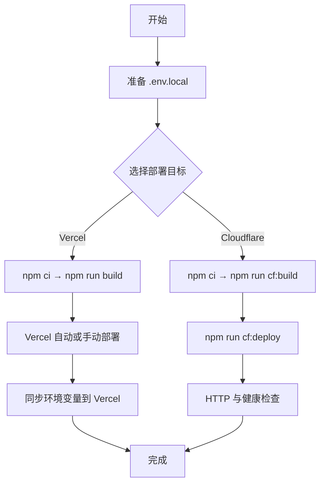

**图表来源**
- [README.md:80-89](file://README.md#L80-L89)
- [vercel.json:1-180](file://vercel.json#L1-L180)
- [wrangler.jsonc:1-117](file://wrangler.jsonc#L1-L117)
- [docs/cloudflare-app-migration.md:1-124](file://docs/cloudflare-app-migration.md#L1-L124)

**章节来源**
- [README.md:80-89](file://README.md#L80-L89)
- [vercel.json:1-180](file://vercel.json#L1-L180)
- [wrangler.jsonc:1-117](file://wrangler.jsonc#L1-L117)
- [docs/cloudflare-app-migration.md:1-124](file://docs/cloudflare-app-migration.md#L1-L124)

## CI/CD 管道配置
仓库中包含两个 GitHub Actions 工作流：

| 工作流 | 触发方式 | 职责 |
|---|---|---|
| `deploy-cloudflare-app.yml` | 手动触发 | 部署 Cloudflare App，运行测试、构建、部署并执行 HTTP 验证 |
| `deploy-cloudflare-workers.yml` | 手动触发 | 部署共享 Cloudflare Workers，并在有 Vercel Token 时连线 Vercel 环境变量 |

### Cloudflare App 工作流
该工作流在 `workflow_dispatch` 触发后：
1. 检出代码。
2. 设置 Node.js 24。
3. 注入 Cloudflare API Token、Supabase 公开变量、Razorpay 公开变量和应用 URL。
4. 校验必要凭证。
5. 安装依赖。
6. 运行 Cloudflare 构建相关测试、后台任务和定时任务测试。
7. 执行 `cf:build`。
8. 执行 `cf:deploy`。
9. 运行 `scripts/verify-cloudflake-http.mjs` 进行基本连通性验证。

### Cloudflare Workers 工作流
该工作流：
1. 解析 `CLOUDFLARE_API_TOKEN` 或 `Cloudflare_Token`。
2. 若两者都缺失，则跳过部署。
3. 执行 `scripts/deploy-cloudflare-workers.sh`。
4. 若提供 Vercel Token，则额外执行 `scripts/wire-auth-email-vercel.sh`，将 auth-email Worker 的 URL 和内部令牌写入 Vercel。

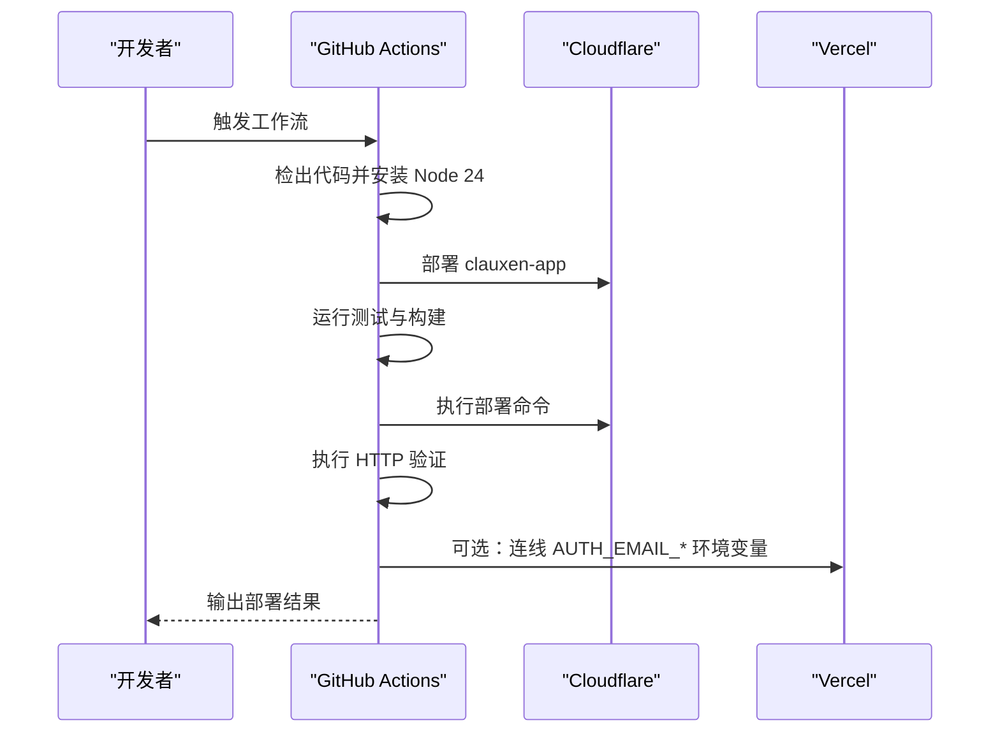

**图表来源**
- [.github/workflows/deploy-cloudflare-app.yml:1-42](file://.github/workflows/deploy-cloudflare-app.yml#L1-L42)
- [.github/workflows/deploy-cloudflare-workers.yml:1-48](file://.github/workflows/deploy-cloudflare-workers.yml#L1-L48)

**章节来源**
- [.github/workflows/deploy-cloudflare-app.yml:1-42](file://.github/workflows/deploy-cloudflare-app.yml#L1-L42)
- [.github/workflows/deploy-cloudflare-workers.yml:1-48](file://.github/workflows/deploy-cloudflare-workers.yml#L1-L48)

## Vercel 部署指南
### 适用场景
当 Next.js 应用仍由 Vercel 托管，或通过 Vercel 进行预览、预发和开发分支部署时使用。

### 关键配置
`vercel.json` 定义了：
- 框架为 Next.js。
- 构建命令为 `npm run build`。
- 安装命令为 `npm ci`。
- 部署区域限制为 `pdx1`。
- 静态资源和 API 路由的缓存策略。
- 通用安全响应头，包括 `X-Content-Type-Options`、`X-Frame-Options`、`Referrer-Policy`、`Permissions-Policy`、`Strict-Transport-Security`。
- API 路由禁止 CDN 缓存。
- 针对长耗时 API 路由单独提升内存和超时时间。

### 环境变量同步
仓库提供两套 Vercel 环境变量同步脚本：

| 脚本 | 实现方式 | 特点 |
|---|---|---|
| `scripts/sync-vercel-env.mjs` | 调用 `npx vercel@41.7.0` CLI | 逐键删除再添加，按 production、preview、development 三套环境同步 |
| `scripts/sync-vercel-env-api.mjs` | 直接调用 Vercel REST API | 使用敏感类型和加密类型区分生产预览与开发环境，支持自动补全 `NEXT_PUBLIC_SUPABASE_ANON_KEY` |

两个脚本都会强制覆盖生产环境的以下键：
- `AUTH_DEV_BYPASS=false`
- `AUTH_REQUIRED_FOR_CHAT=true`
- `STORAGE_REQUIRE_R2=true`
- `NEXT_PUBLIC_APP_URL=https://www.clauxen.com`（仅 API 版本）

**章节来源**
- [vercel.json:1-180](file://vercel.json#L1-L180)
- [scripts/sync-vercel-env.mjs:1-140](file://scripts/sync-vercel-env.mjs#L1-L140)
- [scripts/sync-vercel-env-api.mjs:1-193](file://scripts/sync-vercel-env-api.mjs#L1-L193)

## Cloudflare Workers 部署指南
### 应用入口
根级 `cloudflare-worker.ts` 是 OpenNext 生成的 Worker 入口包装器。它：
- 拦截 `/api/v1/storage/object`，交由存储签名处理逻辑。
- 其余请求交给 `.open-next/worker.js` 中的 OpenNext 处理器。
- 暴露 `queue` 处理器，消费生成队列事件并转发给 OpenNext 请求处理器。

### Wrangler 配置
`wrangler.jsonc` 定义了：
- 应用名称 `clauxen-app`。
- 自定义域名 `clauxen.com` 和 `www.clauxen.com`。
- 静态资源目录绑定为 `ASSETS`。
- 多个私有 Worker 服务绑定，包括 GitHub Agent、Chat Coordination、Chat History、Billing、Auth Email、Share Gate 和 Connector Gateway。
- Hyperdrive 绑定，用于 Postgres 连接。
- 多个 R2 Bucket 绑定。
- Cloudflare Images 绑定。
- 生成切片队列生产者与消费者。
- 观测性开关、查询字符串脱敏和采样率。
- 公共变量与私有变量。
- KV Namespace 绑定。

### 部署命令
`docs/cloudflare-app-migration.md` 明确推荐：
- 使用 Node.js 24。
- 使用锁文件安装依赖。
- 先运行 Cloudflare 相关测试。
- 使用 `npm run cf:release`、`npm run cf:build` 和 `npm run cf:deploy`。
- 部署完成后运行 `node scripts/verify-cloudflare-http.mjs`。

### 共享 Worker 部署
`scripts/deploy-cloudflare-workers.sh` 负责部署一组共享 Worker，包括：
- chat-history
- r2-gateway
- auth-email
- chat-coord
- scheduled-tasks（可选）
- billing（可选）
- generations-watchdog（可选）

脚本会：
- 解析 `CLOUDFLARE_API_TOKEN` 或 `Cloudflare_Token`。
- 生成或复用内部令牌。
- 将 Supabase URL、匿名 Key、内部令牌等写入各 Worker 的 Secret。
- 根据是否提供 Vercel Token，自动将 Worker URL 和内部令牌写入 Vercel 环境变量。

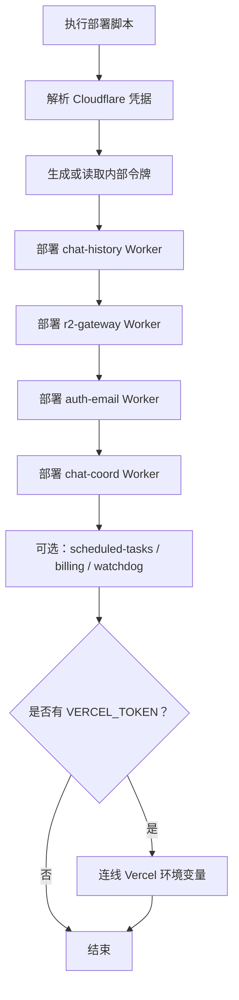

**图表来源**
- [scripts/deploy-cloudflare-workers.sh:1-221](file://scripts/deploy-cloudflare-workers.sh#L1-L221)
- [wrangler.jsonc:1-117](file://wrangler.jsonc#L1-L117)

**章节来源**
- [cloudflare-worker.ts:1-22](file://cloudflare-worker.ts#L1-L22)
- [wrangler.jsonc:1-117](file://wrangler.jsonc#L1-L117)
- [docs/cloudflare-app-migration.md:1-124](file://docs/cloudflare-app-migration.md#L1-L124)
- [scripts/deploy-cloudflare-workers.sh:1-221](file://scripts/deploy-cloudflare-workers.sh#L1-L221)

## Supabase 集成
Supabase 在本项目中承担数据库、认证、存储和实时能力。部署脚本和配置显示以下集成点：

- 本地开发使用 Docker 提供的 Postgres 与 Redis。
- `scripts/bootstrap-db-env.mjs` 将 `POSTGRES_PRISMA_URL`、`POSTGRES_URL_NON_POOLING`、`POSTGRES_URL` 推导为 `DATABASE_URL`，供 Prisma 或 Next 构建阶段使用。
- Vercel 环境变量同步脚本会处理 Supabase 公开键与服务端键。
- Cloudflare Workers 部署脚本会将 Supabase URL 和匿名 Key 写入 Worker Secret。
- `wrangler.jsonc` 通过 Hyperdrive 绑定 Postgres 连接。
- `next.config.ts` 配置了 Supabase WebSocket 和 HTTPS 源，以及内容安全策略中允许的 Supabase 连接域。

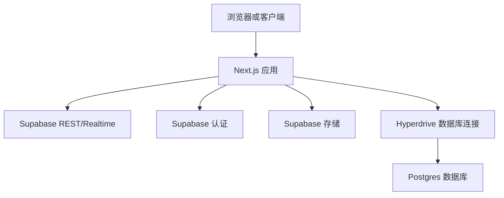

**图表来源**
- [docker-compose.yml:1-34](file://docker-compose.yml#L1-L34)
- [scripts/bootstrap-db-env.mjs:1-11](file://scripts/bootstrap-db-env.mjs#L1-L11)
- [wrangler.jsonc:1-117](file://wrangler.jsonc#L1-L117)
- [next.config.ts:1-200](file://next.config.ts#L1-L200)

**章节来源**
- [docker-compose.yml:1-34](file://docker-compose.yml#L1-L34)
- [scripts/bootstrap-db-env.mjs:1-11](file://scripts/bootstrap-db-env.mjs#L1-L11)
- [wrangler.jsonc:1-117](file://wrangler.jsonc#L1-L117)
- [next.config.ts:1-200](file://next.config.ts#L1-L200)

## 环境变量管理与密钥轮换
### 环境变量分类
| 类别 | 典型键 | 存放位置 |
|---|---|---|
| 前端公开变量 | `NEXT_PUBLIC_APP_URL`、`NEXT_PUBLIC_SUPABASE_URL`、`NEXT_PUBLIC_SUPABASE_ANON_KEY`、`NEXT_PUBLIC_RAZORPAY_KEY_ID` | Vercel 公开变量、Cloudflare `vars`、构建产物 |
| 服务端机密 | `SUPABASE_SERVICE_ROLE_KEY`、`JWT_SECRET`、`RAZORPAY_KEY_SECRET`、内部 Worker 令牌 | Vercel 敏感变量、Cloudflare Secret、Worker Secret |
| 平台运行变量 | `HOSTING_PLATFORM`、`AUTH_DEV_BYPASS`、`STORAGE_REQUIRE_R2` | 多平台脚本统一注入 |
| 本地开发变量 | `.env.local`、`.dev.vars`、Docker 环境变量 | 仅本地或受控 CI 环境 |

### 关键规则
- README 明确要求：不要使用 `NEXT_PUBLIC_` 前缀存放机密。
- `scripts/audit-public-env.mjs` 扫描代码中的 `NEXT_PUBLIC_*` 引用，只允许白名单键，并拒绝常见机密模式。
- `scripts/prepare-cloudflare-env.mjs` 合并多个环境变量文件，生成 `.dev.vars` 和临时 secret 文件，并校验必填键。
- `scripts/reconcile-vercel-env.mjs` 将 Vercel 环境变量规范化为 canonical 列表，并按生产、预览、开发设置不同敏感类型。
- `scripts/cleanup-vercel-env.mjs` 提供清理与重建 Vercel 环境变量的能力，但标记为废弃，推荐使用 reconcile 脚本。

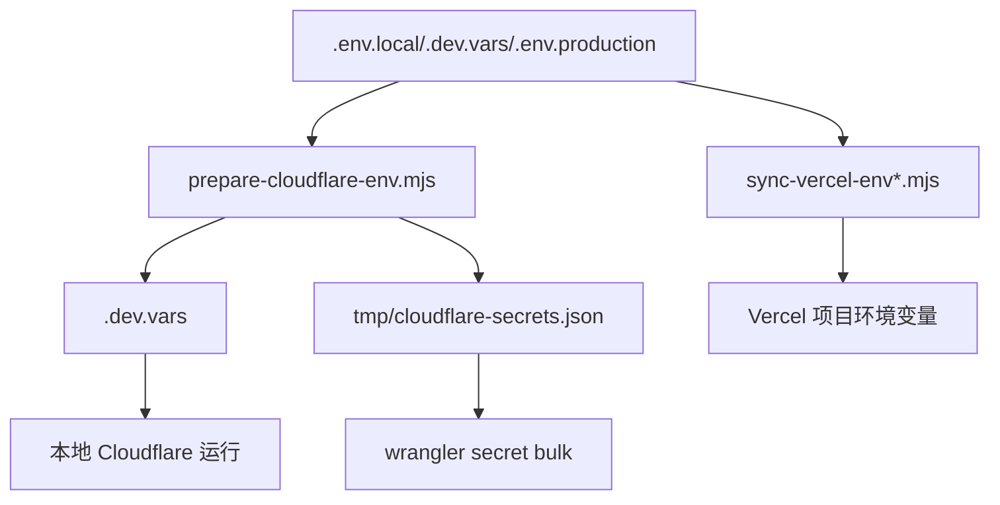

**图表来源**
- [scripts/prepare-cloudflare-env.mjs:1-95](file://scripts/prepare-cloudflare-env.mjs#L1-L95)
- [scripts/audit-public-env.mjs:1-71](file://scripts/audit-public-env.mjs#L1-L71)
- [scripts/sync-vercel-env.mjs:1-140](file://scripts/sync-vercel-env.mjs#L1-L140)
- [scripts/sync-vercel-env-api.mjs:1-193](file://scripts/sync-vercel-env-api.mjs#L1-L193)
- [scripts/reconcile-vercel-env.mjs:1-375](file://scripts/reconcile-vercel-env.mjs#L1-L375)
- [scripts/cleanup-vercel-env.mjs:1-207](file://scripts/cleanup-vercel-env.mjs#L1-L207)

### 密钥轮换建议
基于仓库行为，密钥轮换应遵循：

1. **区分前端可见密钥与后端机密**：只有白名单中的 `NEXT_PUBLIC_*` 键会被编译到前端。
2. **优先更新 Worker Secret 而非重新构建前端**：对后端机密密钥，通常只需更新 Cloudflare Secret 或 Vercel 敏感变量。
3. **需要前端行为变化的密钥才重新构建**：例如 `NEXT_PUBLIC_APP_URL`、`NEXT_PUBLIC_AUTH_REQUIRED_FOR_CHAT`。
4. **内部 Worker 令牌必须两端一致**：auth-email、chat-history、chat-coordination、billing 等 Worker 的内部令牌需要在 Cloudflare 和 Vercel 上保持一致。
5. **谨慎轮换不可逆加密密钥**：`docs/cloudflare-workers-setup.md` 明确指出 connector 加密密钥不应随意轮换，否则会破坏已密封的 OAuth token。

**章节来源**
- [README.md:60-89](file://README.md#L60-L89)
- [scripts/audit-public-env.mjs:1-71](file://scripts/audit-public-env.mjs#L1-L71)
- [scripts/prepare-cloudflare-env.mjs:1-95](file://scripts/prepare-cloudflare-env.mjs#L1-L95)
- [scripts/sync-vercel-env-api.mjs:1-193](file://scripts/sync-vercel-env-api.mjs#L1-L193)
- [docs/cloudflare-workers-setup.md:1-70](file://docs/cloudflare-workers-setup.md#L1-L70)

## 监控、日志与错误追踪
### Cloudflare 观测性
`wrangler.jsonc` 启用了 Cloudflare 观测性，并配置：
- 启用观测性。
- 脱敏查询字符串。
- 头部采样率为 5%。

此外，Cloudflare App 迁移文档提到在 API 响应中添加 `Server-Timing` 头，用于测量处理器持续时间。

### 构建期与运行期日志控制
`next.config.ts` 在生产环境中移除控制台输出，但保留 `error` 和 `warn`。这有助于降低生产日志噪音，同时保留错误与警告信息。

### 健康检查与验证
- Cloudflare App 工作流在部署后执行 `scripts/verify-cloudflare-http.mjs`。
- Cloudflare Workers 设置文档建议通过 connector gateway 的 health 接口验证 Worker 健康状态。
- 迁移文档记录了端到端短延迟请求、AI 生成队列处理和临时账户数据的验证过程。

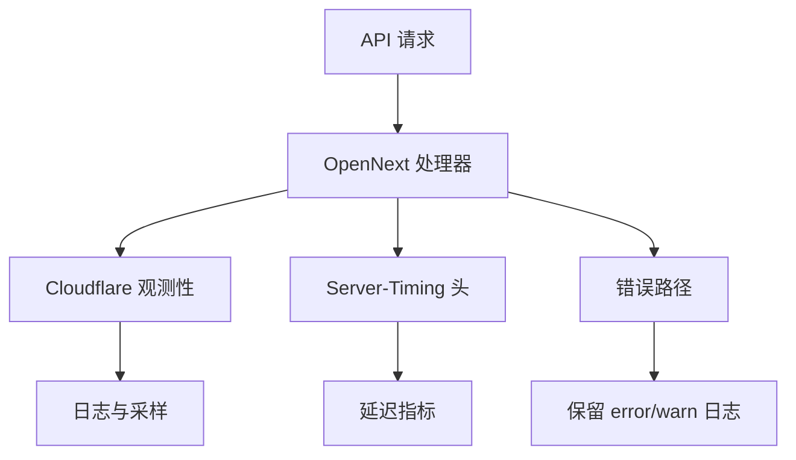

**图表来源**
- [wrangler.jsonc:1-117](file://wrangler.jsonc#L1-L117)
- [next.config.ts:1-200](file://next.config.ts#L1-L200)
- [docs/cloudflare-app-migration.md:1-124](file://docs/cloudflare-app-migration.md#L1-L124)

**章节来源**
- [wrangler.jsonc:1-117](file://wrangler.jsonc#L1-L117)
- [next.config.ts:1-200](file://next.config.ts#L1-L200)
- [docs/cloudflare-app-migration.md:1-124](file://docs/cloudflare-app-migration.md#L1-L124)

## 性能优化建议
### 静态资源缓存
`vercel.json` 为 `_next/static` 设置长期不可变缓存，为 `/assets` 设置带 stale-while-revalidate 的缓存策略，有利于 CDN 层缓存。

### 图像优化
`next.config.ts` 启用 AVIF 和 WebP 格式，并设置较长的最小缓存时间。`open-next.config.ts` 将增量缓存后端切换到 R2，结合 Cloudflare Images 绑定，可在 Cloudflare 环境下优化图片缓存与处理。

### 函数资源与超时
`vercel.json` 为长耗时 API 路由提升内存上限和最大运行时间，例如生成、代理、沙箱、Shirova 等路径。

### Worker 层容量控制
`wrangler.jsonc` 配置：
- 每调用 CPU 上限 30,000 ms。
- 生成队列消费者并发度为 8。
- 队列重试次数为 3。
- 使用死信队列隔离失败消息。
- 观测性采样率为 5%。

这些参数保护数据库和外部服务，避免无界扩展导致雪崩。

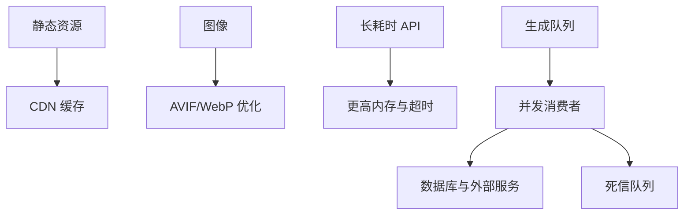

**图表来源**
- [vercel.json:1-180](file://vercel.json#L1-L180)
- [next.config.ts:1-200](file://next.config.ts#L1-L200)
- [open-next.config.ts:1-4](file://open-next.config.ts#L1-L4)
- [wrangler.jsonc:1-117](file://wrangler.jsonc#L1-L117)

**章节来源**
- [vercel.json:1-180](file://vercel.json#L1-L180)
- [next.config.ts:1-200](file://next.config.ts#L1-L200)
- [open-next.config.ts:1-4](file://open-next.config.ts#L1-L4)
- [wrangler.jsonc:1-117](file://wrangler.jsonc#L1-L117)

## 扩容策略
### 应用实例扩容
`apphosting.yaml` 中 Firebase App Hosting 的 `maxInstances` 设置为 1，表明默认不自动扩容。若采用 App Hosting 路径，应根据流量模型调整该值。

### Cloudflare 平台特性
Cloudflare Workers 本身具备平台级扩缩容能力，但仓库中的显式容量约束集中在队列消费者并发度和 CPU 时间上限。增加生成吞吐时需要评估：
- Postgres/Hyperdrive 连接池。
- AI 提供商配额。
- 协调 Worker 负载。
- 用户级配额。
- 外部支付和存储服务成本。

### 队列与背压
队列消费者配置限制了批量大小、批处理超时、并发数和重试次数，并通过死信队列防止无限重试。扩容时应优先观察队列积压和死信消息，而不是盲目提高并发。

**章节来源**
- [apphosting.yaml:1-7](file://apphosting.yaml#L1-L7)
- [wrangler.jsonc:1-117](file://wrangler.jsonc#L1-L117)
- [docs/cloudflare-app-migration.md:100-124](file://docs/cloudflare-app-migration.md#L100-L124)

## 备份恢复与灾难恢复
### 数据库与存储
Supabase 提供数据库、认证和存储能力；R2 提供对象存储。仓库中没有内建的备份脚本，因此备份策略应以 Supabase 和 Cloudflare 平台能力为主：
- 定期导出 Supabase 数据库快照。
- 对关键 R2 Bucket 建立跨区域或跨账号复制策略。
- 将重要环境变量和 Worker Secret 纳入受控密钥管理系统。

### 回滚策略
Cloudflare App 迁移文档明确记录了回滚路径：
- 分离新的 Worker 自定义域名。
- 恢复原有 DNS CNAME 记录。
- 禁用新的分钟级调度器。
- 重新启用旧的调度器。
- 保持 Vercel 部署作为备用。

### 紧急环境变量重建
`scripts/cleanup-vercel-env.mjs` 和 `scripts/reconcile-vercel-env.mjs` 提供了清理与重建 Vercel 环境变量的能力。reconcile 脚本更适合作为标准操作，因为它会维护 canonical 键列表并按环境区分敏感类型。

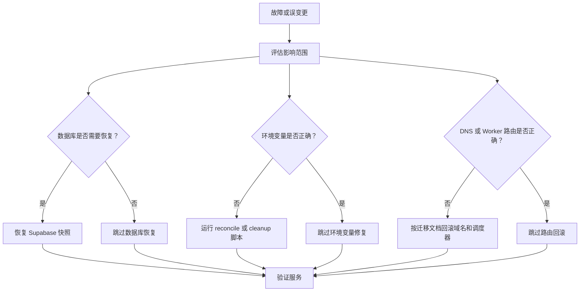

**图表来源**
- [docs/cloudflare-app-migration.md:80-124](file://docs/cloudflare-app-migration.md#L80-L124)
- [scripts/cleanup-vercel-env.mjs:1-207](file://scripts/cleanup-vercel-env.mjs#L1-L207)
- [scripts/reconcile-vercel-env.mjs:1-375](file://scripts/reconcile-vercel-env.mjs#L1-L375)

**章节来源**
- [docs/cloudflare-app-migration.md:80-124](file://docs/cloudflare-app-migration.md#L80-L124)
- [scripts/cleanup-vercel-env.mjs:1-207](file://scripts/cleanup-vercel-env.mjs#L1-L207)
- [scripts/reconcile-vercel-env.mjs:1-375](file://scripts/reconcile-vercel-env.mjs#L1-L375)

## 安全加固最佳实践
### 响应头安全
`vercel.json` 和 `next.config.ts` 共同强化了安全响应头：
- 禁止 MIME sniffing。
- 限制点击劫持。
- 严格 Referrer Policy。
- 限制 Permissions Policy。
- 启用 HSTS。
- 生产环境移除控制台输出。

### 内容安全策略
`next.config.ts` 设置了较严格的 CSP，允许 Razorpay 支付、Google Identity Services、Cloudflare Challenge、Supabase 连接、R2、Workers 和云存储域名。这是为了兼容第三方 SDK 与边缘服务，但也意味着接入新外部脚本时需审查 CSP。

### 环境变量审计
`scripts/audit-public-env.mjs` 阻止将高危键暴露在浏览器中，并仅允许有限的前端公开键。建议在 CI 中始终运行该审计。

### Worker 内部通信
共享 Worker 通过内部令牌进行身份校验。部署脚本会为 auth-email、chat-history、chat-coord、billing 等 Worker 生成或复用内部令牌，并写入 Cloudflare Secret 和 Vercel 环境变量。

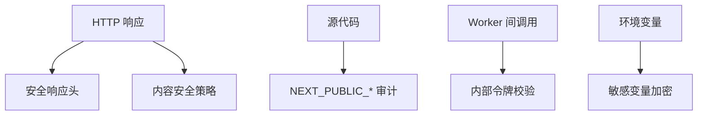

**图表来源**
- [vercel.json:1-180](file://vercel.json#L1-L180)
- [next.config.ts:1-200](file://next.config.ts#L1-L200)
- [scripts/audit-public-env.mjs:1-71](file://scripts/audit-public-env.mjs#L1-L71)
- [scripts/deploy-cloudflare-workers.sh:1-221](file://scripts/deploy-cloudflare-workers.sh#L1-L221)

**章节来源**
- [vercel.json:1-180](file://vercel.json#L1-L180)
- [next.config.ts:1-200](file://next.config.ts#L1-L200)
- [scripts/audit-public-env.mjs:1-71](file://scripts/audit-public-env.mjs#L1-L71)
- [scripts/deploy-cloudflare-workers.sh:1-221](file://scripts/deploy-cloudflare-workers.sh#L1-L221)

## 故障排查指南
### 无法登录 Cloudflare
如果 `scripts/deploy-cloudflare-workers.sh` 提示缺少 `CLOUDFLARE_API_TOKEN` 且未登录 wrangler：
- 使用 `npx wrangler login`。
- 或在 CI 中提供 `CLOUDFLARE_API_TOKEN` 或 `Cloudflare_Token`。
- 确保 `CLOUDFLARE_ACCOUNT_ID` 正确。

### Vercel 环境变量不同步
如果使用 `scripts/sync-vercel-env.mjs` 失败：
- 确认已通过 `npx vercel@41.7.0 login` 登录。
- 检查 `VERCEL_TOKEN` 或 CLI 认证状态。
- 注意脚本会跳过某些被识别为可疑的 `NEXT_PUBLIC_*` 键。

如果使用 `scripts/sync-vercel-env-api.mjs` 失败：
- 确认 `VERCEL_TOKEN` 可用。
- 检查项目 ID 与团队 ID 是否与脚本中一致。
- 查看 Vercel API 返回的错误信息。

### Worker 与 Vercel 之间密钥不一致
auth-email、chat-history、chat-coordination 等 Worker 的内部令牌必须在 Cloudflare 和 Vercel 上保持一致。部署脚本会生成令牌并尝试写入 Vercel；若缺少 Vercel Token，则不会自动连线。

### 构建失败或环境变量缺失
`scripts/prepare-cloudflare-env.mjs` 会校验必填键，包括 Provider API Key、Supabase 服务角色 Key、JWT Secret、各类内部令牌和支付加密密钥。缺失时会抛出错误。

### 生产环境访问异常
Cloudflare App 迁移文档记录了生产域名可能受到 Cloudflare 挑战的影响，直接 HTTP 请求可能返回 403。需要通过浏览器或适配挑战的检测逻辑进行验证，而不是把挑战拦截当作应用失败。

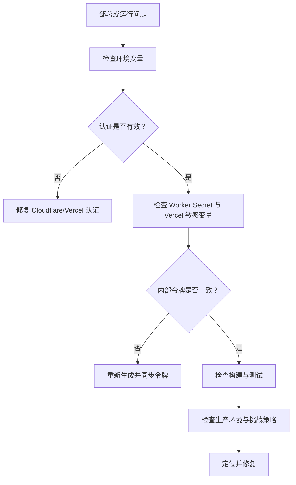

**图表来源**
- [scripts/deploy-cloudflare-workers.sh:1-221](file://scripts/deploy-cloudflare-workers.sh#L1-L221)
- [scripts/sync-vercel-env.mjs:1-140](file://scripts/sync-vercel-env.mjs#L1-L140)
- [scripts/sync-vercel-env-api.mjs:1-193](file://scripts/sync-vercel-env-api.mjs#L1-L193)
- [scripts/prepare-cloudflare-env.mjs:1-95](file://scripts/prepare-cloudflare-env.mjs#L1-L95)
- [docs/cloudflare-app-migration.md:80-124](file://docs/cloudflare-app-migration.md#L80-L124)

**章节来源**
- [scripts/deploy-cloudflare-workers.sh:1-221](file://scripts/deploy-cloudflare-workers.sh#L1-L221)
- [scripts/sync-vercel-env.mjs:1-140](file://scripts/sync-vercel-env.mjs#L1-L140)
- [scripts/sync-vercel-env-api.mjs:1-193](file://scripts/sync-vercel-env-api.mjs#L1-L193)
- [scripts/prepare-cloudflare-env.mjs:1-95](file://scripts/prepare-cloudflare-env.mjs#L1-L95)
- [docs/cloudflare-app-migration.md:80-124](file://docs/cloudflare-app-migration.md#L80-L124)

## 结论
本项目的部署与运维体系围绕 Next.js 应用、Vercel、Cloudflare Workers、Supabase、R2、KV、队列和内部 Worker 通信展开。核心原则是：
- 明确区分前端公开变量与后端机密。
- 使用脚本统一管理 Vercel 和 Cloudflare 的环境变量。
- 通过 CI/CD 固化构建、测试和部署流程。
- 用队列、死信队列和并发限制保护数据库与外部服务。
- 利用平台观测性和 `Server-Timing` 辅助性能分析。
- 以文档和脚本为依据进行回滚、备份和安全加固。

在实际操作中，应优先使用仓库提供的脚本与工作流，而不是手工修改云平台配置。对于密钥轮换、域名切换、调度器变更和回滚，应严格对照 `docs/cloudflare-workers-setup.md` 与 `docs/cloudflare-app-migration.md` 执行。