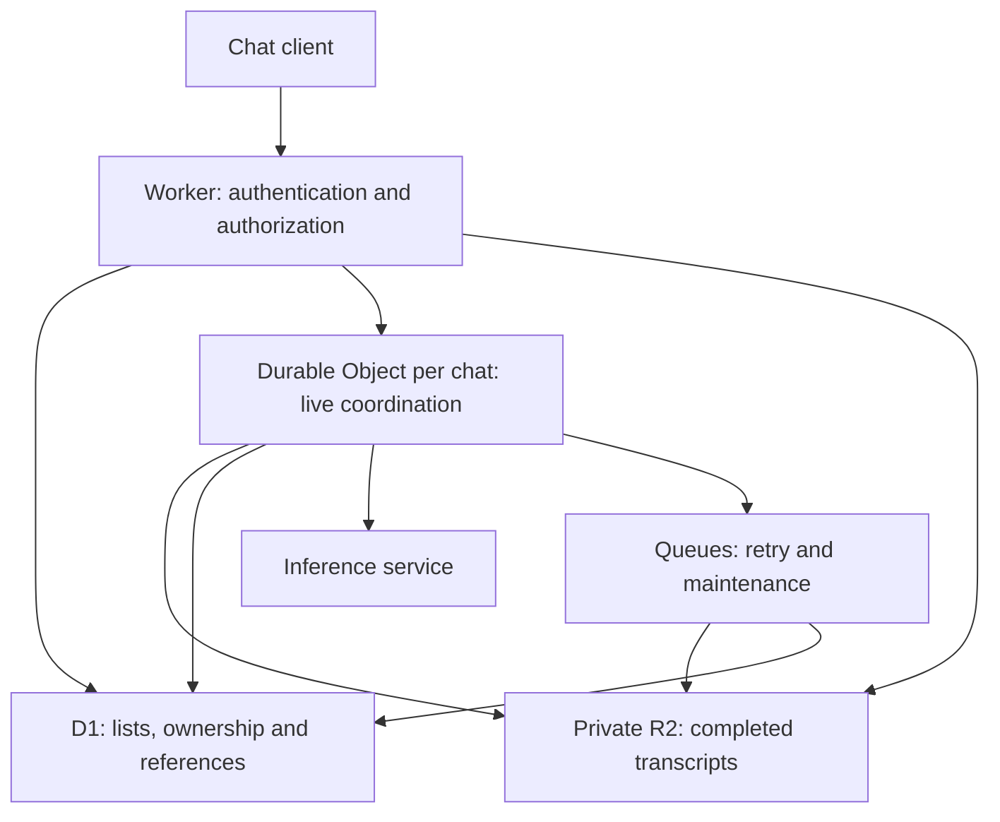

# Cloudflare-only chat storage architecture

Design decision, 10 October 2026: consolidate chat storage onto Workers, D1, R2 and Durable Objects. This is a design document, not a deployed migration. It supersedes the destination ambiguity and hybrid text-storage recommendation in chat-storage-migration-assessment.md.

## Service responsibilities

| Service | Responsibility |
| --- | --- |
| Worker | Authenticate requests, enforce ownership, expose history APIs, invoke inference, stream responses |
| D1 | Queryable metadata: accounts, ownership, chat titles, folders, timestamps, branches, transcript references, generation status, deletion state |
| Private R2 Standard bucket | Canonical completed message bodies, tool outputs, attachments, transcript segments and immutable manifests |
| One Durable Object per chat | Serialize mutations; generation admission/fencing; durable bounded streaming checkpoints; reconnect/replay; pending publication journal |
| Queues + scheduled Worker | Retry metadata publication, compact segments, reconcile references, complete deletion and clean orphan objects |

Hyperdrive is unnecessary: it accelerates connections to an existing Postgres/MySQL origin; it does not host a database or connect D1. D1 uses SQLite semantics, so this removes PostgreSQL from this part of the application.



Inference is separate from storage. Workers AI can keep inference on Cloudflare where its available models satisfy product requirements; invoking OpenAI/Anthropic remains an external dependency.

## Metadata and object layout

Conceptual D1 tables (not implementation SQL):

- chats: id, owner_id, title, project_id, created_at, updated_at, archived_at, deletion_state, active_branch_id, committed_revision, manifest_key, message_count, transcript_bytes.
- branches: id, chat_id, parent_branch_id, fork_message_id, head_message_id.
- transcript_segments: chat_id, branch_id, revision, first_sequence, last_sequence, object_key, checksum, byte_count, format_version. These rows support pagination without listing the whole R2 prefix.
- message_refs, only where needed for branching/editing: message_id, parent_message_id, segment_id, position, role, status. No message text or content JSON.
- generation_jobs: request_id, chat_id, branch_id, fencing_epoch, status, published_revision, retry state. Enforce uniqueness for request IDs.
- accounts, sessions and permissions: separately designed replacement for current Supabase Auth dependencies.

Index chat listings by owner_id, updated_at and id; segment lookup by chat_id, branch_id and sequence. Include ownership checks for every operation. Do not issue SQL updates for each streamed token.

Suggested R2 keys:

```
chats/{chatId}/turns/{requestId}/{contentHash}.json
chats/{chatId}/segments/{segmentId}-{contentHash}.jsonl.gz
chats/{chatId}/manifests/{revision}-{contentHash}.json
files/{ownerId}/{fileId}/{contentHash}
```

JSONL records preserve stable message IDs, parent links, role, creation time, typed text/tool parts and schema version. Branch manifests reference shared immutable segments; regeneration creates a new branch instead of overwriting the previous answer. Avoid user email/name in object keys. Object keys are identifiers, not authorization credentials.

## Durable write and publication protocol

1. Worker authenticates and checks D1 ownership. All mutations enter the chat's Durable Object. Validate a client request ID; reuse its existing result on retries.
2. Persist the accepted user message and generation job in durable DO storage before reporting acceptance. Give each generation a fencing epoch so a cancelled or superseded attempt cannot publish later.
3. Stream tokens and tool events to the client. Persist bounded checkpoints to DO storage, initially about every 1–2 seconds or at a byte threshold. Checkpoint intervals are a proposed tradeoff, not a zero-loss guarantee: tokens sent since the last successful checkpoint may be lost on interruption. Exact replay requires durable acknowledgement before emission. A checkpoint supports partial-answer recovery; it does not guarantee an external model request can resume.
4. Write completed user/assistant records to immutable R2 objects. Persist the pending publication intent in the DO journal. Write the immutable manifest only after all referenced objects exist.
5. Publish the manifest key, revision, segment references and job completion in one D1 transaction/batch, guarded by the previous revision and generation epoch. A retry must not increment message counts twice. Successful final acknowledgement follows durable R2 writes and metadata publication.
6. Clear the DO journal and unnecessary checkpoints after successful publication. Keep only a bounded recent context/replay window. Use an alarm/retry plus a scheduled reconciler for unfinished publication; critical durability must not depend solely on an unawaited background task.

D1 and R2 do not share a transaction. An R2-success/D1-failure leaves an unpublished object, which is recoverable through the publication journal. A D1 pointer must never be committed before the referenced R2 objects. The D1 committed manifest is the authoritative visible snapshot; R2 listing is not the commit log. R2 has strong consistency, but CDN caching has separate behavior.

## Reading long conversations

The sidebar reads only D1. Opening a chat reads its committed revision and the newest relevant segment objects; earlier pages load using a revision-bound cursor. Fetch bounded pages with capped parallel object reads. Compact completed turns into immutable segments, initially targeting 32–64 messages with a byte cap; tune these values using measured latency and operation costs. Small per-turn objects provide fast initial persistence; compaction reduces historical GET counts.

Do not download or decompress an entire long chat on every open or inference turn. Generation uses a bounded recent-message window plus an R2-stored summary, fetching older messages only when needed. Keep summaries distinguishable from the original transcript. A chat's large history does not enlarge the model's context window.

Title/metadata search is supported by D1. Full transcript search requires a separate index and deletion pipeline; R2 alone is not a full-text search engine. Vectorize may support semantic retrieval later but is not a replacement for exact text search.

## Security, deletion and recovery

- Keep transcript buckets private. Serve through authenticated Workers; do not publicly cache private responses. Shared chats need explicit, revocable grants scoped to a committed snapshot.
- D1 does not automatically inherit Supabase RLS. Enforce owner/share permissions in the application, including DO entry points and R2 downloads. Use least-privilege bindings and keep content out of logs.
- Deletion first fences generations and tombstones the chat, immediately blocking access. A resumable job removes manifests, segments, branches, attachments no longer referenced elsewhere, DO checkpoints, and any search index records. Prevent in-flight generation from resurrecting a deleted chat. Handle concurrently written objects with reconciliation.
- Retain explicit backup/recovery manifests and D1 exports in a separate protected R2 bucket or prefix with different deletion policy. Document retention, including deleted data in recovery copies. R2 durability is not protection against application deletion bugs; D1 Time Travel does not restore deleted R2 objects.
- Monitor publication backlog, recovery failures, R2 GET/PUT volume, D1 row reads/writes and bytes per metadata row. Exercise interrupted generation, duplicate retries, concurrent tabs, fork/edit, failed publication and deletion during generation.

## Capacity and economics

Paid D1 has a hard 10 GB per-database cap, including indexes; R2 transcripts are outside it. The Paid account total is currently 1 TB, but this does not raise the single-database cap. Keep one D1 database and reserve the final 40% as headroom: alert at 5 GB and treat 6 GB as the point to reduce metadata or plan a future move. These are operating thresholds, not Cloudflare limits.

To extend the single-database lifespan, store one compact row per chat and only the branch/message IDs needed for product actions, plus one pointer per transcript segment. Put the full branch tree and message index in R2 manifests. Avoid a D1 row for every message unless a measured feature requires it, and keep full-text transcript indexes out of D1. At a conservative planning allowance of 4 KB per chat, including indexes and amortized segment references, 5 GB is roughly 1.3 million chats and the 6 GB operating ceiling is roughly 1.6 million. At 2 KB per chat those figures double. These are capacity illustrations, not guarantees: the actual number depends on schema, indexes, branch behavior and SQLite page overhead. The existing Supabase sample is too small to calibrate this.

Measure actual D1 size after realistic imports and track read/write counters as well as bytes. A single D1 is single-threaded, so it can queue or overload before it fills. If a single database is a firm requirement, move any excess listing/index metadata into R2 manifests and keep D1 as the compact chat directory. No plan setting expands one D1 beyond 10 GB; beyond that point you must remove/move metadata or use multiple databases.

Workers Paid is the appropriate baseline: Free has a 100,000-request daily cap; Paid has no general request-count limit. Both have 128 MB memory per isolate. Paid HTTP requests default to 30 seconds of active CPU, configurable up to 5 minutes; HTTP streaming has no hard wall-clock cutoff while the client remains connected. Stream transcript and model bodies instead of buffering complete chats in Worker memory. [Workers limits](https://developers.cloudflare.com/workers/platform/limits/).

R2 Standard rates checked today: $0.015/GB-month, $4.50/million Class A operations and $0.36/million Class B operations; internet egress is free. Included monthly usage: 10 GB-month, 1 million Class A and 10 million Class B operations. For 100 GB-month of transcripts, storage alone is approximately $1.35 after the included storage, excluding other usage, billing rounding and taxes. Frequent checkpoints and tiny objects can dominate cost despite low storage costs. Workers, DOs, D1, queues, logs and inference are separate charges. Prefer Standard for frequently accessed chat history; Infrequent Access has retrieval charges and a minimum storage duration.

## Migration boundaries

The existing app already uses R2 archives and DO coordination, so reuse their contracts where suitable. Replace history storage behind a repository interface; port Postgres-specific SQL, branch paging and generation persistence. Remove per-token/checkpoint Postgres writes. Replace Supabase Realtime with authenticated live events and replace Supabase Auth before claiming a Cloudflare-only platform. Other account, billing and integration tables also need migration; this chat design alone does not remove every Supabase dependency.

Backfill a consistent export into immutable R2 objects and D1 metadata. Verify IDs, branch links, counts and checksums. Exercise production-like history and recovery flows in staging. Use a short write pause or an explicit idempotent catch-up process for cutover. Retain the source until rollback and parity are verified; then remove the old database path and Hyperdrive binding.

## Primary documentation

- [D1 limits](https://developers.cloudflare.com/d1/platform/limits/)
- [D1 pricing](https://developers.cloudflare.com/d1/platform/pricing/)
- [R2 pricing](https://developers.cloudflare.com/r2/pricing/)
- [R2 consistency](https://developers.cloudflare.com/r2/reference/consistency/)
- [Durable Object storage](https://developers.cloudflare.com/durable-objects/best-practices/access-durable-objects-storage/)
- [Hyperdrive architecture](https://developers.cloudflare.com/hyperdrive/concepts/how-hyperdrive-works/)
